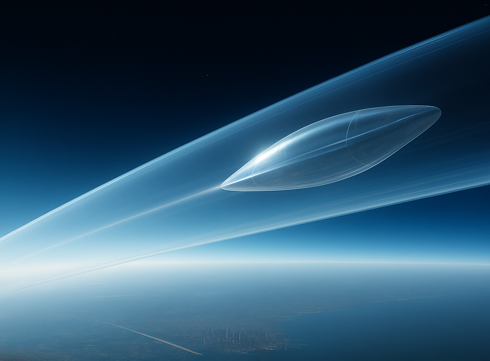

# Skyloop  
  
  
  
Skyloop is a vision for a buoyant, near vacuum sky transport system connecting major cities via stratospheric corridors. By suspending lightweight tubes high above the weather for launching and linearly accelerating small gliders inside them, Skyloop aims to deliver intercity travel at Mach 2–6 speeds with energy efficiency and throughput orders of magnitude better than current aviation.  
  
**Studies summary (October 2026):** [SUMMARY.md](SUMMARY.md) compares BoomShield, the Skyloop re-review and Hyperloop (our version) on one page.  
  
## Documents  
- [docs/01-overview.md](docs/01-overview.md): overview of the concept, network design, advantages, and pod classes.  
- [docs/02-architecture.md](docs/02-architecture.md): architecture covering route & network topology, tube structure, stations, and pod design.  
- [docs/03-unit-economics.md](docs/03-unit-economics.md): unit economics analysis including capital and operating costs, capacity, and throughput.  
- [docs/04-roadmap.md](docs/04-roadmap.md): roadmap of development phases from demonstrator to global network.  
- [docs/05-market.md](docs/05-market.md): summarizes potential cargo markets for the early phases of Skyloop's deployment.  
- [docs/06-r-and-d.md](docs/06-r-and-d.md): initial R&D, focusing on a tabletop-scale prototype to study near‑vacuum transport physics.  
- [docs/07-sections.md](docs/07-sections.md): details modular tube sections, structural features, installation, maintenance, and scale progression.  
- [docs/08-tethers.md](docs/08-tethers.md): describes tether systems connecting the Skyloop to ground anchors, with configuration, materials, deployment and scalability.

## Boom Shield  
A side study of a tethered stratospheric hydrogen layer that blocks sonic booms under supersonic flight corridors. See [boom-shield/README.md](boom-shield/README.md) for the studies and [boom-shield/STATUS.md](boom-shield/STATUS.md) for the current status and verdict.  

## Skyloop re-review (October 2026)  
A second look at the stratospheric near-vacuum tube using the BoomShield models. Verdict: the floating tube cannot be held straight enough for Mach 2-6, and safe headway caps capacity; a ground tube is the better bet only if it can be built near $50 M/km (see Hyperloop below). See [skyloop-review/README.md](skyloop-review/README.md).

## Hyperloop (our version)  
An elevated ground tube with compliant-gap maglev pods, mapped with the same models. Verdict: the compliant gap solves alignment and there is no physics veto to ~Mach 6 (breach deceleration caps speed), but mountain tunnels lift the cost to ~$120 M/km against a ~$52 M/km break-even, and it needs a certified ~10 s moving block. Keep it as a watching brief at Mach 3–4. See [hyperloop/README.md](hyperloop/README.md).
