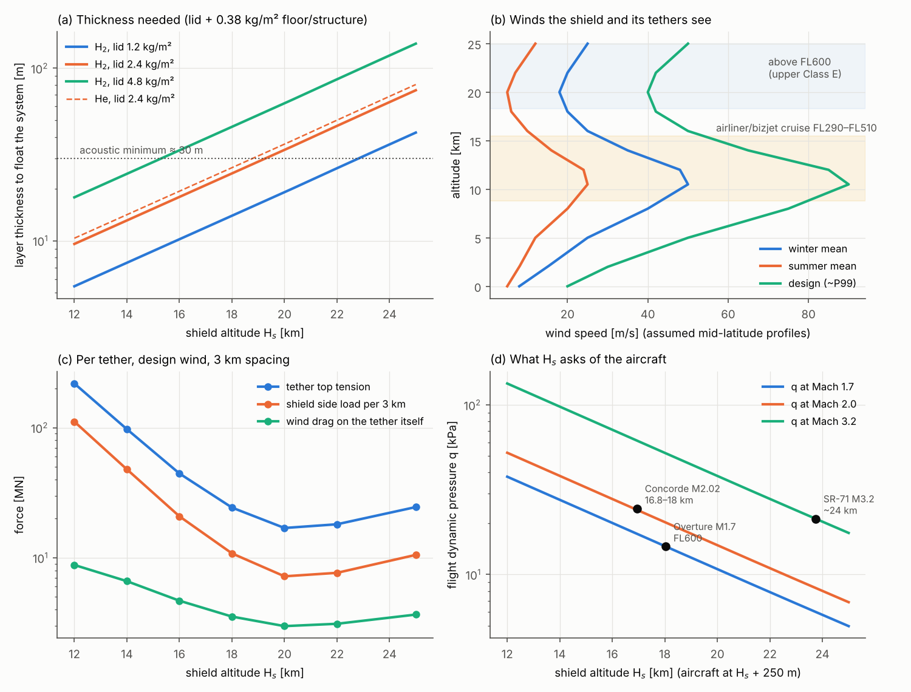

# BoomShield — operating-altitude trade (non-acoustic)

**Skyloop · 22 October 2026 · screening study.** Baseline: floating-lid H₂ pillow, 1 km wide, 30 m thick, 2.46 kg/m² system mass on the lid, aircraft 250 m above ([structure-concept](../structure/structure-concept.md)). H_s = 12–25 km; US Std 1976 via `boomsim.atmosphere`. Winds are **assumed** mid-latitude (30–45° N) profiles built from the cited summaries, not ERA5 statistics. Files: `altitude_trade.py` → `altitude_metrics.csv`, `lid_thickness.csv`, `wind_profiles.csv`, `altitude_trade.png`.

## Verdict

**Keep the shield top at 19–22 km; 20 km remains the best single value**, now for quantified reasons:

- **Lift and acoustics close together at 20 km.** The evanescent decay κ = ω√(1/V² − 1/c_g²) does not depend on density, so the ~30 m acoustic minimum holds at every altitude. At 20 km, 30 m lifts exactly 2.46 kg/m². Lower, surplus lift inflates the H₂ inventory (1.0–2.6 Mt vs 0.74); higher, thickness grows as 1/ρ.
- **Station-keeping is cheapest at 20–22 km:** 17 MN per tether, against 44 MN at 16 km and 97 MN at 14 km.
- **Weather and airspace:** only record storms reach 20 km, and it lies above FL600, in upper Class E.
- **Cost on the aircraft:** at Mach 2, a Concorde-class aircraft needs ~1.9× Concorde's wing area. Pair altitude with Mach: ~19 km for Mach 1.7, ~20 km for Mach 2, ~22 km for Mach 2.5–3.
- **Below 18 km, everything worsens together.**

## 1. Buoyancy

| H_s km | ρ_air | H₂ lift kg/m³ (He) | T for 2.46 kg/m² | T used (≥ 30 m) | surplus lift kg/m² | H₂ t/km (Mt per 4,000 km) | superheat K* | lift swing % | breathing m/day |
|---|---|---|---|---|---|---|---|---|---|
| 12 | 0.312 | 0.290 (0.269) | 8.5 | 30 | 6.25 | 651 (2.61) | 11 | 4.9 | 1.5 |
| 14 | 0.228 | 0.212 (0.196) | 11.6 | 30 | 3.90 | 476 (1.90) | 13 | 5.8 | 1.8 |
| 16 | 0.167 | 0.155 (0.144) | 15.9 | 30 | 2.19 | 348 (1.39) | 15 | 6.9 | 2.1 |
| 18 | 0.122 | 0.113 (0.105) | 21.7 | 30 | 0.94 | 254 (1.02) | 17 | 8.0 | 2.4 |
| **20** | 0.089 | 0.083 (0.077) | 29.7 | 30 | 0.02 | 186 (0.74) | 20 | 9.2 | 2.8 |
| 22 | 0.065 | 0.060 (0.056) | 41 | 41 | 0 | 184 (0.74) | 23 | 10.5 | 4.3 |
| 25 | 0.040 | 0.037 (0.035) | 66 | 66 | 0 | 184 (0.74) | 28 | 12.4 | 8.2 |

- **Lids 1.2–4.8 kg/m²** (+0.38 floor/structure, `lid_thickness.csv`): 19–63 m of H₂ at 20 km, 10–33 m at 16 km. Helium needs ~8 % more; inventory, not lift, rules it out.
- **H₂ per kg of lift is altitude-independent:** M_H₂/(M_air − M_H₂) = 0.075 kg/kg. Inventory grows below 20 km only because of the 30 m acoustic floor. The surplus lift could buy heavier faces or tether pretension, but it also adds stored energy (already ~5 kt TNT per km).
- ***Superheat (toy model):** convection ∝ ρ^(2/3) in parallel with low-ε radiation (0.3 W/m²K), calibrated to 20 K at 20 km. Superheat grows with altitude because convection weakens [8]; 39 K was measured on a superpressure balloon (abstract) [9]. Zero-pressure balloons vent by day and drop ballast at sunset [10]. The breathing stroke triples from 20 to 25 km. At the tropical cold point (~190 K, 16–17 km), films embrittle [11].

## 2. Weather

| band | exposure |
|---|---|
| tropopause [1] | tropics 16–18 km; mid-latitudes 10–13 km (higher in summer); poles ~8 km |
| 12–14 km | jet cores and anvils: hail, convective turbulence, ice-crystal icing (engine events up to ~12 km [5]), lightning onto an H₂ layer |
| 16 km | above the mid-latitude tropopause, but within summer overshooting tops (central US peak May–July [3]) and at the tropical cold point |
| 18 km | rare: 0.1 % of tropical systems reach 380 K, ~17 km (1.3 % reach 14 km) [2] |
| ≥ 20 km | record storms only; North American monsoon storms occasionally exceed 20 km [4] |

- **Clear-air turbulence** peaks at 7–11 km and falls off above 12 km. A 1967 NASA sample put 77 % below the tropopause [6].
- **Lightning:** blue jets reach 40–50 km but are rare [7]. The practical ignition paths are static and storms reaching the layer; H₂ ignition energy is 17 µJ [12].
- **Mountain waves** grow as ρ^(−1/2), 1.6× from 14 to 20 km. This is the one load that worsens with height (open, STATUS risk 4).

## 3. Winds and side loads

**Profiles.** The jet peaks at 10.5–12 km and the minimum sits near 20 km. Winter mean / summer mean / design (~P99, assumed) at 20 km: 18 / 5 / 40 m/s; in the jet: 50 / 25 / 90 m/s.

**Sources.** HAA studies put the minimum at 60–70 kft: 20–30 m/s in winter vs ~5 m/s summer easterlies, with transients above 15 m/s [13, 14]. The tropical QBO has a ~28-month period, peaks near 20 hPa, and its easterly peaks are more than twice the westerly ones [15]; the ±15–30 m/s amplitude is a background value, not retrieved. The winter polar-night jet strengthens 20–25 km winds poleward of ~50° [16]; no number was retrieved.

**Loads.** Side load F = ½ρU²(C_D·T + 2W·C_f), C_D = 1, C_f ≈ 0.002; gust lift uses w′ = 5 % U on a 1 km thin-aerofoil chord. Lid weight = 24 Pa.

| H_s km | U winter / design m/s | side load, winter / design kN/m | gust lift, design Pa |
|---|---|---|---|
| 12 | 48 / 85 | 11.9 / 37.1 | 354 |
| 14 | 35 / 65 | 4.7 / 15.9 | 151 |
| 16 | 25 / 50 | 1.75 / 6.9 | 65 |
| 18 | 20 / 42 | 0.83 / 3.6 | 34 |
| **20** | 18 / 40 | 0.49 / 2.4 | 22 |
| 22 | 20 / 42 | 0.58 / 2.6 | 18 |
| 25 | 25 / 50 | 0.88 / 3.5 | 16 |

Above 20 km, T ∝ 1/ρ at a fixed lid, so pressure side load ∝ U² alone. Below, the 30 m floor and denser air add load; design-gust lift exceeds lid weight 3–15× at 12–16 km.

## 4. Airspace and traffic

**Classes.** Class A runs from 18,000 ft MSL to FL600 inclusive, ≈ 18.3 km [17]. Above is upper Class E, where the FAA ETM concept (balloons, HALE UAS, returning SSTs) relies on cooperative, shared intent [18].

**Existing traffic.** Airliners fly FL290–FL430; business jets up to FL510 (G650, 51,000 ft [19]).

**By altitude:**
- **12 km (FL390):** inside airliner cruise; crossing traffic can only go under.
- **14 km:** business-jet levels.
- **16 km (~FL525):** only ~0.5 km above FL510.
- **18 km:** shield and corridor traffic inside Class A at FL590–600 (Concorde's levels).
- **≥ 18.6 km:** both above FL600.

**Tethers obstruct every flight level whatever H_s is:** a tether every 2–5 km over 4,000 km is a picket fence through Class A. It needs a permanent restricted area plus designed crossing gates.

**Density vs pressure surfaces.** A zero-pressure layer floats on a density surface; aircraft fly pressure levels. The two drift ~Z·ΔT/T apart, ≈ 250 m per 3 K column anomaly, which is the whole gap. Aircraft must fly shield-relative height at any H_s.

**Failure.** A burst 2.46 kg/m² membrane reaches FL510 in 0 / 0.5 / 2.5 / 4.2 / 7.4 min from 14 / 16 / 18 / 20 / 25 km. Minutes at best: closing the airspace below is the real safeguard.

## 5. Aircraft side

At H_s + 250 m, q = ½γpM²; best-cruise C_L ≈ 0.14 gives W/S ≈ 0.14·q. C_L is derived here, not cited: Concorde ~145 t / 358 m² at Mach 2.02, 16.8 km → 0.15 [20]; SR-71 ~55 t / 167 m² at Mach 3.2, 24 km (assumed) → 0.15.

| H_s km | q M1.7 / M2 / M3.2 kPa | W/S at M2 Pa (Concorde ≈ 4,000) | unshielded ground boom vs 20 km† | near-field pulse on lid (200–600 Pa at 20 km) |
|---|---|---|---|---|
| 12 | 38 / 52 / 134 | 7,300 | +3.3 to +8.7 dB | ×3.5 |
| 14 | 28 / 38 / 98 | 5,300 | +2.3 to +6.4 dB | ×2.6 |
| 16 | 20 / 28 / 71 | 3,900 (Concorde-native) | +1.4 to +4.2 dB | ×1.9 |
| 18 | 15 / 20 / 52 (Overture M1.7 at FL600 ≈ 14.6 [21]) | 2,850 | +0.7 to +2.0 dB | ×1.4 |
| **20** | 11 / 15 / 38 | 2,080 | 0 | ×1.0 |
| 22 | 7.9 / 11 / 28 | 1,530 | −0.6 to −2.0 dB | ×0.73 |
| 25 | 5.0 / 6.9 / 18 (SR-71 regime) | 960 | −1.4 to −4.8 dB | ×0.46 |

†Carlson [22]: Δp ∝ K_s·√(p_v·p_g)·h_e^(−3/4) (standard form; page not re-read). The low end is lift-dominated (K_s ∝ √(W/p_v), p_v cancels); the high end is volume-dominated (K_s constant).

- **At its design point Concorde's L/D (~7–7.5 [20]) does not depend on altitude.**
- **At 20 km a Concorde-class airframe needs** ~1.9× the wing, or flies at C_L/C_L* ≈ 1.9 (L/D × 0.82, ~+20 % fuel). Engines need ~1.9× the airflow because thrust lapses with ρ.
- **Lower flight:** lid pulses 1.4–3.5× bigger (fatigue, STATUS risk 2) and a primary boom up to ~9 dB louder for the shield to remove.

## 6. Mooring and tethers

Assumed: UHMWPE at 1.2 GPa working stress on fibre area, ρ 975 kg/m³, fill 0.65; 34° from vertical (V/H = 1.5); C_D 1.2; drag integrated as for a vertical tether (conservative); 3 km spacing; design wind.

| H_s km | tether length km | top tension MN | diameter cm | mass t | drag on tether, design (winter mean) MN | extra shield lift needed kg/m² |
|---|---|---|---|---|---|---|
| 12 | 14 | 219 | 60 | 2,560 | 8.8 (1.4) | 6.7 |
| 14 | 17 | 97 | 40 | 1,330 | 6.6 (0.99) | 3.0 |
| 16 | 19 | 44 | 27 | 695 | 4.7 (0.65) | 1.4 |
| 18 | 22 | 24 | 20 | 428 | 3.5 (0.46) | 0.78 |
| **20** | 24 | 17 | 17 | 331 | 3.0 (0.37) | 0.55 |
| 22 | 26 | 18 | 17 | 389 | 3.1 (0.40) | 0.59 |
| 25 | 30 | 25 | 20 | 599 | 3.7 (0.49) | 0.82 |

- **Every tether crosses the jet:** ~46 % of drag comes from 8–13 km at every H_s. Raising the shield only adds length; at low altitude, tension is driven by the shield's own side load.
- **Cross-check:** winter-mean drag at 20 km (0.37 MN) reproduces the addendum's 0.35–0.63 MN.
- **Minimum at 20–22 km:** 17–18 MN, 330–390 t, ~1,300 tethers. That exceeds the structure study's 2.2–5.6 MN, which used 30 m/s and no pretension.
- **New closure item:** at 20 km the 30 m layer has no lift spare for pretension (+0.55 kg/m², +22 %, i.e. ~37 m of H₂ or a lighter lid).
- **Failure:** a cut tether lets the shield drift with the upper wind; a burst layer falls (§4), and at 12–14 km lands directly in traffic.

## 7. Synthesis

Scores 1 (bad) to 5 (good); equal weights; aircraft scored for Mach 2.

| H_s km | buoyancy / H₂ | weather | wind (shield) | tethers | airspace / traffic | aircraft (M2) | lid pulse + primary boom | acoustic | total (7 non-acoustic) |
|---|---|---|---|---|---|---|---|---|---|
| 12 | 2 | 1 | 1 | 1 | 1 | 2 | 1 | pending | 9 |
| 14 | 2 | 1 | 1 | 1 | 1 | 3 | 2 | pending | 11 |
| 16 | 3 | 2 | 2 | 2 | 2 | 5 | 3 | pending | 19 |
| 18 | 4 | 4 | 4 | 4 | 3 | 4 | 4 | pending | 27 |
| **20** | 5 | 5 | 5 | 5 | 4 | 3 | 4 | pending | **31** |
| 22 | 4 | 5 | 5 | 5 | 4 | 2 | 5 | pending | 30 |
| 25 | 2 | 5 | 4 | 4 | 4 | 1 | 5 | pending | 25 |

**Recommendation: shield top at 19–22 km.**
- **Lower bound (~19 km):** FL600 + 250 m + ~0.5 km buffer, rare overshoots, and the wind/tether minimum.
- **Upper bound (~22 km):** thickness and breathing stroke, and wing size for Mach 2.
- **Within the band, pick by Mach:** ~19 km for Mach 1.7, ~20 km for Mach 2, ~22 km for Mach 2.5–3.
- **Siting:** prefer 20–40° latitude away from monsoon convection; use ≥ 21 km in the tropics.
- **Not solved by altitude:** the tether picket fence through Class A, the dominant airspace problem at every H_s.

## Acoustic results

Acoustic results: see [psf_sweep.md](../sim/results/psf_sweep.md). It did not exist when this was written, so the acoustic column is pending.

## Sources

Page fetches were blocked (DNS failure), so every entry below rests on search-result summaries and has not been re-read at the source.

1. Tropopause height: ACP 25, 17319 (2025), <https://acp.copernicus.org/articles/25/17319/2025/acp-25-17319-2025.pdf>; regional (Iran) 16.5–17.4 / 11.5–12.8 km, <https://jphgr.ut.ac.ir/article_92282_en.html>.
2. Liu & Zipser, JGR 2005, overshooting from TRMM (1.3 % reach 14 km, 0.1 % reach 380 K): <https://csl.noaa.gov/events/CT3LS/program/talks/103_Liu.pdf>.
3. Cooney et al., JGR 123 (2018), doi:10.1002/2017JD027718; EOS highlight <https://eos.org/editor-highlights/continental-convection-reaches-new-highs>.
4. DCOTSS radar descriptions (NAM storms > 20 km): <https://asdc.larc.nasa.gov/wagdocuments/527/DCOTSS_Radar_Descriptions.pdf>.
5. Ice-crystal icing, NASA: <https://ntrs.nasa.gov/api/citations/20150002337/downloads/20150002337.pdf>; HKO <https://www.hko.gov.hk/en/education/aviation-and-marine/aviation/00501-ice-crystal-icing-a-threat-to-aircraft-engine.html>.
6. CAT: ERA5 NH climatology <https://essopenarchive.org/doi/full/10.1002/essoar.10512213.1>; China voice reports <https://www.mdpi.com/2073-4433/16/10/1218>; NASA 1967 <https://ntrs.nasa.gov/api/citations/19680017335/downloads/19680017335.pdf>.
7. Blue and gigantic jets: <https://link.springer.com/doi/10.1007/s11214-008-9346-z>; <https://pure.psu.edu/en/publications/blue-jets-and-gigantic-jets-transient-luminous-events-between-thu/>.
8. BLASTPol thermal design: <https://arxiv.org/pdf/1407.2670>.
9. Superheat of 39 K (abstract): <https://onlinelibrary.wiley.com/doi/abs/10.1155/2018/7806036>.
10. Raven Aerostar, zero-pressure/superpressure capabilities: <https://cdn.ravenaerostar.com/legacy/aerospace/technical-documents/Extended_Capabilities_Zero_Pressure_2003.pdf>.
11. DRDO, plastic balloons in India (−85 °C tropopause): <https://publications.drdo.gov.in/ojs/index.php/dsj/article/view/7583>.
12. NASA, hydrogen lifting gas 2025: <https://ntrs.nasa.gov/api/citations/20250004774/downloads/Hydrogen%20Lifting%20Gas%202025-2.pdf>.
13. Airships for science (KISS): <https://arxiv.org/pdf/1402.6706>.
14. AMS 2008 HAA winds: <https://ams.confex.com/ams/pdfpapers/128256.pdf>.
15. Baldwin et al., Rev. Geophys. 39 (2001), <https://acomstaff.acom.ucar.edu/randel/Baldwin%20etal%20%202001.pdf>; ERA5 QBO <https://arxiv.org/pdf/2008.10146>.
16. Polar-night jet: Ando et al., ACP 18 (2018), <https://acp.copernicus.org/articles/18/12639/2018/>.
17. FAA AIM 3-2 (Class A): <https://www.faa.gov/Air_Traffic/publications/atpubs/aim_html/chap3_section_2.html>.
18. FAA ETM: <https://www.faa.gov/sites/faa.gov/files/uas/advanced_operations/upper_class_etm/ETM_Surveillance_Alternatives_Assessment.pdf>; NASA <https://ntrs.nasa.gov/api/citations/20210017271/downloads/20210017271_Yoo_Aviation2021_Paper.pdf>.
19. G650, 51,000 ft: <https://www.jetcraft.com/jetstream/2016/06/gulfstream-g650-overview-2012-present/>. The FL290–FL430 airliner band is background knowledge, not retrieved.
20. Concorde cruise at 50–60 kft and L/D ≈ 7–7.5 at Mach 2: <https://flyawaysimulation.com/ask/answers/concorde-cruise-altitude/>; <https://wikipedia.com/wiki/L/D_ratio> (secondary sources).
21. Overture, Mach 1.7 up to 60,000 ft: <https://flightplan.forecastinternational.com/2025/08/25/boom-supersonic-overture-airliner-program-outlook/>.
22. Carlson, *Simplified Sonic-Boom Prediction*, NASA TP-1122 (1978): <https://ntrs.nasa.gov/citations/19780012135>.

SR-71 cruise conditions (Mach 3.2, about 24 km, about 55 t) and the design-wind values are assumptions and were not retrieved.
