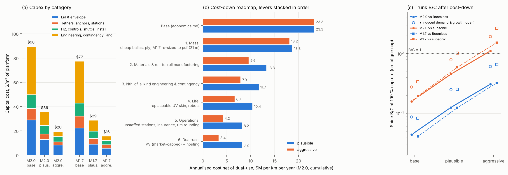

# BoomShield: unit-cost reduction study

**Skyloop · 22 October 2026 · screening level.** `cost_down.py` imports [economics](../economics.md)' `cost_model.py` read-only, reproduces its base exactly ($23.34 / $17.27 M/km/yr) and stacks six levers at plausible and aggressive settings. `physics.py` re-sizes the lid (psf_sweep τ-formula) and sizes PV. Spine benefits come from coverage `scenarios.csv` (3,614 km, no fatigue cap). [U] = engineering estimate; web sources are unverified search summaries. Finance is fixed at 7 % / 25 yr.

## Verdict

1. **The cost comes down about 3× on plausible assumptions and about 7–8× on aggressive ones.**
   - **Plausible:** $90 → **$36/m²**, $23 → **$8.2 M/km/yr** (M2.0); M1.7 **$29/m²**, $5.7 M.
   - **Aggressive:** **$16–20/m²**, **$2.2–3.4 M/km/yr** net of dual-use.
   - Materials and manufacturing do most (×1.5–2.1 alone); mass, overheads, life and operations give ×1.15–1.3 each; dual-use only ×1.0–1.35.
2. **The lid mass is doing acoustic work at Mach 2, but it does not need to be expensive.**
   - In the psf time constant, face mass loads the gas spring (the m/ρ_g term). It is not mass-law shielding.
   - **Mach 2:** a 0.4 kg/m² lid would need 67 m of H₂ and 4.4 kg/m² of extra tether hold-down. The fix is a cheap mineral-filled ballast ply.
   - **Mach 1.7:** the 36 m layer was set by lift, not by psf. Re-sized to **21 m with a 1.0 kg/m² lid**, it carries 56 % less mass and 42 % less H₂.
3. **Stratospheric PV is real energy but not real subsidy.**
   - A full PV lid would *gross* $11–16/m²/yr, about the whole base annual cost, but it competes with ground PV and would equal half of US electricity.
   - The defensible rent is **$0–3/m² of PV per year** on ≤ 15 % of the lid. Conductive tethers and high voltage over H₂, not mass, are the obstacles.
4. **The trunk is still short of Boomless.**
   - **Spine B/C at 100 % capture (M2.0):** 0.044 → **0.13** (plausible) → **0.31** (aggressive) against Boomless; 0.16 → 0.45 → **1.1** against subsonic.
   - **Adding the sibling's induced demand and growth:** aggressive reaches **0.61 vs Boomless and 1.9 vs subsonic**.
   - **At 10 % capture every case stays below 0.2.**
   - **Against Boomless the gap cannot close on cost.** Break-even needs ≤ $1.0 M/km/yr all-in, below the aggressive opex alone.

*(a) Capex by category. (b) Net annual cost as levers stack, M2.0. (c) Spine B/C at 100 % capture; open markers add induced demand and traffic growth.*

## 1. Mass: re-optimising the lid

The ground peak scales as W·(Vτ)^−3/2, so equal τ means equal psf. The τ-formula reproduces psf_sweep's check that a fixed 2.4 kg/m² lid needs ~61 m.

**Table 1. Lift-closed lid (lid = lift − floor − hold-down) vs a light lid** (`lid_reopt.csv`)

| Aircraft | Case | H₂ m | Lid kg/m² | Extra hold-down kg/m² |
|---|---|---|---|---|
| M2.0 | lift-closed, bare tethers (0.62) | 55.6 | 3.88 | 0 |
| M2.0 | lift-closed, rounded rim (0.25) | 54.6 | 4.17 | 0 |
| M2.0 | **light lid 0.4** | **66.6** | 0.40 | **4.39** |
| M2.0 | same 54 m, lid 0.4 / 1.0 / 2.3 | 54 | — | peak ×1.36 / 1.29 / 1.17 |
| M1.7 | **lift-closed, bare (economics uses 36 m, 2.33)** | **21.0** | **1.02** | 0 |
| M1.7 | light lid 0.4 | 22.1 | 0.40 | 0.71 |

**Minimum structural mass** (`min_structure.csv`): **0.20 / 0.32 / 0.51 kg/m²**. That covers 25–90 µm face film at 5–10 MPa, a bonded second ply, a 12–25 µm UV skin, 0.1 kg/m² of tapes, seams and tie pads, and controls.

**Everything above that is ballast.**
- **Mach 2:** that is 3.5 kg/m², charged at the $4/kg PE price in the base.
- **Cheap ballast:** a 50–70 % CaCO₃- or ATH-filled PE ply costs $0.8–1.2/kg [U]. Filler masterbatch lists at $0.3–2.6/kg [1]. ATH filler is also a flame retardant, which helps the firebreak joints.
- **Useful payload:** surplus lift can carry PV (§5), which counts as face mass if it is bonded.

**Risk:** a light M1.7 lid raises boom strains ~3–4× (lid-fatigue margin 40–200× → 10–60×); filled ply is brittler at 217 K.

## 2. Materials and manufacturing

**Table 2. Unit costs** (base → plausible → aggressive)

| Item | Base | Plausible | Aggressive | Basis |
|---|---|---|---|---|
| Structural film, $/kg | 4 | 2.5 | 1.8 | LLDPE resin ~$0.9/kg + blown-film conversion; geomembrane-class sheet [2] |
| Ballast ply, $/kg | 4 | 1.2 | 0.8 | Filled compound [1] |
| UHMWPE, $/kg | 30 | 22 | 15 | Chinese capacity ~80 kt/yr [3]; no bulk quote |
| Floor film, $/kg | 15 | 4 | 2.5 | Commodity thin film vs balloon-grade |
| Seams and fabrication, $/m² | 6 | 3 | 1.5 | Wide-web (≥ 16 m) roll-to-roll heat sealing [U] |
| Install / controls per cell | $6/m², $150 k | $3.5, $75 k | $2, $40 k | Wright's law (below) |
| Engineering / contingency | 20 / 50 % | 12 / 30 % | 8 / 20 % | First-of-a-kind → Nth-of-a-kind |

**Learning** (`learning.csv`): over ~14,500 modules, a 10–15 % learning rate from a 1–3 % pilot gives a cumulative average of **0.44–0.68× the pilot cost**. The aggressive column needs 15–20 %, or vertical integration from resin to sealed module.

**Scale** (`scale_check.csv`).
- **Area:** 630 km²/yr over a 10-year build is **0.3 % of China's annual mulch-film area** (20 Mha) [4].
- **Mass:** 24.7 Mt at Mach 2 (2.5 Mt/yr) is **~2 % of world PE** (~110 Mt [U]) and **~40 % of world agricultural film** (~6 Mt [5]). Filled ballast halves the polymer; re-sized M1.7 needs 6.3 Mt.
- **Commodity-scale, not exotic.**

## 3. Life

**Envelope replacement is the base case's largest opex line:** $6.2 M/km/yr, everything renewed every 10 years.

**The lever:** a bonded bulk lid (strain ~10⁻⁵) under a replaceable UV/ozone skin lasts **20 / 30 years** (ETFE claims 50, PTFE/glass 29+; lid-fatigue S5–S6). Robots re-lay the skin every 8–10 years ($0.3–0.5/m² per pass [U]); fatigue-aware details cut H₂ make-up to 6 / 3 %/yr. **Effect:** ×1.14–1.22 alone; replacement falls to $1.7 / $0.8 M/km/yr.

## 4. Operations

**Unstaffed stations** (8 → 1 / 0.3 FTE per site, a remote operations centre).

**Insurance** at 0.6 / 0.35 % of capital through a pooled captive; insurers may balk at 14–27 kt TNT of H₂ per km.

**Rim rounding** (28.4 → 11.3 MN at C_D 0.3): tether mass ×0.6 / ×0.4, spacing 4 / 5 km; needs an acoustic edge check.

**H₂ from on-site electrolysis vs bought: immaterial** (≤ $0.3 M/km/yr). The leak rate matters, not the price.

**Effect:** ×1.14–1.21 on its own.

**The base also undercounts tethers.** Operations needs two tether rows, one for each crosswind direction (~2,700 tethers). That adds **+17–19 % capex** in every scenario (`sensitivities.csv`), and aggressive M2.0 B/C vs subsonic drops to 0.92.

## 5. Dual-use

**Table 3. Stratospheric PV per m² of PV** (`pv_dualuse.csv`, `pv_resource.csv`, `pv_thermal.csv`)

| | Plausible | Aggressive |
|---|---|---|
| Horizontal insolation, 20 km, 40° N | 2,680 kWh/m²/yr (computed: TOA 2,850 × beam loss ~3 % at AM1; SoftBank finds 20 km within 1–2 % of AM0 at high sun [6]) | same |
| Thin film: efficiency, mass | 15 %, ~1 kg/m² (flexible perovskite ML-Flex ≈ 1.06 kg/m² [7]; glass-free CIGS 1.7–2.9 kg/m², ≤ 17 % [8]) | 18 %, 0.8 kg/m² |
| Delivered energy (PR 0.80–0.82) | 322 kWh/m²/yr (2,140 kWh/kWp) | 396 kWh/m²/yr |
| System cost incl. tether conductors and HVDC converters [9] | $0.70/W → LCOE **$35/MWh** | $0.45/W → **$20/MWh** |
| Gross revenue, $35–40/MWh (EIA 2025 hubs ~$40 [10]) | $11.3/m²/yr | $15.8/m²/yr |
| Rent net of ground PV (Lazard 2025: $38–78/MWh [11]; aggressive-era ground $28 [U]) | **$0.2** | **$3.1** (price-taker: $7.8) |
| Area share (market cap) | 5 % | 15 % (≈ 375 TWh/yr, ~9 % of US demand) |
| **Credit, $M/km/yr** | **0.01** | **0.81** |

**Can PV carry the shield? Gross, almost. Net, no.**
- Gross PV revenue on a full lid ($11–16/m²/yr) roughly equals the base shield cost ($13.3/m²/yr).
- But the full spine would produce **2,000–2,500 TWh/yr at ~1,000 GW peak**, half of US consumption and daytime only.
- The flat lid yields only ~1.1–1.4× a ground tracker per kWp, so the shield's rent is free racking and land.

**Mass and transmission are easy:** ~240 MW per export tether at ±100 kV needs ~150 t of aluminium (+27 % of a bare tether, 0.02 kg/m² of lid) and loses 0.7 %; PV mass replaces ballast.

**Safety is the hard part.**
- **Lightning:** a conductor from the ground to 20 km is a triggered-lightning wire. Rocket-triggered lightning works with a grounded wire at 3–5 kV/m [12], and aerostat tethers carry tens of kA [13].
- **High voltage over H₂:** DC arcs persist; pinholes vent H₂ into the PV layer; arcs ignite it where sparks at 55 hPa are marginal.
- Export breaks the failure study's all-dielectric tether: a potential show-stopper.

**Thermal.**
- At noon a PV lid runs at **305–322 K**, against 241 K for a white skin: 65–80 K hotter.
- Even 15–20 K more gas superheat adds 7–9 % to the daily lift swing (0.46 %/K). That is charged as +40–55 % tether capacity under the PV.
- Self-powering the lid's own loads (~1 kWh/m²/yr) is safe and is in both scenarios.

**Telecom, sensing and other uses.**

| Use | Value | Status |
|---|---|---|
| HAPS-style 5G / direct-to-device | ~1 site per 100 km (Zephyr ~100 km range [14]) at $1–5 M/yr ≈ 40–200 tower tenancies at ~$25 k [15] → **$0.01–0.05 M/km/yr** | Speculative. Loon closed in 2021, not commercially viable [16]; AALTO has no fixed model [17] |
| Earth observation, weather, GNSS pseudolites | ≤ $0.005 M/km/yr | Small |
| Defence surveillance tenant (JLENS-class) | Unpriced | Possible anchor customer, not a market |

## 6. Roadmap

**Table 4. Scenarios, spine (3,614 km)** (`scenarios.csv`)

| Design · scenario | H₂ m / lid kg/m² | $/m² | $M/km | Annual $M/km/yr | Dual-use | **Net $M/km/yr ($/m²/yr)** | × | B/C vs BL 10 % / 100 % | B/C vs sub 10 % / 100 % |
|---|---|---|---|---|---|---|---|---|---|
| M2.0 base | 55 / 3.9 | 89.7 | 157 | 23.3 | 0 | **23.3 (13.3)** | 1 | 0.0044 / 0.044 | 0.016 / 0.16 |
| M2.0 plausible | 55 / 3.8 | 35.7 | 62 | 8.2 | 0.03 | **8.2 (4.7)** | 2.9 | 0.013 / 0.13 | 0.045 / 0.45 |
| M2.0 aggressive | 55 / 4.2 | 19.8 | 35 | 4.2 | 0.87 | **3.4 (1.9)** | 7.0 | 0.031 / 0.31 | 0.11 / **1.1** |
| M1.7 base | 36 / 2.3 | 77.5 | 116 | 17.3 | 0 | **17.3 (11.5)** | 1 | 0.0041 / 0.041 | 0.020 / 0.20 |
| M1.7 plausible | 21 / 1.0 | 28.9 | 43 | 5.7 | 0.03 | **5.7 (3.8)** | 3.0 | 0.012 / 0.12 | 0.059 / 0.59 |
| M1.7 aggressive | 20 / 1.3 | 15.8 | 24 | 3.0 | 0.75 | **2.2 (1.5)** | 7.9 | 0.032 / 0.32 | 0.15 / **1.5** |

**Single levers on the M2.0 base** (`levers.csv`), plausible / aggressive:

| Lever | Factor |
|---|---|
| Materials | 1.5 / 2.1 |
| Mass | 1.24 / 1.29 |
| Nth-of-a-kind overheads | 1.14 / 1.22 |
| Life | 1.14 / 1.22 |
| Operations | 1.14 / 1.21 |
| Dual-use | 1.0 / 1.04 |

Stacked, they compound to the totals above. Without PV, aggressive M2.0 nets $4.2 M/km/yr.

**Joint scenario with induced demand.**
> **Superseded (22 Oct 2026):** this paragraph and `joint_demand.csv` use preliminary uplifts (×1.41 / ×1.24); the current base uplifts are ×1.066 / ×1.046, and the authoritative combined table is [network-maps/demand/joint_costdown.csv](../../network-maps/demand/joint_costdown.csv).

The sibling's `demand/scenario_results.csv` (read before its write-up existed: preliminary) gives spine uplifts of ×1.41 vs Boomless and ×1.24 vs subsonic, or ×2.0 / ×1.7 with life-average growth. Aggressive M2.0 then reaches **0.44–0.61 vs Boomless and 1.4–1.9 vs subsonic** at 100 % capture (M1.7: 0.47–0.66 and 1.9–2.7). Peak traffic of 4,500–6,700 flights/day stays under the 10,000/day fatigue cap. `joint_demand.csv` refreshes on re-run.

## What this means

**3× is credible with today's practice** (geomembrane-class sheet, filled ballast, roll-to-roll seams, unstaffed stations). **7–8× needs every aggressive assumption at once.** That makes the shield defensible against subsonic flight on a fully captured spine, never against Boomless Cruise, whose margin ($0.7–1.0 M/km/yr) is below even the aggressive opex.

**Recommended next work:**
1. 217 K coupons of filled ballast ply and seams.
2. An acoustic check of a rounded rim.
3. Supplier quotes for sheet and UHMWPE.
4. A hazard study before any conductive tether.

## Sources (search summaries, unverified)

1. Filler masterbatch listings: b2usa/europeanplastic ($290/t FOB); Global Sources ($2.4–2.6 k/t); IndiaMART.
2. Geomembrane HDPE 0.5–2.5 mm, $0.5–2/m² listing (goldsupplier). LLDPE resin: economics.md [1].
3. Texleader (China UHMWPE fibre ~80 kt/yr); ResearchAndMarkets / BusinessWire (market $0.9–2.3 B).
4. Bloomberg 2017 (1.45 Mt over 20 Mha); Dryad dataset doi:10.5061/dryad.6hdr7srcd.
5. AMI agricultural films report via PFFC (~6 Mt, 2016).
6. SoftBank research topics 051/089 (20 km irradiance vs AM0); arXiv 2511.14527.
7. pv-magazine, Jan 2025 (Mellow ML-Flex, 260–300 W, 1.92 m², 2.04 kg).
8. GreenDelta LCA forum DF91, Oct 2025; Ascent Solar press release, Jun 2025.
9. ±800 kV converters 0.65–0.97 M RMB/MW (DOAJ, 2020); OPIS TOPCon $0.08/W FOB (pv-magazine, May 2025).
10. EIA *Today in Energy* 64384 (2025 forecast ~$40/MWh) and 67106.
11. Lazard LCOE+ 2025 via pv-tech ($38–78/MWh).
12. arXiv 2404.10020 (rocket-triggered lightning).
13. US 4,842,221; DTIC ADA034847.
14. MONOist, June 2024 (Zephyr ~100 km).
15. Cell Tower Lease Experts / Steel in the Air (~$1.1–2.4 k/month).
16. Telecompaper; Wireless Estimator (Loon, 2021).
17. Bisnis.com, March 2026 (AALTO).
