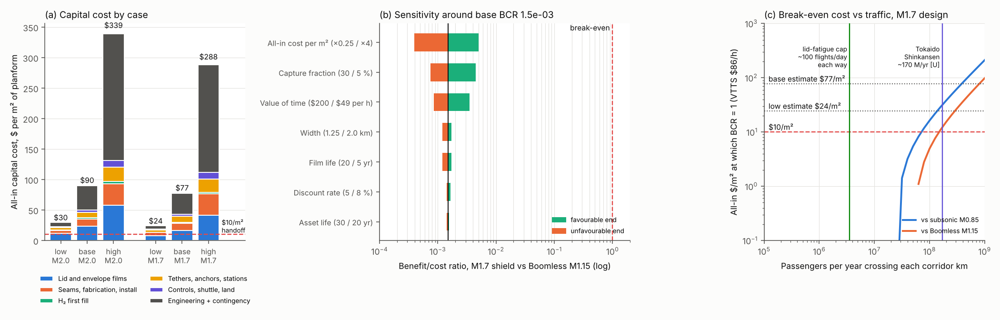

# BoomShield: first-cut economics

**Skyloop · 22 October 2026 · screening level.** All figures are in 2025 US$ per km of corridor unless stated. The design points come from [STATUS](../STATUS.md) §6, [altitude-trade](../altitude/altitude-trade.md) §6–7 and [structure-concept](../structure/structure-concept.md) §2–4. Two layers are costed:

- **M2.0 baseline:** 55 m of H₂, 1.5 / 1.75 / 2.0 km wide (low / base / high), lid 3.9 kg/m².
- **M1.7 variant:** 36 m, lift-set, 1.5–2.0 km wide, lid 2.3 kg/m². This is the Overture-class case that routes.csv values.

**Files:** `cost_model.py` writes `capex_breakdown.csv`, `opex_breakdown.csv`, `annual_breakeven.csv`, `corridor_economics.csv`, `segment_economics.csv`, `land_rights.csv`, `tornado.csv`, `breakeven_curve.csv` and `economics.png`. Unit costs marked **[U]** are unverified engineering estimates. Every web source rests on search-result summaries; page fetches failed with DNS errors.

## Verdict

**No corridor pays, and the shortfall is 300–3,000×, not a factor of two.**

- **Base capital cost is $78–90/m², or $116–157 M/km.** That is about California HSR's cost per km, and 8–9× the $10/m² sensitivity used in the handoff.
- **The best kilometre in the network falls far short.** On the shared DEN–ORD trunk at 10 % capture, the shield saves 317 passenger-hours per km per year over Overture's Boomless Cruise, worth about **$26 k/km/yr**. Annualised cost is **$17 M/km/yr**, so the benefit/cost ratio (BCR) is **1.5 × 10⁻³** (3.4 × 10⁻³ against subsonic flight).
- **No single input closes the gap.** The tornado moves the BCR by at most about 3×.
- **A free shield still loses.** Staffed tether stations and inspection alone cost $0.3–4 M/km/yr. The most time value the lid's fatigue cap allows is $0.08–0.4 M/km/yr.

## 1. Capital cost

**Table 1. $/m² of planform** (M2.0; M1.7 totals underneath)

| Line | Low | Base | High | Basis |
|---|---|---|---|---|
| Lid mass (PE sheet/laminate, 3.75 kg/m²) | 7.5 | 15.0 | 37.0 | $2 / 4 / 10 per kg: LLDPE resin $0.85–0.95/kg in 2025 [1] plus conversion [U] |
| UV skin, UHMWPE tapes, floor film, partitions, ties | 4.1 | 8.2 | 20.8 | UHMWPE $15 / 30 / 60 per kg [U][2]; balloon film $8–30/kg [U] |
| Seams and fabrication | 3.0 | 6.0 | 15.0 | Balloon check below |
| H₂ first fill (0.34 kg/m², +10 % losses) | 0.7 | 2.1 | 4.5 | Grey $1.1–2.4/kg; green $3.7–11.7/kg [3]; + $0.5–3/kg delivery [U] |
| Tethers (bare, 555 t per 3 km) | 1.9 | 3.2 | 5.6 | operations/tether_sizing.csv × UHMWPE $/kg |
| Anchors (3,037 m³ gravity block per site) | 0.8 | 1.2 | 2.4 | operations/failure_landuse.csv; $800–3,000/m³ [U] |
| Winch / tension stations, $10 / 25 / 60 M per site | 1.3 | 4.8 | 15.0 | Spacing 5 / 3 / 2 km [U] |
| Controls, sensors, transponders, gas shuttle | 1.3 | 3.4 | 9.4 | $50–400 k per 250 m × 250 m cell [U] |
| Launch and installation | 2.0 | 6.0 | 20.0 | No precedent [U] |
| Engineering (10–30 %) + contingency (20–100 %) | 7.3 | 39.9 | 207.4 | First-of-a-kind [U] |
| Land and easements | 0.0 | 0.1 | 2.0 | §3 |
| **M2.0 total, $/m² · $M/km · $B per 4,000 km** | **30 · 45 · 179** | **90 · 157 · 628** | **339 · 678 · 2,712** | |
| **M1.7 total** | **24 · 37 · 146** | **77 · 116 · 465** | **288 · 577 · 2,306** | |

**Against the $10/m² sensitivity.** The handoff's $10/m² was arithmetic, not a quote. This bottom-up estimate is **2.4–3× that figure in the low case, 8–9× in the base case and ~30× in the high case**.

- **Materials alone already exceed it.** Films, tapes and ties come to ~$23/m² in the base case.
- **The cost is in mass, not area.** The lid has to carry 2.3–3.9 kg/m² because acoustics want face mass (STATUS §6).
- **Scientific balloons are the wrong comparison.** A NASA 40 MCF balloon cost about $120 k for roughly 5.3 ha of 20 µm film (Air & Space, date unknown [4]). That is ~$2/m², but **~$120/kg**. BoomShield is ~200× heavier per m², so neither unit transfers.
- **The lid is a polymer-supply problem in its own right.** It weighs 3.5–7.8 kt per km, or **14–31 Mt for 4,000 km**: a large fraction of a year's world polyethylene output (~110 Mt/yr [U]).

**Faired tethers** (operations: 498 t fibre + 68 t fairing, against 555 t bare) cost about the same as bare ones. Their value is lower drag and a different failure mode, not capital cost.

## 2. Operating cost

**Table 2. $M/km/yr** (M2.0; M1.7 totals underneath)

| Line | Low | Base | High | Basis |
|---|---|---|---|---|
| Envelope replacement (UV, slack-cycle fatigue) | 1.0 | 6.2 | 44.5 | Film life 20 / 10 / 5 yr [U] |
| Insurance | 0.2 | 1.6 | 13.6 | 0.5–2 % of capital per year; 14–27 kt TNT of H₂ per km [U] |
| Staffing, inspection, power, O&M, easement rent | 0.4 | 1.5 | 5.8 | 4–12 FTE per site [U] |
| H₂ make-up | 0.05 | 0.33 | 1.5 | 5–20 %/yr (structure §4; operations/h2_makeup.csv) |
| Tether replacement | 0.13 | 0.34 | 1.0 | 20 / 15 / 10 yr; UHMWPE creep [U] |
| **Total M2.0 (M1.7)** | **1.8 (1.5)** | **9.9 (7.3)** | **66 (56)** | |
| **Annualised capital + opex**, CRF 5 % / 30 yr, 7 % / 25 yr, 8 % / 20 yr | **4.7 (3.9)** | **23.3 (17.3)** | **135 (114)** | |

**Weather downtime** is applied to benefits as availability of 98 / 95 / 90 %. **Film life is the swing term.** Five-year films make replacement the largest single cost.

## 3. Land and rights

**Table 3. Land take per km of route**

| | High-speed rail | BoomShield |
|---|---|---|
| Total cost | CA HSR Merced–Bakersfield $29.8–33.0 B for 171 mi ≈ **$110–120 M/km**, ~$175 M/km at the IG's ~$48 B [5]; Brightline West $21.5 B / 218 mi ≈ $61 M/km [6]; Spain ~$18.5 M/km; HS2 ≥ $175 M/km [7] | $37–678 M/km (Table 1) |
| Land and right-of-way cost | CA Central Valley ~$1.5 B (2018 estimate; initial estimate $332 M) over ~119 mi ≈ **$7.8 M/km**, ~5–10 % of cost [8] | **$0.01–4.0 M/km** (base $0.18 M); <1 % of cost |
| Land take | Continuous strip, 50 ft envelope (FL HSR guidelines) to 80–120 ft (CA Peninsula) [9] = **3.8–9.0 acres/km** in fee, plus remnants; ~2,300 parcels in the Central Valley (~12/km) [8] | 0.2–0.5 sites per km. Hard area 3.5–9.3 ha per site (operations: 4.6 ha at r = 100 m) = **1.7–11.5 acres/km** (base 3.8) in fee. Exclusion easement r = 300–1,000 m = **12–377 acres/km** (base 61), farming allowed |
| Severance | Splits farms and roads; grade separations | None on the ground. A tether fall line (drift 9–17 km bare, operations/fall_footprint.csv) and a shadow band overhead instead |

Land is priced at USDA 2025 values ($1,920 pasture, $4,350 farm real estate, $9,830 Pacific cropland per acre) [10]. Fee purchases carry a 1.5–6× premium; easements cost 30–90 % of fee value.

**Who must consent to a structure overhead?**

- **The air above 20 km is not the landowner's to sell.** *United States v. Causby* (1946) rejected *ad coelum* ownership and held navigable airspace to be public domain. A taking arises only from use "so low and so frequent as to be a direct and immediate interference" [11].
- **The binding consent is the FAA's.**
  - The shield is not an aircraft: it is a moored balloon under 14 CFR 101 Subpart B, which bars operation more than 500 ft above the surface except inside a restricted area [12].
  - That means a permanent restricted area under Part 73, a rulemaking, plus obstruction study and Part 101 marking of ~1,300 mooring lines that cross Class A.
  - Canada and Mexico must also agree for any cross-border trunk.
- **Landowners matter at three places:**
  - **Anchor sites:** a negotiated purchase or easement, like a wind farm. A private developer has no eminent domain, which CHSRA has.
  - **The low tether span:** it crosses neighbouring parcels and needs aerial easements, as transmission lines do.
  - **The shadow:** if the lid is opaque, ground 5–35 km poleward of an east–west corridor at 37° N is shaded up to **~380 h/yr**, including whole days near the equinoxes (`shadow_hours()`). That is a plausible Causby-style nuisance or takings claim against farms and solar plants (untested).
- **Environmental review.** The CEQ mean was 4.5 years from notice of intent to record of decision (2010–18); the 2024 median was 2.2 years to a final EIS [13]. A programmatic EIS across four states or more would have to cover:
  - stratospheric H₂ leakage (water vapour, ozone, indirect GHG);
  - tether bird strikes (MBTA, ESA);
  - burst, fire and debris corridors;
  - shading and visual impact;
  - NHPA and tribal consultation at about 800–2,000 sites.

  HSR's EIS scope is different: wetlands (§404), farmland conversion and severance along a continuous line.

## 4. Benefits, fares and break-even

**Value of time.** DOT's 2016 guidance gives intercity air travel at $36.10/h personal and $63.20/h business (2015 $), with a 40 % business share [14]. CPI-adjusted (×1.36 [U]), that is $49 and **$86 (base)**. $200/h stands in for premium travellers [U].

**Fares.** Boom has priced Overture at about today's business fare (~$5,000 round trip [15]), so speed carries no fare premium. Any shield toll has to come out of time value: on JFK–LAX that is 51 min, **$73–171 per trip**.

**Table 4. Time and infrastructure, JFK–LAX** (routes.csv)

| Option | Block time | Saved vs subsonic | Infrastructure |
|---|---|---|---|
| Subsonic | 5.12 h | — | none |
| Overture M0.94 overland | 4.74 h | 23 min | none |
| **Boomless Cruise M1.1–1.3** [16] | 4.10 h | **62 min** | **none**; depends on Mach cut-off conditions |
| BoomShield M1.7 | 3.25 h | 113 min (+51 vs Boomless) | 3,299 shield km, **$60 B/yr**, ~$217 k per captured trip |
| BoomShield M2.0 | ~3.0 h (est.) | +5 min per 1,000 km over M1.7 | +27 % capital |

**Table 5. Best corridors** (M1.7 base cost; 10 % capture, load factor 0.8, from routes.csv / corridor_segments.csv)

| Corridor | Shield km | Benefit vs Boomless, $k/km/yr | Annual cost, $M/km/yr | BCR vs Boomless (vs subsonic) | Capture needed to break even (1 = all seats) |
|---|---|---|---|---|---|
| **DEN–ORD shared trunk** | 1,426 | **25.9** | 17.3 | **1.5 × 10⁻³** (3.4 × 10⁻³) | 67 |
| LAX–DEN / ORD–JFK trunk | 1,385 / 1,188 | 12.7 / 12.4 | 17.3 | 7 × 10⁻⁴ | — |
| HAN–SGN (best stand-alone) | 488 | 12.6 | 22.6 | 5.6 × 10⁻⁴ (1.7 × 10⁻³) | 180 |
| JFK–LAX | 3,299 | 5.8 | 18.1 | 3.2 × 10⁻⁴ (7 × 10⁻⁴) | 311 |

**Break-even traffic is independent of route length**, because benefit and cost both scale per km.

- **At base cost** a corridor needs **0.8 B passengers a year through every kilometre** to beat Boomless Cruise, or 0.38 B to beat subsonic. That is 22,000 Overture flights a day each way, against a lid fatigue cap of ~100.
- **Even if the whole $2,500 fare went to the shield**, it would need **29 M passengers a year per km**, 8× the cap.
- **Cost per passenger-hour saved on DEN–ORD is $55 k** vs Boomless ($24 k vs subsonic), against a value of time of $86/h.

*(a) Capital $/m² by case. (b) Tornado, BCR on DEN–ORD vs Boomless. (c) The all-in $/m² at which BCR = 1, against throughput.*

**Tornado (BCR × 10⁻³, base 1.5):**

| Input | Range tested | BCR range |
|---|---|---|
| Cost per m² | ×0.25 / ×4 | 5.0 / 0.39 |
| Capture | 30 % / 5 % | 4.5 / 0.75 |
| Value of time | $200 / $49 | 3.5 / 0.86 |
| Width | 1.25 / 2.0 km | 1.7 / 1.2 |
| Film life | 20 / 5 yr | 1.7 / 1.2 |
| Discount rate | 5 / 8 % | 1.7 / 1.4 |
| Asset life | 30 / 20 yr | 1.6 / 1.4 |

## 5. Verdict: what would have to change

**The shield's product is too small.** It buys 51 minutes coast to coast over Boomless Cruise, which needs no infrastructure, for a 65-seat aircraft, on a structure whose lid fatigue caps traffic at ~100 movements a day. HSR costs the same per km but moves 10–170 M passengers a year [U].

Panel (c) shows what break-even takes. **All three** of these must hold:

1. **Throughput** of ~10⁸ passengers a year per km, Tokaido Shinkansen scale. That needs large airliners and a lid rated for 10⁷+ cycles.
2. **All-in cost of ≤ $10–30/m²**, the low case or below.
3. **Fixed operations under ~$0.3 M/km/yr**, which means unstaffed tether stations.

**First corridor, if any:** the densest shared trunk kilometre (**DEN–ORD**), not the longest route. A short demonstration segment is a research cost, not an investment case.

**What would change the verdict:**
- Boomless Cruise proving unavailable on most days.
- The 0.11 psf rule banning it outright.
- A non-transport value: defence, or a test range.

Even against subsonic flight, the BCR is ~3 × 10⁻³.

## Plug-ins and placeholders (checked 22 Oct)

| Input | Status |
|---|---|
| network-maps/routes/routes.csv, corridor_segments.csv | **Used.** routes.md appeared at the end; it agrees: DEN–ORD is the densest km at 317 pax-h/km/yr |
| operations/tether_sizing.csv, failure_landuse.csv, fall_footprint.csv, h2_makeup.csv | **Used:** tether masses, anchor block, site area, H₂ make-up range. tethers-build-failure.md was absent, so no faired/bare recommendation or build cost was taken from it |
| sim/results/focus_booms.md | **Absent. Placeholder:** 250 km of ramp per end at 1.3× width |
| All [U] unit costs | Placeholders pending supplier quotes |

## Sources

All entries are search-result level; none was re-read at the source.

1. LLDPE prices: S&P Global Platts, Aug 2025; IMARC, Dec 2025; ChemOrbis, Sep 2025.
2. UHMWPE: no bulk quote found. Retail SK78 rope, Binks Marine. Lankhorst spec sheet.
3. BNEF via BNN Bloomberg / pv magazine, Dec 2024: green $3.74–11.70/kg, grey $1.11–2.35/kg.
4. Smithsonian *Air & Space*, "Science floats": 40 MCF balloon ~$120 k.
5. CHSRA CEO report, Feb 2023; IG estimate via press.
6. Railway Age, "Brightline West costs balloon to $21.5 B".
7. Global Railway Review; CNN on HS2; UK HSR benchmarking study, 2020.
8. Roads & Bridges, 2018 (ROW $332 M → $1.5 B); CHSRA construction update, May 2024 (2,295 parcels).
9. Florida HSR Design Guidelines; Progressive Railroading (Peninsula, 120 → 80 ft).
10. USDA NASS, *Land Values 2025 Summary*.
11. *United States v. Causby*, 328 U.S. 256 (1946) (Cornell LII, govinfo).
12. 14 CFR 101.13, 101.17 and 101.19 (eCFR).
13. CEQ, EIS Timeline Report (2020); CEQ, EIS Timeline Report (Jan 2025).
14. DOT, Revised Departmental Guidance on Valuation of Travel Time (Sept 2016); FAA econ-value §1.
15. Denver Gazette; One Mile at a Time; Boom / Esquire UK (~$5,000 round-trip business).
16. Boom Supersonic, "Boomless Cruise" press release (Feb 2025): up to Mach 1.3, up to 90 min saved coast to coast; Overture 64–80 seats, Mach 1.7 over water.
