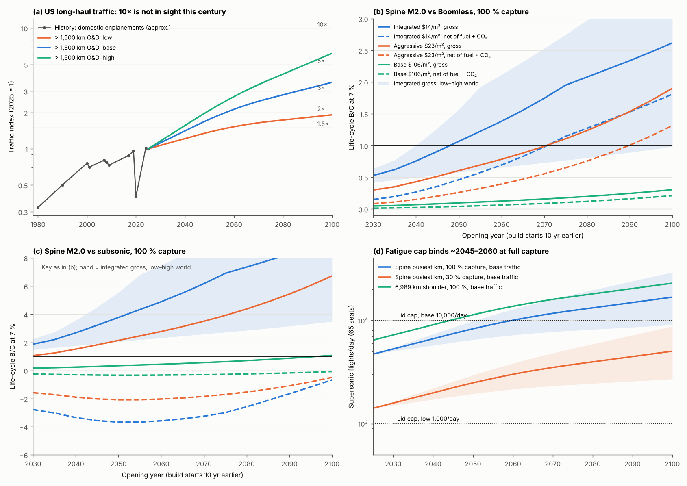

# BoomShield: traffic growth, value-of-time growth and timing

**Skyloop · 22 October 2026 · screening model.** `growth_model.py` imports [cost_model.py](../cost_model.py) read-only and reads [integration](../integration/integration.md) costs (two tether rows), [highmach](../../network-maps/highmach/highmach.md) 2025 benefits, extra fuel and CO₂, and [demand](../../network-maps/demand/demand.md) peak flights. `make_figure.py` draws `growth.png`. Web figures are unverified search summaries (`sources.csv`); [K] background knowledge, [U] assumption. With growth switched off, the model reproduces the siblings' spine B/C vs Boomless (0.040 / 0.273 / 0.496 for base / aggressive / integrated; `static_check.csv`).

## Bottom line

- **10× long-haul traffic is not in sight this century.** In the base case, US domestic trips > 1,500 km reach **1.5× in ~2043, 2× in ~2057 and 3× in ~2086**. 10× comes only ~2190 (high case ~2125). Even premium long-haul, growing 1.5 pp faster, reaches 10× only ~2100.
- **Delay helps, slowly.** Traffic growth plus value-of-time growth raise the life-cycle B/C about **3.5 % for each year the opening slips**.
  - **Gross vs Boomless** (spine, integrated $14/m², 100 % capture): 0.62 for a 2035 opening, **0.91 for 2045, 1.07 for 2050**.
  - **Net of fuel and CO₂:** 0.20 → 0.36 → 0.46. It reaches 1 only for a **~2075 opening** (~2055 in the high world).
  - **At 30 % capture** nothing passes before ~2090.
  - **Base cost ($106/m²)** never passes.
- **Against subsonic, growth makes the carbon problem worse.** Gross B/C is already 2–4 at integrated cost. Net is **−3 to −3.7** under central fuel and carbon prices, and turns positive only with cheap fuel and a low carbon price.
- **Growth brings the lid fatigue cap back.** At 100 % capture the spine reaches **10,000 flights/day by ~2060** (shoulder ~2045). The low cap of 1,000/day already binds. By 2050, LAX would need ~2,000 supersonic movements a day, more than all its movements today.
- **Timing comes from events, not traffic.** Re-run the study when the FAA final rule and Boomless Cruise status are known and Overture's real economics exist, around **2029–2031**. A pilot gate falls around 2038, and the earliest defensible spine opening is **~2055**.

*(a) Traffic index. (b, c) Life-cycle B/C by opening year: solid gross, dashed net of fuel + CO₂, band low–high world. (d) Busiest-km flights/day vs lid caps.*

## 1. Traffic projections

**Table 1. Forecasts**

| Source | Scope | Growth, %/yr |
|---|---|---|
| FAA Aerospace Forecast FY2026–46 (G1) | US domestic enplanements / RPMs | **2.4 / 2.7** (RPMs: pessimistic 1.9, optimistic ~3.0) |
| FAA FY2019–39 (G2) | US domestic RPMs | 1.9 |
| Boeing CMO 2025 (G3) | North America traffic / world RPK | **2.8** / 4.2 |
| Embraer 2025 (G4) | North America / world RPK | 2.4 / 3.9 |
| Airbus GMF 2025 (G5) | World passenger traffic | 3.6 (no North America domestic figure in the summary) |
| IATA 20-year forecast (G6) | World passengers (2× by 2043) | 3.6 (North America "moderate") |
| CBO long-term outlook (G22) | US real GDP | 2.1 → 1.4 by 2055; population growth slowing |

**Table 2. History, US domestic** (G7–G9, [K]; bases differ slightly)

| Period | Enplanements | RPMs | Shock |
|---|---|---|---|
| 1980–2000 | ~4.3 %/yr (275 → 640 M) | ~4.5 %/yr | — |
| 2000–2019 | **~1.3 %/yr** (640 → 811 M) | **~2.4 %/yr** (BTS 2003–17) | 2001: −7 %, 3–4 yr to recover; 2008–09: −9 %, ~6 yr |
| 2019–2025 | ~0.7 %/yr (811 → 845 M) | — | 2020: ~−58 % (April −96 %); ~4 yr |
| 1980–2025 | ~2.5 %/yr | ~3.3 %/yr | — |

**History.** RPMs outgrew enplanements by ~1 pp/yr (longer stages, more nonstops; G10), so long-haul O&D tracks RPMs. Forecasts leave out shocks, each of which cost 3–6 years of growth, so the FAA rates carry a ~0.4 pp haircut here.

**Scenarios** (`traffic_multiples.csv`). Rates hold to 2045, then taper linearly to a mature rate by 2075:
- **> 1,500 km:** low 1.3 → 0.5 %, **base 2.3 → 1.2 %**, high 3.0 → 2.0 %.
- **> 2,500 km:** +0.3 pp (trip-length creep).
- **Premium:** +1.5 pp. In 2025 Delta's premium revenue rose 7 % and United's 11 % while main cabin fell (G16).

**Table 3. Year US long-haul traffic reaches each multiple of 2025**

| Segment · case | 1.5× | 2× | 3× | 5× | 10× |
|---|---|---|---|---|---|
| > 1,500 km · low | 2059 | 2110 | 2191 | 2293 | > 2400 |
| > 1,500 km · **base** | **2043** | **2057** | **2086** | **2129** | **2187** |
| > 1,500 km · high | 2039 | 2049 | 2065 | 2090 | 2125 |
| > 2,500 km · base / high | 2041 / 2038 | 2053 / 2047 | 2074 / 2061 | 2109 / 2082 | 2155 / 2112 |
| Premium > 1,500 km · base / high | 2036 / 2035 | 2044 / 2041 | 2055 / 2051 | 2072 / 2063 | 2098 / 2083 |
| Constant 2 % / 3 % / 4 % (years from 2025) | 20 / 14 / 10 | 35 / 23 / 18 | 56 / 37 / 28 | 81 / 54 / 41 | **116 / 78 / 59** |

**Value of time.** DOT guidance raises VTTS with real income from CBO projections (G11; exact rate not fetched). European practice uses an income elasticity of 0.5–1.0 (G12), and real income per head grows ~1.0–1.5 %/yr (G22). **Rates used: +0.5 / 1.0 / 1.5 %/yr**, so base VOT is ×1.37 at the mid-life of a 2045 opening.

**Fuel and CO₂** (`trajectories.csv`). All-in cost per kg of extra fuel, 2025 → 2050:
- **Benign:** $0.96 → $0.90. Brent $47 (G15); SC-CO₂ $51 → 75/t; 10 % SAF.
- **Central:** **$1.43 → $1.91**. Fossil jet $0.80 → 0.95/kg (Brent $91); EPA SC-CO₂ $200 → 308/t (G13); SAF 50 % by 2050 at $2.0 → 1.6/kg (G14) with a 70 % life-cycle cut; fleet efficiency +0.8 %/yr.
- **Stringent:** $1.87 → $2.59. Brent $155; SC-CO₂ $340 → 480/t; ReFuelEU-like SAF shares.
- The federal SC-CO₂ was withdrawn in 2025 (G13): "benign" is current US policy, not the social-cost view.

## 2. ROI over time

**Method.**
- **Costs:** capex is spread over a 10-year build (15 years for the 5,400–7,000 km networks); opex less dual-use runs for 25 years. Exogenous cost learning is 0 / 1 / 2 %/yr after 2030, floored at $1.48 M/km/yr.
- **Benefits:** the 2025 benefit, fuel and CO₂, scaled by traffic, VOT, a 5-year ramp-up (50 → 100 %) and the lid cap.
- **"World"** moves traffic and VOT together. 7 % discount; base demand; full grid in `roi_grid.csv`.
- **Calibration:** interest during construction and the ramp-up cut the zero-growth integrated spine from the siblings' annualised 0.50 to 0.32.

**Table 4. Spine M2.0, base world, central energy: B/C gross / net of fuel + CO₂** (`roi_headline.csv`)

| Cost | Opening | vs Boomless, 30 % | vs Boomless, 100 % | vs subsonic, 30 % | vs subsonic, 100 % |
|---|---|---|---|---|---|
| Base $106/m² | 2035 / 2045 / 2050 | 0.02 / 0.03 / 0.03 (net ≤ 0.01) | 0.06 / 0.08 / 0.10 (net ≤ 0.04) | 0.06–0.11 / −0.1 | 0.20–0.34 / −0.3 |
| Aggressive $23/m² | 2035 | 0.11 / 0.03 | 0.35 / 0.11 | 0.37 / −0.51 | 1.25 / −1.71 |
| | 2045 | 0.16 / 0.06 | 0.52 / 0.20 | 0.56 / −0.62 | 1.82 / −2.02 |
| | 2050 | 0.19 / 0.08 | 0.60 / 0.26 | 0.67 / −0.65 | 2.14 / −2.08 |
| **Integrated $14/m²** | 2035 | 0.19 / 0.06 | 0.62 / 0.20 | 0.66 / −0.91 | 2.20 / −3.02 |
| | 2040 | 0.23 / 0.08 | 0.76 / 0.27 | 0.81 / −1.01 | 2.68 / −3.34 |
| | 2045 | 0.28 / 0.11 | **0.91 / 0.36** | 0.99 / −1.09 | 3.22 / −3.56 |
| | 2050 | 0.34 / 0.15 | **1.07 / 0.46** | 1.19 / −1.14 | 3.78 / −3.68 |
| M2.2 aircraft, integrated | 2035 / 2050 | 0.34 / 0.04 · 0.56 / 0.16 | 1.13 / 0.15 · 1.67 / 0.46 | 1.05 / −1.5 · 1.72 / −1.7 | 3.5 / −4.9 · 5.2 / −5.2 |
| 6,989 km shoulder, integrated | 2035 / 2050 | 0.12 / 0.03 · 0.21 / 0.09 | 0.37 / 0.10 · 0.53 / 0.22 | 0.37 / −0.47 · 0.66 / −0.57 | 1.16 / −1.48 · 1.67 / −1.50 |

**NPV (2026 $) and IRR**, spine, integrated, 100 % capture, vs Boomless: a 2035 opening gives gross −$28 B / 4.1 %, net −$60 B / −1.8 %; a 2050 opening gives gross **+$1.5 B / 7.4 %**, net −$12 B / 2.4 %. Vs subsonic, gross IRR is 12–17 % but net NPV is −$108 to −$299 B. Base cost: −$230 to −$800 B.

**Reading it.**
- **M2.2 lifts gross B/C ~1.6× but nets out the same as M2.0** (its extra fuel eats the gain). The shoulder never beats the spine.
- **Sensitivities at a 2045 opening** (vs Boomless, gross / net; `sensitivities_2045.csv`):

  | Case | Gross | Net |
  |---|---|---|
  | Central | 0.91 | 0.36 |
  | Discount rate 3 % | 1.73 | 0.71 |
  | Low / high world | 0.60 / 1.15 | 0.17 / 0.55 |
  | Benign / stringent energy | 0.91 | 0.66 / 0.11 |
  | High induced demand | 1.43 | 0.33 |
  | Integrated-plausible cost ($17.6/m²) | 0.54 | 0.21 |
  | Fatigue cap 1,000/day | 0.11 | — |
  | 30 % capture with premium-led drift | 0.44 | — |

**Caps and airports** (`caps_vs_time.csv`).

| Network · capture | Flights/day, 2025 → 2050 (base) | Year reaching 10,000/day: low / base / high |
|---|---|---|
| Spine · 100 % | 4,700 → 8,300 | 2121 / **2060** / 2051 |
| Spine · 30 % | 1,400 → 2,500 | — / 2158 / 2107 |
| Shoulder · 100 % | 6,400 → 11,300 | 2063 / **2045** / 2040 |

- **The cap is reached within an asset life at 100 % capture.** In (b) it shows as the kink near 2075. A 100-seat aircraft would cut flights by 35 % and defer the cap by two to three decades.
- **Airports are the tighter limit.** At 100 % capture LAX alone would see ~2,000 supersonic movements a day in 2050 (65 seats), against ~1,700 movements of all kinds today [K]. The FAA expects 14 runway-constrained airports by 2033 (G23).
- **So realistic capture is nearer 30 % unless the aircraft grows.** At 30 %, every M2.0 B/C vs Boomless stays below 0.35 through a 2050 opening.

## 3. Timing and triggers

**Table 5. First opening year with B/C ≥ 1** (spine M2.0, base demand, central energy; low / base / high world; "—" = not by 2100; `crossing_years.csv`)

| Cost · capture | vs Boomless, gross | vs Boomless, net | vs subsonic, gross | vs subsonic, net |
|---|---|---|---|---|
| Integrated · 100 % | — / **2050** / 2040 | — / **2075** / 2055 | already | — / — / 2085 |
| Integrated · 30 % | — / 2090 / 2065 | — / — / 2075 | 2100 / 2050 / 2040 | — / — / 2090 |
| Aggressive · 100 % | — / 2075 / 2055 | — / 2090 / 2065 | 2045 / already / already | — / — / 2085 |
| Base · any | — | — | — | — |
| M2.2, integrated · 100 % | 2050 / 2035 / 2030 | — / 2075 / 2055 | already | — / — / 2090 |

**Reading Table 5.** Gross vs Boomless reaches 1 for a ~2050 opening, but only with integrated cost and 100 % capture. Net of fuel and carbon it takes ~2075, unless the world is high or energy cheap. Traffic moves B/C ~3.5 %/yr; the binary events below move it 2–4× at once, so they should set the timing.

**Table 6. Triggers that justify re-running the study toward a pilot**

| # | Trigger | Status, Oct 2026 | Gate value | Expected |
|---|---|---|---|---|
| T1 | **FAA final rule; Boomless Cruise legal and operational status** | NPRM 2 Jul 2026, comments closed 17 Aug; §91.817 ban stands (G17) | Final rule text; Boomless availability (% of days a cut-off Mach exists on the spine). If Boomless is ruled out, the comparator becomes subsonic (gross ×3–4) | 2027–28 |
| T2 | **Overture in service, with real economics** | First flight slipped to 2027; EIS ~2029–30 (G18, G19) | Fares ≤ 1.5× business, fuel per seat-km, dispatch reliability, achieved capture | 2030–32 |
| T3 | **Civil adaptive-cycle engine** | NGAP integration ~2030; civil derivative late 2030s–2040s (highmach) | Launch of a ≤ 50 t M2.0–2.2 airliner | 2035–40 |
| T4 | **Film and fibre costs at scale** | Quotes not yet sought; China controls UHMWPE exports (integration) | Filled sheet ≤ $0.8/kg; rope ≤ $10/kg; 217 K coupons to 10⁸ cycles; ≤ $20/m² all-in | 2028–31 |
| T5 | **Stratospheric station-keeping** | 336-day drift (Aerostar 2025, claimed); 12-day / 88 h station-keeping (Sceye 2026) (G20) | A moored or held km-scale structure at ≥ 18 km for ≥ 1 yr | 2032–37 |
| T6 | **Hydrogen economy** | Electrolytic $5–7/kg; DOE target $1/kg by 2031 (G21) | ≤ $2/kg delivered, plus a regulatory precedent for large H₂ envelopes (safety matters more than price: H₂ is < 4 % of capex) | 2031–35 |
| T7 | **Fuel and carbon regime** | Federal SC-CO₂ withdrawn (G13); SAF 2–5× jet (G14) | SAF ≤ $1.5/kg, or a stable carbon price. Sets the sign of net B/C vs subsonic | 2030s |
| T8 | **Traffic** | 2025 base | Long-haul ≥ 1.3× 2025 | ~2037 (base) |

**Table 7. Staged plan** ([U] costs)

| Stage | Dates | Content | Cost | Gate to proceed |
|---|---|---|---|---|
| 0. Desk studies | 2026–29 | STATUS next steps 1–8: regulatory baseline, endogenous capture, emissions incl. non-CO₂, 3-D runs, aero-structure; **full re-run in 2029–31** | $1–3 M | **G-A (~2029):** T1 resolved. If Boomless is legal and reliable, the case rests on net B/C vs Boomless, so pause to ~2035 unless T4 is strong |
| 1. Lab acoustics and materials | 2029–33 | Ballistic-range / shock-tube tests of an H₂ layer under a lid; 217 K fatigue coupons; supplier pilot lines | $10–40 M | **G-B (~2032):** measured ΔdB and psf within 3 dB of boomsim; T4 met; T2 shows fares and capture |
| 2. Subscale tethered demonstrator | 2033–38 | One 250 m × ~0.5–1.5 km module, first moored low, then at 18–20 km for a year; boom fly-under by a supersonic jet | $0.3–1 B | **G-C (~2038):** ≥ 95 % availability through a year; bay-uplift and fire tests; T3 and T5 met; traffic ≥ 1.3× |
| 3. On-ramp pilot segment | 2039–45 | 100–200 km at Denver (acceleration apron plus the first DEN–OMA km); revenue overflights | $3–8 B at $14–25/m² | **G-D (~2045):** measured cost ≤ $20/m², net B/C ≥ 1 on re-run → spine decision; **opening ~2055** |

Openings in 2035–40 would start construction before any pilot exists. **The earliest defensible opening is ~2055**: base-world B/C ~1.2 gross, ~0.6 net vs Boomless.

## 4. First mover

The sibling global-corridor study (`network-maps/global/`) held only its `evidence.csv` when this was written, so no corridor ranking is cited. One growth point applies to it. China's domestic market (~640 M trips in 2024, its G1) is already US-sized and growing about twice as fast as the US (Airbus/Boeing world 3.6–4.2 % vs North America 2.4–2.8 %). There, delay would raise B/C by perhaps ~6 %/yr rather than ~3.5 % [U]. If the global study finds a dense overland corridor in a fast-growing market with no Boomless option, that corridor, not the US spine, is the better first mover.

## Caveats

Inherited: the siblings' benefits, exogenous capture and 65-seat aircraft. Benefits scale with national long-haul traffic, not per pair. The cap is applied on the busiest km, with Boomless-comparator loads. Non-CO₂ effects and H₂ leakage are not counted and would lower every net figure. Pre-2003 history is approximate. No real-options value is computed.
