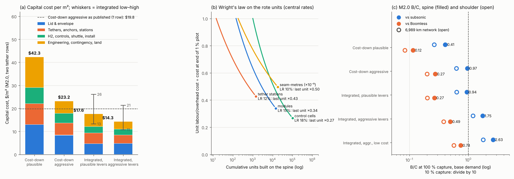

# BoomShield: vertical integration of the main cost drivers

**Skyloop · 22 October 2026 · screening level.** `integration.py` imports [cost_model.py](../cost_model.py) and [cost_down.py](../cost-down/cost_down.py) read-only. It replaces cost-down's lever 2 (bought materials and manufacturing) with owned plants plus Wright's-law learning, and keeps the other levers at plausible or aggressive settings. **Every row carries the second tether row**, which adds **+17–19 % capex** (M2.0: $19.8 → 23.2/m² aggressive). Plants are sized on the 3,614 km spine built in 10 years. [U] marks an engineering estimate. Web figures are unverified search summaries (`sources.csv`).

## Verdict

1. **Integration does reach $20/m², and it does so without cost-down's aggressive operating assumptions.**
   - **M2.0, two rows:** **$14.3/m²** central (range $10.7–21.4) with aggressive levers. With plausible levers it is **$17.6** ($13.2–26.1). The comparable bought costs are $23.2 and $42.3.
   - **Spine capex:** $91 B, against $147 B (aggressive, bought) and $268 B (plausible, bought).
   - **Of the $8.8/m² saved** against bought-aggressive, ~$6.2 is make-vs-buy and ~$2.6 learning.
2. **The plants need $7.1 B up front ($4.6–12.5 B), about 8 % of the spine's capex.** Against aggressive buy prices they save ~$3.5 B a year during the build, a payback of about 1.6 years ($8.4 B a year against plausible prices).
3. **Integration does not change the transport verdict.**
   - **Against subsonic,** the spine clears 1 at 100 % capture: **B/C 1.75** (base demand; the plausible-lever case gives 0.94).
   - **Against Boomless,** the best result is **0.49** (low-cost end 0.74).
   - **At 10 % capture,** every case stays ≤ 0.26.
4. **Make:** sheet and film, the module factory, UHMWPE fibre and rope, launch bases, and station kits. **Buy on long contracts:** resin, H₂, fluoropolymer, electronics, civil works.

*(a) $/m², M2.0, two rows. (b) Wright's law. (c) B/C, 100 % capture, base demand.*

## 1. Bill of materials and cost drivers

**Table 1. M2.0, $M/km with two tether rows, ranked by share of plausible capex** (`bom.csv`; quantities use the aggressive geometry)

| Line | Quantity per km | Base | Plausible (share) | Aggressive | Make / buy |
|---|---|---|---|---|---|
| Contingency | — | 61.9 | 17.1 (23 %) | 6.7 | — |
| Lid (film + filled ballast) | 7,290 t (0.30 + 3.60 kg/m²) | 26.2 | 8.4 (11 %) | 6.0 | **Make** sheet; buy resin |
| Winch/tension stations | 0.40 | 16.7 | 7.5 (10 %) | 4.0 | **Make** kit; buy drives |
| Launch and installation | 4 modules | 10.5 | 6.1 (8 %) | 3.5 | **Make** (own bases) |
| Engineering / PM | — | 20.6 | 6.1 (8 %) | 2.5 | Own team |
| Seams and fabrication | 507 km of seam | 10.5 | 5.3 (7 %) | 2.6 | **Make** |
| Tethers (UHMWPE) | 147 t (bare: 370) | 11.1 | 4.9 (7 %) | 2.2 | **Make** fibre and braid |
| Load tapes (UHMWPE) | 175 t | 5.3 | 3.9 (5 %) | 2.6 | **Make** |
| Anchors | 0.40 sites | 4.4 | 3.5 (5 %) | 3.1 | Buy civil works, standard design |
| UV skin | 1.75 km² | 3.5 | 2.6 (4 %) | 1.8 | Make film; buy resin |
| H₂ first fill | 650 t | 3.6 | 2.6 (4 %) | 1.6 | **Buy** (BOO contract) |
| Controls, shuttle, partitions, floor, ties, land | — | 11.7 | 6.2 (8 %) | 3.9 | Design in-house; EMS/buy |
| **Total** | | **186** | **74** | **41** | |

**Spine totals over the 10-year build:**
- **Polymer:** 26 Mt of lid, or 12.1 Mt of PE (1.2 Mt/yr), plus 13.6 Mt of CaCO₃.
- **UHMWPE:** 1.16 Mt, or 116 kt/yr: **about the whole world's fibre capacity** (China ~80 kt/yr [S1], rest of world ~20–40 kt [U]). With bare tethers instead of a rounded rim it is 2.0 Mt.
- **H₂:** 2.35 Mt.
- **Rote units:** 14,456 modules, 1,446 stations, 101,000 control cells, 1.83 M km of seam.

## 2. Integrated supply chain

**Table 2. Plants: M2.0 spine, aggressive levers, central (low–high)** (`plants.csv`)

| Plant | Capacity | Capex $M | Integrated unit cost | Buy: plausible / aggressive | Margin vs aggressive buy, $M/yr | Payback, yr | After the build |
|---|---|---|---|---|---|---|---|
| PE resin: ethane-indexed offtake | 1.21 Mt/yr | 0 (owned cracker: 5,400) | $0.80/kg (0.70–0.95) | spot $0.85–0.95 | (inside film and sheet) | — | Owned cracker full cost **$0.91/kg**: no edge |
| 21 blown-film lines, 2 t/h, 18–24 m | 286 kt/yr | 252 (152–504) | $1.13/kg (0.94–1.54) | 2.5 / 1.8 | 192 | 1.1 | Skins, arms; then sell |
| 82 filled-sheet lines, 4 t/h, in-line compounding and lamination | 2.27 Mt/yr | 1,230 (650–2,400) | $0.60/kg (0.46–0.86) | 1.2 / 0.8 | 465 | 1.9 | ~1/3 load (30-yr life) |
| UV skin casting (fluoropolymer bought) | 632 M m²/yr | 45 | $0.55/m² (0.35–0.90) | 1.5 / 1.0 | 285 | 0.2 | **Full**: re-skin every 8–10 yr |
| UHMWPE gel-spun fibre + braiding/UD tape | 116 kt/yr | 2,620 (1,690–4,370) | fibre $8.2, rope $9.4/kg (6.1–16.1) | 22 / 15 | 648 | 2.6 | ~1/4 load; else stranded |
| H₂: build-own-operate SMR contract | 235 kt/yr | 0 (own SMR: 820) | $2.1/kg delivered (1.5–2.8) | 4.0 / 2.5 | (94) | — | Make-up 3–6 %/yr |
| Module factory, 6 lines (seams, lay-up, ties, fold) | 1,446 modules/yr | 700 (450–1,100) | $0.52/m² (0.28–1.04) | 3.0 / 1.5 | 622 | 1.0 | Spares, arms; ~1/3 load |
| 12 launch bases, tugs, zip robots | 14 modules per window day | 2,140 (1,500–3,800) | $0.79/m² (0.50–1.49) | 3.5 / 2.0 | 768 | 2.0 | Maintenance depots |
| Station-kit factory (winch, brake, H₂ skid) | 145/yr | 150 (80–250) | $6.1 M (4.3–9.3) | 15 / 10 | 560 | 0.3 | Spares; mooring winches |
| **Total owned plants** | | **7,140 (4,570–12,470)** | | | **3,540** | **~1.6** | |

**Resin: contract, don't build.**
- A 1.2 Mt/yr cracker and PE plant costs ~$5.4 B ([S5, S6]: $8.5 B for 2 Mt/yr; Monaca $6–10 B for 1.6 Mt/yr). With ethylene cash cost at ~$0.31/kg [S17], its full cost is $0.91/kg: no better than spot.
- An ethane-indexed offtake (~$0.80/kg) captures the spread without overrun risk. The demand is ~1 % of world PE.

**Film and sheet: make.**
- Wide agricultural film lines run 2.1 t/h at 18.5 m [S7]. The ballast ply is a 2.3 mm sheet, 60 % CaCO₃ (~$120/t [S20]), compounded in-line, with the structural ply laminated onto it at the die.
- Owned conversion (capital, 15 FTE per line, energy) adds only $0.15–0.30/kg; merchant sheet adds margin and freight on top.

**UHMWPE fibre: make, because there is no market to buy from.**
- **Why the fibre is expensive [K]:** it is spun from a 5–10 % gel in mineral oil or decalin, the solvent is extracted and recovered, and drawing is 30–100× in hot stages. Lines are small (~0.3–1 kt/yr), know-how sits with Avient/DSM (Dyneema), Solstice/Honeywell (Spectra) and Toyobo [S2, S27], and the market is small ($1–2 B/yr [S4]).
- **Capacities:**
  - **Chinese projects are kt-scale:** Tongyizhong RMB 198 M for 2.4 kt/yr; Youfu RMB 150 M for 1.6 kt/yr [S8, S9]. That is ~$12 k per t/yr.
  - **Largest approved:** Baotou COSCO, 10 kt [S3].
  - **Western leaders:** no capacity is published. Dyneema has six plants [S27]; Solstice has a >$220 M expansion [S2].
- **What the plant costs:** at $20 k per t/yr (a US build, ~1.6× China), 116 kt/yr costs $2.6 B, and fibre comes out at $8.2/kg against Chinese merchant fibre at roughly $9–12 [U]. Tongyizhong reported a 37.5 % gross margin [S16].
- **Why not import:** China has controlled UHMWPE fibre exports since July 2024 [S26].
- **Braiding:** the 24 km, 221 t ropes are braided next to the launch bases.

**H₂: buy.**
- First fill is <4 % of capex. An owned SMR ($0.8 B) saves ≤ $0.1 B a year; electrolysis (~2.4 GW at $2,300/kW [S21]) costs ~$3–4/kg.

**Module factory: the core competence.**
- 250 m halls weld 9 m laminated web, floor, skin and partitions (0.29 m of seam per m²), then fit ties, fold and leak-test: ~4 modules a day with ~1,000 FTE.
- Seaming is not the bottleneck (~40–60 automated heads); handling and QA are. Analogue: blade plants cost $50–180 M for 600–1,800 blades a year with 220–800 staff [S23].

**Launch bases and stations.**
- **Launch bases:** 12, each with three 40 ha inflation pads, an H₂ manifold, tugs and joining robots ($170 M each).
- **Stations:** a standard unstaffed kit; the $9 M pilot unit learns on 70 % of its cost, giving **$6.1 M**, against $10–15 M bought.

## 3. Learning

**Table 3. Wright's law over the spine, from the end of a 1 % pilot** (`learning.csv`)

| Unit | Count | Learning rate, central (range) | Cumulative average ÷ pilot | Analogue |
|---|---|---|---|---|
| Modules (fabrication labour, launch crews) | 14,456 | 15 % (10–20) | 0.44 | Aircraft ~20 % (Wright 1936); aerospace 15 %, shipbuilding 15–20 % [S12]; Liberty ships cut labour hours >50 % [S15] |
| Seam-metres | 1.83 × 10⁹ | 10 % (7–15) | 0.58 | Mature welding [U] |
| Tether stations (70 % learnable) | 1,446 | 12 % (8–15) | 0.52 | Wind: 7–14 % installed, 14–29 % manufacturing [S14] |
| Control cells (80 % learnable) | 101,000 | 18 % (12–22) | 0.37 | PV modules ~20 % (studies 10–53 %) [S13] |
| Anchors (50 % learnable) | 1,446 | 8 % | 0.65 | Construction [U] |

**Without learning** (pilot-rate costs throughout), integrated M2.0 costs $17.0/m² instead of $14.3/m².

## 4. Results

**Table 4. Cost, two tether rows** (`results.csv`; net = annualised capex at 7 %/25 yr + opex − dual-use)

| Design · case | $/m² | $M/km | Opex $M/km/yr | Net $M/km/yr | Spine $B |
|---|---|---|---|---|---|
| M2.0 base | 106.3 | 186 | 11.3 | 27.3 | 672 |
| M2.0 cost-down plausible | 42.3 | 74 | 3.2 | 9.6 | 268 |
| M2.0 cost-down aggressive (1 row: 19.8) | 23.2 | 41 | 1.4 | 4.0 | 147 |
| **M2.0 integrated, plausible levers** | **17.6** (13.2–26.1) | 31 | 1.5 | **4.1** | 111 |
| **M2.0 integrated, aggressive levers** | **14.3** (10.7–21.4) | 25 | 0.9 | **2.2** (1.5–3.7) | **91** |
| M2.0 integrated, aggressive, bare tethers | 17.9 | 31 | 1.1 | 3.0 | 113 |
| M1.7 cost-down aggressive | 19.4 | 29 | 1.1 | 2.8 | 105 |
| **M1.7 integrated, aggressive levers** | **11.8** (8.9–17.6) | 18 | 0.7 | **1.5** (1.0–2.5) | 64 |

**Table 5. B/C, joint_costdown convention** (`bcr.csv`; 10 % / 100 % capture; demand scenario as named)

| Network · cost | Demand | vs Boomless | vs subsonic |
|---|---|---|---|
| Spine M2.0 · cost-down aggressive + 2nd row | fixed / base | 0.026 / 0.26 · 0.027 / 0.27 | 0.092 / **0.92** · 0.097 / **0.97** |
| Spine M2.0 · integrated, plausible levers | base | 0.027 / 0.27 | 0.094 / 0.94 |
| **Spine M2.0 · integrated, aggressive levers** | fixed / base | 0.046 / 0.46 · 0.050 / **0.49** | 0.17 / 1.68 · 0.18 / **1.75** |
| Spine M2.0 · integrated, low cost | base | 0.074 / 0.74 | 0.26 / 2.63 |
| 5,421 km · integrated, aggressive | base | 0.042 / 0.42 | 0.14 / 1.43 |
| 6,989 km · integrated, aggressive | base | 0.036 / 0.36 | 0.11 / 1.12 |
| Spine M1.7 · integrated, aggressive | base | 0.051 / 0.51 | 0.24 / 2.40 |
| Higher-Mach aircraft (network-maps/highmach/) | — | *hook: no B/C table yet* | *rescale by net cost* |

**What the B/C table shows:**
- **The second tether row puts cost-down's aggressive case back below 1 against subsonic** (0.92–0.97). Integration restores it to 1.7–1.8, and the network arms keep it above 1 (1.1–1.4).
- **Against Boomless, break-even needs ≤ $1.10 M/km/yr net** (base demand). Even the low-cost integrated case ($1.48) misses that.
- **Highmach hook:** the sibling has no B/C table yet. Combined row = its spine B/C at base cost × 23.34 / integrated net; `highmach_hook()` flags a table when one appears.

## 5. Risks and what not to integrate

**Execution.**
- **Seven first-of-a-kind plants at once,** including a fibre plant the size of the world industry. Cracker-style overruns (Monaca: $6 B → up to $10 B) are the high case: $12.5 B, and $21/m².
- **The build rate is coupled to the plants.** A slipping plant stalls launches, because film sets the pace (operations).
- **Integration creates common-mode defects.** One faulty sheet or seam recipe reaches 14,000 modules, so 217 K coupon qualification before scale-up is essential.

**Demand after the build.**
- **Network arms:** extending to 6,989 km keeps every plant full for another ~9 years.
- **Replacement load after that:**
  - the skin plant stays full (8–10-year re-skins);
  - sheet, film, factory and launch run at ~1/3 load (30-year bulk life);
  - fibre runs at ~1/4 load (25-year tethers).
- **No outside market can absorb the surplus:**
  - 2.3 Mt/yr of sheet is ~40 % of world agricultural film;
  - 116 kt/yr of fibre doubles world supply.
- **Salvage is therefore only 5–30 %.**

**Market and antitrust reaction.**
- **As a buyer of PE, CaCO₃ and H₂,** the project is too small to matter.
- **In fibre it is a giant entrant:** expect withheld licences or price cuts to defer the build; China's export licensing rules out imports. Selling surplus invites dumping complaints.
- **The real antitrust issue is downstream.** If the shield owner is affiliated with an airline or airframer, open-access rules and regulated transfer prices for its in-house supply are likely.

**What NOT to integrate:**

| Item | Why not |
|---|---|
| Resin (the cracker) | A $5.4 B commodity plant with no cost edge; use an ethane-indexed offtake |
| H₂ production | Immaterial cost; electrolysis is dearer |
| Fluoropolymer and UHMWPE resins | Specialty chemistry; take long contracts or a JV for 25–30 % of world UHMWPE resin |
| Chips, drives, gearboxes | Design to cost and buy |
| Cement and anchor civil works | Local framework contracts |
| CaCO₃ | Quarry contract |
| Insurance | Captive (cost-down) |

## Sources

Ids [S1]–[S27] refer to `sources.csv` (search summaries with URLs, all unverified). [K] = background knowledge.
