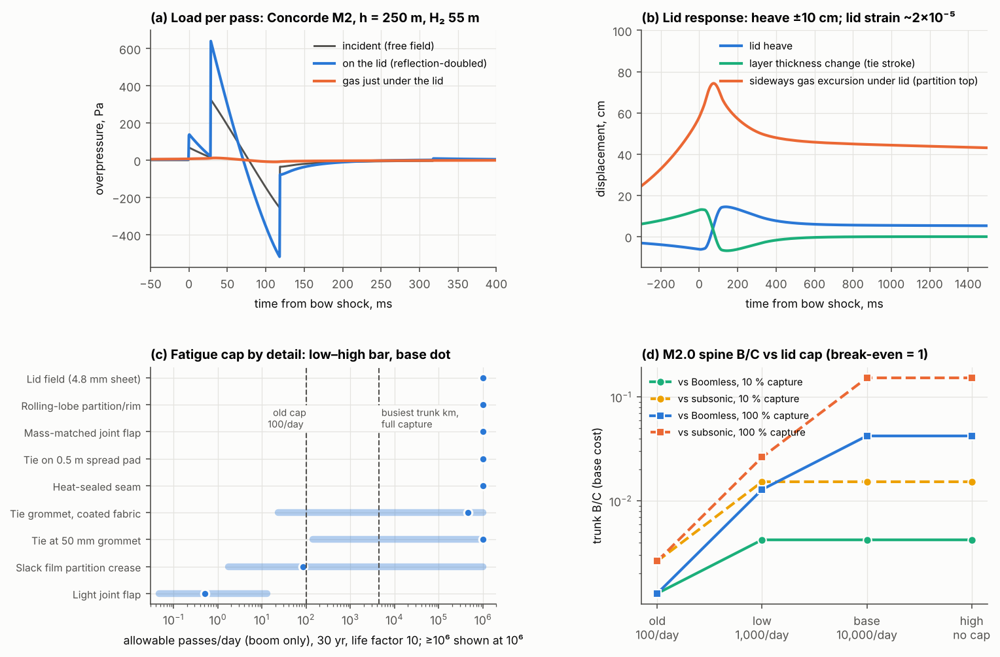

# BoomShield: lid fatigue under repeated boom loading

**Skyloop · 22 October 2026 · screening check.** This tests the ~100 flights/day "lid fatigue cap" in [economics](../economics/economics.md) §2 and §4, which [trunk](../network-maps/trunk/trunk.md) applied. Scripts `lid_response.py`, `lid_fatigue.py`, `trunk_bcr_revised.py` and `make_figure.py` write the CSVs and figure here. Literature rests on search summaries only ([notes](sources_notes.md)). **[K]** marks handbook-class values from background knowledge.

## Verdict

1. **The cap is not a property of the lid.** A floating lid of 2.3–4.5 kg/m² is mass-controlled. It carries the doubled boom (300–650 Pa) by inertia, heaving 0.1–0.2 m. The travelling pattern bends it so gently (curvature ~4 × 10⁻⁴ m⁻¹) that its strain is **~1–6 × 10⁻⁵**, about **40–200× below** a cold PE endurance strain (~0.1–0.5 %). Even at 10⁷ passes the sheet itself does not fatigue.
2. **The cap is real only at bad details**, and those details fail from weather anyway:
   - **light joint flaps:** ~0.05–90 passes/day (base ~1);
   - **slack thin-film partition creases:** ~1–1,100/day from booms alone, and they fail from daily breathing and gravity waves even with no traffic;
   - **ties on small grommets in film or coated fabric:** ~20–140/day, low case.
   The old "10⁵–10⁶ cycles" number describes these details, not the lid.
3. **A fatigue-aware design** has every detail at ≥ 10⁶ passes/day computed: mass-matched flaps, ties on spread pads, rolling-lobe partitions and rim, and a UV top skin.
   - **Revised cap: low 1,000, base 10,000, high none (traffic-limited).**
4. **Economics:**
   - **At the base cap** the trunk returns to its uncapped B/C: **0.042 vs Boomless and 0.15 vs subsonic at 100 % capture** (M2.0), against 1.3 × 10⁻³ when capped.
   - **At the low cap** it is 0.013 / 0.026.
   - **Fatigue was a false binding constraint.** Removing it still leaves the trunk ~25× short of break-even.

## 1. Load and response per pass

The incident waveforms are the undertrack signals at the 20 km shield plane, cached by `run_psf_sweep.py` (nonlinear propagation from the near field, h = 250 m). They drive the 1-D floating-lid transfer matrix (`boomsim.shield`) with ties K = 10 Pa/m and a 0.1 kg/m² floor. Strains assume a travelling pattern w(x − Vt): slope v/V and curvature a/V². Membrane strain is taken as ½·slope², an upper bound for a lid that cannot slide in-plane.

**Table 1. Per pass, undertrack** (Concorde M2 light lid in brackets)

| | Overture M1.7, H₂ 36 m, lid 2.9 | Concorde M2, H₂ 55 m, lid 4.5 (2.3) |
|---|---|---|
| Incident peak + / −, duration | 159 / −123 Pa, 0.12 s | 328 / −255 Pa, 0.12 s |
| On lid (reflection-doubled) | 307 / −253 Pa | 648 / −518 Pa |
| Gas pressure under lid | 5 Pa | 12 (19) Pa: **the lid carries the load inertially** |
| Lid heave, peak-to-peak | 0.11 m | 0.21 (0.32) m |
| Thickness change (tie stroke) | 0.11 m | 0.20 (0.31) m |
| Tie force swing, 10 m pitch | 106 N | 200 (310) N |
| Sideways gas excursion at partition tops | 0.16 m (0.4 m incl. slow swell) | 0.31 m (0.75) |
| Slope; curvature | 0.004; 4 × 10⁻⁴ m⁻¹ | 0.005 (0.009); 4 (8) × 10⁻⁴ m⁻¹ |
| Lid strain (membrane + bending) | 0.9 × 10⁻⁵ | 1.6 (4.1) × 10⁻⁵ |
| Stress at E = 1–3 GPa (217 K) | 9–27 kPa | 16–47 (41–123) kPa |

**Local details.**
- **Seams** take K_t 2–4; **ties** put the force swing on a 50 mm grommet (K_t 3) or 0.5 m pad (K_t 2); **partition creases** strain t/2R in 50 µm film (R = 2/10/50 mm).
- **Light flaps:** a 0.5 kg/m² flap over a 1 m gap cannot follow the lid's inertia and sags ~0.4 m per pass, folding its hinge.
- **Tethers** see < 0.1 % of 26 MN: the layer passes the boom (T(0) = 1).
- Stress-derived strains are multiplied by **3 / 1.5 / 1** (low / base / high) for omitted 3-D effects: edge diffraction, ramp focusing, slack-taut snatch, heavier aircraft.

**Weather vs booms** (`cycle_census.csv`).

| Source | Cycles/yr | What it loads |
|---|---|---|
| Booms, 100 / 4,400 flights/day | 3.7 × 10⁴ / 1.6 × 10⁶ | Lid inertia; 0.1–0.3 m tie/partition strokes |
| Diurnal breathing | 365 | **~5 m strokes**: partitions, ties, rim fold fully |
| Gravity and mountain waves (4–60 min) | 10⁴–5 × 10⁴ (est.) | 0.1–0.5 m strokes |
| Gusts (5–22 Pa over km) | 10⁵–10⁶ | Negligible lid strain; tethers |
| Synoptic wind (0.5–2 kN/m) | 50–100 | Tethers, rim tendons |

Booms bring the most cycles, weather the largest strokes.

## 2. Materials

Each material gets one strain-life line at 217 K: a 10⁷-cycle strain ε_e [K], reduced for cold (k_T) and for end-of-life UV/ozone (k_age), joined to a fold anchor from flex data. Below ε_e there is no hard endurance limit (N ∝ ε⁻¹⁰), which is conservative because PE has one [S8].

| Material | ε_e at 23 °C | Fold anchor | −56 °C knock-down | Evidence |
|---|---|---|---|---|
| LLDPE balloon film | 0.5 % | 20 % at 3 × 10³ | 0.35–1.0 | Gelbo pinholes 10³–10⁴; brittle near −60 to −90 °C [S2, S9] |
| PE/PET laminate | 0.5 % | 20 % at 3 × 10² | 0.5–1.0 | PET has no endurance limit and poor flex; UV −50 % [S8, S12] |
| UHMWPE scrim | 1.0 % | 10 % at 3 × 10⁴ | 0.8–1.0 | Good tension fatigue; creep is the limit [S7] |
| Vectran | 0.8 % | 10 % at 10⁵ | 0.8–1.0 | 115 k fold cycles vs 1.4–15 k for aramid; crease ×100: −0.8 % [S11] |
| Aramid | 0.8 % | 10 % at 3 × 10³ | 0.8–1.0 | Kink bands: crease ×100 −23 %; UV-poor [S10, S11] |
| PU/PVF-coated polyester | 0.4 % | 10 % at 10⁴ | 0.25–0.8 | TARS envelopes 5–6 yr at ground; PU stiffens near −50 °C [S4] |

- **Creep** is set by static loads (face ~0.2 kN/m; ≤ 2.7 kN per tie from breathing) and slows in the cold.
- **UV:** unprotected PE lasts weeks to months at 20 km [K]; a PVF/PVDF or metallised top skin is mandatory [S4], its 5–20 yr life already priced in economics.md.
- **Ozone** cracks strained natural rubber: silicone or fluoroelastomer tie springs [S14].

**Precedents.** ETFE cushions claim ≥ 50 yr, creep-limited [S5]; PTFE/glass has run 29+ yr at the Hajj Terminal, failing at cold-installation creases [S6]; sails die by flogging [S10]; stratospheric balloons last days to ~100 days, failing at seals and pinholes [S13]. None sees ~10⁷ cycles at ~10⁻⁵ strain, far gentler than wind on a tensile roof [K].

## 3. Allowed traffic (30 yr, life factor 10, Miner sum with weather)

**Table 2. Passes/day by detail, Concorde M2, lid 4.5 kg/m²** (low / base / high; ≥ 10⁶ means fatigue does not limit)

| Detail | Booms only | With weather |
|---|---|---|
| Lid field, seams, mass-matched flaps, spread-pad ties, rolling lobes | ≥ 10⁶ (coated-fabric seam, low case: 1.6 × 10⁵) | same |
| Tie on 50 mm grommet, PE/PET (coated fabric) | 140 (23) / ≥ 10⁶ / ≥ 10⁶ | **0** in the low case: breathing alone |
| Slack-film partition crease, LLDPE (PE/PET) | 1.7 (0.8) / 85 (1,100) / ≥ 10⁶ | **0 / 0** / ≥ 10⁶: breathing and gravity waves alone |
| Light joint flap | 0.05–2 / 0.5–8 / 8–90 | same |

The light lid (2.3 kg/m²) raises strains ~3×. A coated-fabric seam then drops to 70/day in the low case, and a grommet to 6–60/day.

**Revised cap**

| Case | Cap | Basis |
|---|---|---|
| **Low** | **1,000/day** | Fatigue-aware design, but one untested moving-crease detail survives at base severity in PE/PET (~1,100/day) |
| **Base** | **10,000/day** | Design C computes ≥ 10⁶; a 100× model-risk discount remains above the busiest km (4,400/day at M2, 6,900 at M3.2) |
| **High** | none | Lid strains 40–200× below cold endurance; in-trail separation binds first |

**Design features that raise the cap:**
- **Mass-matched joint flaps and hatches.** The lid is inertia-loaded, so any lighter patch flaps.
- **Load-spreading pads (≥ 0.3–0.5 m) at ties,** sized for the static breathing load, which is 13–25× the boom swing.
- **Pre-formed rolling-lobe partitions and rim,** with bend radius ≥ 0.2–0.5 m as on air springs, so no slack film creases.
- **Bonded multi-ply lids.** Unbonded thin plies would wrinkle independently.
- **Silicone tie springs; a replaceable UV top skin;** UHMWPE or Vectran scrim, not aramid.

**If the cap stays low** (designs A/B): partitions sit inside the gas, and at 4,400/day slack-film partitions would need replacing every **0.6–7 yr** (light flaps every ~1 day): impractical. Inspection would use lid-crawling robots, H₂ leak sensing per 250 m compartment and witness coupons pulled yearly, at ≤ ⅓ of demonstrated crack-initiation life. **Next step:** 217 K coupon tests of a seam, a tie pad and a lobe hinge to 10⁸ cycles (1–2 months at 20–50 Hz).

## 4. Economics

The cap is applied to build_trunk's cached segment loads; its uncapped and 100/day values reproduce exactly.

**Table 3. Greedy spine B/C (base cost), vs Boomless / vs subsonic**

| Mach | Cap | 10 % capture | 100 % capture |
|---|---|---|---|
| 1.7 | old 100 | 0.0014 / 0.0032 | 0.0014 / 0.0032 |
| 1.7 | low 1,000 | 0.0039 / 0.018 | 0.014 / 0.032 |
| 1.7 | base 10,000 or none | 0.0039 / 0.018 | **0.039 / 0.18** |
| 2.0 | old 100 | 0.0013 / 0.0026 | 0.0013 / 0.0026 |
| 2.0 | low 1,000 | 0.0042 / 0.015 | 0.013 / 0.026 |
| 2.0 | base 10,000 or none | 0.0042 / 0.015 | **0.042 / 0.15** |
| 2.5 / 3.2 | base or none | 0.0046 / 0.0045 vs BL | 0.046 / 0.045 vs BL |

At 10 % capture even the low cap does not bind; the busiest km carries 440 flights/day.

For a competently detailed lid, **fatigue is a detail-design and test requirement, not a traffic cap.** economics.md and trunk.md keep their verdicts for other reasons (cost per m², minutes saved). **Correction for both:** replace "lid fatigue cap ~100/day" with "fatigue-aware details required; cap ≥ 10⁴/day (base)".
