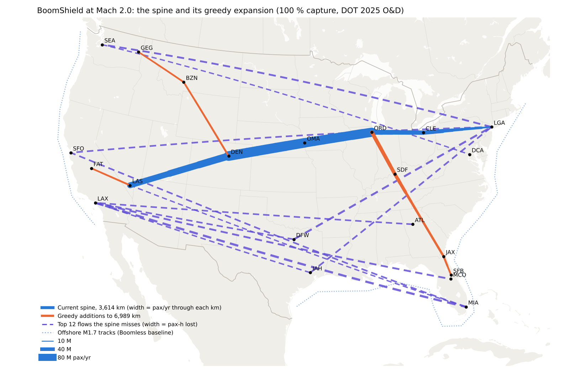
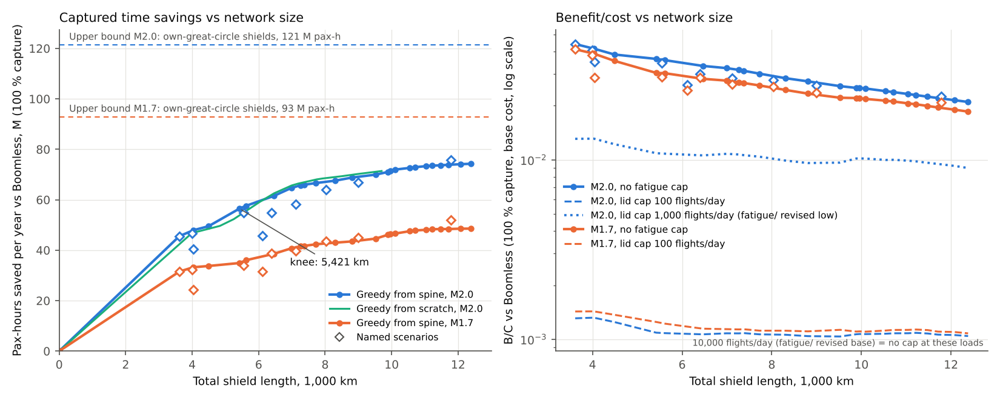

# BoomShield coverage: how much long-haul traffic does the trunk address?

**Skyloop · 22 October 2026 · screening model.** `build_coverage.py` writes the CSVs here and `figures/`. It imports the time model and routing from [trunk](../trunk/trunk.md) / [routes](../routes/routes.md), costs from [economics](../../economics/economics.md) and lid caps from [fatigue](../../fatigue/).

## Bottom line

- **Total traffic.** US domestic air travel is **~650 M one-way O&D trips/yr** (600–700 M). That is T-100's 845 M 2025 enplanements ÷ 1.2–1.4 enplanements per trip.
  - **> 1,500 km:** 53 % of trips (~350 M) and 75 % of passenger-km.
  - **> 2,500 km:** 21 % of trips (~140 M) and 41 % of pax-km.
  - **> 3,500 km:** 9 % of trips (~57 M) and 19 % of pax-km.
- **Addressable traffic** (a shield on the pair's own great circle saves ≥ 10 min against Boomless, including M1.7 offshore): at **M2.0, 217 M pax/yr**, 578 bn pax-km and **122 M pax-h/yr**; at M1.7, 196 M pax and 93 M pax-h. All trips over 2,500 km qualify; none under ~1,600 km.
- **The spine captures about 37 %.** At M2.0 it carries 81 M pax/yr: 38 % of addressable pax, 46 % of pax-km and **37 % of pax-h** (34 % at M1.7; 52 % vs subsonic).
- **76 M pax-h/yr are left on the table, almost all in the south.**
  - **Not captured at all:** Florida–West, Texas–Northeast, Texas–California, LAX/SFO–Florida/Atlanta.
  - **18–20 % captured:** Pacific NW–East, Southeast–West.
  - **Northeast–Florida** (35 M pax) is not addressable: Boomless already flies M1.7 offshore.
- **Every addition lowers B/C, so the best network is the spine itself.**
  - **Spine:** B/C **0.044** at M2.0 (0.041 at M1.7) with 100 % capture, base cost and no fatigue cap; 0.0044 at 10 % capture.
  - **Shoulder:** the curve's knee sits at **5,400–7,000 km** (spine + Florida, Pacific Northwest and California arms). That network captures 53 % at B/C 0.032.
  - **Flattening:** the curve levels off at ~61 % by 12,400 km (B/C 0.021).
- **Fatigue caps:**
  - **100 flights/day:** B/C is ~0.001 at any size.
  - **1,000/day** (fatigue study, revised low): 0.013 for the spine, falling to 0.009.
  - **10,000/day** (revised base): never binds, since peak loads are 4,500–6,400 flights/day at 100 % capture.

## 1. Demand: real O&D data

BTS, DOT and Kaggle are blocked here, but anonymous GitHub clones work.

- **DOT Consumer Airfare Report Table 1** (top 1,000 contiguous-US city-pair markets, DB1B scaled to 100 %, one-way trips/day both directions) comes from a mirror, `Kaichung862/mist6380_project`, extracted to `dot_table1_2024_2025.csv`.
  - **2025:** 1,157 markets, **377.8 M trips**, cutoff ~221 pax/day.
  - **Check:** DEN–PHX O&D is 1.2 M against ~2.4 M T-100 segment pax, a plausible local share.
- **BTS T-100 Domestic Segment totals** come from a public repo's report (`vaibhavsoni85-spec/…`): **856.4 M (2024), 845.2 M (2025)**. Top segments: LAX–JFK 2.9 M, ORD–LGA 2.8 M.
- **Gravity fill** covers pairs below the cutoff among the 128 markets: a log-linear model (city effects + distance bands) fitted to Table 1, rms log error 0.49, capped at the cutoff. It adds **129 M trips**.

**Table 1. US domestic O&D by great-circle distance, 2025**

| Band | Trips, located 128 markets (Table 1 + fill), M | National estimate, M (×650/507) | Share of trips | pax-km, bn | Share of pax-km |
|---|---|---|---|---|---|
| All | 507 (378 + 129) | **650** (600–700) | 100 % | 889 | 100 % |
| > 1,500 km | 270 (201 + 69) | **347** | 53 % | 667 | 75 % |
| > 2,500 km | 109 (80 + 29) | **140** | 21 % | 363 | 41 % |
| > 3,500 km | 44 (34 + 10) | **57** | 9 % | 172 | 19 % |

**Uncertainty.**

- **Measured share:** Table 1 pairs carry 73 % of addressable pax-h; fill pairs are ±50 %.
- **National total:** depends on enplanements per trip **[U]**. DOT's text ("top 1,000 = 47 % of domestic passengers") would imply ~800 M, which conflicts with 845 M enplanements. Transborder, Hawaii and Alaska are excluded.
- **trunk.md's gravity model ran high:** **1.22× overall, 1.33× above 2,500 km** (`gravity_vs_dot.csv`). Spine users barely change (81 M vs 79 M) because the real matrix has 128 markets, not 57.

## 2. Addressable traffic

**Time model:** as trunk.md (0.23 / 0.46 m/s² ramps, M0.85/M1.15 feeders, 5 min merge, ≥ 10 min cut). **Baseline:** Boomless gets the faster of

- the M1.15 great circle;
- Boomless feeders onto **offshore M1.7 tracks** at least 45 km from the coast (Atlantic, Florida Straits + Gulf, Pacific).

This removes 28 M long-haul pax at M2.0 (NYC–South Florida: 134 → 124 min, equal to a shield).

**Table 2. Addressable traffic** (own-great-circle shield, ≥ 10 min saving)

| | M1.7 | M2.0 |
|---|---|---|
| Pairs / pax, M/yr | 3,783 / **196** | 4,067 / **217** |
| pax-km, bn | 542 | 578 |
| pax-h saved vs Boomless, M/yr (mean min) | **93** (28.5) | **122** (33.6) |
| Same, offshore credit ignored | 99 | 130 |
| vs subsonic: pax, M / pax-h, M | 355 / 287 | 355 / 315 |
| Long-haul (> 1,500 km) not addressable: ramp overhead / offshore | 52 / 23 M pax | 25 / 28 M pax |

## 3. What the spine captures

**Table 3. Spine coverage** (3,614 km, 100 % capture)

| | M1.7 | M2.0 |
|---|---|---|
| Pax captured, M (share of addressable) | 67 (34 %) | **81 (38 %)** |
| Share of addressable pax-km | 41 % | 46 % |
| pax-h vs Boomless, M (share of upper bound) | 31.5 (34 %) | **45.6 (37 %)** |
| pax-h vs subsonic, M (share) | 149 (52 %) | 165 (52 %) |
| Busiest km (OMA–DEN), M pax/yr | 67 | 80 |

**Why flows are missed (M2.0, 76 M pax-h lost):**

- **Detour, 28 M.** Feeder + trunk + feeder is more than 1.15× the great circle. These are the south-west to south-east flows.
- **Crossing, 27 M.** The flow crosses the spine, so it can only ride ~100–500 km of shield, too short to accelerate. These are Texas–West, Texas–Northeast and SEA–South.
- **Partial capture, 18 M.** Users are captured, but their feeders are long. NYC–SFO saves 53 min instead of 67.
- **Off-axis feeders, 4 M.**

**Table 4. Biggest uncaptured flows** (M2.0; saving in min; lost = upper bound − spine, M pax-h/yr)

| Pair | km | M pax/yr | Own shield / spine | Lost | Why |
|---|---|---|---|---|---|
| LAX–South Florida | 3,763 | 1.31 | 48 / 0 | **1.05** | Detour 20 % |
| DFW–NYC | 2,231 | 2.27 | 24 / 0 | 0.92 | Detour 17 % |
| LAX–Orlando | 3,562 | 1.06 | 47 / 0 | 0.83 | Detour 19 % |
| NYC–SEA | 3,872 | 1.17 | 61 / 18.5 | 0.83 | Partial: SEA feeder to LAS/DEN |
| HOU–NYC | 2,276 | 1.74 | 25 / 0 | 0.74 | Crossing |
| NYC–SFO | 4,141 | 3.10 | 67 / 53 | 0.72 | Partial |
| SFO–South Florida | 4,154 | 0.73 | 59 / 0 | 0.72 | Detour |
| DFW–LAX | 1,983 | 2.22 | 19 / 0 | 0.70 | Crossing |
| ATL–LAX | 3,126 | 1.22 | 44 / 10 | 0.69 | Partial |
| SEA–South Florida | 4,380 | 0.41 | 72 / 0 | 0.49 | Crossing |
| SEA–ATL | 3,505 | 0.45 | 53 / 0 | 0.40 | Crossing |
| SFO–BOS | 4,341 | 1.23 | 72 / 55 | 0.34 | Partial |
| LAX–BOS | 4,193 | 1.31 | 68 / 62 | 0.14 | 90 % captured |

**Table 5. Flow groups** (M2.0)

| Group | M pax/yr | Upper bound, M pax-h | Spine share |
|---|---|---|---|
| California–Northeast | 17.7 | 18.9 | **85 %** |
| California–Midwest | 10.7 | 6.8 | 72 % |
| Florida–West (FL × CA/NV/AZ/CO/UT/PNW) | 16.4 | **12.9** | **0 %** |
| Pacific NW–East | 8.1 | 8.1 | 18 % |
| Southeast–West | 10.9 | 7.9 | 20 % |
| Texas–Northeast | 12.5 | 5.2 | 0 % |
| Texas–California | 9.6 | 3.6 | 0 % |
| Northeast–Florida | 35.4 | 0 | n/a (offshore) |

## 4. Network expansions and the coverage curve

**Two searches were run:**

- **Greedy from the spine.** It runs on a Delaunay graph of 104 metros plus 74 inland Steiner points and adds, at each step, the path to the metro with the most pax-h per added km (`coverage_curve.csv`).
- **Greedy from scratch.** It re-finds the spine as LAX–LAS–DEN–DSM–CLE–NYC (3,991 km, B/C 0.041), so **the spine is the right core.**

Named scenarios are in `scenarios.csv`. All B/C values below are vs Boomless at 100 % capture and base cost. Costs are $23.3 M/km/yr at M2.0 and $17.3 M/km/yr at M1.7. Value of time is $86/h × 95 %.

**Table 6. Networks at M2.0** (B/C at M1.7 in brackets)

| Network | km | pax-h, M (share of upper bound) | B/C, no cap | Cap 1,000/day | Cap 100/day | vs subsonic |
|---|---|---|---|---|---|---|
| **Spine** | 3,614 | 45.6 (37 %) | **0.044** (0.041) | 0.013 | 0.0013 | 0.16 |
| Spine + LAS–LAX | 3,994 | 46.6 (38 %) | 0.041 | 0.013 | 0.0013 | 0.15 |
| South only LAX–PHX–DFW–ATL–WAS | 4,043 | 40.4 (33 %) | 0.035 (0.029) | 0.010 | 0.0010 | 0.15 |
| Spine + CHI–ATL–MCO–MIA | 5,550 | 54.8 (45 %) | 0.035 | 0.010 | 0.0010 | 0.12 |
| Greedy knee: + LAS–Fresno, CHI–Louisville–JAX–Orlando | 5,421 | 56.5 (47 %) | 0.037 (0.031) | 0.011 | 0.0011 | 0.12 |
| Spine + north SEA–MSP–CHI | 6,396 | 54.9 (45 %) | 0.030 | 0.013 | 0.0013 | 0.10 |
| Spine + east coast BOS–NYC–WAS–CLT–ATL–MIA | 6,113 | 45.8 (38 %) | 0.026 | 0.008 | 0.0009 | 0.11 |
| **Greedy shoulder** (+ DEN–Bozeman–Spokane) | **6,989** | **64.7 (53 %)** | **0.032** (0.028) | 0.011 | 0.0011 | 0.10 |
| X at Denver (+ SEA–SLC–DEN–DFW–HOU) | 7,121 | 58.1 (48 %) | 0.029 | 0.011 | 0.0011 | 0.09 |
| Two-spine (+ LAX–PHX–DFW–ATL–WAS) | 8,036 | 64.0 (53 %) | 0.028 | 0.012 | 0.0012 | 0.09 |
| Greedy + Gulf arm DEN–DFW–MSY–TLH | 10,100 | 72.0 (59 %) | 0.025 | 0.010 | 0.0011 | 0.08 |
| X + north + south + ATL–MIA | 11,780 | 75.8 (62 %) | 0.023 | 0.011 | 0.0012 | 0.07 |
| Greedy, last step | 12,380 | 74.3 (61 %) | 0.021 (0.019) | 0.009 | 0.0010 | 0.06 |

**The knee.**

- **No addition beats the spine per km:** 12,500 pax-h/km on average, against 4,800 for the best addition (LAS–Fresno). trunk.md's 0.5× rule stops at the spine.
- **Arms only raise coverage.** Arms keeping ≥ 0.3× the spine's average end at **~7,000 km** (53 % of the upper bound); a direct knee fit gives 5,400 km.
- **Past 10,000 km each km adds < 2,000 pax-h.** The network never passes ~62 % of the upper bound, because diagonal and crossing flows need their own corridors.
- **Arms carry 18–43 M pax/yr**, mostly feeding the core: OMA–DEN rises from 80 M to 110 M.
- **Mach 2.0 beats Mach 1.7** at every size (B/C ×1.07–1.2).

## Caveats

- **Demand:** below-cutoff pairs are modelled; small cities excluded; capture linear, not fare-driven.
- **Offshore tracks.** They are author waypoints, and Bahamas overflight is ignored.
- **Greedy search** is myopic, uses 10 ramp points per metro (final evaluations 40; ≤ 4 % effect), and adds metro paths, not true Steiner trees.
- **Not modelled.** Winds, merge sequencing, and induced demand.
