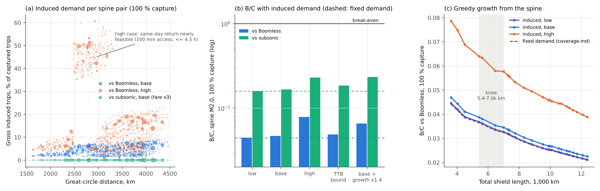

# BoomShield induced demand: does faster travel close the gap?

**Skyloop · 22 October 2026 · screening model.** `build_demand.py` writes the CSVs here and `figures/induced_demand.png`. It re-uses the [coverage](../coverage/coverage.md) demand matrix (DOT 2025 Table 1 + gravity fill), its Boomless and subsonic baselines, and its network evaluator, plus the [trunk](../trunk/trunk.md) and [routes](../routes/routes.md) time model and [cost_model.py](../../economics/cost_model.py) ($86/h × 95 %; $23.3 M/km/yr at M2.0). Literature rests on search summaries only and is **unverified**; **[K]** marks background knowledge (`evidence.csv`).

## Bottom line

- **Induced demand is real but small here, because the shield's time cut is small.**
  - Against Boomless, the shield cuts door to door by 9–16 % (NYC–LAX 6.3 → 5.3 h); the fare does not change.
  - Base case: the spine induces **+4.8 % trips** (3.9 M gross, **2.3 M net new**/yr). Range: +1.9 % (low) to +21 % (high).
  - B/C vs Boomless goes **0.044 → 0.047** (base), 0.045–0.079 across the range.
- **The rule of half caps it.** Induced trips are worth at most half the saving each, so B/C scales as ≈ 1 + ½ × traffic growth. Closing a 25× gap would need traffic to grow ~50×; HSR's best case is ~1.4–1.7×.
- **Day returns, not elasticity, drive the high case.** Coast to coast stays at **5.3–5.5 h door to door**, above any day-return threshold. Day returns open only for 2,400–3,300 km pairs (DEN–NYC, CHI–LAX), and only with ~100 min airport overhead.
- **The fare premium kills induced demand against subsonic.** At Boom's business-class pricing (×3), no traveller with a plausible value of time gains. Only ~10 % would switch even at ×1.5 (`fare_premium_capture.csv`), so **100 % capture vs subsonic implies fare parity**.
- **The knee does not move.** The uplift is flat across network sizes (base 1.063–1.073, high 1.76–1.85). The spine stays the B/C maximum, and the 5,400–7,000 km shoulder gains no ground.
- **The side effects are larger than the benefit.**
  - **Carbon:** the CO₂ from induced trips costs ~6× their consumer surplus.
  - **Fatigue cap:** peak load stays under the 10,000/day cap (6,600/day with growth on the spine, 9,000 on the shoulder).
  - **Airports:** LAX and SFO would need +35–45 % movements.

## 1. Evidence base

| Strand | Finding | Used as |
|---|---|---|
| Fare elasticities: InterVISTAS/IATA 2007; Brons et al. 2002 meta (mean −1.15, business −0.8); Gillen et al. 2003 (254 estimates; business and long-haul less elastic) | Route −1.4 vs national −0.8 [K]: ~40 % of a route response is diversion from other routes | Route-level GC elasticity −0.8 / **−1.3** / −2.0 (fare elasticity ÷ fare share of GC 0.5–0.7); net-new share 0.5 / **0.6** / 0.75 |
| Time elasticities: Wardman 2012 (427 UK estimates); Norway domestic air (fare −0.69 short run, −1.63 long run); US city-pair work | Time elasticities grow with distance; HSR ≈ conventional | Implied time elasticity −0.25 to −1.0 (ε_GC × time share of GC 0.3–0.5) |
| HSR: Paris–Lyon (rail 40→72 %, air 31→7 %; ~49 % induced [K]); Madrid–Seville (air 40→13 %; ~26 % induced [K]); Tokaido (14.5 % of trips induced); King 1996 (≤ 35 %); China (+35 % bilateral trips per direct link; +60 % Chengdu–Chongqing incl. mode shift) | 15–50 % of new HSR traffic is induced, from **40–60 % time cuts** | Calibration: a 38 % door-to-door cut on Paris–Lyon gives +23 / +40 / +67 % corridor traffic in the model (time share of GC 0.6), or 26 / 40 / 56 % of TGV traffic induced. That matches. |
| Concorde; business jets | ~100 seats, fares 1.2–2× first class, ~50 % load factor; bizjet users cite "save time" first | The premium tail is real but **< 1 %** of the market |
| Thresholds: Leeds ITS (rail–air 3 h threshold); Tokaido day trips | Step changes near 3–4 h | Day-return and after-work-arrival credits, below |
| Travel-time budget: Zahavi/Marchetti 1.1–1.3 h/day; Schafer & Victor (8–15 % money budget); contested by Italian GPS data | Saved time is re-spent on distance | Upper bound: trips ∝ 1/door-to-door time, all net new |

## 2. Model

- **Generalised cost per trip:** GC = fare + $86/h × (block + O). Fare = DOT Table 1 average ($235 pax-weighted; fill pairs fitted 51.3·km^0.21). Supersonic fare = φ × that.
- **Captured share** c (10 % / 100 %, exogenous as in coverage.md) gets the trunk's block time. Gross route response = c·Q₀[(GC₁/GC₀)^ε − 1]; a share n of it is net new, and the rest is diverted from uncaptured pairs.
- **Benefit:**
  - existing captured pax-h (coverage.md metric, unchanged);
  - threshold credits;
  - ½ × gross response × ΔGC. The rule of half on the route demand curve stays correct under diversion, because the losing pairs' GC is unchanged.
- **Thresholds**, per direction, with time zones:
  - **Day return:** leave home 06:00, home by 23:00. Each leg must be ≤ D_max, with ≥ W hours inside 08:30–18:00 at the destination.
  - **After-work arrival:** leave 17:30, reach the destination door by 00:30 local.
  - A newly feasible direction earns a GC credit (d_day / d_eve per trip).

| | ε_GC | Net share n | Fare φ | Overhead O | D_max / W | d_day / d_eve |
|---|---|---|---|---|---|---|
| Low | −0.8 | 0.50 | 5× | 150 min | 3.5 h / 6 h | $0 / $0 |
| **Base** | **−1.3** | **0.60** | **3×** | **130 min** | **4.0 h / 5 h** | **$60 / $20** |
| High | −2.0 | 0.75 | 1.5× | 100 min | 4.5 h / 4 h | $100 / $30 |
| TTB bound | trips ∝ 1/T | 1.0 | — | 130 min | as base | as base |

## 3. Results (spine, M2.0)

**Table 1. Scenarios** (B/C at base cost, no fatigue cap; pax-h-equivalent = benefit ÷ $86/h)

| Scenario | Induced trips, gross / net, M/yr (% of captured) | pax-h-eq., M/yr | B/C vs Boomless, 10 % / 100 % | vs subsonic, 10 % / 100 % |
|---|---|---|---|---|
| Fixed demand (coverage.md) | — | 45.6 | 0.0044 / 0.044 | 0.016 / 0.159 |
| Low | 1.5 / 0.8 (1.9 %) | 46.1 | 0.0045 / 0.045 | 0.016 / 0.159 |
| **Base** | **3.9 / 2.3 (4.8 %)** | **48.6** | **0.0047 / 0.047** | **0.017 / 0.167** |
| High | 16.8 / 12.6 (21 %) | 81.2 | 0.0079 / 0.079 | 0.023 / 0.231 |
| TTB bound | 8.9 / 8.9 (11 %) | 50.3 | 0.0049 / 0.049 | 0.018 / 0.185 |
| Base + growth ×1.4 (life-average, [U]) | 5.4 / 3.3 | 68.0 | 0.0066 / 0.066 | 0.023 / 0.233 |

- **What the uplift is made of (base):** induced consumer surplus 2.7 %, threshold credits 3.5 %. All of the credits are after-work arrivals (7.3 M pax/yr); no spine pair gains a day return.
- **High case:** 20.5 M pax/yr gain a day return. Credits make up 31 % of benefit and induced surplus 13 %.
- **Against subsonic:** only the high case (φ = 1.5) induces anything, +4 %. The travel-time-budget bound gives +16 %.
- **M1.7** behaves alike: 0.041 → 0.044 (base), 0.069 (high).

**Table 2. Busiest segments, M pax/yr at 100 % capture** (`segment_flows.csv`)

| Segment | Fixed | Base | High | Base + growth |
|---|---|---|---|---|
| OMA–DEN (spine) | 80.1 | 83.9 | 96.8 | 117.5 |
| ORD–OMA | 77.3 | 81.0 | 93.8 | 113.4 |
| DEN–LAS | 68.3 | 71.7 | 82.5 | 100.4 |
| OMA–DEN (6,989 km shoulder) | 109.3 | 114.6 | 132.2 | 160.4 |

**Network-wide net new trips:**

| Network | Base, M/yr | High, M/yr | Share of ~650 M domestic trips |
|---|---|---|---|
| Spine | 2.3 | 12.6 | 0.4–1.9 % |
| 6,989 km shoulder | 3.4 | 18.0 | — |
| 12,400 km network | 3.9 | 21.7 | — |

**Table 3. Network size** (B/C vs Boomless, 100 % capture; `knee_shift.csv`)

| Network | Fixed | Base | High | Uplift, base / high |
|---|---|---|---|---|
| Spine, 3,614 km | 0.044 | 0.047 | 0.079 | 1.066 / 1.78 |
| Knee, 5,421 km | 0.037 | 0.039 | 0.064 | 1.063 / 1.76 |
| Shoulder, 6,989 km | 0.032 | 0.035 | 0.058 | 1.066 / 1.78 |
| 12,381 km | 0.021 | 0.023 | 0.039 | 1.072 / 1.85 |

**The arms carry the same mix of savings, so induced demand scales every network alike.** It does not shift the knee toward 5,400–7,000 km.

## 4. Side effects

- **Lid fatigue** (peak flights/day, `flights_vs_caps.csv`):

  | Network | Fixed | Base | High | Base + growth |
  |---|---|---|---|---|
  | Spine | 4,500 | 4,700 | 5,400 | 6,600 |
  | Shoulder | 6,100 | 6,400 | 7,400 | 9,000 |

  - **Base cap (10,000/day):** the shoulder with growth reaches 90 % of it.
  - **Low cap (1,000/day):** binds 4.5–9×.
- **Airports and ATC** (base, 100 % capture, 65 seats, `airports.csv`):
  - **Peak movements:** LAX ~1,160 Overture movements/day, NYC ~1,050, SFO ~720.
  - **Net additions:** after the narrowbodies they replace, that adds ~45 % to LAX's ~1,700 movements/day [K][U], 35 % to SFO's and 20 % to NYC's. NYC and DCA are slot-controlled.
  - **Sequencing:** ~5,000 supersonic merges a day onto one shield would need dedicated sequencing.
- **Emissions (flag, rough).** Assumptions: CO₂ at 90 g/pax-km subsonic, supersonic 3/5/7× (ICCT 2018), costed at $190/t [K].
  - **Induced trips (base):** add 3.6 Mt/yr, costing **$0.69 B against $0.11 B of induced consumer surplus.** Pricing carbon into fares would remove most of the induced demand.
  - **Against subsonic:** moving 200 M trips to supersonic adds 100–300 Mt/yr, comparable to or above all of today's US domestic aviation (~130 Mt [K]). Its carbon cost is **1.4–3× the time benefit.**
  - **Not counted:** non-CO₂ effects at FL600 and H₂ leakage.

## 5. Joint scenario with cost-down

[cost-down](../../economics/cost-down/cost-down.md) now exists. `joint_costdown.csv` multiplies its spine B/C by these uplifts.

| M2.0 spine, 100 % capture | Fixed | Base | High | Base + growth |
|---|---|---|---|---|
| Base cost, vs Boomless / subsonic | 0.044 / 0.16 | 0.047 / 0.17 | 0.078 / 0.23 | 0.066 / 0.23 |
| Plausible cost (÷2.85) | 0.13 / 0.45 | 0.13 / 0.47 | 0.22 / 0.66 | 0.19 / 0.66 |
| Aggressive cost (÷7.0) | 0.31 / 1.11 | 0.33 / 1.16 | 0.55 / 1.61 | 0.46 / 1.63 |

**Results at 10 % capture are 10× lower.**

**Against Boomless, even aggressive cost plus high demand reaches only 0.55.**

**Against subsonic, B/C exceeds 1 only with aggressive costs.** That case also needs supersonic fares near parity (§3), and its carbon cost exceeds the benefit (§4).

**The sibling's own `joint_demand.csv` is stale.** It was built from this study's preliminary run (uplifts 1.41 / 1.24), which had no 4 h day-return limit. Current base uplifts are 1.066 / 1.046.

## Caveats

- **Fixed inputs:**
  - Capture is exogenous.
  - The greedy sequence is coverage.md's fixed-demand one and was not re-optimised.
  - Thresholds and credits are assumptions.
  - Time zones come from longitude bands, with no daylight saving time.
- **Demand side:**
  - Induced demand ramps up over 5–10 years, and all figures here are at maturity.
  - Wider economic benefits (often +10–30 % of user benefits in UK appraisal [K]) are excluded.
