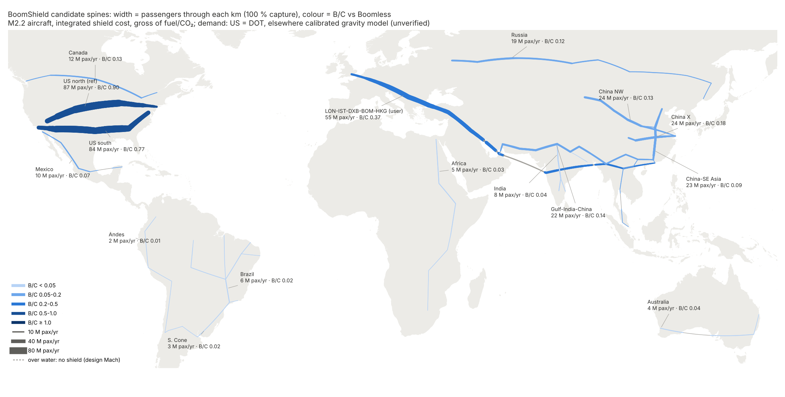

# BoomShield worldwide: other long overland spines

> **Canonical net values:** net-of-fuel/CO₂ (and integrated-cost) B/C here are superseded by [net-reconciliation](../../economics/net/net-reconciliation.md).

**Skyloop · 22 October 2026 · screening model.** `build_global.py` writes `corridors.csv`, `ranking.csv`, `greedy.csv`, `calibration.csv`, `demand_bands.csv` and `figures/global_map.png`. Sources are in `evidence.csv`. The time model and routing come from [trunk](../trunk/trunk.md). The aircraft, shield, cost and fuel conventions come from [highmach](../highmach/highmach.md): design A at M2.2 (M2.0 adaptive in the CSVs), base and integrated costs, $86/h × 0.95, and highmach's induced-demand uplift. **Web figures are unverified search summaries; [U] marks author estimates.**

## Bottom line

- **No corridor matches the US spine.** At M2.2, integrated cost and 100 % capture, LAS–DEN–OMA–CHI–CLE–NYC scores **B/C 0.90 against Boomless**, and the US southern spine 0.77. The best spine outside the US is **Europe–Gulf (LON–IST–DXB): 0.48**, or 0.57 for a greedy variant routed through Israeli and Kuwaiti airspace. That is 55–65 % of the US.
- **Your LON–IST–DXB–BOM–HKG has the most traffic but the wrong shape.**
  - It saves the most time of any corridor: 65 M pax-h/yr against Boomless (US: 58 M), 303 M against subsonic. But it needs **9,700 km of overland shield**, so B/C is 0.375.
  - Beyond Dubai it adds little: DXB–BOM is 1,730 km of Arabian Sea, crossed at design Mach without a shield, and India–Hong Kong traffic is thin.
  - Many of its trips are 5,500–9,600 km. Capped at the M2.2 jet's 5,000 km design range, B/C falls to 0.20.
- **China is the biggest domestic market, but most of it is too short.**
  - The modelled market is 470 M trips a year, but only **19 M are over 2,500 km**, against 109 M in the US (`demand_bands.csv`).
  - High-speed rail pushes the fitted distance decay to β = 0.9.
  - The best Chinese network (an X through Wuhan) scores 0.18, or 0.10 at an income-scaled value of time.
- **India, Brazil, Africa, Australia and the Andes score ≤ 0.05.**
  - Their trips are short (India's busiest pairs are 1,100–1,700 km) or thin (Perth, Manaus, Johannesburg–Nairobi).
  - The climate also works against the shield: warm ground lets Boomless Cruise run at M1.15 on 85–95 % of days.
- **Against subsonic,** the US (2.6), Europe–Gulf (2.1), China (1.8–2.8 on short spines) and India (1.2–1.9) all clear 1. **Net of fuel and CO₂ against subsonic, every corridor is negative**, as in highmach.
- **The first mover is still the US.** It is the only jurisdiction found with a draft numeric boom limit (0.11 psf) that a shield is built to meet.

## Method

**Demand.**
- **US:** coverage's DOT Table 1 matrix plus gravity fill.
- **Everywhere else,** 251 metros in four systems:
  - Old World: Europe, Africa, the Middle East, Asia, Russia (183 metros);
  - Canada;
  - Latin America (incl. Mexico);
  - Australia.
- **Domestic flows:** a gravity model per country, k·m_i·m_j·d^−β(1−e^−(d/d₀)²). Each country is fitted to its national total (China 640 M, India 161 M, Russia 84 M, Brazil 93 M, Australia 63 M passengers) and to route anchors (OAG 2024 seats; YVR–YYZ 3.5 M; JNB–CPT 3.3 M; ANAC monthly flows).
- **International flows:** a production-constrained gravity model (each metro sends its international O&D, β = 1.1 fitted). Three affinity uplifts [U]: Gulf–South Asia, Gulf–Egypt, Hong Kong–Taiwan.
- **Fit and check:** anchors land within ×0.4–2.1 (`calibration.csv`), so treat non-US corridors as **±2×**. On the US spine the same code gives 58.5 M pax-h and B/C 0.900 (highmach: 58.6 M, 0.901).

**Baselines** (same M2.2 aircraft, no shield):
- **Boomless:** M1.15 over restricted ground (Natural Earth land plus 40 km), design Mach over open-water runs. Each pair also tries one of 54 offshore waypoints, as coverage.md does.
- **Subsonic:** M0.85.
- **Range:** the nonstop cap is 7,000 km [U], Overture-class; the 5,000 km sensitivity is in `ranking.csv`.

**Spines.**
- **Hand-built:** 36 corridors (the full list in `corridors.csv`).
- **Greedy:** a trunk.md-style builder per region on a Delaunay graph of metros (`greedy.csv`).
- **Cost:** only overland km pay for shield; water gaps are free.
- **Greedy** beat the hand-built spine only in the Gulf (0.57, via Vienna–Istanbul–Antalya–Tel Aviv–Kuwait) and India (0.07, DEL–JAI–HYD–BLR); in the US it found 0.69, below the known spine.

## Ranking (M2.2; B/C against Boomless unless noted; 30 % capture = 0.3 × the 100 % value)

| # | Corridor | Overland km (water) | Busiest km, M pax/yr | pax-h saved, M/yr: vs BL / vs sub | B/C base 100 % | B/C integrated 30 % / 100 % | Integrated net of fuel + CO₂: M2.2 / M2.0 | vs subsonic, integrated | Days Boomless OK (M_c ≥ 1.15) |
|---|---|---|---|---|---|---|---|---|---|
| 1 | **US north spine** (reference) | 3,614 | 87 | 58.5 / 172 | 0.077 | 0.27 / **0.90** | 0.12 / 0.40 | 2.6 | 53 % |
| 2 | US southern LAX–PHX–DFW–ATL–WAS | 4,043 | 84 | 55.9 / 184 | 0.066 | 0.23 / 0.77 | 0.01 / 0.27 | 2.5 | 63 % |
| 3 | Europe–Levant–Gulf (greedy, via TLV–KWI) | 4,939 (973) | 58 | 50.4 / 208 | 0.048 | 0.17 / **0.57** | 0.03 / – | 2.3 | – |
| 4 | **Europe–Gulf LON–FRA–IST–(Iraq)–DXB** | 5,299 (252) | 54 | 45.6 / 200 | 0.041 | 0.14 / **0.48** | 0.04 / 0.20 | 2.1 | 55 % |
| 5 | Europe–Gulf–India …DXB–(Iran/Pakistan)–DEL | 7,717 (303) | 54 | 54.6 / 233 | 0.034 | 0.12 / 0.39 | 0.02 / 0.15 | 1.7 | 59 % |
| 6 | **LON–IST–DXB–BOM–HKG (user)** | 9,708 (2,078) | 55 | **65.5 / 303** | 0.032 | 0.11 / 0.375 | 0.03 / 0.15 | 1.7 | 66 % |
| 7 | Russia MOW–SVX–OVB | 2,838 | 19 | 9.3 / 56 | 0.016 | 0.05 / 0.18 | −0.05 / 0.04 | 1.1 | 34 % |
| 8 | China X: PEK–WUH–CAN + SHA–WUH–CTU | 3,851 | 24 | 12.4 / 129 | 0.015 | 0.05 / 0.18 | −0.11 / 0.01 | 1.8 | 68 % |
| 9 | China big H (+CTU–KMG, CTU–LHW–URC) | 6,785 | 37 | 20.3 / 149 | 0.014 | 0.05 / 0.17 | −0.08 / 0.02 | 1.2 | 62 % |
| 10 | Gulf–India–China DXB–DEL–KTM–KMG–CAN | 6,621 (50) | 22 | 16.7 / 156 | 0.012 | 0.04 / 0.14 | −0.02 / 0.04 | 1.3 | 72 % |
| 11 | Gulf–China DXB–TAS–URC–PEK | 6,986 (50) | 26 | 17.5 / 144 | 0.012 | 0.04 / 0.14 | −0.02 / 0.04 | 1.1 | 55 % |
| 12 | Europe–China via Kazakhstan | 9,571 | 25 | 23.2 / 178 | 0.012 | 0.04 / 0.135 | −0.03 / 0.03 | 1.0 | 45 % |
| 13 | Canada YVR–YYC–YWG–YYZ–YUL | 3,889 | 12 | 9.1 / 19 | 0.011 | 0.04 / 0.13 | 0.03 / 0.07 | 0.26 | 44 % |
| 14 | Trans-Siberian LON–MOW–OVB–PEK–SEL | 9,198 (399) | 23 | 20.5 / 141 | 0.011 | 0.04 / 0.12 | 0.00 / 0.04 | 0.8 | 38 % |
| 15 | China–SE Asia PEK–CAN–HAN–BKK–SIN | 4,915 (573) | 23 | 7.9 / 132 | 0.008 | 0.03 / 0.09 | −0.04 / 0.01 | 1.5 | 84 % |
| 16 | Mexico TIJ–GDL–MEX–CUN | 3,072 (604) | 10 | 4.1 / 21 | 0.006 | 0.02 / 0.07 | −0.01 / 0.03 | 0.4 | 72 % |
| 17 | Australia PER–ADL–MEL–SYD | 2,491 (971) | 7 | 2.2 / 14 | 0.004 | 0.01 / 0.05 | −0.03 / 0.00 | 0.3 | 59 % |
| 18 | India DEL–HYD–BLR/MAA + CCU | 3,546 | 8 | 2.7 / 76 | 0.004 | 0.01 / 0.04 | −0.02 / 0.01 | 1.2 | 86 % |
| 19 | Africa CAI–(Sudan)–ADD–NBO–JNB | 6,893 | 5 | 3.5 / 46 | 0.002 | 0.01 / 0.03 | −0.01 / 0.01 | 0.4 | 92 % |
| 20 | Brazil SAO–BSB + NE + Amazon | 7,760 | 6 | 3.0 / 17 | 0.002 | 0.01 / 0.02 | −0.01 / 0.00 | 0.1 | 95 % |
| 21 | S. Cone SCL–(Andes)–BUE–SAO | 3,043 | 3 | 1.0 / 9 | 0.002 | 0.01 / 0.02 | 0.00 / 0.01 | 0.2 | 64 % |
| 22 | Andes BOG–UIO–LIM–LPB–SCL | 5,019 | 2 | 0.6 / 16 | 0.001 | 0.00 / 0.01 | 0.00 / 0.00 | 0.2 | 54 % |

**Sensitivities** (integrated, 100 %; `ranking.csv`):
- **Income-scaled value of time** [U] (√ of GDP per capita relative to the US): Europe–Gulf 0.39, user's corridor 0.28, China 0.10, India 0.015.
- **5,000 km range cap:** Europe–Gulf 0.31; the US is unchanged.
- **M2.0 adaptive:** gross 15–25 % lower, but much better net of fuel and CO₂.
- **Busiest-km loads stay under the 10,000 flights/day lid cap:** 170–4,900 flights/day.

## Overwater gaps (no shield; design Mach, as Overture's M1.7 over the ocean)

| Corridor | Gaps |
|---|---|
| User's corridor | Gulf crossing 2 × 126 km; DXB–BOM 1,726 km (Arabian Sea) |
| Bay of Bengal | Avoided by routing overland via Odisha–Myanmar (one 100 km gap); the BOM–HKG great circle stays overland |
| Other corridors | Gulf of Thailand (BKK–KUL) 573 km; Great Australian Bight 970 km; Gulf of Mexico 554 km; South China Sea not on any spine |

Coastal pairs (HAN–SGN, São Paulo–Northeast Brazil, Lima–Santiago) gain little, because Boomless takes an offshore track; the inland Andes spine is worthless.

## Mach cutoff, wind and terrain

**Mach cutoff** [U, parametric]: surface temperature from latitude, season, desert and elevation; 211–217 K at 14.3 km; jets as along-track wind; M_c = (max(a+u) below − u_aircraft) / a_aircraft.

**Warm ground raises the cutoff Mach, so Boomless works best in the tropics.**
- **Days with M_c ≥ 1.15:** Brazil 95 %, Africa 92 %, India 86 %, China–SE Asia 84 %.
- **Cold, high or jet-swept routes:** US north 53 %, Canada 44 %, Russia 34–38 %.
- **Eastbound under the winter subtropical jet,** over the Middle East, northern India and China, the cutoff Mach falls below 1.1.

Re-basing on a climatological Boomless Mach (US north M1.13) lifts B/C everywhere poleward:

| Corridor | B/C (stated Boomless) | B/C (climatological Boomless) |
|---|---|---|
| US north | 0.90 | 0.96 |
| Russia | 0.18 | 0.23 |
| Europe–Gulf | 0.48 | 0.51 |

**Jet-level wind and tether drag.** Tether drag scales with u².
- **China:** the strongest exposure. The East Asian winter jet averages 50–62 m/s, giving **u² 1.8–2.1× the US spine.**
- **Australia:** 1.3× (winter subtropical jet).
- **Middle East and India:** about 1.0× in this model, with a 40–45 m/s winter subtropical-jet core near 28° N. In the tropics (southern India, SE Asia), the stratospheric quasi-biennial oscillation (±15 m/s at ~20 km) adds side load at shield level.

**Terrain.** The ground boom scales as √(p_ground)·(h − z)^−3/4, which gives **×0.97 / 0.94 / 0.91 at 1.5 / 3 / 4.5 km ground** with the shield at 20 km. So the shield altitude need not change, and tethers get 7–23 % shorter.
- **Cold high plateaus collapse Boomless:** the cutoff Mach over Tibet in winter is about 1.05–1.10, which raises the shield's relative value there.
- **Corridors on high ground:**
  - Gulf–India–China via Kathmandu touches 4.5 km;
  - China NW (Qilian) 3 km;
  - the Andes 3–3.8 km.
- **These routes carry little traffic; Himalayan or Andean tether fields are a construction and avalanche problem.**

## Regulation and politics (flags only)

| Jurisdiction | Overland boom rule found | Corridors | Politics / airspace |
|---|---|---|---|
| US | §91.817 ban; NPRM 0.11 psf, final rule targeted mid-2027 [R1] | US spines | Low |
| Canada | CARs: no flight at true Mach ≥ 1 [R2] | Canada | Low |
| UK / EU | UK CAA proposes an overland ban unless approved [R3]; no EASA rule found; Council of Europe 1972 [R4] | Europe–Gulf, user's | Iraq, Syria and Iran airspace; Israel routing |
| Gulf, Turkey | None found | Europe–Gulf | Six to ten sovereigns per spine |
| China | None found [R6] | China | Military controls most airspace; one sovereign could mandate |
| India | None found [R6] | India, user's | India–Pakistan overflight closures |
| Russia | Tu-144 flew overland 1977–78 [K1] | Russia, Trans-Siberian | Sanctions; closed to EU/US carriers |
| Australia | No text found; Concorde barred overland [R5] | Australia | Low; Nullarbor nearly unpopulated |

Every rule found (US, Canada, UK) is restrictive; none turned up for China, India or EASA. Only the FAA path defines a pass mark a shield can be engineered to meet.

**The empty-land alternative.** Over nearly empty land (Kazakh steppe, Siberia, Nullarbor, Arabian interior), a regulator could simply allow unshielded booms, which would remove the need for a shield. That option competes directly with the shield on the Asian corridors.

## Answer

- **Equal or better than the US:** none. Second tier: Europe–Gulf (0.48–0.57). Your full LON–HKG spine scores 0.375.
- **Biggest:** by time saved, LON–IST–DXB–BOM–HKG (65 M pax-h); by domestic trips carried, China's big H (64 M users), at a fifth of US value per km.
- **First mover:** the US spine, then possibly a single-sovereign Chinese X if Beijing wanted it and the comparison is against subsonic (1.8).
- **Only Europe–Gulf merits deeper study:** real O&D data (MIDT/Sabre), a longer-range aircraft, and a route choice (Iraq or Levant).

## Caveats

- **Demand** outside the US is gravity, ±2×; Europe–Russia flows are pre-sanctions shaped. **Climate** is parametric, not reanalysis; plateau elevations are coarse boxes [K].
- **Costs** are US costs everywhere; cheaper Chinese or Indian construction would lift those corridors by at most ~1.3×. Capture is linear.
