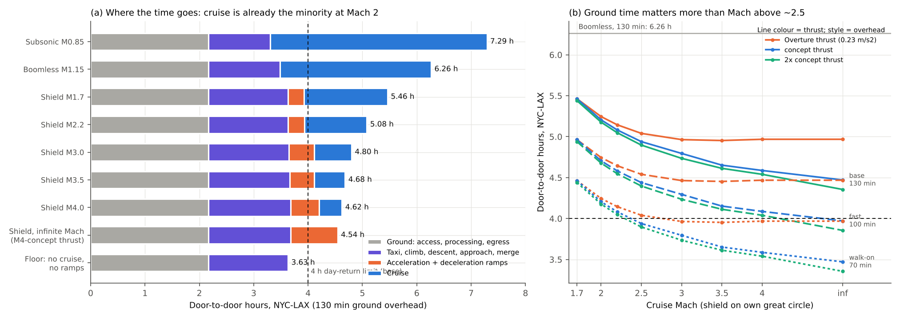
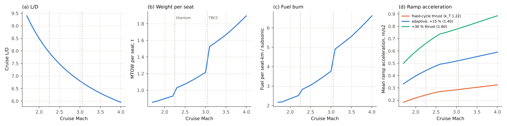
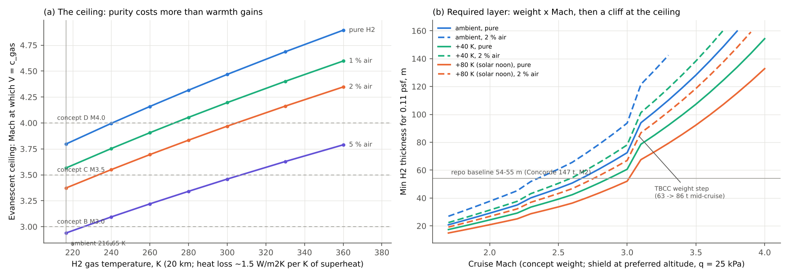
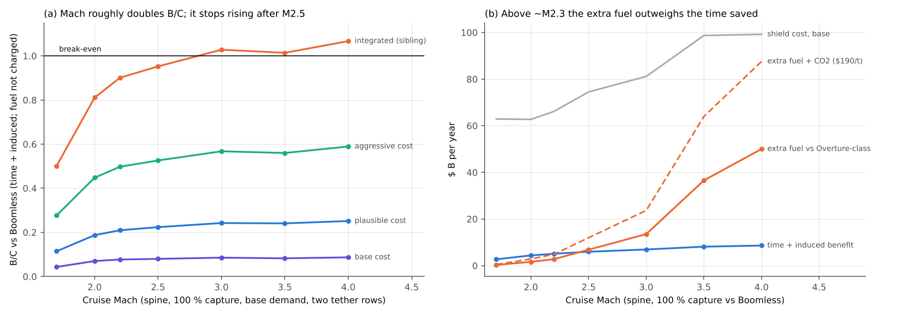

# BoomShield at higher Mach: does speed close the gap?

**Skyloop · 22 October 2026 · screening model.** Scripts: `hm_aircraft.py`, `hm_shield.py`, `hm_time.py`, `hm_network.py`, `hm_cost.py`, `summarise.py`, `walkon_check.py`, `make_figures.py`. Reuses (read-only) [trunk](../trunk/trunk.md), [coverage](../coverage/coverage.md), [demand](../demand/demand.md), [cost-down](../../economics/cost-down/cost-down.md) and psf_sweep's τ-formula. **Every cost includes the second tether row.** Web sources are unverified search summaries (`evidence.csv`, E1–E16); [U] = estimate.

## Bottom line

- **Fixed overheads, not Mach, keep the gain small.** At M2, NYC–LAX takes 5.2 h door to door, 1.3 h of it cruise; 3.6 h is fixed (130 min ground, 88 min taxi, climb, descent, approach). Infinite Mach: 4.5 h. Boomless: 6.3 h.
- **Higher Mach helps the time-only B/C, but less than other levers.**
  - **Mach.** Spine B/C against Boomless goes 0.043 (M1.7) → 0.077 (M2.2) → 0.085 (M3), then flattens.
  - **Weight and thrust.** Half the gain is a 50 t aircraft, which cuts the H₂ layer from 55 m to 29–35 m. Adaptive-cycle thrust margin doubles ramp acceleration.
  - **Integration.** With the sibling's integrated costs and 100 % capture, B/C reaches 0.90 (M2.2) and **1.03 (M3)**.
- **Above ~M2.3, extra fuel costs more than the time it buys.** Fuel per seat-km is ×1.16 (M2.2), ×1.74 (M3) and ×2.8 (M3.5) an Overture-class jet's. The value of time that breaks even net of fuel is $50/h at M2.2 and $177/h at M3, against the study's $86/h. From M2.5 up, B/C net of fuel and CO₂ is negative even with a free shield.
- **The shield works to ~M3.4–3.8, at rising cost.** The ceiling (V = c_H₂) is M3.80 for pure H₂ but **M3.37 at 98 % purity**. Warming the gas to reach M4 needs ~1,900 TWh/yr on the spine; solar superheat works only by day. Thickness: 35 m (M2.2), 73 m (M3), 128 m (M3.5).
- **Day returns need faster ground processing.** Coast to coast needs M ≥ 2.5 *and* a ~70 min walk-on overhead. That overhead lifts B/C ×1.3–1.4 at every Mach, more than M2.2 → M4 does.
- **Sweet spot: M2.0–2.2.** An aluminium, ≤ 50 t, adaptive-cycle-class aircraft; 29–35 m of H₂ at 20 km, ~1.25 km wide; fast ground processing; integrated shield costs.

## 1. Engines and aircraft

**Engines** (E1–E7).

- **What they improve.** AETP XA100/XA101 target +25 % fuel efficiency, +10–20 % thrust and ~2× heat sink. NGAP XA102/XA103 passed detailed design (Feb 2025) and assembly readiness (May 2026).
- **Supercruise runs at low bypass.** The third stream opens subsonically and closes in supercruise, leaving a turbojet-like cycle. The 25 % is a subsonic/loiter figure; a 2025 civil study finds ~3 % SFC at supersonic cruise (E5). The civil gains are thrust margin (faster ramps), take-off and subsonic efficiency, and heat rejection.
- **Timeline.** The F-47 flies in 2028 on interim engines; NGAP integrates ~2030. Hot-section and cycle data are export-controlled (USML XIX / 600-series), so a civil derivative is likely late 2030s–2040s (my inference).

**Airframes** (E8–E12).

- **Prior studies.** NASA's 2023 Mach 2–4 contracts (Boeing, Northrop teams): ~50 mostly transoceanic routes, no final results found. HSCT settled on M2–2.4; above M3.2 was judged high-risk or impractical.
- **Heat limits.** Skin is ~130 °C at M2.2 (2xxx aluminium limit 135 °C) and ~290 °C at M3.2, beyond polymer composites; titanium is needed from ~M2.4. Turbines run out near M2.5–3, so TBCC switches to ramjet at ~M2.8–3.

**Parametric model** (`aircraft_param.csv`, `concepts.csv`): L/D = 0.85 × Küchemann 4(M+3)/M; η₀ 0.40–0.475 by engine family; a 5,000 km domestic mission; sizing calibrated to Overture (65 seats, 77 t); ramp acceleration g(k_T − 1)/(L/D), where k_T = 1.22 gives the repo's 0.23 m/s².

**Table 1. Concepts** (65 seats; fuel per seat-km on NYC–LAX against a subsonic narrowbody; ICCT-anchored values are ×5/3)

| Concept | MTOW / mid t | Cruise alt km | L/D | TSFC lb/lbf·h | Ramp accel m/s² | Fuel/seat-km vs subsonic (model / ICCT-anchored) |
|---|---|---|---|---|---|---|
| Overture M1.7 (as built) | 77 / 62 | 18–20 | 9.4 | 1.03 | 0.23 | 3.0 / 5 |
| **A: M2.2 Al-limit, adaptive** | 60 / 50 | 20.25 | 8.0 | 1.21 | 0.43 | 2.5 / 4.2 |
| **B: M3.0 Ti, adaptive** | 79 / 63 | 22.1 | 6.8 | 1.60 | 0.52 | 3.8 / 6.3 |
| **C: M3.5 TBCC** | 120 / 94 | 24.1 | 6.3 | 1.84 | 0.83 | 6.1 / 10 |
| D: M4.0 TBCC | 138 / 106 | 25.9 | 6.0 | 2.03 | 0.89 | 7.4 / 12 |

## 2. Why the gain is small

**Table 2. NYC–LAX door to door, minutes** (own great-circle shield; 130 min overhead = access 40 + processing 55 + egress 35 [U]; `door_to_door.csv`)

| Mode | Ground | Taxi + climb + descent + approach + merge | Ramps | Cruise | **Door to door, h** | DEN–NYC / CHI–LAX, h |
|---|---|---|---|---|---|---|
| Subsonic M0.85 | 130 | 68 | 0 | 239 | **7.29** | 5.73 / 5.95 |
| Boomless M1.15 | 130 | 79 | 0 | 167 | **6.27** | 5.11 / 5.28 |
| Shield M1.7 (Overture) | 130 | 88 | 18 | 92 | **5.46** | 4.71 / 4.81 |
| Shield M2.0 | 130 | 88 | 16 | 78 | **5.20** | 4.56 / 4.65 |
| Shield M2.5 | 130 | 88 | 21 | 57 | **4.94** | 4.43 / 4.50 |
| Shield M3.0 | 130 | 89 | 28 | 41 | **4.80** | 4.37 / 4.43 |
| Shield M3.5 | 130 | 90 | 27 | 34 | **4.68** | 4.31 / 4.37 |
| Shield M4.0 | 130 | 91 | 31 | 25 | **4.62** | 4.30 / 4.35 |
| Infinite Mach, M4 thrust (peak M5.9) | 130 | 91 | 52 | 0 | **4.54** | 4.30 / 4.34 |
| Floor: no cruise, no ramps | 130 | 88 | 0 | 0 | **3.63** | 3.63 / 3.63 |

- **The asymptote is the ramps.** At Overture's 0.23 m/s², NYC–LAX never gets below 4.92 h (best peak M3.6). With concept thrust the ramps take 530 km (M2.2) to 1,430 km (M4); doubling thrust saves only 3–8 min.
- **Ground processing is the bigger lever:** a 70 min walk-on saves 60 min, more than M2 → M∞.
- **Day returns** (≤ 4 h each way, ≥ 5 h at the destination):
  - **NYC–LAX** never qualifies at 130 min. It needs **M2.5 with 70 min** (3.94 h).
  - **DEN–NYC, CHI–LAX:** M2.5 with 100 min, or M2.0 with 70 min.
  - **At 130 min,** only 1,300–2,000 km spine pairs gain day returns (ORD–DEN 3.9 h at M3): 1.4–5.6 M pax/yr.

## 3. The shield at higher Mach

**The ceiling** (`ceiling.csv`).

- **Ambient** c_H₂ = 1,120 m/s: M3.80 at 20 km. **Purity** dominates: 1 / 2 / 5 % air gives M3.57 / 3.37 / 2.94.
- **Warm gas** helps as √T (+23 K → M4.0), but holding +23 K takes ~35 W/m², **~1,900 TWh/yr** on the spine (~45 % of US electricity) and adds a 10 % lift swing. Solar superheat is daytime-only, and the layer cools in 1–2 h. So M4 is a heated or daytime service.

**Thickness, width, altitude** (`shield_vs_mach.csv`). The τ-formula reproduces psf_sweep's 54/77/71 m as 58/80/72 m (2–7 % conservative). The lid is lift-closed with 0.62 kg/m² hold-down.

- **Altitude.** Lid, H₂ and side load scale with ρ·d, so cost *falls* as the shield rises with the aircraft. M3.5 at 20 km needs 107 m at q 46 kPa; at 23.9 km, 128 m (69 m-equivalent) at q 25 kPa. Above M2.6 the shield follows the aircraft up.
- **Width** grows only from 1.23 to 1.60 km. **Ramps** need only ~10 km aprons, but at M3–4 fill a third of the spine.

**Table 3. Shield per design** (two tether rows; $M/km/yr net)

| Design | W mid t | H_s km | H₂ m (20 km-eq.) | Width km | H₂ t/km | Base / plausible / aggressive |
|---|---|---|---|---|---|---|
| Repo M2.0 (Concorde 147 t) | 147 | 20 | 55 | 1.75 | 596 | 27.3 / 9.6 / 4.0 |
| M1.7 Overture | 62 | 20 | 25 | 1.33 | 205 | 17.4 / 6.6 / 2.7 |
| **A: M2.2** | 50 | 20 | 35 | 1.23 | 266 | 18.3 / 6.7 / 2.8 |
| **B: M3.0** | 63 | 21.9 | 73 (54) | 1.33 | 441 | 22.5 / 7.9 / 3.4 |
| **C: M3.5** | 94 | 23.9 | 128 (69) | 1.50 | 641 | 27.3 / 9.3 / 4.0 |
| D: M4.0 (+40 K gas) | 106 | 25.6 | 154 (64) | 1.60 | 529 | 27.5 / 9.5 / 4.0 |

## 4. Demand and economics across Mach

- **Method.** Seven networks were re-evaluated at each Mach with each concept's ramps, under demand.md's base and high scenarios. Fares scale with aircraft cost (60 % weight per seat ÷ block speed, 40 % fuel): ×1.05 at M2.2, ×1.36 at M3, ×2.1 at M3.5.
- **The spine stays the B/C maximum at every Mach.** Peak load is 3,700–6,200 flights/day, under the 10,000 cap.
- **Induced demand vanishes above M2.2**, as higher fares outweigh the time saved. Only day-return credits grow.

**Table 4. Spine, base demand, 100 % capture** (`summary_by_mach.csv`; 10 % capture = ÷10; "integrated" = sibling's integrated/aggressive cost ratio 0.55 at M2.0, applied to every Mach [scaling])

| Design | NYC–LAX h | pax-h vs BL, M | **B/C vs Boomless:** base / plausible / aggressive / integrated | High demand, integrated | **vs subsonic:** base / aggressive / integrated | Break-even VOT net of fuel ($/h) |
|---|---|---|---|---|---|---|
| Repo M2.0 (55 m) | 5.20 | 45.6 | 0.040 / 0.11 / 0.27 / 0.49 | 0.82 | 0.14 / 0.96 / 1.74 | 39 |
| M1.7 Overture | 5.46 | 31.5 | 0.043 / 0.11 / 0.28 / 0.50 | 0.79 | 0.20 / 1.30 / 2.35 | 10 |
| M2.0 adaptive | 5.20 | 50.2 | 0.070 / 0.19 / 0.45 / 0.81 | 1.39 | 0.24 / 1.51 / 2.74 | 34 |
| **A: M2.2** | 5.08 | 58.6 | **0.077 / 0.21 / 0.50 / 0.90** | 1.53 | 0.24 / 1.54 / 2.79 | **50** |
| M2.5 | 4.94 | 68.8 | 0.080 / 0.22 / 0.53 / 0.95 | 1.65 | 0.23 / 1.51 / 2.73 | 105 |
| **B: M3.0** | 4.80 | 80.3 | 0.085 / 0.24 / 0.57 / **1.03** | 1.76 | 0.22 / 1.49 / 2.70 | 177 |
| **C: M3.5** | 4.68 | 93.1 | 0.082 / 0.24 / 0.56 / 1.01 | 1.73 | 0.20 / 1.35 / 2.45 | 414 |
| D: M4.0 (heated) | 4.62 | 98.7 | 0.087 / 0.25 / 0.59 / 1.07 | 1.81 | 0.20 / 1.38 / 2.50 | 534 |

**Reading it.**

- **Mach is the weakest lever.** Lighter aircraft and thrust take M2.0 from 0.040 to 0.070; M2.2 adds 10 %, M4 24 %. The second tether row costs 17–23 %. A 70 min overhead adds 30–40 % (`walkon_check.csv`).
- **Net of fuel and CO₂** (aggressive cost, vs Boomless): +0.16 (M2.0), +0.02 (M2.2), −0.53 (M2.5), −1.37 (M3). Against subsonic every row is negative.
- **Emissions.** Extra CO₂ against Boomless on the spine: 6 Mt/yr (M2.0), 11 (M2.2), 53 (M3), 144 (M3.5); against subsonic 84–400 Mt, versus ~130 Mt for all US domestic aviation [K]. Uncosted: NOx at 22–26 km (ozone, E10) and stratospheric water vapour.

## 5. Verdict

**Pushing Mach does not close the gap alone.**

- **What Mach buys.** It doubles the time-only B/C from M1.7 to M3, then flattens against 3.6 h of fixed time and long ramps.
- **What crosses 1 against Boomless.** Four levers together, plus 100 % capture: a ≤ 50 t aircraft, adaptive-cycle thrust, integrated shield costs and fast ground processing. That gives 1.03 at M3 (0.90 at M2.2; 1.5–1.8 at high demand).
- **Fuel undoes it above ~M2.3.** An M3 airliner burns ~1.7× an Overture-class seat's fuel. It pays only where time is worth > $180/h, and adds tens of Mt CO₂ a year.
- **Sweet spot: M2.0–2.2.** Aluminium airframe, late-2030s adaptive-cycle-class engines, 29–35 m × 1.25 km of H₂ at 20 km. Above M3.4 the shield needs heat or daylight.
- **Next:** a 3-D psf run for a 50 t M2.2 aircraft, a propulsion/airframe sizing check, and endogenous fares at M2.2.

## Caveats

- **Inputs.** The parametric aircraft is calibrated only to Overture [U]; η₀, empty-weight steps and k_T drive it. Thickness comes from a fit, not new 3-D runs, and is untested near the ceiling. Width is wavelength-scaled.
- **Scaling.** The integration row applies the sibling's M2.0 cost ratio to every Mach. The walk-on overhead is a scenario; fares are heuristic; fuel is $0.80/kg.
- **Inherited.** Demand, capture and time zones come from coverage/demand.

**Sources:** `evidence.csv` (URLs for E1–E16).
