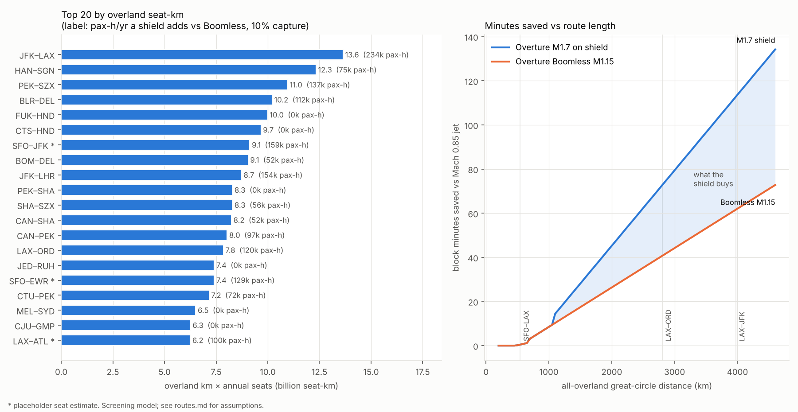

# BoomShield routes: where the shield buys time

**Skyloop · 22 October 2026 · screening model, Overture class.** `build_routes.py` (builds on `../america-north`; fills its top-pairs template) → `routes.csv`, `corridor_segments.csv`, `savings_vs_distance.csv`, `figures/routes_ranking.png`.

## Bottom line

- **Ranked by overland km × seats/yr, JFK–LAX is #1 worldwide** at 13.6 bn seat-km. Asian trunks follow (HAN–SGN, PEK–SZX, DEL–BLR, HND–FUK/CTS).
- **The ranking metric is misleading below ~1,100 km.** Overture's climb, acceleration, deceleration and descent take ~1,125 km (74 min). Shorter routes never reach Mach 1.7, so a shield buys **0 min** on 6 of the top 20 (FUK–HND, CTS–HND, PEK–SHA, JED–RUH, MEL–SYD, CJU–GMP) and on SFO–LAX.
- **Shield increment over Boomless Cruise (M1.15):** ≥ 10 min from 1,500 km, ≥ 20 min from 2,100 km, ≥ 30 min from 2,700 km. Coast-to-coast it saves about 51–57 min, on top of the ~61–68 min that Boomless already saves against a Mach 0.85 jet.
- **The densest shield-km is DEN–ORD.** With 10 % capture it carries 317 pax-h saved per km per year vs Boomless, twice LAX–DEN or ORD–JFK, because every transcon funnels through it.

## Method

**Traffic.** Wikipedia, OAG, BTS and DOT pages were unreachable here; figures are search summaries of the cited pages, **unverified**. World routes: OAG 2024 seats. US: OAG 2025 seats (top 10). India: FY2023-24 passengers (†, ÷ LF 0.8). Other US transcons are **placeholders** (*, frequency × gauge); replace with DB1B/T-100.

**Geometry.** Great circles sampled every 5 km against Natural Earth 1:50m land. `land_fraction` = over land; `overland_fraction` = over land **or within 40 km of a coast** (≈ M1.7 carpet half-width, > the 12 nmi territorial sea in §91.817), i.e. where a boom must not reach the ground. It drives the ranking and the time model. Inland water counts as land; flown distance = GC × 1.03; no wind.

**Overture.** Boom: M1.7 over water, 4,250 nmi, M0.94 overland today; Boomless Cruise "up to M1.3" by Mach cutoff, XB-1 boomless at M1.12 (Feb 2025). Used here: **M1.15 effective**; speeds at a = 1,062 km/h (M0.85 = 903, M1.15 = 1,222, M1.7 = 1,806 km/h). Ramps are **my estimates, unverified**:

| Phase (min, km) | M0.85 jet | Overture Boomless | Overture M1.7 shield |
|---|---|---|---|
| Taxi out + in | 22, — | 22, — | 22, — |
| Climb to FL350–390 | 18, 230 | 18, 230 | 18, 230 |
| Accel (no afterburner) | — | M0.9→1.15: 7, 130 | M0.95→1.7 to FL600: 16, 390 |
| Decel + descent | 18, 200 | 4+18, 75+200 | 8+22, 185+260 |
| Approach (terminal) | 10, 60 | 10, 60 | 10, 60 |
| **Ramps total** | **46 min, 490 km** | **57 min, 695 km** | **74 min, 1,125 km** |

**Rules.** Boomless: M1.15 over restricted ground, M1.7 over open-water runs ≥ 370 km (with transition cost). Shield: M1.7 throughout cruise. If ramps don't fit, fall back M1.7 → Boomless → M0.94. Pax-h/yr = seats × LF 0.8 × **capture** × hours saved; capture (Overture's share of the route) is a flag, default 0.10, linear. `shield_km` = restricted distance flown above cutoff Mach.

## Top 20 by the requested metric

| # | Pair | GC km | land / overland frac | seats M (yr) | overland bn seat-km | sub min | BL min | M1.7 min | saved vs sub | saved vs BL | pax-h/yr vs BL (10 %) |
|---|---|---|---|---|---|---|---|---|---|---|---|
| 1 | JFK–LAX | 3,974 | 0.99 / 1.00 | 3.4 (2025) | **13.6** | 307 | 246 | 195 | 113 | 51 | 234k |
| 2 | HAN–SGN | 1,160 | 0.85 / 1.00 | 10.6 (2024) | **12.3** | 115 | 104 | 98 | 16 | 5 | 75k |
| 3 | PEK–SZX | 1,957 | 1.00 / 1.00 | 5.6 (2024) | **11.0** | 169 | 144 | 125 | 44 | 18 | 137k |
| 4 | BLR–DEL | 1,709 | 1.00 / 1.00 | 6.0† (2024) | **10.2** | 152 | 131 | 117 | 35 | 14 | 112k |
| 5 | FUK–HND | 881 | 0.60 / 1.00 | 11.3 (2024) | **10.0** | 95 | 89 | 89 | 6 | 0 | 0 |
| 6 | CTS–HND | 820 | 0.78 / 0.99 | 11.9 (2024) | **9.7** | 91 | 86 | 86 | 5 | 0 | 0 |
| 7 | SFO–JFK | 4,152 | 0.99 / 1.00 | 2.2* (2025) | **9.1** | 319 | 255 | 201 | 118 | 54 | 159k |
| 8 | BOM–DEL | 1,137 | 1.00 / 1.00 | 8.0 (2024) | **9.1** | 113 | 103 | 98 | 16 | 5 | 52k |
| 9 | JFK–LHR | 5,540 | 0.25 / 0.39 | 4.0 (2024) | **8.7** | 415 | 277 | 248 | 166 | 29 | 154k |
| 10 | PEK–SHA | 1,076 | 0.91 / 1.00 | 7.7 (2024) | **8.3** | 109 | 100 | 100 | 10 | 0 | 0 |
| 11 | SHA–SZX | 1,208 | 0.99 / 1.00 | 6.9 (2024) | **8.3** | 118 | 106 | 100 | 18 | 6 | 56k |
| 12 | CAN–SHA | 1,176 | 0.99 / 1.00 | 7.0 (2024) | **8.2** | 116 | 104 | 99 | 17 | 6 | 52k |
| 13 | CAN–PEK | 1,881 | 1.00 / 1.00 | 4.3 (2024) | **8.0** | 164 | 140 | 123 | 41 | 17 | 97k |
| 14 | LAX–ORD | 2,802 | 1.00 / 1.00 | 2.8 (2025) | **7.8** | 227 | 187 | 154 | 72 | 32 | 120k |
| 15 | JED–RUH | 852 | 1.00 / 1.00 | 8.7 (2024) | **7.4** | 94 | 88 | 88 | 6 | 0 | 0 |
| 16 | SFO–EWR | 4,118 | 1.00 / 1.00 | 1.8* (2025) | **7.4** | 317 | 253 | 200 | 117 | 54 | 129k |
| 17 | CTU–PEK | 1,557 | 1.00 / 1.00 | 4.6 (2024) | **7.2** | 142 | 124 | 112 | 30 | 12 | 72k |
| 18 | MEL–SYD | 706 | 1.00 / 1.00 | 9.2 (2024) | **6.5** | 83 | 81 | 81 | 3 | 0 | 0 |
| 19 | CJU–GMP | 451 | 0.66 / 0.98 | 14.2 (2024) | **6.3** | 65 | 65 | 65 | 0 | 0 | 0 |
| 20 | LAX–ATL | 3,126 | 1.00 / 1.00 | 2.0* (2025) | **6.2** | 249 | 203 | 166 | 84 | 38 | 100k |

More North America (rank, min saved vs Boomless): BOS–SFO* #21 57; LAX–EWR* #22 51; SFO–ORD* #23 35; BOS–LAX* #25 55; LAX–DFW* #27 19; LGA–ORD #34 6; LAX–SFO #57 0. By pax-hours the order becomes JFK–LAX, SFO–JFK, JFK–LHR, PEK–SZX, SFO–EWR, LAX–ORD.

## Where acceleration eats the savings

| Route | Block min: sub / Boomless / M1.7 | Cruise segment min: sub / BL / M1.7 |
|---|---|---|
| SFO–LAX (544 km) | 72 / 72 / 72 | 5 / — / — (ramps do not fit) |
| LAX–ORD (2,802 km) | 227 / 187 / 154 | 159 / 108 / 59 |
| LAX–JFK (3,974 km) | 307 / 246 / 195 | 239 / 167 / 99 |

**SFO–LAX is ~50 min airborne with ~5 min of cruise.** Boomless ramps need 695 km and M1.7 ramps 1,125 km, so neither fits; M0.94 saves under a minute. **Minimum useful shield route ≈ 1,100 km** (gain over Boomless only 4 min there); vs a subsonic jet M1.7 saves 15 min from 1,150 km and 30 min from 1,600 km.

**Sensitivity.** Slowing the transonic acceleration and deceleration by 1.5× costs 2.4 min on long routes and pushes the first M1.7 gain out to ~1,370 km.

## Corridor aggregation

Each route's supersonic-over-restricted samples within 200 km of a trunk-hypothesis segment get its pax-hours pro rata by distance (10 % capture; joining detours ignored).

| Segment | km | pax-h/yr vs sub | vs Boomless | **pax-h/km·yr vs BL** |
|---|---|---|---|---|
| LAX–DEN | 1,385 | 489k | 215k | 155 |
| **DEN–ORD** | 1,426 | 1,010k | 452k | **317** |
| ORD–JFK | 1,188 | 422k | 181k | 152 |
| DFW–DEN spur | 1,031 | 220k | 99k | 96 |
| ATL–ORD spur | 976 | 203k | 90k | 92 |
| YYZ–ORD spur | 701 | 87k | 40k | 57 |
| SEA–LAX spur | 1,537 | 90k | 35k | 23 |
| SFO–LAX, MIA–ATL, YVR–SEA | — | 0 | 0 | 0 (too short) |

The 4,000 km trunk collects 847k of the 1.71 M pax-h/yr a shield adds across the 37 North American pairs, which on their own great circles would need 50,000 shield-km. Spurs under ~1,000 km are ramps (acceleration, merging), not shield.

## Coastal offsets (Overture can already do M1.7 over open water)

- **SFO–LAX, SEA–SFO, SEA–LAX:** inland GCs (land 0.96–1.00); a Pacific track 40–80 km out would be legal at M1.7, but they are too short to reach it and the 40–350 km offset search found no gain. Neither shield nor offset helps.
- **MIA–JFK:** Atlantic track 120 km out, 118 min vs 124 Boomless GC; a shield adds only 1 min.
- **LAX–MIA:** Gulf track 218 min vs 226 Boomless, 187 on a shield.
- **JFK–LHR:** skirting Newfoundland/Ireland 259 min vs 248 on a shield.
- **HAN–SGN, CJU–GMP, HKG–TPE** are "overland" only via the 40 km buffer; multi-waypoint seaward tracks not searched.

## Caveats

Seats are search summaries (* placeholders). Boomless M1.15 depends on the day's atmosphere. Ramps are guesses, not Overture data. §91.817 still bans overland booms; the 0.11 psf NPRM (July 2026) is not final. Not modelled: winds, merge delays, M1.7 range/fuel, fleet size.

**Sources.** OAG 2024 lists via airlineratings.com, airwaysmag.com, oag.com/pressroom; OAG 2025 US via onemileatatime.com, travelweekly.com; Wikipedia "List of busiest passenger flight routes" (not fetched); boomsupersonic.com (Overture 2022, Boomless Cruise Feb 2025); Natural Earth 1:50m; FAA NPRM 91 FR 40470 (`../../STATUS.md`).
