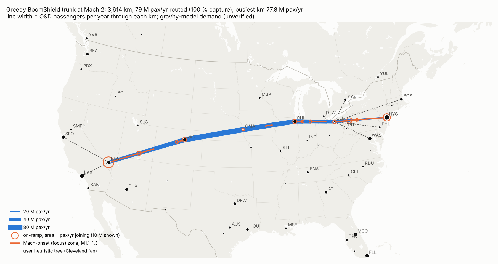
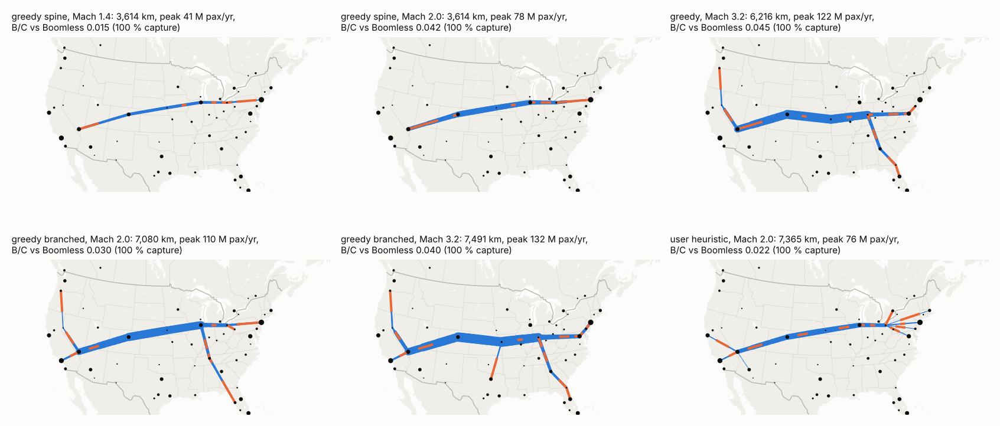
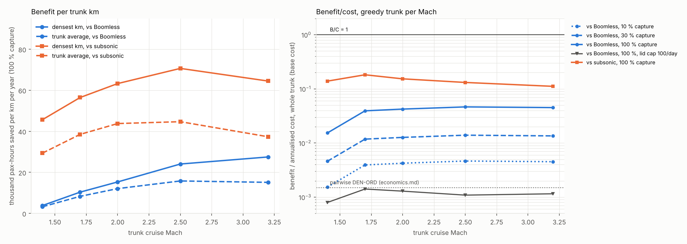

# BoomShield trunk: does a shared cross-country spine change the economics?

**Skyloop · 22 October 2026 · screening model.** `build_trunk.py` → `metros.csv`, `calibration_anchors.csv`, `od_matrix.csv`, `trees.csv`, `greedy_growth.csv`, `trunk_summary.csv`, `trunk_segments.csv`, `ramps.csv`, `cost_per_km_by_mach.csv`, `figures/`. Builds on [routes](../routes/routes.md), [economics](../../economics/economics.md) (`cost_model.py` imported directly) and [STATUS](../../STATUS.md).

## Bottom line

- **The algorithm finds the user's shape, minus the fans.** The best Mach 1.4–2.0 trunk is a single **3,614 km spine, LAS–DEN–OMA–CHI–CLE–NYC**. LAX, SFO, PHX, SEA, BOS, WAS, PHL and YYZ traffic reaches it by Boomless (M1.15) feeder legs, with no shield needed. The user's fans (SFO/LAX/PHX→LAS, CLE→YYZ/BOS/PHL/WAS) double the km and halve B/C.
- **Traffic per km does rise by orders of magnitude.** At Mach 2 and 100 % capture, **78 M pax/yr cross the busiest km (OMA–DEN)**. That is ~45× the DEN–ORD pair's own traffic. In pax-hours saved per km against subsonic, it is ~9× the pooled corridor in routes.md. 79 M trips use the trunk, about **12 % of US domestic O&D trips**.
- **B/C rises much less.** Against Boomless at the base cost, the whole trunk scores **4.2 × 10⁻³ at 10 % capture** (2.8× the pairwise 1.5 × 10⁻³) and **0.042 at 100 %**. That is ~1.5 orders of magnitude, nearly all of it from capture. Against subsonic flight it reaches 0.15–0.18.
- **Mach barely matters for B/C.** Moving from M1.7 to M3.2 raises B/C only from 0.039 to 0.045, because shield cost rises with H₂ thickness and the ramps lengthen (M3.2 needs 1,770 km to accelerate).
- **Lid fatigue cancels the network effect.** 78 M pax/yr means ~4,400 Overture flights/day on one km. The lid is capped at ~100/day (economics.md), and with that cap B/C falls back to **1.3 × 10⁻³**.
- **Feeders must be the same aircraft.** A hub transfer pays the ramps twice: 9 M users, B/C 0.005.

## 1. Demand matrix (gravity model; unverified)

No DB1B or T-100 data was used: BTS, DOT Consumer Airfare tables, data.gov and Kaggle were all **blocked**.

- **Markets.** 57 city markets: 50 US, plus Toronto, Montreal, Ottawa, Vancouver, Calgary and Mexico City. Each market's mass is its O&D enplanements (author estimates **[U]**).
- **Model.** T_ij = k·m_i·m_j·d^−β·(1−e^−(d/400 km)²)·b_ij, with border factor b = 0.35 for US–Canada and 0.25 for US–Mexico **[U]**.
- **Calibration.** Fitted to the nine OAG 2025 US seat counts in routes.csv, converted as seats × 0.83 × local share ÷ airport share of market (shares **[U]**). Result: **β = 0.50**, rms log error 0.28, model/anchor 0.71–1.59.
- **Scale.** 461 M pax/yr among the 57 metros, against ~654 M US O&D trips (0.87 B enplanements ÷ 1.33 **[U]**). That share is probably high.
- **Sensitivity.** β = 0.25 and a ×0.75 demand case each move B/C by ±30 %.

## 2. Network construction

**Time model.** Same as routes.md: taxi 22 min, climb 230 km, approach 60 km, path factor 1.03. Trunk acceleration is 0.23 m/s² and deceleration 0.46 m/s², fitted to Overture's ramps. These reproduce JFK–LAX at **307 / 246 / 195 min** (subsonic / Boomless / M1.7).

**Routing.** The aircraft flies a feeder leg at M0.85 or M1.15 to any ramp point (every ~100 km). It accelerates over the shield, cruises at M, and decelerates before leaving; on short runs the peak Mach is lower. Two connection modes:

- **same aircraft:** 5 min merge penalty;
- **hub transfer:** separate flights with a 30 or 60 min connection.

A pair uses the trunk only if it saves ≥ 10 min against Boomless direct.

**Greedy algorithm, per Mach:**

1. **Cut** pairs that gain < 10 min even on their own great-circle shield. At M2.0, 865 of 1,540 pairs remain, carrying 225 M pax.
2. **Seed** with the densest pair's shortest path through a Delaunay graph of metros (plus direct links ≤ 1,100 km).
3. **Grow** by adding the attachment path with the highest marginal pax-hours saved per km. Stop when the marginal value falls below 0.5× the trunk average ("spine") or 0.25× ("branched").
4. **Prune** leaf edges below the threshold.
5. **Re-route** all pairs over the final tree.

**Table 1. Trees at Mach 2.0** (same aircraft, best feeder, base demand, 100 % capture)

| Tree | km | Trips using, M/yr | Peak km, M pax/yr | pax-h/km/yr vs BL | B/C vs BL |
|---|---|---|---|---|---|
| **Greedy spine** LAS–DEN–OMA–CHI–CLE–NYC | **3,614** | 79 | **78** | 12,080 | **0.042** |
| Greedy branched (+LAX, CHI–BNA–TPA, LAS–RNO–PDX, CLE–PIT) | 7,080 | 116 | 110 | 8,560 | 0.030 |
| User heuristic, Cleveland fan | 7,365 | 77 | 76 | 6,380 | 0.022 |
| User heuristic, five spokes from Chicago | 9,232 | 76 | 75 | 5,140 | 0.018 |
| Spine, subsonic feeders only | 3,614 | 63 | 63 | — | 0.034 |
| Spine, hub transfer 60 (30) min | 3,614 | 9 | 9 | — | 0.005 |

At M2.5–3.2 the greedy spine shifts south: LAS–DEN–MCI–IND–WAS, plus IND–ATL–JAX–MCO (4,521 km at M2.5).

**Table 2. Per-segment, greedy spine, Mach 2.0** (100 % capture)

| Segment | km | Mean / max pax/yr (M) | Flights/day (65 seats) | pax-h/km/yr vs BL / vs sub | B/C vs BL at 10 / 30 / 100 % |
|---|---|---|---|---|---|
| LAS–DEN | 1,009 | 58 / 70 | 3,270 | 12,200 / 43,800 | 0.0043 / 0.013 / 0.043 |
| DEN–OMA | 758 | **77 / 78** | 4,350 | **15,300 / 57,600** | 0.0053 / 0.016 / **0.053** |
| OMA–CHI | 668 | 71 / 74 | 4,010 | 14,400 / 53,100 | 0.0050 / 0.015 / 0.050 |
| CHI–CLE | 507 | 54 / 60 | 3,030 | 11,200 / 39,700 | 0.0039 / 0.012 / 0.039 |
| CLE–NYC | 672 | 31 / 43 | 1,730 | 6,700 / 22,100 | 0.0023 / 0.007 / 0.023 |

## 3–4. Benefit and economics vs Mach

Benefit is valued at **$86/h × 95 % availability**. Cost per km is from `cost_model.capex/opex` (base case, CRF 7 % over 25 yr). The H₂ layer is **36 m** at M1.4–1.7, **55 m** at M2.0, **77 m** at M2.5 and **75 m** at M3.2, from STATUS §4. M3.2 is outside the q limit at 20 km.

**Table 3. Greedy trunk built for each Mach** (B/C is for the whole trunk; BL = Boomless)

| Mach | Trunk km | Trips, M/yr (share of US O&D) | Mean saving vs BL, min | Densest km, pax-h/yr vs BL | Cost, $M/km/yr | B/C vs BL at 10 / 30 / 100 % | 100 %, lid-capped | B/C vs subsonic at 100 % | Toll per trip for B/C = 1 at 100 % capture |
|---|---|---|---|---|---|---|---|---|---|
| 1.4 | 3,614 | 41 (6 %) | 17 | 3,840 | 17.3 | 0.0015 / 0.005 / 0.015 | 0.0008 | 0.14 | $1,510 |
| 1.7 | 3,614 | 65 (10 %) | 28 | 10,350 | 17.3 | 0.0039 / 0.012 / 0.039 | 0.0014 | **0.18** | **$970** |
| 2.0 | 3,614 | 79 (12 %) | 33 | 15,330 | 23.3 | 0.0042 / 0.013 / 0.042 | 0.0013 | 0.15 | $1,070 |
| 2.5 | 4,521 | 117 (18 %) | 37 | 24,060 | 27.8 | 0.0046 / 0.014 / 0.046 | 0.0011 | 0.13 | $1,080 |
| 3.2 | 6,216 | 128 (20 %) | 44 | 27,500 | 27.4 | 0.0045 / 0.014 / 0.045 | 0.0012 | 0.11 | $1,330 |

**Network effect, against the pairwise benchmark** (DEN–ORD at M1.7 vs Boomless, 10 % capture: 1.5 × 10⁻³):

- **Pooling all flows:** 3.9 × 10⁻³ for the whole trunk, 4.9 × 10⁻³ on the densest km, or ×2.6–3.3. routes.md had already pooled 37 transcon pairs onto DEN–ORD.
- **100 % capture** adds ×10, for **~1.4 orders of magnitude** (0.04).
- **Traffic per km:** the thesis holds, at ~45× a single pair.
- **Value per km:** it fails. Each passenger saves only 28–44 min against Boomless, spread over the whole trunk.

**Table 4. Can the remaining 25× gap close?** (spine, M2.0, 100 % capture, base B/C 0.042)

| Lever | B/C | Comment |
|---|---|---|
| Low cost case (~$30/m²) | 0.21 | Already 3× below the bottom-up base cost |
| Value of time $200/h | 0.10 | Premium travellers only |
| Fare premium $300 per one-way trip | 0.28 | Breaks even at **$1,070 per trip** (~$1,900 per hour saved); $10,700 at 10 % capture |
| Induced demand +20 % | 0.05 | A 13 % door-to-door cut gives roughly +13–25 % |
| Demand β = 0.25 (flatter) / ×0.75 | 0.056 / 0.032 | Gravity-model uncertainty |
| Acceleration ×2 (M3.2) | 0.059 | Shorter ramps help mostly at high Mach |
| Lid cap 100 flights/day | **0.0013** | Binds at ~2 % capture of the spine's traffic |
| All favourable together: M3.2, low cost, $200/h, β 0.25, accel ×2 | **~0.9** | Multiplicative estimate, uncapped; needs ~9,000 Overture-size flights/day on one km |

**Candid verdict.** The network effect is real but worth ~1.5 orders of magnitude, not the 2.5–3 needed.

- **No single lever closes the gap,** and Mach helps least.
- **Break-even needs every favourable assumption at once:** near-total capture of transcontinental demand, the low cost case, premium value of time, and a lid rated for 10⁷–10⁸ cycles carrying airliner-size aircraft.
- **The lid requirement is hardest.** It also collides with STATUS's weight × Mach limit (66 t per 30 m of H₂ at Mach 2).
- **Without Boomless Cruise** (ban or failure), the case improves ~4× (0.15–0.18 vs subsonic) but is still not rescued.

## 5. On-ramps and Mach-onset zones (for the focus-boom study)

On the M2.0 spine, 12 ramps each take ≥ 2 % of joins (`ramps.csv`):

| Ramp | Joining traffic | Share of joins |
|---|---|---|
| **Las Vegas** (all of CA, AZ, NV and the Pacific Northwest) | 25 M/yr | 32 % |
| **New York** | 11 M/yr | 14 % |
| Western PA, ~105 km NE of PIT (BOS, PHL, WAS, YYZ) | 6 M/yr | 8 % |
| Denver ×2, Chicago, SE Utah (PHX/ABQ), Cleveland, Omaha, NW Indiana | 2–4 M/yr each | — |

- **Acceleration zones** (M0.95→2.0, ~590 km per ramp per direction) overlap and cover the **whole spine**.
- **Mach-onset zones** (M1.1–1.3) run ~90 km per ramp per direction and total **~1,780 km** at M2.0, or 1,180–2,730 km across Mach (orange on the maps).
- **Boomless feeders arrive at M1.15,** so their onset begins at the merge point. The shield must start upstream of each ramp.
- **Width.** The draft [focus_booms.md](../../sim/results/focus_booms.md) gives ~4 psf unshielded and ~0.01 psf over 55 m of H₂, so no extra width may be needed. economics.md's 1.3× width placeholder would add ~15 % to cost.

## Caveats

- **Demand** is a gravity model, not DB1B. Replace it with DB1B Market or DOT Table 1/6 when reachable.
- **Not modelled:**
  - overwater M1.7 tracks (Florida–Northeast, Pacific);
  - winds and merge sequencing;
  - aircraft weight and range above M2;
  - capture as a function of fare.
- **The greedy builder** uses metro nodes only (no Steiner points), and its thresholds are choices. Every step is in `greedy_growth.csv`.
- **Costs** are economics.md's, marked **[U]**.
