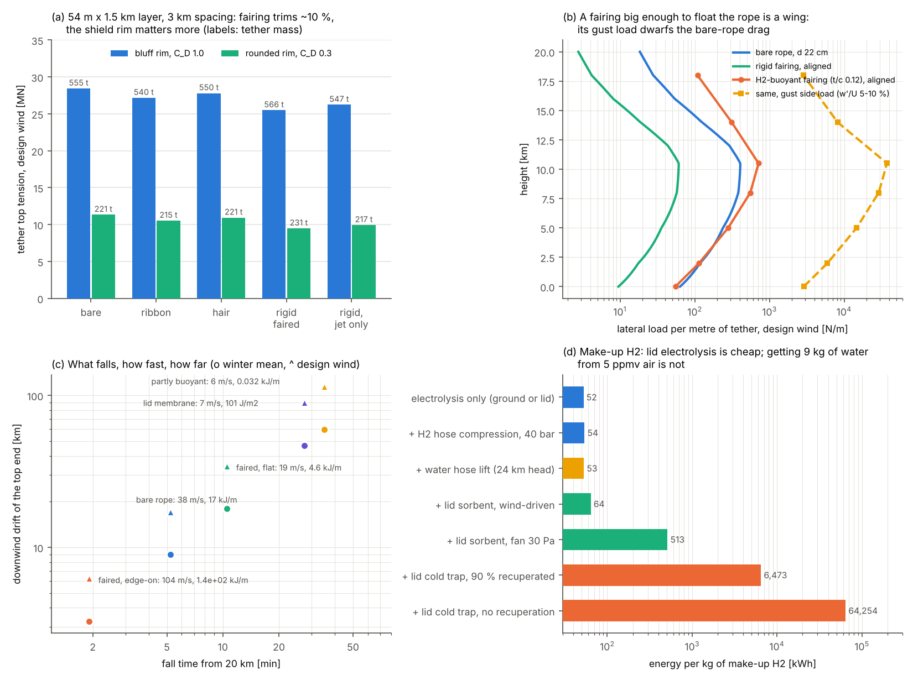

# BoomShield: tethers, build-out and failure modes

**Skyloop · 22 October 2026 · screening review.** Baseline: the [STATUS](../STATUS.md) §6 floating-lid H₂ pillow, 54 m × 1.5 km at 20 km (system 3.96 kg/m², lift 4.5 kg/m²), with tethers every 3 km. The tether model, winds and atmosphere are imported unchanged from [altitude_trade.py](../altitude/altitude_trade.py): UHMWPE at 1.2 GPa working stress, V/H 1.5, drag integrated as for a vertical line, assumed mid-latitude winds. The results therefore compare directly with [altitude-trade](../altitude/altitude-trade.md) §6. Script: `tethers_build_failure.py`. Outputs: `tether_sizing.csv`, `buoyant_tether.csv`, `fall_footprint.csv`, `h2_makeup.csv`, `failure_landuse.csv`, `tethers_build_failure.png`. *(A)* marks my assumptions.

## Verdict

1. **Faired tethers: worth having, but the gain is modest.** Tension falls ~10 % and mass does not fall. Bare-tether drag is only ~13 % of the top load; the shield's bluff 54 m rim sets it. Recomputed for the psf layer, a bare tether carries **28.4 MN** (STATUS scaled this to ~26 MN) and weighs 555 t. **Rounding the rim** (C_D 1.0 → 0.3 *(A)*) brings that to 11 MN and 221 t. That is the bigger lever, and it needs an acoustic check of the edge.
2. **Self-buoyant H₂ tethers: no, neither full nor partial.** Floating the rope takes a "wing" with a 14–84 m chord. In the jet its gust load is ~70× the bare-rope drag, and at best it saves ~3 % of shield lift.
3. **The build strawman partly works.** The lid inflates flat as a 3.5 m mattress and rises in ~1.4 h. Three things must change: launch sealed 250 m modules, close the joints with membrane flaps only, and raise tethers per 3 km bay. The pace needed is 8–16 modules per launch-window day for 10 years.
4. **Make-up H₂: run a hose up every ~10th tether.** Electrolysis on the lid has power to spare, but extracting the water from 5 ppmv air does not work.
5. **The worst tether failure is not the falling tether.** It is the bay rising into the flight level about 100 s after its hold-down is lost. Answers: twin-rope tethers, anti-cascade stations, firebreak joints and automatic traffic stops.
6. **Land use:** 1.5–10 ha per km of corridor with one anchor row, 3–20 ha/km with two. HSR takes ~1.4–8 ha/km of continuous strip.

## 1. Faired tethers

**Drag coefficients:**
- **Bare stranded cable:** C_D ≈ 1.0–1.3, and higher when it strums [1, 2].
- **Ribbon and hair fairings:** these mainly stop strumming. A vendor quotes C_D 0.2 and 0.6 [2]; patents call the drag gain "limited" [3]. I use 0.8 and 1.0.
- **Rigid shells (t/c 0.22):** C_D 0.15 on shell thickness, with 0.3 as a sensitivity *(A, Hoerner-class; the DTMB tables [4] were not opened)*. Shell mass ~2.8 kg/m *(A)*.

**Table 1. Psf layer 54 m × 1.5 km, 3 km spacing, design wind**

| tether | rim C_D | tether drag MN (winter mean) | top tension MN | Ø cm | mass t (fairing) | hold-down kg/m² |
|---|---|---|---|---|---|---|
| bare | 1.0 | 3.86 (0.48) | **28.4** | 21.5 | 555 | 0.62 |
| ribbon / hair | 1.0 | 2.5 / 3.2 | 27.2 / 27.8 | 21.1 / 21.3 | 540 / 550 | 0.59 / 0.60 |
| rigid faired (C_D 0.3) | 1.0 | 0.55 (0.07) | 25.5 (26.0) | 20.4 | 566 (68) | 0.56 |
| rigid, 6–16 km only | 1.0 | 1.46 | 26.2 | 20.7 | 547 (34) | 0.57 |
| bare | **0.3** | 2.44 | **11.3** | 13.6 | 221 | 0.25 |
| rigid, 6–16 km only | 0.3 | 0.90 | 9.9 | 12.7 | 217 (24) | 0.22 |

The 30 m × 1 km case reproduces altitude-trade: 16.9 MN, 16.6 cm, 331 t. The 77 m × 2 km layer needs 39 MN and 767 t. For the psf layer the hold-down is **0.62 kg/m², not 0.55**.

**Table 1b. Fairing engineering issues**

| issue | number | design answer |
|---|---|---|
| weathervane stiffness | ~7 Hz in the jet, ~1.4 Hz at 20 km (1 m chord, estimated) | rope at the nose; aerodynamic centre aft |
| flutter, kiting, twist | centre of mass aft of the pivot and cannot be balanced; towed-cable patents report kiting from segment friction, flapping and torsion [5] | wind-tunnel tests; low-friction bearings; light tails |
| directional wind shear | up to 180° between the westerly jet and summer easterlies at 20 km | 1–3 m segments, free through 360°, bearings to −60 °C: ~12,000 per tether, ~16 M per corridor |
| icing (supercooled cloud, 0–7 km) | rime jams segments and leaves them misaligned → kiting; an iced bare rope gallops; ice is shed onto the ground below | fair only the jet band: 6–16 km keeps ~3/4 of the gain; start at ~8 km to avoid icing |
| lightning | unlike an aerostat [6], the tether cannot be reeled in | all-dielectric line, designed to take strikes |

### 1b. H₂-filled buoyant tether (coordinator's question)

The premise that "faired, the line drops to a few kg/m" fails. Fairing removes tether drag, not the 12.7 MN of shield side load each tether carries, so the fibre stays at 21–23 kg/m.

**Table 2. A fairing that floats 23 kg/m of rope** (H₂ net lift 1.14 / 0.36 / 0.11 kg/m³; 0.25 kg/m² envelope *(A)*)

| height km | chord m (t/c 0.12 / 0.20) | aligned drag vs bare | gust side load, w′/U 5–10 % |
|---|---|---|---|
| 0 | 19 / 14 | 0.7–0.9× | 2.1–2.9 kN/m |
| 10.5 (jet) | 38 / 27 | 1.4–1.9× | **27–37 kN/m** (bare: 0.38) |
| 18 | 84 / 59 | 3–4× | 2.0–2.8 kN/m |

| option | gain | penalty |
|---|---|---|
| fully buoyant | ≤ 0.12 kg/m² of shield lift (~3 %) | ~150 MN gust load over the jet, 5× the tether rating |
| buoyant at 0–3 km only | 0.02 kg/m² | 8–16 MN gust load |
| H₂ in the 1 m rigid fairing | floats 0.1–0.7 % of the rope | ~16 M sealed H₂ cells |
| trimmed fairing for lift | none: on a near-vertical line, lift is horizontal | kiting |

**No self-buoyancy.** Carry the H₂ in a separate small pressurised hose in the fairing nose or alongside the rope (§3).

## 2. Buildability (the user's strawman)

| step | finding | requirement |
|---|---|---|
| ground inflation | float gas fills 7.3 % of its volume at the ground, so the lid floats on a **3.5 m H₂ mattress**; it needs no bubble launch | rim, bellows and ties take a 16:1 stroke |
| module size | a 250 m × 1.5 km compartment is 2.1 × 10⁷ m³ at float (12× the largest balloon ever flown [7]), carries **1,485 t** of structure and covers 37.5 ha on the ground | sealed 250 m modules; a whole 4.5 km² bay is too big to launch |
| ascent | 2.3 m/s at 10 % free lift; 20 km in ~1.4 h, ~20 min in the jet | — |
| jet loads at 10.5 km | narrow end leading: 0.5 / 1.0 / 6.7 MN at 25 / 35 / 90 m/s; broadside 2–28 MN | windows with surface wind ≲ 3 m/s (NASA < 6 kt [8]), jet ≲ 35 m/s, no convection: mostly summer, ~50–150 days/yr *(estimate)* |
| transit | ~0.15 MW tug per module at 5 m/s relative in the summer minimum | 10–20 launch bases, modules towed to the front |
| mating | open gaps must be ≲ 0.1 m; membrane-closed gaps ≤ 1 m cost ≤ 1 dB ([alongtrack](../sim/results/alongtrack_summary.md)) | no H₂ seams at altitude; lid and floor overlap flaps, 3–4 km of zip per joint (~56,000 km in all, robotic) |
| tethers | a joined bay's hold-down (2,475 t) lifts a 555 t tether as the anchor winch brakes | "pull tight" works per 3 km bay |

**Throughput.** The corridor needs 16,000 modules (1,333 bays). Over 10 years with 100–200 windows a year, that is **8–16 modules, or 3–6 km² of lid, per window day**. Totals are ~13,800 km² of film and ~24 Mt of lid. Film manufacturing, not launch, sets the pace.

## 3. H₂ make-up

**Table 3** (`h2_makeup.csv`; 5 ppmv water at 20 km; electrolysis 52.5 kWh/kg [9])

| quantity | 2 Mt, 5 %/yr | 4 Mt, 20 %/yr |
|---|---|---|
| make-up | 0.1 Mt/yr; 25 t/km/yr | 0.8 Mt/yr; 200 t/km/yr |
| electrolysis on the lid; PV share of lid *(A: 360 kWh/m²/yr)* | 0.9 kWh/m²/yr; **0.24 %** | 5.3 kWh/m²/yr; **1.5 %** |
| air to process (3.2 × 10⁷ m³ per kg H₂) | 26,000 m³/s per km | 205,000 m³/s per km |
| contactor area at 2 m/s | 1.3 ha/km | 10 ha/km |
| water capture, kWh per kg H₂ | cold trap 6,500 (90 % recuperated) to 64,000; sorbent with fan ~460; wind-driven sorbent ~11 plus hardware | same |
| water hose up the tether | 235 MPa static head; freezes above ~8 km (SPICE planned slurry this way [11]) | reject |
| tanker balloons, 6 t H₂ each | 44 per day | 350 per day: reject |
| **H₂ hose, 133 supply tethers** | 24 g/s each; 50 mm bore; 20 bar in → 13 bar at top | 190 g/s; 80 mm; 40 → 23 bar |
| hose mass at 1–3 kg/m *(A)*; ground electrolyser | 24–70 t per supply tether; 5 MW | 36 MW |

**On-board electrolysis.** Power is easy. Water is the problem: stratospheric air holds 3.5–7 ppmv [10], with a frost point near −85 °C. Freezing it out costs 100–1,000× the electrolysis energy. A wind-driven sorbent cuts that to ~1.2×, but needs hectares of contactor per km plus warm electrolysers and O₂ vents at ~16,000 compartments. One speculative water source is the traffic's own exhaust: at 50 flights a day, ~210 t of water per km per year is deposited 250 m above the lid. That is ≈ 24 t of H₂, about the 5 %/yr need (burn assumed; capture fraction unknown).

**Recommendation: an all-dielectric H₂ hose on every ~10th tether**, feeding check-valved manifolds over ±15 km. The H₂ column's own weight matters at 20–40 bar, but 50–80 mm bores suffice. Ground electricity comes to 5–42 TWh/yr, the price of not making H₂ on the lid (for economics).

## 4. Failure

**Table 4. A tether break**

| aspect | value |
|---|---|
| strain at working load; release wave | 1.03 % (E ≈ 116 GPa [12]); crosses 24 km in 2.2 s |
| recoil; stored energy | ~113 m/s at the broken end; 3.5 GJ (~0.85 t TNT) per tether: snap-back zones at fittings [13] |
| break at the top | line falls as a strip from the anchor, ≤ 24 km long, top drifting 9–17 km |
| break at the bottom | line hangs from the shield and drags. JLENS's 2 km tether cut power to ~20,000 customers [14]; this one is 12× longer and weighs 555 t |

**Table 4b. Falling objects** (drift: winter mean to design wind)

| object | speed at ground | fall from 20 km | drift km | impact |
|---|---|---|---|---|
| bare rope, 23 kg/m | 38 m/s | 5 min | 9–17 | **17 kJ/m**, lethal |
| faired, shells edge-on | 104 m/s | 2 min | 3–6 | 140 kJ/m |
| faired, flat or tumbling | 19 m/s | 10 min | 18–34 | 4.6 kJ/m |
| net 2 kg/m (partly buoyant, or drogues) | 6 m/s | 35 min | 60–115 | 0.03 kJ/m |
| deflated lid, 3.96 kg/m² | 7 m/s | 27 min | 47–90 | 0.1 kJ/m² (a tarp) |

**Buoyant tethers on failure (coordinator's question).**
- **Partly buoyant line:** falls slowly and can be winched in during the descent (24 km at 1–2 m/s takes 3–7 h), but its footprint grows 5–10×.
- **Neutral line broken at the top:** lays over downwind and sweeps up to 24 km at low height.
- **Neutral line broken at the bottom:** streams from the shield; re-anchoring means catching the free end.
- **Line broken twice:** becomes a free balloon, which needs cells every 50–100 m, ADS-B beacons and a commanded rip.

Self-buoyancy is rejected anyway. **Packed drogues that open on loss of tension** give the same slow fall: a 30–35 m canopy per 100 m of line, ~0.35 kg/m (+1.5 %) *(estimate)*.

**Table 4c. Shield response and segment loss**

| event | numbers | consequence and design answer |
|---|---|---|
| neighbours take the load | 1.5× static, ≤ 2× dynamic = 50–67 % of breaking load at SF 3; a second adjacent loss → ≥ 2× | survivable once; cascade beyond that. **Twin ropes**, each 50 % at SF 3 (100 % at SF 1.5 after one parts; same fibre). **Anti-cascade stations every ~10 tethers**, as on power lines [15] |
| lateral bow | rim tendon 32 MN (3 km span, 5 % sag) → 63 MN and a **300 m bow** over 6 km | tendons rated for a 6 km span; flights re-centre |
| **uplift** | loses 24 MN (5.4 Pa) of hold-down; **reaches flight level (+250 m) in ~100 s** | the top hazard: twin ropes, automatic traffic stop, shield-relative altitude hold |
| one compartment lost | 128 t H₂ (≈ 3.7 kt TNT chemical); 1,690 t lift lost < 2,475 t bay hold-down | **the bay stays up** (it can absorb ~1.5 compartments); the dead compartment hangs as a sling; the acoustic hole closes the segment |
| H₂ fire | the 4 % flammability limit holds near 55 hPa; sparks marginal, engines ignite it (structure §4); overpressure ~kPa | H₂ rises into traffic; fire spreads along a PE lid: **firebreak joints** (the non-combustible module flaps), detection, closure |
| whole 3 km bay lost | 17,800 t of film and 1,530 t of H₂; film falls for 27 min, lands 50–90 km downwind as a 4.5 km² tarp | drapes rail and power lines (PV and metallised films short them); compartments, controlled descent |
| two-sided crosswind | winds at 20 km reverse seasonally | moorings for both directions **double the count to ~2,700** (STATUS's ~1,300 covers one) |

**Table 5. Qualitative risk matrix** (corridor life; residual risk assumes the mitigations)

| event | likelihood | consequence | key mitigations | residual |
|---|---|---|---|---|
| a rope parts (fatigue, lightning) | likely | moderate | twin ropes, dielectric line, inspection | medium |
| tether falls on rail, road or power line | possible | major | drogues, anchor siting, risk-zoned strips | medium |
| bay rises into the flight level | possible | catastrophic | twin ropes, traffic stop, shield-relative altitude | **high → medium** |
| cascade of ≥ 3 tethers | unlikely | catastrophic | SF ≥ 3, anti-cascade stations every ~30 km | medium |
| aircraft strikes a tether [6] | possible | catastrophic | restricted area, lighting, ADS-B | **high** |
| H₂ leak, no ignition | likely | moderate | 250 m compartments, detection | low |
| compartment fire | possible | major | firebreak joints, closure, weak links that drop a burning lid | **high** |
| segment loss, film falls | unlikely | major | compartments, hold-down reserve | medium |
| fairing icing, jamming or kiting | likely | moderate | fairings in the jet band only; icing tests | medium |
| free-floating buoyant tether | possible, if built | major | don't build it; otherwise cells, beacons, rip | — |
| ice shed from tethers | likely | minor | exclusion strips | low |

## 5. Land use (for the economics comparison)

| item | value |
|---|---|
| anchor load, psf tether | V 21.9 MN, H 16.5 MN; ~7,300 t gravity block (3,000 m³), or rock anchors or piles |
| site: block, trim winch, H₂ skid, substation, pad *(A)* | ~1.5 ha |
| fenced snap-back and ice zone, radius 100 / 150 / 300 m | 4.6 / 8.6 / 30 ha per anchor |
| **per km of corridor, one row** (1,333 anchors) | **1.5 / 2.9 / 9.9 ha/km** |
| per km, two rows (both crosswind directions) | 3.1 / 5.7 / 20 ha/km |
| layout | point sites ~13 km either side of the track; land under the lines stays farmable, with no tall structures |
| HSR | double-track formation ≤ 14 m ≈ 1.4 ha/km [16]; land take including works ~7.8 ha/km (Adif Burgos) [16]; continuous and severing |

The areas are comparable. BoomShield does not sever land, but it adds an airspace restriction and risk-zoned fall strips up to 24 km downwind of each anchor.

## Sources

All at search-summary level: page fetches failed, so none was read in full.

1. Cable fairing overview: <https://en.wikipedia.org/wiki/Cable_fairing>.
2. EIVA vendor note (ribbon 0.2, hair 0.6, bare 1.0–1.3; **unverified**, page unreachable): <https://www.eiva.com/about/eiva-log/how-to-optimise-operations-by-fairing-your-tow-cable>.
3. US 6,244,204 (ribbon and hair mainly cut strumming; rigid fairings vulnerable on drums): <https://patents.google.com/patent/US6244204>.
4. DTNSRDC/DTMB faired-cable reports, not opened: <https://apps.dtic.mil/sti/pdfs/ADA071330.pdf>, <https://apps.dtic.mil/sti/pdfs/ADA071543.pdf>, <https://apps.dtic.mil/sti/pdfs/ADA113478.pdf>.
5. Kiting, flutter and torsion: US 4,350,110 <https://patents.google.com/patent/US4350110>; US 12,005,998 <https://patents.google.com/patent/US12005998> (which patent supports which point is unverified).
6. Aerostat lightning: US 4,842,221 <https://image-ppubs.uspto.gov/dirsearch-public/print/downloadPdf/4842221>; DTIC ADA034847. Aircraft hitting a tether: <https://www.aopa.org/training-and-safety/air-safety-institute/accident-analysis/featured-accidents/airship-tether-severs-cessna-wing-killing-three>.
7. Big 60 balloon, 1.7 × 10⁶ m³: <https://stratocat.com.ar/stratopedia/323.htm>.
8. NASA balloon launch weather: <https://foxweather.com/earth-space/nasa-scientific-balloons-forecasting-stratosphere>.
9. PEM electrolysis, 50–60 kWh/kg: <https://hyfindr.com/en/hydrogen-knowledge/pem-electrolyser>.
10. Stratospheric water vapour: JPGU 2009 <https://www2.jpgu.org/meeting/2009/program/session/pdf/F207/F207-002_e.pdf>; ACP 3, 1991 (2003) <https://acp.copernicus.org/articles/3/1991/2003/>.
11. SPICE tethered-balloon slurry pumping: <https://meetingorganizer.copernicus.org/EGU2011/EGU2011-7005.pdf>.
12. Dyneema SK78 rope data from a supplier: <https://www.mennens.nl/en/products/fibre-ropes/dynice-75-p204590>.
13. Snap-back zones: <https://www.westpandi.com/news-and-resources/loss-prevention-bulletins/snap-back-zones>.
14. JLENS breakaway, 2015: <https://www.military.com/daily-news/2015/10/28/spy-blimp-lassoed-pennsylvania-after-breaking-free-maryland.html>.
15. Anti-cascade towers: <https://en.wikipedia.org/wiki/Dead-end_tower>; CSCE 2015 <https://legacy.csce.ca/elf/apps/CONFERENCEVIEWER/conferences/2015/pdfs/190.pdf>.
16. ÖBB formation width: <https://infrastruktur.oebb.at/en/company/environment-climate-protection/liveable-environment>; Adif land take: <https://railwaynews.net/adif-av-launches-1-3m-sqm-land-for-burgos-vitoria-line.html>.

**Unverified or assumed:** Concorde-class burn of ~20 t/h; ~3,000 kWh/m²/yr of sunlight at 20 km; world HAA-film capacity; rim C_D 0.3; rigid-fairing C_D 0.15; hose and fairing mass; anchor site area; launch-window counts.
