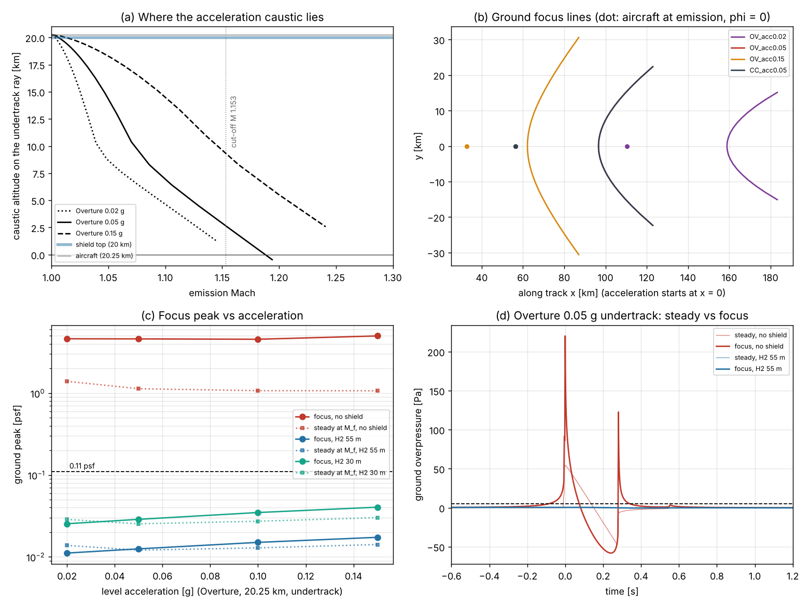

# Focused sonic booms (superbooms) and BoomShield

Code: `boomsim/focus.py`, `run_focus.py` (phases `scenarios`, `points`, `validate`, `extras`, `report`; cache in `focus_cache/`). Tests: `tests/test_focus.py` (18). Data: `focus_booms.csv`. Figure: `focus_booms.png`.

All results use the windless US Standard Atmosphere 1976. Wind enters only through the cut-off Mach. The H₂ layer is 1-D (horizontally infinite), with a floating lid.

## Bottom line

1. **Every acceleration through the Mach cut-off focuses on the ground, at any rate.** M_cut = 1.153 at 20.25 km. For an Overture-like aircraft at 0.02–0.15 g the focus is emitted at M 1.16–1.28 and lands 29–48 km ahead as a crescent ±15–31 km wide. Unshielded it is **4.6–5.0 psf** (linear 5.4–6.4), 103–107 PLdB: 3.3–4.7× the steady boom and **~40× the 0.11 psf limit**. Concorde-class gives 8 psf. Gentle acceleration only moves the focus toward M_cut, where the steady boom is already enhanced.
2. **Over the shield the focus vanishes: 0.011–0.017 psf with 55 m of H₂** (0.025–0.040 with 30 m; Concorde 0.031–0.043), inaudible. Every ground-reaching ray crosses the layer 0.15–0.44 km ahead of the aircraft, before it converges, at a trace speed of 340–390 m/s ≪ c_H₂, so the layer is strongly evanescent. What is left is a 1–2 s swell whose Airy layer (δ ≈ 1.1–1.7 km) is thicker than its focusing length (L_c 0.5–2 km), so it barely focuses (×0.8–1.3).
3. **Only rays that never reach the ground focus above the layer** (emission M 1.00–1.01; panel a). They load the lid.
4. **Deceleration forms no caustic** (G ≤ 1). **Steady turns** at M1.7 focus on the ground only above **18.7° bank** (10.3° at M1.4), at the inside carpet edge ~43 km off track: 2.0–2.1 psf unshielded, 0.004 psf shielded.

## Method

Rays are launched on the Mach cone of a trajectory M(t), ψ(t), z(t) and traced analytically to the ground; caustics are zeros of J = det ∂(X,Y)/∂(t_e,φ). At each ground focus the fold parameters L_c, R and tilt α come from the two traced post-focus arrivals: G⁴d = L_c/sin α and ΔT = (4/3c)√(2/R)(d sin α)^{3/2}. The incident is the Gate-0 steady signature on the same ray, passed through `shield.apply` at trace speed 1/|s_h| when shielded. The focus is the linear Airy solution, plus a marching NKZ (nonlinear Tricomi) solver with a Taylor-balanced shock (input: Gate-0 rise-time proxy). Ground reflection ×1.9.

## Validation

| Check | Model | Reference |
|---|---|---|
| Uniform air: β³ = aH/c² | 1e-10 rel. | Analytic |
| R and α from arrivals vs envelope curvature | 0.01 %, 0.001 % | Analytic envelope |
| Jacobian vs finite differences (turn, climb) | ≤ 1e-4 | — |
| Airy far field: incident amplitude (L_c/ξ)^{1/4}, equal reflected energy, ω^{1/6} | ≤ 2–3 % | Pierce (1989) §9 |
| Overture M1.7 min H₂ for 0.11 psf | 20.1 m | 20 m (psf_sweep) |
| Concorde M2.0 min H₂ | 54.4 m | 54 m (psf_sweep) |
| F-16 class, 10 kft, steady M1.2 | 4.3 psf | 5.0 psf predicted [1] |
| F-16 class, level acceleration 0.1–0.3 g, focus | **10.1–11.0 psf** (NKZ); 25–26 (linear raw) | **19.1, 20.9 psf measured; 12.1 psf predicted** [1] ᵘ |
| Focus factor | 2.6–4.8 vs steady at M_f | 2–5 typical; "3–4" [1,3,5] ᵘ |

ᵘ From search abstracts; aircraft type and acceleration rate unverified.

The NKZ sits ~1.7× below the measured F-16 peaks, like the 1998 prediction; the measurement lies between it and the linear raw value. In the strong limit it saturates faster than Guiraud's 4/5 law (peak ∝ amplitude^0.99→0.50). **Unshielded values are lower bounds; the linear column is the upper bound.** Shielded values are linear (μP ~ 10⁻⁴), hence unaffected.

## Results (undertrack unless noted; ground peak, psf)

| Case | M_f | Focus ahead of aircraft | Steady at M_f | **Focus, no shield** (linear) | PLdB focus / steady | **H₂ 55 m** | H₂ 30 m |
|---|---|---|---|---|---|---|---|
| Overture 0.02 g, 20.25 km | 1.162 | 48 km, ±15 km | 1.39 | **4.6** (5.4) | 105 / 100 | **0.014** | 0.029 |
| Overture 0.05 g | 1.188 | 40 km, ±22 km | 1.13 | **4.6** (5.4) | 105 / 98 | **0.013** | 0.029 |
| Overture 0.10 g | 1.235 | 33 km, ±29 km | 1.07 | **4.6** (5.8) | 105 / 98 | **0.015** | 0.035 |
| Overture 0.15 g | 1.277 | 29 km, ±31 km | 1.07 | **5.0** (6.4) | 107 / 99 | **0.017** | 0.040 |
| Overture 0.05 g, φ = 30° | 1.231 | — | 0.96 | 3.7 (4.0) | 103 / 95 | 0.009 | 0.020 |
| Overture climb 12 → 20.25 km, 0.05 g (focus emitted at 14.9 km) | 1.216 | 35 km | 0.96 | **2.7** (4.1) | 106 / 101 | under shield: n/a | — |
| Overture climb 17 → 20.25 km | 1.198 | 38 km | 1.09 | 3.1 (4.5) | 104 / 99 | n/a | — |
| Overture turn M1.7, bank 5/10/15° | — | none | — | — | — | — | — |
| Overture turn, bank 20° / 25° (inside edge) | 1.70 | ~43 km lateral | 0.25 / 0.26 | **2.0 / 2.1** | 99 / 82 | **0.004** | 0.009 |
| Overture deceleration −0.05, −0.15 g | — | none, G ≤ 1 | — | — | — | — | — |
| Concorde 0.05 g, 20.25 km | 1.188 | 40 km | 1.83 | **8.0** (13.9) | 112 / 108 | **0.031** | — |
| Concorde 0.15 g | 1.277 | 29 km | 1.71 | **8.3** (14.4) | 112 / 107 | **0.043** | — |
| Concorde-like departure, climb 8.5 → 16.8 km, 0.04 g | 1.181 | 29 km | 1.66 | **5.9** (10.2) | 113 / 111 | n/a | — |

For reference, steady cruise at 20.25 km gives Overture M1.7 1.12 psf (102 PLdB) and Concorde M2 1.78 psf (108 PLdB).

## Shield interaction

- **Width.** Ground-reaching rays cross the layer within ±300 m of the track (Concorde ±325 m; focus rays ±116–250 m), so a 1.5 km shield keeps them 500–630 m inside the edge. The 3-D runs passed at 450 m for Concorde M2. Near cut-off the swell is longer, so the needed edge margin grows: scaled, Overture-class needs ~1.1–1.25 km, but Concorde-class needs ~1.7–1.85 km at M1.16–1.2 ([onramp_shield](onramp_shield.md); a 3-D check is open).
- **Length.** Rays land 29–48 km ahead but cross the layer < 0.5 km ahead, so no extension beyond the acceleration point is needed. The shield must be under the aircraft from the point where it exceeds the day's cut-off (1.08–1.23 with the repo's jet and QBO winds).
- **Lid.** Do not cross Mach 1 over the lid, or design for the focused load.

## Operational rules

1. **No transonic acceleration over populated land without the shield** (under it counts as without). No rate passes, and the steady near-cut-off boom alone is 10–13× the limit; otherwise accelerate over water or empty land.
2. **Accelerate 250 m above the shield.** The shield must begin at or before the point where the aircraft exceeds the day's effective cut-off Mach (1.08–1.23), plus a navigation apron of ~5–10 km.
   - To be conservative, start the shield at the Mach 1.0 point: +73 / 29 / 15 / 10 km at 0.02 / 0.05 / 0.10 / 0.15 g.
   - It must then run continuously to cruise: 347 / 139 / 69 / 46 km from M_cut to Mach 1.7.
3. **Any rate from 0.02 to 0.15 g is acceptable over 55 m of H₂.** The peak is ≤ 0.017 psf, ≤ 0.04 psf with 30 m. Rates above 0.15 g were not run.
4. **Exit by deceleration** (no caustic). Hold the shield until M < the day's effective cut-off.
5. **Bank limits.**
   - ≤ 18° at Mach 1.7 and ≤ 10° at Mach 1.4 keeps any ground caustic away. Use these limits wherever a carpet edge could leave the shield (ends, curves).
   - Over the shield, steeper turns are acoustically acceptable (0.004 psf), but the shield must follow the curve.
6. **Climb only below cut-off when off the shield.** Climb-and-accelerate departures below 20 km are unshielded and give 2.7–5.9 psf, so they belong over water or empty land. Level-offs longer than ~2 s add no ground caustic.

## Caveats

1-D shield per ray (no 3-D edge-diffraction run for the focus); no turbulence (it defocuses [1]); fold caustics only (no cusps at the ends of the focus line); no wind in the rays; unshaped N-waves; unshielded PLdB from the linear waveform rescaled to the nonlinear peak.

## Sources

ᵘ marks unverified details (search abstracts only).

1. Downing, M. et al., "Controlled focused sonic booms from maneuvering aircraft," JASA 104(1), 112–121 (1998); DTIC ADA338070 ᵘ.
2. Page, J. A., Plotkin, K. J., Haering, E. A. et al., SCAMP Final Report, NTRS 20150019419 (F-18B, 2011; lossy-NKZ predictions "compare very well") ᵘ.
3. Wanner, J.-C. et al., JASA 52, 13–32 (1972) (Jericho focus tests) ᵘ.
4. Guiraud, J. Mécanique 4, 215 (1965); Gill & Seebass, AIAA PA&A 38 (1975); Plotkin & Cantril, AIAA 76-2 (1976); Sanai, Toong & Pierce, JASA 59, 513 (1976) (scaling constant 2.6 vs 1.3) ᵘ.
5. Marchiano, Coulouvrat & Grenon, JASA 114, 1758 (2003); Salamone, Sparrow & Plotkin, AIAA J. (2013) ᵘ.
6. Pierce, *Acoustics* (1989), §9.
