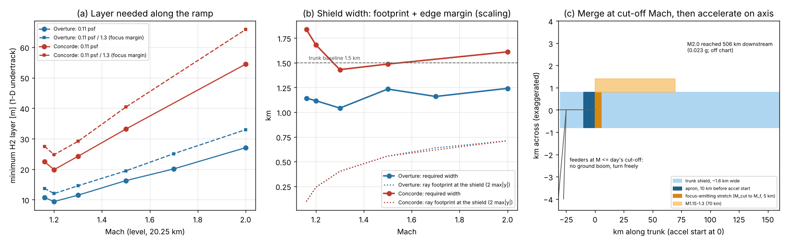

# On-ramp shields for the BoomShield trunk

How should the shield be laid out where traffic joins the Mach-2 spine LAS–DEN–OMA–CHI–CLE–NYC? The spine has 12 on-ramps; LAS takes 32 % of joins and NYC 14 % ([trunk](../../network-maps/trunk/trunk.md)). Feeders arrive at Boomless Cruise, M ≈ 1.15.

Code: `run_focus.py --phase onramp`. Data: `onramp_shield.csv`. Figure: `onramp_shield.png`. Physics and validation are in [focus_booms](focus_booms.md).

Assumptions:
- Shield top at 20 km, aircraft 250 m above.
- Trunk acceleration 0.023 g and deceleration 0.046 g, as in `build_trunk.py`.
- US Standard Atmosphere, with the repo's wind profiles used for the cut-off only.

## Bottom line

1. **Merge first, then accelerate.** Below the day's cut-off Mach, no ray reaches the ground, so feeders can turn, climb and merge anywhere without a shield. With that rule an on-ramp needs **no funnel or wedge**, just a ~10 km apron where the trunk ends: about **20 km on the whole spine (+0.6 %)**.
2. **Width: no narrower, and wider for heavy aircraft.**
   - Near cut-off the rays cross the layer close to the track (±50–200 m at M1.16–1.3, against ±355 m at M2).
   - But the transmitted swell is longer there, so the edge needs more margin.
   - Scaled from the 3-D run that passed: Overture-class needs **1.1–1.25 km** everywhere. Concorde-class needs **1.7–1.85 km at M1.16–1.2**, against 1.6 km at M2.
   - That flare runs ~68 km per ramp per direction, about **+10 % of trunk area**, and only for heavy aircraft.
3. **The layer could be thinner near cut-off acoustically, but lift sets it.** For 0.11 psf (with ×1.3 focus margin), Overture-class needs 10–15 m of H₂ at M1.16–1.3 and 27–33 m at M2; Concorde-class needs 20–29 m and 54–66 m. At 20 km about 30–36 m is needed to float the structure (STATUS §6), so a taper only helps a heavy-aircraft M2 trunk (55 → ~35 m over the first ~100 km).
4. **A shield over only the acceleration or focus zone does not work on its own.**
   - The focus is not the only violation. Every leg above the day's cut-off carries the steady boom: 1.1 psf for Overture, 1.8 for Concorde, 10–16× the limit.
   - So legs above Mach 1.3 need the full trunk.
   - A short shield lets an aircraft go above cut-off only to come back down before the shield ends. That saves < 20 s per 100 km.

## Geometry of a ramp

| Quantity | Value |
|---|---|
| Cut-off Mach at 20.25 km: calm / winter jet / QBO | 1.153 / 1.18–1.19 / 1.08–1.23 |
| Distance between those cut-offs at 0.023 g | 65 km |
| Focus-emitting stretch (M_cut → M_f ≈ 1.165) | 5.4 km |
| Focus on the ground (0.02–0.05 g runs) | 40–48 km ahead of emission, ±15–22 km wide |
| Ray crossing at the shield | 0.15–0.44 km ahead; ±116 m (focus rays) |
| M_cut → 1.3 / → 2.0 (acceleration) | 68 / 506 km |
| 2.0 → M_cut (deceleration, no caustic) | 253 km |

**Table 1. Layer and width along the ramp** (1-D undertrack; width is a scaling estimate)

| Mach | Overture: H₂ for 0.11 psf (×1.3) | Concorde: H₂ (×1.3) | Rays' max \|y\| at shield | Overture width | Concorde width |
|---|---|---|---|---|---|
| 1.16 | 11 (14) m | 22 (28) m | 48 m | 1.14 km | 1.84 km |
| 1.2 | 9 (12) | 20 (25) | 121 m | 1.12 | 1.68 |
| 1.3 | 11 (15) | 24 (29) | 201 m | 1.04 | 1.43 |
| 1.5 | 16 (19) | 33 (40) | 278 m | 1.23 | 1.49 |
| 1.7 | 20 (25) | — | 320 m | 1.16 | — |
| 2.0 | 27 (33) | 54 (66) | 355 m | 1.24 | 1.61 |

How width is estimated:
- Width = 2 × (max|y| + edge margin).
- The edge margin is the 450 m that passed in 3-D (Concorde M2, H₂ 60 m, psf_sweep), scaled by the swell's cross-plane wavelength λ⊥ = V·T_swell/β.
- Add ±185 m for RNP 0.1 navigation, giving ~1.5 km for Overture and ~2.2 km for Concorde near cut-off.

**Altitude.** Keep the trunk altitude. Below 20 km the feeder is under the shield, i.e. unshielded: a climb-and-accelerate departure gives 2.7–5.9 psf. In the 11–20 km isothermal layer the cut-off Mach does not depend on altitude, so a Boomless feeder can climb to 20.25 km at M1.15 and stay silent.

## Shield km per option (M2 spine, 3,614 km; 22 ramp-directions)

The 22 ramp-directions are 10 intermediate ramps × 2 directions plus 2 end ramps × 1.

| Option | Per ramp-direction | Total | vs trunk | Works alone? |
|---|---|---|---|---|
| Full trunk (needed for any leg above cut-off) | — | 3,614 km | 100 % | yes |
| **Merge-first apron** (trunk ends only) | 10 km | **20 km** | +0.6 % | addition |
| Concorde-class flare to ~1.85 km over M_cut–1.3 | 68 km × +0.35 km | ~520 km² | **+10 % area** | addition |
| Merging at 30–60° while accelerating: curved strip, bank ≤ 18° (R ≈ 39 km at M1.2) | 20–41 km | 440–900 km | +12–25 % | addition, avoid |
| Focus-only shield (M_cut → M_f + apron) | 15 km | 340 km | 9 % | **no**: the steady boom above cut-off is 10–16× the limit |
| Onset-only shield (M_cut → 1.3 + apron) | 78 km | 1,730 km | 48 % | **no**: steady boom from 1.0 to 1.8 psf |

## Design rules for merging traffic

1. **Ingress, egress and last mile are conventional.**
   - Fly subsonic, or Boomless at M ≤ the day's cut-off − 0.02 (the real-time cut-off Boomless already needs).
   - Below cut-off any route, turn, climb or descent is silent.
2. **Match altitude below cut-off.** Climb to 20.25 km (250 m above the lid) and hold ±50 m: peak −9 %/+12 %, footprint ±20 %. Level-offs longer than ~2 s add no caustic.
3. **Cross Mach 1 off the lid.** Rays emitted at M 1.00–1.01 focus between the aircraft and the lid. Subsonic feeders should go supersonic ≥ 2 km before the shield start. Boomless feeders already have.
4. **Align with the trunk before exceeding the day's cut-off.** If that is impossible, bank ≤ 18° at M1.7 or ≤ 10° at M1.4 (no ground caustic even at the edge), with the shield under the whole arc.
5. **Acceleration.** Any rate from 0.02 to 0.15 g is acceptable over 55 m of H₂: focus ≤ 0.017 psf (Concorde ≤ 0.043). Higher rates were not run. Begin ≥ 10 km past the shield start.
6. **Lateral.** One lane on the centreline, with the width budget of Table 1 plus navigation error. No side-by-side merging on a 1.5 km shield.
7. **Spacing is not set by booms.** Shielded booms are 0.01–0.04 psf swells of 1–2 s. Aircraft more than ~2 s apart never overlap at a ground point, and 2–3 overlapping swells would still be < 0.11 psf (Overture-class). In-trail spacing is therefore set by ATC and wake (5 nmi ≈ 25 s) and by lid fatigue (~100 flights/day/km, economics.md).
8. **Exit.** Decelerate on the axis to below the day's cut-off before the shield ends. Deceleration forms no caustic. Then diverge freely.

## Caveats

- **Width** is a wavelength-scaling estimate; the 3-D BEM has not been run at M1.15–1.3 (next step: `run_psf_sweep --phase 3d` at M1.2).
- **Wind** shifts only the cut-off here.
- **Aircraft and ramps.** Unshaped sources; ramp positions are taken from `ramps.csv`.
- **Lift budget** follows STATUS. A 10–20 m layer does not float its structure at 20 km.
