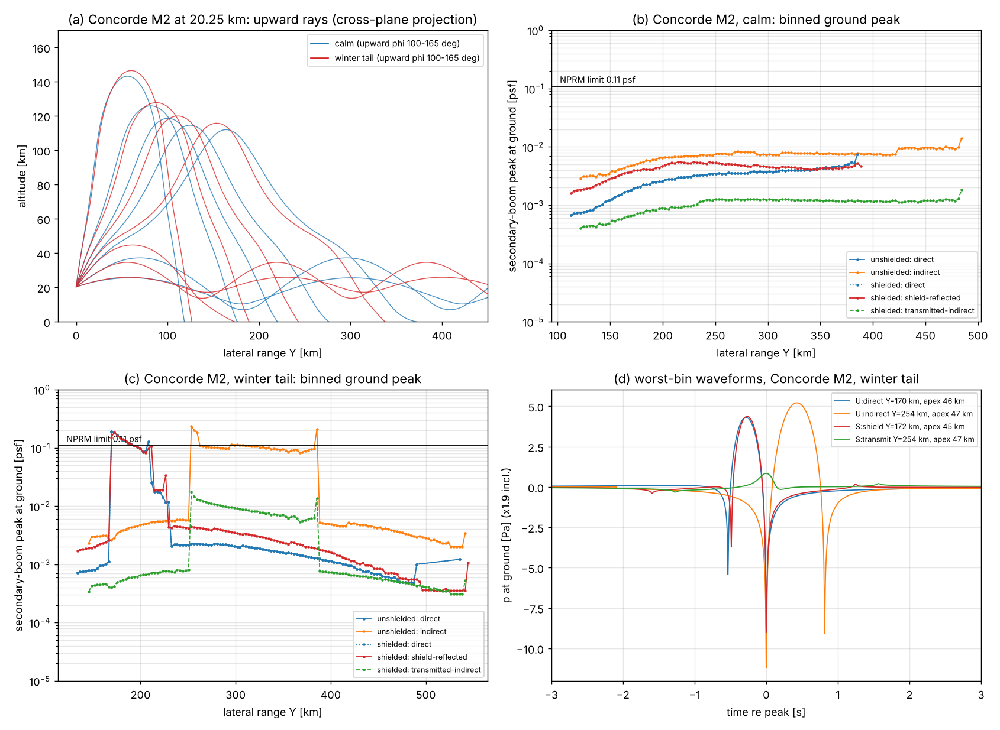

# Secondary sonic booms with BoomShield

Model `boomsim/secondary.py`; driver `run_secondary.py` (one process, ~1.5 h, restart-safe cache); tests `tests/test_secondary.py` (26 pass). Data in `secondary_booms.csv`: `record=bin` rows hold binned ground levels, `record=ray` rows hold per-ray diagnostics. Figure: `secondary_booms.png`.

## Bottom line

1. **The shield does not make secondary booms worse.**
   - Without a shield, the downward boom reflects off the ground and climbs anyway. The NPRM calls what comes back an *indirect* secondary boom.
   - The shield moves that reflection from 0 to 20 km, onto rays with the same horizontal slowness and the same turning heights.
   - In the seven cases run, the shielded worst bin is **0.54–1.02×** the unshielded one.
   - The exceedance zone shrinks to the inner carpet edge (150–230 km), where direct booms already land.
2. **The limit is broken without any shield.**
   - An unshaped Concorde- or SR-71-class aircraft at 20 km exceeds 0.11 psf whenever middle-atmosphere winds form a stratospheric duct. The four ducted cases give **0.14–0.37 psf**.
   - In calm air or a headwind, only thermospheric returns reach the ground, at ≤ 0.02 psf.
   - So compliance is an aircraft and routing problem, not a shield problem.

## NPRM definitions

FAA, "Enabling Supersonic Overland Flight", 91 FR 40470 (2 July 2026), docket FAA-2026-6935. Proposed § 91.817(a)(2)(i) requires surface overpressure ≤ 0.11 psf for primary booms and for **direct and indirect secondary** booms. New § 1.1 definitions, paraphrased from Holland & Knight (9 Jul 2026) and DLA Piper summaries because the FR text could not be fetched here:

- **Primary:** travels directly from the aircraft to the surface.
- **Secondary:** refracted or reflected so that it travels farther and may reach the surface.
- **Direct secondary:** "over the top": refracted back to the surface by the upper atmosphere.
- **Indirect secondary:** reflected first by the surface, then refracted back by the upper atmosphere.

How this study applies them:
- A *shield-reflected* boom fits neither definition literally, because the reflector is a structure at 20 km, not the surface. It is scored here as a secondary boom subject to 0.11 psf.
- Both definitions require upper-atmosphere refraction. Rays beyond the lateral cut-off turn in the lower atmosphere and then climb; they are counted as direct.
- Terrain reflections are not modelled.

## Method

- **Atmosphere.**
  - USSA76 below 86 km.
  - From 86 to 200 km: USSA76 kinetic-temperature formulas, tabulated mean molar mass and hydrostatic pressure.
  - γ and c include atomic O: c = 405 m/s at 120 km and 567 m/s at 150 km.
- **Winds.** Representative 40°N CIRA-86 profiles (Fleming et al. 1990): a winter westerly of 64 m/s at 60 km and a summer easterly of −60 m/s at 65 km. Tides are set to zero.
- **Rays.** 3-D Hamiltonian rays in a moving stratified medium, integrated in time so turning points are regular.
  - Launched on the Mach cone from 20.25 km, φ = 0–180° in 0.1° steps.
  - The ground and the shield top act as mirrors.
- **Amplitude.** Blokhintzev invariant with tube flux area Q = (e_x × ∂r/∂φ)·v_ray, taken from neighbouring rays.
  - A sign change of Q is a caustic and is applied as a Hilbert transform.
- **Waveform.** Augmented Burgers (`propagate.burgers_step`) from the Whitham near field at each φ. The upward lobe uses A_v − A_L.
  - Absorption: classical plus rotational in the Sutherland & Bass (2004) form, which scales as 1/p (0.43 dB/km at 1 Hz at 100 km). ISO O₂/N₂ relaxation is added.
  - Shield: R(f) or T(f) from `shield.transfer` at the ray's trace speed, for H₂ 30 m with 1.24 kg/m² faces. Every ray with |φ| < 63.4° hits the 1 km strip.
  - Ground reflection ×0.9.
  - Δp/p_ambient peaks at 0.05–0.17, marginal for weak-shock theory.
  - Propagation is linear below (apex − 15 km).
- **Ground levels.** Energy is binned in 3 km lateral bins per branch: p² ∝ (ρc²Ω/|v_z|) Σ E_h Δφ/ΔY. This stays finite at the fold caustic on every carpet edge.
  - Ground factor ×1.9; peak taken as max|p| (conservative).

## Validation

| Check | Model | Reference |
|---|---|---|
| p, ρ at 86–200 km | ≤ 1 % | USSA76 tables |
| Ground classical absorption | ≤ 1 % | ISO 9613-1 |
| Primary boom vs `ground_signature` (Concorde, SR-71; φ = 0°, 40°) | peak ≤ 0.5 %, PLdB ≤ 0.1 dB | — |
| Turning heights | 41–51 km; 111–140 km | 40–50; 100–130 km (Balachandran, Donn & Rind, *Science* 197, 1977) |
| Delay after overflight | 8–13 min (stratospheric); 18–31 min (thermospheric) | "10–15 min" (Rogers & Maglieri, *Acoustics Today*, 2015) |
| Range from track | 150–390 km; 110–550 km | 165–1000 km (Balachandran 1977) |
| Amplitude | 5–18 Pa (stratospheric); 0.1–1 Pa (thermospheric) | "1–10 Pa" (Rogers & Maglieri); "~0.2 psf" (Falcon-9 JASA-EL 2026, citing Concorde); 0.1 Pa far range (Liszka 1978)* |

\*Abstract only, unverified.

Stratospheric returns sit at or slightly above the observed range. Likely reasons: favourable jets, a steady 2-D carpet, and no turbulence or multipath smearing (real booms last 5–10 s). Treat the levels as good to about ×2.

## Results (worst 3 km bin, psf)

| Aircraft, atmosphere | U direct | U indirect | S direct | S shield-reflected | S transmitted | **Max U → S** | PLdB; CSEL U → S |
|---|---|---|---|---|---|---|---|
| Concorde M2, calm | 0.008 | 0.014 | 0.008 | 0.006 | 0.002 | **0.014 → 0.008** | –; 16 → 8 |
| Concorde, winter tailwind | 0.19 | 0.23 | 0.19 | 0.19 | 0.018 | **0.23 → 0.19** | 65 → 61; 84 → 82 |
| Concorde, winter headwind | 0.009 | 0.020 | 0.009 | 0.017 | 0.003 | **0.020 → 0.017** | –; 20 → 17 |
| Concorde, winter crosswind | 0.18 | 0.20 | 0.18 | 0.205 | 0.016 | **0.20 → 0.205** | 65 → 62; 82 → 82 |
| Concorde, summer tailwind | 0.37 | 0.34 | 0.37 | 0.31 | 0.025 | **0.37 → 0.37** | 73 → 70; 91 → 88 |
| SR-71 M3.2, calm | 0.005 | 0.003 | 0.005 | 0.002 | 0.001 | **0.005 → 0.005** | –; 9 → 11 |
| SR-71, winter tailwind | 0.14 | 0.11 | 0.14 | 0.11 | 0.004 | **0.14 → 0.14** | 58 → 58; 81 → 80 |

U = unshielded, S = shielded. "–" means no Mark VII band above threshold (sub-5 Hz rumble). Exceedance zone: winter tailwind 170–386 → 170–209 km; summer 155–254 → 155–164 km.

**Why the shield adds nothing** (one ray, φ = 55°, winter tailwind; normalised ground energy):

| Case | Normalised ground energy |
|---|---|
| Perfect mirror at 20 km | 1037 |
| Unshielded ground reflection | 1016 |
| Real shield | 199 |

- The fresher wave reflected at 20 km loses more to shocks: −6.4 dB, against −3.3 dB for the aged wave.
- The real shield reflects 99.9 % of the incident energy (|R| ≥ 0.86 above 0.3 Hz). Its phase, however, swings from 150° at 1 Hz to 25° at 30 Hz (face mass and gas stiffness), so the reflected pulse is dispersed and less of it survives the duct.
- That 7 dB margin is model-specific. The robust result is the bound **shield-reflected ≤ perfect mirror ≈ unshielded indirect**.

## Uncertainty

- **Winds dominate.** A duct versus no duct changes levels 15–40×. Tides, gravity waves and stratospheric warmings can open ducts in any season. The profiles are representative, not a climatology.
- **Caustics and binning.** Bins of 1.5 or 6 km move peaks by +10–45 % or −5–30 %. Adding branches coherently gives up to +75 %.
- **Not modelled:**
  - scattering into the gap between the primary and secondary carpets;
  - finite-strip diffraction of the reflected field below 2 Hz; the 1-D R likely overstates reflection there;
  - shield motion relative to the air;
  - shaped aircraft.
- **Trimmed after container restarts:** SR-71 crosswind; half the azimuths of the transmitted family when more than 24 were needed.

## Mitigations

- **Aircraft and route.**
  - Route and schedule on wind climatology, avoiding ducting azimuths (eastbound in winter, westbound in summer).
  - Shape the upward boom as well as the downward one.
  - Cruise higher or slower.
- **Shield edges.**
  - Only rays reflected at |y| ≈ 310–400 m (φ ≈ 51–58°) feed the stratospheric duct.
  - Raising the outer 150–200 m of each side by 5–10° (a shallow dish) would steepen those reflections by 10–20°. Their trace speed would reach ≥ 370 m/s, above the roughly 355 m/s the modelled ducts accept, so they would fall into the thermospheric family at ≤ 0.02 psf.
  - Check this in the BEM against the edge leak.
- **Absorptive top layer.** It would act mainly above a few hertz, while the ducted peak comes from 0.3–3 Hz content. Low value per kilogram.
- **Avoid a cleaner low-frequency mirror** (heavier or stiffer stacks). It raises the reflected secondary toward, but not above, the unshielded indirect level.

