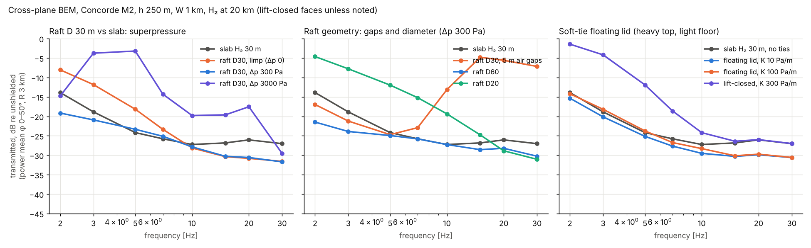

# BoomShield — structural concept study

**Skyloop · 21 October 2026 · screening study.** Setup: a 1 km wide H₂ layer at 20 km (US-1976: 216.65 K, 5529 Pa, ρ = 0.0889 kg/m³) under a Concorde-class aircraft at Mach 2 (V = 590 m/s), h = 250 m. All masses and lifts are per m² of planform.

**Files** (all in `boom-shield/structure/`):

- `raft_bem.py`: tube-raft cross-plane BEM on `boomsim.bem2d`.
- `run_raft_bem.py` and `analyse_bem.py`: produce `results/raft_bem*.csv` and `figures/raft_vs_slab.png`.
- `budget.py`: produces `results/budget_*.csv`.

## Verdict

1. **The finding that changes the brief: superpressure is harmless, but a locked volume is a stud.**
   - Tube superpressure up to 1 kPa costs nothing acoustically. The ovalisation stiffness 3Δp/R is tolerable up to about 200 Pa/m (D 30).
   - What couples the faces is the skin's hoop-stretch ("breathing") stiffness, E·t/R². At 444 Pa/m it is harmless; at 4,400 Pa/m the shield is transparent.
   - Holding volume constant against the 255–1,000 Pa diurnal superheat swing (NASA superpressure practice) needs exactly that stiffness. **Every viable architecture is therefore quasi-zero-pressure and breathes about 5–9 % in volume each day.** This extends the vacuum review's rule from "anything holding the faces apart" to "anything holding the volume fixed".
2. **Recommended baseline: a touching raft of compliant-hoop H₂ tubes, D ≈ 60 m (40–80 m to test).**
   - Acoustically it equals the 60 m slab.
   - It needs no ties and no cross-width compression members, and its structural mass is 0.6–1.2 kg/m² against 3.9 kg/m² of lift.
   - **Alternate:** the "floating-lid" zero-pressure pillow with soft ties (K 3–30 Pa/m). It is acoustically the best case modelled, but it needs RT stabilisation and many tie elements.
3. **Rejected:**
   - (b) drop-stitch at superpressure: its ties are 10–80× too stiff.
   - (c) lens with cross-width struts: 9–130 kg/m² of structure against 2–4 kg/m² of lift.
   - Raft with air gaps between tubes: a 2 m slit already loses 15 dB.
4. **Hydrogen is forced.**
   - A 4,000 km × 1 km × 30 m corridor holds 0.6–0.74 Mt of H₂, 0.6–0.8 % of one year's world hydrogen supply.
   - Filled with helium, the same corridor would take 35–45 years of world helium production.

## 1. Acoustics: cross-plane BEM, raft vs slab

**Model.**
- Each tube is its own K₀ gas domain, with exterior air in Helmholtz form.
- Touching tubes share a flattened contact strip: a double skin with no gas, b = 1–4 m.
- The skin has mass, along-track tension Δp·R/2, and a curved-membrane hoop operator N(w″ + w/R²) − κ(Et/C)∮κw (N = Δp·R), passed to `bem2d` through `Problem.ties`.
- **Checks:**
  - Single tensioned tube vs cylinder-harmonic series with mode-dependent impedance: 0.12 % error (`raft_bem.self_test`).
  - Closed-contour energy balance for touching and gapped rafts: 0.6 %.
- **Metric:** |p/p_inc| on the 3 km matching circle (as in the 3-D study), power-averaged over φ 0–50°. Also reported: undertrack (φ ≤ 3°) and a near-field line 100 m below the shield (|y| ≤ 300 m), which shows local leakage that edge diffraction hides at 3 km.
- Faces are lift-closed unless noted. Linear incident field. 8 frequencies, 2–30 Hz.

**Table 1 — transmitted level, dB re unshielded (5–30 Hz power mean; 2–3 Hz in brackets)**

| configuration | circle φ 0–50° | undertrack | near-field line |
|---|---|---|---|
| slab H₂ 30 m (3-D-study reference) | −26.0 (−15.7) | −32.0 | −36.6 |
| slab H₂ 60 m | −24.7 (−21.7) | −35.5 | −45.6 |
| raft D 30, limp (Δp 0, Et 0) | −24.0 (−9.5) | −23.2 | −25.1 |
| raft D 30, Δp 300, Et 10⁵ N/m (Et/R² 444) | −27.0 (−19.9) | −26.9 | −29.4 |
| raft D 30, Δp 1000 (3Δp/R = 200 Pa/m) | −27.2 (−15.5) | −26.4 | −29.1 |
| raft D 30, Δp 3000 (600 Pa/m) | **−10.3** | −23.9 | −11.3 |
| raft D 30, Et 10⁶ (Et/R² 4,440 Pa/m) | **−4.2** (−0.5) | −3.1 | −3.6 |
| raft D 30, contact strip 4 m | −26.9 | −26.7 | −29.4 |
| raft D 30, air gaps 2 / 5 / 15 m | **−12.3 / −8.4 / −4.2** | −9.7 / −6.3 / −2.7 | −11.5 / −7.5 / −3.3 |
| raft D 30, light skin 0.2 kg/m² | −25.7 | −23.7 | −26.0 |
| raft D 20 (Et/R² 1,000) | −17.3 | −15.7 | −17.0 |
| **raft D 60, Δp 300 / 1000** | **−27.1 / −27.9** (−23) | **−36.3 / −37.8** | **−41.2 / −41.5** |
| floating lid T 30, top 2.38 / bottom 0.1 kg/m², K 0 / 10 / 30 | −28.1 / −28.4 / −28.7 | −32.2 / −33.4 / −36.3 | −36.4 / −38.2 / −41.7 |
| floating lid, K 100 | −27.5 (−15.7) | −37.0 | −32.1 |
| slab lift-closed, smeared ties K 300 | **−18.3** (−2.6) | −20.4 | −18.9 |

ET_SWEEP_PLACEHOLDER

**Reading the table.**

- **Edge diffraction still sets the 3 km level** (−24 to −28 dB for every good case), as in the 3-D study. The near-field line shows the shield's own leakage, which matters once edges are fringed.
- **Raft D 30** matches the slab at 3 km but leaks 6–9 dB more undertrack and in the near field.
- **Raft D 60** matches the 60 m slab in every metric. The contact cusps behave like the limp partitions of the 3-D study: harmless as long as no air slit opens.
- **Moderate stiffness helps at 2–3 Hz.** Both tension and soft ties partly cancel the gas's negative dynamic stiffness ρ_g/(a²d) (review_evanescent §3.1), giving 4–10 dB more at 2–3 Hz. That band is the inaudible, impulse-carrying part.

## 2. Architectures: mass and feasibility

Table 2 assumptions:
- **Laminate:** 0.2 kg/m² for 100 kN/m ultimate, safety factor 4. **Assumed**, HAA-class.
- **Film:** minimum gauge 0.03 kg/m², +15 % for seams.
- **Fixed allowances:** controls 0.05 kg/m²; tether load-spreading 0.10 kg/m²; reserve 15 % of lift.
- **Superheat** 20 K (central case) → Δp_max = 150 + 510 Pa. The hot case is 39 K, the measured value for a He superpressure balloon (search abstract, unverified).

Volume factor: a circle or ellipse holds π/4 = 0.785 of the slab volume at the same depth, so a raft of D-tubes lifts like a slab of 0.785 D.

**Table 2 — per m² planform (H₂ lift density 0.0827 kg/m³)**

| architecture | lift | structure | net after reserve | face coupling K [Pa/m] | allowable | status |
|---|---|---|---|---|---|---|
| (a) raft D 30, Δp 660 (1,150 hot) | 1.95 | 0.45 (0.66) | 1.21 (1.00) | oval 132–229; breathing must be ≲ 400–1,000 | BEM | ✔ if hoop compliant |
| (a) raft D 60 | 3.90 | 0.73 (1.15) | 2.58 (2.16) | oval 66–115 | BEM | ✔ baseline |
| (b) drop-stitch SP, T 30, fibre ties | 2.48 | 0.39 | 1.72 | **2,420** = Δp/(ε_w T) | 35–100 (smeared, 1-D) | ✘ |
| (b) same, with soft ties K = 30 | – | – | – | 30 | – | ✘: needs 73 % tie strain and a 17 m day–night stroke |
| (c) lens T 30–60, zero-pressure, struts | 1.95–3.9 | **9.1** | −6 to −7 | ~0 | – | ✘ |
| (c) lens, superpressure | – | **70–130** | ≪ 0 | – | – | ✘ |
| (d) floating lid, T 30 | 2.46 | 0.28 (+ lid ballast) | 1.81 → spent as lid mass | 3–30 (designer's choice) | ≥ 0.8 (RT) | ✔ alternate |

**(a) Raft.**
- Each tube carries Δp by hoop tension alone, so nothing spans the faces.
- **It must touch its neighbours:** air slits are a direct leak.
- Lace the tubes at the upper and lower cusps with horizontal links (no vertical studs) to give cross-track bending stiffness.
- **The skin must be hoop-compliant:** a lobed or fluted skin on along-track tendons, sized so Et/R² stays below the BEM limit. The tubes then breathe.
- Excess lift (2–3 kg/m² at D 60) should go into heavier, longer-life faces or be removed by reducing D. It should not become tether pull, because 1 kg/m² of excess lift is 10 kN per metre of corridor.

**(b) Drop-stitch.**
- Flatness needs ties at spacing s ≈ √(4·T·f) ≈ 8 m for 0.5 m pillowing.
- Smeared tie stiffness is Δp/(ε_w·T), independent of spacing: about 2,400 Pa/m for UHMWPE at about 1 % working strain. **Confirmed failure.**

**(c) Lens.**
- The face tension of a zero-pressure lens is N = Δρ·g·W²/4 ≈ 200 kN/m, independent of T. With superpressure it rises to 2.8–5.5 MN/m.
- The rim compression of 2N needs CFRP struts 1 km long and 14–33 m in radius at 2 km spacing. A raft of narrow lenses is simply a tube raft.

**(d) Floating lid.** A new arrangement:
- **No evanescent gas is neutral.** It must satisfy ρ_g ≤ γp/V² = 0.022 kg/m³ at Mach 2, so it lifts at least 75 % as much as air displaced. A "hung" acoustic layer therefore cannot hang, and the layer must be the lift body.
- **Put the system mass on the top face** (lid ≈ lift; e.g. thermal-control laminate, PV, or ballast), with a light floor. The floor is then a gravitationally stable H₂-over-air interface (stiffness +Δρ·g = +0.81 Pa/m), the lid floats on the gas, and the rims carry the rim-bulge tension (≈ 180 N/m at T 30): **the structure is self-equilibrated, with no static tie load.**
- The lid is Rayleigh–Taylor unstable at wavelengths λ > 2π·√(N/Δρg) ≈ 94 m. Ties of K > 0.8 Pa/m stabilise it, and K 3–10 Pa/m also holds wind-pressure deflection to 0.5–2 m.
- Along-track partitions must be slack (bellows) so they do not act as line ties.

## 3. Loads

**Superheat.**
- The constant-volume Δp swing is p·ΔT/T: 255 / 510 / 995 Pa for 10 / 20 / 39 K.
- Flight Δp reported for NASA superpressure balloons is ≤ 180 Pa (stratocat, unverified).
- **If the volume floats** (the required case): lift swings 5–9 % per day, which means ±150–300 m of altitude if free (exponential scale height 6.3 km), or ±1–2 kN/m of corridor if held by tethers.
- **Recommendation:** let the layer float on winched tethers and have aircraft fly a fixed offset above the reported shield altitude.

**Wind** (20 km mean 10–20 m/s; winter 20–30 m/s; peaks near 50 m/s, per airship literature from search abstracts; T 30):

| U [m/s] | side force [kN/m of corridor] | quasi-steady gust lift, w′ = 5 % U [Pa] |
|---|---|---|
| 20 | 0.50 | 5.6 |
| 30 | 1.12 | 12.6 |
| 40 | 1.99 | 22.3 |

The 1 km chord acts as a wing. The gust lift is an upper bound, because the layer's added mass ρπW/4 ≈ 70 kg/m² (versus about 2.5 kg/m² of structure) makes it ride gusts. Mountain-wave updrafts are the open case.

**Station-keeping.**
- **Propulsion is excluded:** F·U/η ≈ 67 kW per metre of corridor, about 270 GW for 4,000 km.
- **Tethers** every 2–5 km at 30 m/s carry 2.2–5.6 MN each:
  - UHMWPE tether 6–10 cm in diameter, 90–220 t;
  - downforce 0.16 kg/m² (45° elevation);
  - jet-stream drag on the tether itself 0.6–1.0 MN, scaled from the addendum.

**Boom transient.**
- With |R| ≈ 1, the top face sees about 2× the incident pressure: 200–600 Pa. That is 10–25× the lift head of the floating lid and 0.3–4× the raft superpressure.
- Top skins will go slack and wrinkle on every pass, with 0.1–0.3 m displacement (review §3.7). Soft ties will slack and re-tension, so they need damping.
- At 20–100 flights a day for 30 years that is 2×10⁵–10⁶ cycles. **Flex-crack pinholes in the film are the main leak driver.**

## 4. Hydrogen

| quantity | value |
|---|---|
| H₂ inventory, 4,000 km × 1 km × 30 m (raft D 30) | 0.74 (0.58) Mt; 8.3 (6.5) × 10⁹ Nm³ |
| share of world H₂ supply (~97 Mt in 2023, IEA GHR 2024) | 0.8 % (0.6 %) of one year |
| same volume as He (world ~185 × 10⁶ m³/yr, 2024, secondary, unverified) | **45 (35) years** of world output: ruled out |
| permeation, 25 µm LDPE (≈ 7 Barrer at 23 °C, **assumed**; cold correction E_a 35 kJ/mol **assumed**) | 36 %/yr at room temperature; ~0.2 %/yr at 217 K |
| replenishment budget (holes and flex cracks dominate) | 5–20 %/yr ≈ 0.04–0.15 Mt/yr; first fill $1–4 B at $2–6/kg |
| stored combustion energy | 60–90 PJ for the corridor, ≈ 5 kt TNT-equivalent per km |

**Safety flag (rough).**
- H₂–air keeps a lower flammability limit near 4 % down to about 50 mbar.
- Reported minimum ignition pressures are below 50 mbar for hot-wire ignition and about 100 mbar for spark ignition (conference abstracts, unverified). The layer sits at 55 mbar: marginal for sparks, not safe against engine exhaust.
- A puncture releases buoyant H₂ that rises toward the flight level 100–250 m above. Aircraft debris falling into the layer could start a fire that spreads.
- **Needs:** compartments (tube ends or bellows partitions every ≤ 250 m), leak detection that closes sections to traffic, and a proper hazard analysis before anything else is built.

## 5. Next acoustic and structural iteration (parameters to test)

1. **Raft, baseline:**
   - D ∈ {40, 60, 80} m; Et/R² ∈ {100, 300, 1,000} Pa/m; Δp ∈ {100, 1,000} Pa.
   - Contact gap tolerance: 0, 0.3, 1 m.
   - Horizontal cusp-lacing springs.
   - Lift-closed vs 0.5 kg/m² skins.
   - **Full 3-D PLdB carpet** at W 1 km, with and without a 150 m fringe (the fringe exposes the near-field leak).
   - Tube end domes every 250–500 m (along-track cell walls).
2. **Floating lid:**
   - Discrete soft ties at 5, 10 and 25 m pitch with K 3–30 Pa/m. This checks the line-tie discreteness effect; `bem2d` line ties are being fixed by another agent.
   - Bellows partitions every 100 m.
   - Lid 2.4 kg/m² vs 0.15 kg/m² plus hold-down (queued: `slab_H2_30_light_*`).
3. **Both:**
   - Nonlinear slack top face under a 200–600 Pa pulse.
   - Breathing ±9 % thickness.
   - Wind-driven roll.

## 6. Open risks

1. **Thermal breathing.** A layer that cannot be volume-locked moves ±150–300 m in altitude, or swings tether load, every day. Thermal-control coatings (superheat < 10 K) are the main lever; the achievable value is unverified.
2. **Compliant-hoop skin.** A lobed skin with Et/R² ≲ 10³ Pa/m at 10–15 % equivalent hoop strain is not standard balloon practice and needs design and test.
3. **Hydrogen fire next to traffic** (§4).
4. **1 km-chord aerodynamics**: gust and mountain-wave lift, roll, and flutter of slack faces.
5. **Fatigue** at 10⁵–10⁶ boom cycles, which drives leakage.
6. **Tether field**: 800–2,000 tethers through the jet stream for 4,000 km.
7. **Model limits:**
   - 2-D, x-invariant, linear.
   - Ratios are taken at the matching circle, not ground PLdB.
   - The raft's contact strip is idealised (no sliding).

**Sources** (verified only to search-result level; page fetches were blocked):
- IEA, *Global Hydrogen Review 2024*, demand ≈ 97 Mt in 2023: <https://www.iea.org/reports/global-hydrogen-review-2024/hydrogen-demand>
- USGS MCS 2025/2026 helium (world 185 × 10⁶ m³ in 2024 via secondary press, **unverified**): <https://pubs.usgs.gov/periodicals/mcs2026/mcs2026-helium.pdf>
- NASA superpressure-balloon Δp ≤ 180 Pa and few-hundred-ft excursions:
  - <https://stratocat.com.ar/fichas/2022/WNK-20220527.htm>
  - <https://aerostar.com/news/raven-s-aerostar-subsidiary-announces-successful-flight-of-nasa-prototype-super-pressure-balloon-in>
- Superheat 39 K and 649 Pa (thermal-model paper, abstract only): <https://onlinelibrary.wiley.com/doi/abs/10.1155/2018/7806036>
- Stratospheric wind minimum near 20 km: <https://arxiv.org/pdf/1402.6706> and <https://ams.confex.com/ams/pdfpapers/128256.pdf>
- H₂ flammability at sub-atmospheric pressure:
  - <https://arxiv.org/pdf/2602.10279>
  - AIChE 2012 (Le, Nayak & Mannan): <https://www.aiche.org/conferences/videos/conference-presentations/flammability-limits-hydrogen-and-its-mixtures-hydrocarbons-air-atmospheric-and-sub-atmospheric>
- SPICE tethered balloon (Davidson et al., *Phil. Trans. R. Soc. A* 370, 2012, cited from the addendum, not re-verified)
