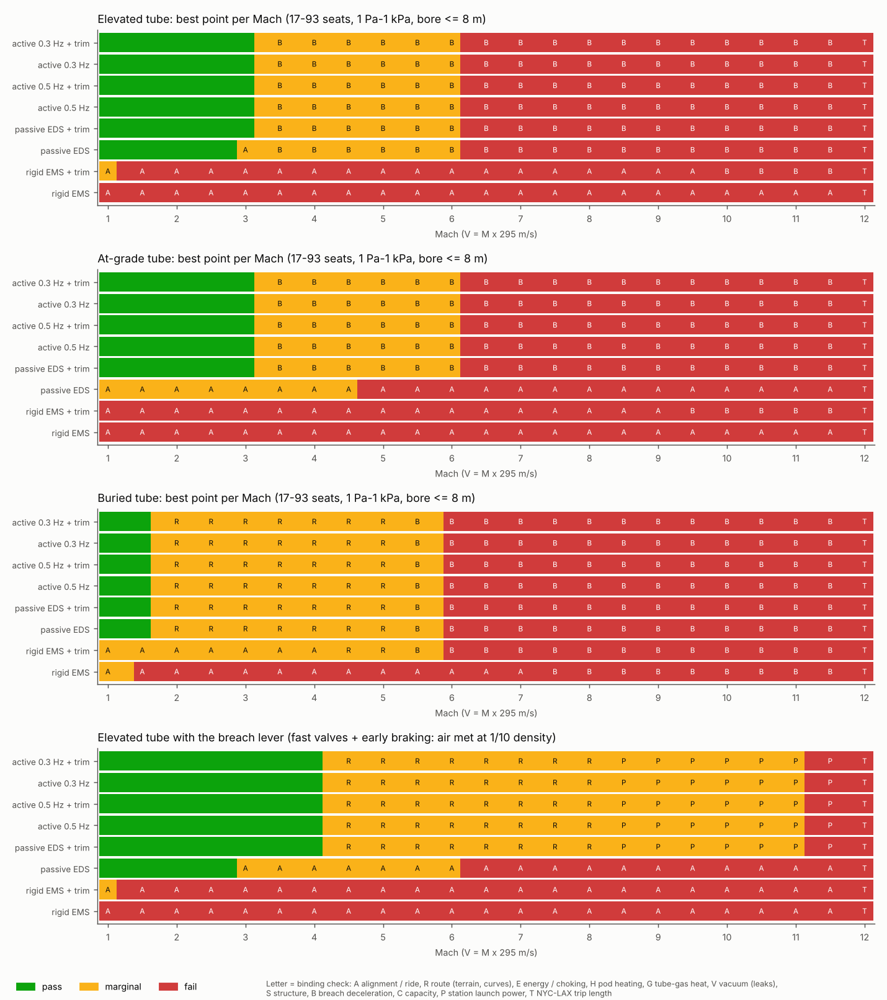
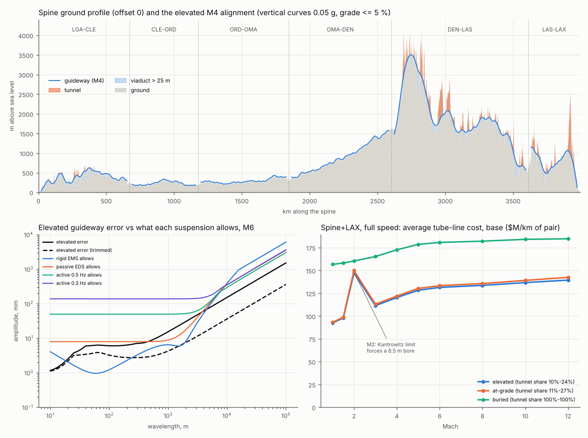
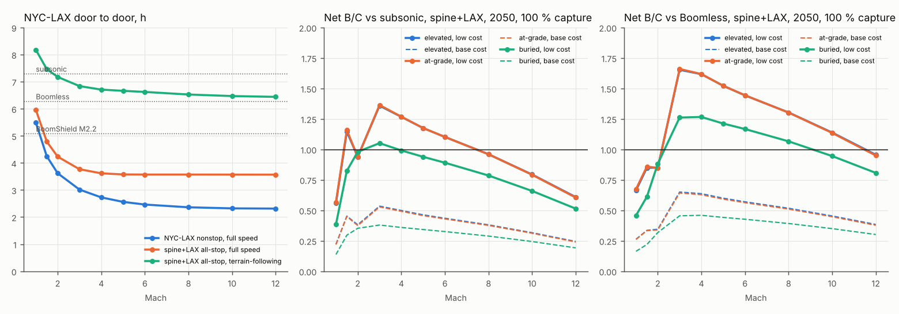

# Hyperloop (our version): a ground tube with compliant-gap maglev pods

**Skyloop review · 23 October 2026 · screening level.** A low-pressure tube on pylons near the ground (at-grade and buried for comparison), carrying SC-EDS maglev pods with a compliant, actively controlled gap. As with BoomShield, this maps the rough feasible region, taking faster as better.

- **Code:** `hyperloop.py` reuses the review's checks read-only (regime.evaluate, hybrid.allow_amp, heating, sky_model demand and lifecycle), so results are comparable. Terrain comes from the AWS Terrarium DEM every 500 m along each spine leg at five lateral offsets. `hl_terrain.csv` and `hl_grid.csv` are gitignored and rebuildable.
- **Conventions:** V = M × 295 m/s. *(A)* marks an assumption; web items are **unverified** search summaries.

## Bottom line

- **The compliant gap solves alignment, as hybrid.md said.** An active 0.3 Hz / 0.3 m gap, or a passive EDS gap plus slow pylon trim, rides a realistic pylon guideway to **M13–20**. Rigid EMS (Transrapid-type) fails above ~M0.5–1.
- **Breach deceleration now limits speed.** A pod meeting ambient air in a full-bore breach takes 2.5 / 10 / 23 g at M2 / 4 / 6: **pass to M3, marginal to M6, fail above, in every setting.** Fast valves plus early braking (air met at 1/10 density, *(A)*) give pass M4, marginal M11. Then right-of-way, launch power and trip length bind.
- **Terrain, not curve radius, sets cost.** The plains legs (CLE–ORD–OMA–DEN, ~1,950 km) need almost no tunnel. The Appalachians, Rockies and Transverse Ranges force **240 km of tunnel at HSR speed, 690 km at M4, 910 km at M12** (6 → 18 → 24 % of the rural route), plus ~1,200 km of viaduct over 25 m. Grade and roughness set most of it; 0.1 g vertical curves barely help.
- **Cost:** **$120 M/km per tube pair** route average at M4 (low $51 M, high $300 M), against $80 M for a standard elevated km. Spine+LAX costs **$552 B** ($233–1,344 B).
- **NYC–LAX door to door: 2.73 h nonstop at M4**, 2.46 h at M6, 3.62 h all-stop.
- **B/C peaks at M3–4.** Spine+LAX, 2050, 100 % capture, net vs subsonic: **0.50–0.53 base, 1.27–1.36 low cost**; vs Boomless 0.64–0.65 / 1.62–1.65; vs BoomShield M2.2 0.33–0.35 / 0.84–0.89. At 30 % capture, ≤ 0.63.
- **It pays below ~$52 M/km all-in** (net, vs subsonic, 100 %): $71 M vs Boomless, $29 M vs BoomShield, ~$10 M at 30 % capture.
- **Verdict:** the review's only tube without a physics veto up to ~M6, but a $50 M/km and moving-block-certification problem, not a Mach problem. **Design for M3–4, elevated, active gap, ~4 m bore at ~10 Pa.**

## 1. Alignment and ride (`hl_alignment.csv`, `hl_align_limits.csv`)

**Error spectrum** (RSS amplitude per wavelength, *(A)*; trimmed values in brackets):

| Source | Elevated | At-grade | Buried |
|---|---|---|---|
| As-built / survey | 1 mm + 2 mm/km | same | same |
| Thermal camber (10 K top–bottom, 30 m span) | 3 mm at 25–70 m | — | — |
| Settlement | 5 mm pier differential (1) | 8 mm embankment (2) | 2 mm (1) |
| Frost heave | — | 5 mm at 10–100 m (2 mm) | — |
| Wind on pylons (25 m/s limit) | 2 mm, 60 m–2 km | — | — |
| Creep and ground movement | 15 (3) mm/km | 20 (5) mm/km | 5 (2) mm/km |

Calibration: Transrapid girders are machined to ~0.1–0.4 mm (and run ≤ M0.4); Shanghai caps added pier settlement at 1 mm and re-aligns at 5 / 8 mm; Eurocode uses 18 K for steel decks. Seismic offset is a stop-and-resurvey event.

**Highest Mach on a fixed guideway** (0.05 g ride; pass / marginal, i.e. within 2×):

| Suspension | Elevated | + trim | At-grade | + trim | Buried |
|---|---|---|---|---|---|
| Rigid EMS 10 mm + 1 Hz secondary | — / 0.8 | 0.5 / 1.0 | — | 0.2 / 0.6 | 0.6 / 1.4 |
| Passive SC-EDS 0.10 m gap | 2.9 / 6.2 | **12.9** / 20 | — / 4.6 | 8.7 / 17.5 | 8.7 / 17.5 |
| Active gap 0.5 Hz, 0.15 m | 7.7 / 15.6 | > 20 | 5.8 / 11.7 | > 20 | > 20 |
| Active gap 0.3 Hz, 0.3 m | **13** / 20 | > 20 | 9.7 / 19.5 | > 20 | > 20 |

Binding wavelengths are 0.6–3 km (passive) and 5–18 km (active). Slow trim (pylon jacks, survey every few weeks, ~$1.5 M/km) is worth as much as the active gap.

## 2. Route geometry (`hl_route.csv`, `hl_route.png`)

A linear program per leg × offset × Mach keeps the guideway 6–25 m above ground (viaduct preferred to tunnel) with |z''| ≤ a_v/V², a_v = 0.05 g (HSR vertical radii of 10–24 km at 300–350 km/h), and grade ≤ 5 %. Offsets of ±25–50 km are allowed where the arc radius is at least R_min = V²/0.5 g (71 / 284 / 639 / 1,136 km at M2 / 4 / 6 / 8).

| Mach (elevated) | 0.3 (HSR) | 1 | 2 | 4 | 6 | 8 | 12 |
|---|---|---|---|---|---|---|---|
| Tunnel, km (of 3,760 rural) | 240 | 360 | 566 | 692 | 762 | 798 | 910 |
| of which DEN–LAS | 188 | 252 | 374 | 453 | 478 | 500 | 540 |
| Viaduct > 25 m, km | 546 | 916 | 1,072 | 1,197 | 1,274 | 1,350 | 1,419 |
| Deepest overburden, m | 617 | 737 | 967 | 1,182 | 1,813 | 1,792 | 1,762 |
| Reverse curve to dodge a 2 km obstacle, km | — | 12 | 24 | 48 | 71 | 95 | 143 |

- **Plains are straight enough:** ≤ 20 km of tunnel even at M12, but 100–280 km of tall viaduct per leg.
- **Right-of-way binds above ~M4:** with an obstacle (town, lake, reserve) to dodge every ~50 km *(A)*, reverse curves stop fitting. A rolling pod (0.62 g) reaches M4.25; rail-like 0.24 g caps at M2.75.
- **Buried** runs 1.2–2.3 km under the Rockies (Gotthard: 2,300 m, 44–46 °C rock), so passes only to M1.5.
- **Terrain-following** (M0.3–0.6 in mountains) saves ~450 km of tunnel but makes NYC–LAX 6.7 h; B/C < 0.35.

## 3. Tube, gas and heat (from `hl_grid.csv`)

17 t, 50-seat pod; 4.1 m bore (β = 0.3); 10 Pa.

- **Kantrowitz:** β_max = 0.13 / 0.25 / 0.31 / 0.36 at M2 / 3 / 4 / 6, so a pod-sized bore runs unchoked only from ~M4. At M2–3 it chokes (piston heating 350–700 K per pass, crossovers every ~1 km) or needs a 6.5 m bore (the M2 cost spike).
- **Pumping:** 0.1 cm²/km of leaks at 10 Pa need ~12 m³/s, ~120 kW per km; floor ~3–6 Pa; re-evacuating 10 km takes ~3 h.
- **Gas heat:** 76 / 157 K per pass at M4 / 6, returned to the ambient steel wall within τ ≈ 2 s at 10 Pa (18 s at 100 Pa). Throughput cap at M4 is 1,300 pods/h at 10 Pa (231 needed) but 116/h at 100 Pa: **keep ≤ ~30 Pa above M4.**
- **Pod heat:** nose 680 / 916 / 1,135 K at M4 / 6 / 8 (10 Pa); 26–130 kW in vs ~250 kW radiated. Fails above ~100 Pa at M6.

## 4. Propulsion and energy (`hl_points.csv`)

Wayside LSM on launch and brake zones plus 5 % boosters (EDS drag ~0.004 g); regeneration 0.85 each way.

| Mach | 2 | 3 | 4 | 6 | 8 | 10 | 12 |
|---|---|---|---|---|---|---|---|
| Wh/pax-km, spine all-stop | 19 | 36 | 59 | 127 | 222 | 345 | 494 |
| Wh/pax-km, NYC–LAX nonstop | 7 | 11 | 15 | 28 | 46 | 69 | 97 |
| Station launch power, GW per direction (peak) | 0.22 | 0.5 | 0.89 | 2.0 | 3.6 | 5.6 | 8.1 |

Kinetic-energy losses dominate: all-stop energy reaches jet-fuel parity (~340 Wh) at ~M10. Net of regeneration, a station draws ~40 % of its launch power.

## 5. Capacity and switching

- **A 10 s moving block** gives 360 pods/h per direction, **126 M pax/yr per tube pair** (50 seats); the spine's peak segment needs 81 M, so one pair. **Brick-wall** at 0.5 g needs 135 s at M4 (9 M pax/yr, 6+ pairs; B/C 0.04).
- **Certification:** 10 s at M4 is *relative*-braking operation, nearer "virtual coupling" research than certified CBTC. It is the main regulatory gate, and puts 24 pods within stopping distance of a breach.
- **No switching at speed:** a 10 m diverge at 0.1 g takes 7.5 km at M4 and an off-line station 237 km of brake lane. Branches sit at station throats; express service needs its own tube pair.

## 6. Safety

- **Breach** (17 t; 30 t pods ~15 % lower): 2.5 / 10 / 23 / 40 g at M2 / 4 / 6 / 8; kinetic energy 0.7 / 2.8 / 6.4 / 11 t TNT. The hard ceiling.
- **Evacuation** is easy on the ground: exits every 1–2 km (~$3 M/km), ≤ 15 min walk.
- **Seismic:** LAS–LAX crosses the San Andreas at Cajon Pass. Stopping from M4 takes 4 min against seconds of ShakeAlert warning, so fault crossings need slow zones and flexible joints; the active gap rides out ~20 mm of 2 Hz shaking.

## 7. Cost, times and B/C (`hl_cost.csv`, `hl_econ.csv`)

**Cost per km of tube pair** (4.1 m bore; $M/km including 15–35 % soft costs and 15–50 % contingency; low / base / high):

| Element | Elevated | At-grade | Buried |
|---|---|---|---|
| Two steel tubes, 2.1 t/m each at $2–4.5/kg (tunnel: liner only) | 11 / 21 / 38 | 11 / 21 / 38 | 3 / 6 / 12 |
| Levitation track, vacuum, power and signalling, trim | 11 / 27 / 67 | 11 / 26 / 65 | 10 / 26 / 64 |
| Pylons (33/km) / slab + crossings / twin TBM bores | 11 / 24 / 61 | 8 / 21 / 53 | 49 / 133 / 376 |
| Egress and land | 3 / 8 / 24 | 2 / 8 / 26 | 0.3 / 0.8 / 2 |
| **Standard km, all-in** | **35 / 80 / 190** | **32 / 76 / 182** | **63 / 166 / 453** |
| Route average at M4 (tunnel, tall viaduct, LSM) | **51 / 120 / 300** | 52 / 123 / 306 | 67 / 173 / 469 |

Comparators: HTT Great Lakes $31–37 M, Hyperloop One $52–75 M, China HSR viaduct ¥57–73 M/km, Gotthard ~CHF 214 M/km, Chuo $165–260 M. Urban approaches (20 km per leg end, $60–300 M/km), stations, launch power ($0.5 B/GW) and pods follow system.md.

**Door to door, h** (100 min station overhead; subsonic 7.29, Boomless 6.27, BoomShield M2.2 5.08):

| | M1 | M2 | M3 | M4 | M6 | M8 | M10 |
|---|---|---|---|---|---|---|---|
| NYC–LAX nonstop | 5.49 | 3.62 | 3.02 | **2.73** | 2.46 | 2.36 | 2.32 |
| NYC–LAX all-stop | 5.96 | 4.23 | 3.77 | 3.62 | 3.57 | 3.57 | 3.57 |
| DEN–CHI | 3.14 | 2.52 | 2.35 | 2.29 | 2.28 | 2.28 | 2.28 |

**B/C, life cycle, elevated full speed** (base / low cost):

| Case | vs subsonic gross / net | vs Boomless net | vs BoomShield net | net vs subsonic, 30 % |
|---|---|---|---|---|
| Spine+LAX M3, 2050 | 0.39 / **0.53** · 0.98 / **1.36** | 0.65 / **1.65** | 0.35 / 0.89 | 0.20 / 0.51 |
| Spine+LAX M4, 2045 → 2060 | 0.34 → 0.42 / 0.47 → 0.55 · low net 1.20 → 1.40 | 0.58 → 0.73 / 1.47 → 1.85 | 0.30 → 0.40 / 0.76 → 1.02 | ≤ 0.62 |
| Spine+LAX M8, 2050 | 0.34 / 0.38 · 0.85 / 0.96 | 0.52 / 1.30 | 0.27 / 0.69 | 0.15 / 0.38 |
| NYC–LAX nonstop M6, 2050 | 0.33 / 0.45 · 0.83 / 1.16 | 0.41 / 1.04 | 0.30 / 0.76 | 0.14 / 0.35 |
| Buried, spine M4, 2050 | 0.27 / 0.36 · 0.74 / 0.99 | 0.46 / 1.27 | 0.24 / 0.66 | 0.14 / 0.39 |

**Break-even average tube cost** (2050, 100 %, spine M4): $52 M/km net ($34 M gross) vs subsonic, $71 M vs Boomless, $29 M vs BoomShield; at M8, $38 / 59 / 22 M.

## 8. Feasibility, best points, levers, verdict

**Binding constraints by region** (elevated, active gap + trim):

| Region | Status | Binding |
|---|---|---|
| < 1 Pa / > 30–100 Pa | fail / marginal | vacuum leaks / gas heat, pod heat (M ≥ 4) |
| M1–3 | **pass** | Kantrowitz (choked, crossovers) at M2–3 |
| M3–6 | marginal | **breach** 5–20 g; right-of-way from M4; launch power from M5 |
| > M6 | fail | breach; energy > 100 Wh above M8; trip length at M12 |
| Rigid EMS, any setting | fail above ~M1 | alignment |
| Buried, > M1.5 | marginal | 1.2–2.3 km overburden |

**Best points:** fastest passing M3 (30 t pods, ~10 Pa, 6 m bore); best B/C M3–4 spine all-stop (17 t, 4.1 m, ~10 Pa); fastest marginal M6 (NYC–LAX nonstop 2.46 h); M11 marginal with the breach lever.

**Levers** (`hl_levers.csv`):

| Lever | Effect |
|---|---|
| Breach: fast valves + early braking (1/10 density met) | frontier M3 / 6 → **M4 / 11** (then right-of-way, launch power) |
| All positive feasibility levers | M4.25 / 11.5 (trip length) |
| 5 GW stations, regeneration 0.95, 0.1 g vertical curves, banking | none alone (breach binds); 0.1 g barely cuts tunnels |
| All tube-line items at the low level | spine M4 net B/C 0.50 → **1.01** at base everything else |
| TBM twin bores at $30 M/km civil | 0.50 → 0.57 |
| 70 min walk-on stations | 0.50 → 0.58 |
| Brick-wall headway (no moving-block certification) | 0.50 → **0.04** |

**Comparison** (NYC–LAX; 2050 opening; 100 % capture)

| | BoomShield M2.2 ¹ | Skyloop floating, 20 km (M4) | **Hyperloop, elevated (M4)** |
|---|---|---|---|
| Door to door | 5.08 h | 2.7 h (if buildable) | **2.73 h** nonstop, 3.62 h all-stop |
| Physics status | acoustics pass a screen | **alignment veto** (8–485 m motion) | **passes to M3, marginal to M6** (breach) |
| Infrastructure, $M/km | 25 integrated – 186 (Concorde-class shield) | 66 run + 157 ramp | 80 standard, **120 route average** (51–300) |
| Corridor capex | $91 B spine (Concorde-class, integrated) | $569 B spine+LAX | **$552 B** spine+LAX ($233–1,344 B) |
| Energy, Wh/pax-km | ~1,400 (fuel) | 21–85 | 15 nonstop · 59 all-stop |
| Capacity | lid cap 10,000 flights/day | 126 M/yr moving block, 9 M brick-wall | same |
| B/C vs subsonic, gross / net, base | 5.17 / −5.18 | 0.36 / 0.47 | **0.37 / 0.50** |
| B/C vs subsonic, net, low cost | — | 1.67 | **1.27** |
| B/C vs Boomless, net, base / low | 0.46 (gross 1.67), 2050 life-cycle | 0.61 / 2.17 | 0.64 / 1.62 |
| Pays below | does not pay net in a 2025 year; life-cycle net = 1 only for a ~2075 opening (gate G-D asks ≤ $20/m²) | $40–55 M/km | **$52 M/km** (net), $34 M (gross) |

¹ BoomShield B/C is its 2050-opening life-cycle value (STATUS.md); its cost per km and capex are for the Concorde-class integrated shield (the M2.2 shield is thinner and cheaper).

**Verdict.** "Our" Hyperloop is the review's first tube with no physics veto: the compliant gap turns alignment from fatal into a non-issue to M13–20. What remains is breach deceleration (ceiling ~M6), straight right-of-way (from ~M4), mountain tunnels (18–24 % of the route), relative-braking certification and, above all, cost. At base it reaches half of break-even (0.50 net); at the low end 1.0–1.4 net vs subsonic and 1.5–1.9 vs Boomless, but ~1 vs BoomShield only for a 2060 opening. Faster is not better above ~M4: energy grows as V² and all-stop legs never reach cruise. **Keep it as the ground-vactrain watching brief at M3–4**, gated on a priced elevated km ≤ $50 M including mountains, a regulator's path to ~10 s headways, and a breach-mitigation demonstration (sector valves ≤ 1 s).

## Caveats

Screening, 1-D, quasi-steady. 235 m DEM; real alignments would trade tunnels against curvature. The error spectrum, obstacle spacing and unit costs are *(A)*. Breach is regime's full-bore guillotine. Benefits follow system.md; urban approaches are charged per leg end (240 km vs system.md's 140).

## Sources (search summaries, unverified)

- Transrapid tolerances (0.1 mm per 25 m; ~1 mm functional): <https://patents.google.com/patent/US7182023>, <https://pdf.archiexpo.com/pdf/max-boegl/mgb-maglev-guideway-boegl/59913-265822.html>
- Shanghai settlement limits: <https://transsyst.ru/transsyst/article/view/10869>; re-alignment at 5 / 8 mm: <https://easychair.org/publications/preprint/Qlhj>
- Chuo / Yamanashi (accuracy matters; no mm figure found): <https://www.jsce.or.jp/kokusai/civil_engineering/1998/millimeter.pdf>
- China HSR viaducts: <https://www.worldbank.org/en/news/press-release/2014/07/10/cost-of-high-speed-rail-in-china-one-third-lower-than-in-other-countries>
- ISO 2631 comfort: <https://ptmc.tongji.edu.cn/yyljs/article/html/202402003> (HSR vertical radii 10–24 km: search summary, page not identified)
- Eurocode deck ΔT: <https://structville.com/2022/05/temperature-actions-on-bridge-decks.html>
- Gotthard: <https://www.eda.admin.ch/content/dam/PRS-Web/en/dokumente/gottardo2016-fact-figures_EN.pdf>
- DEM: <https://registry.opendata.aws/terrain-tiles/>; Hyperloop and maglev costs: system.md (evidence.csv)
