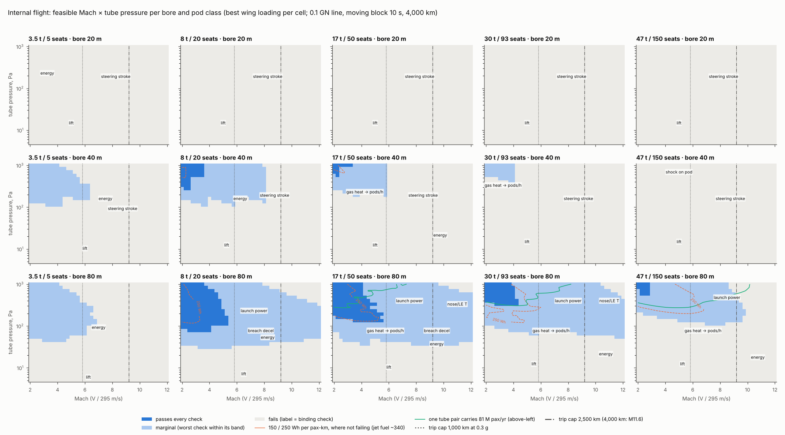
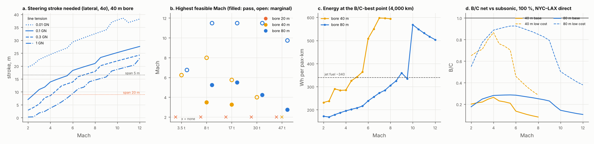

# Internal flight: design map for winged pods in a wide floating bore

**Skyloop review · 23 October 2026 · screening level.** Concept: an H₂-lifted, tensioned tube at ~20 km with a 20–80 m low-pressure bore, in which winged pods fly over an actively steered motor strip that gives thrust only; boarding is at ground portals. As with BoomShield, this maps the rough feasible region.

- **Code:** `flight.py` imports `heating.py`, `stability.py`, `regime.py`, `skyloop_physics.py` and `sky_model.py` read-only. It writes the `flight_*.csv` files and figures; `flight_grid.csv` (> 2 MB) is gitignored.
- **Conventions:** V = M × 295 m/s. *(A)* marks an assumption; web items are **unverified** search summaries.

## Bottom line

- **A real band exists, but only in an 80 m bore:**

  | Pod (W/S 200–400 Pa, span 20–48 m) | Passes every check | Marginal |
  |---|---|---|
  | 8–17 t (20–50 seats) | Mach 2–5.5 at ~80–1,000 Pa | to M11.5 on NYC–LAX, where the trip-length cap sits |
  | 47 t (150 seats) | M2–2.8 at 0.6–1 kPa | to M9.8 |

  A **40 m bore** passes only M2–3.5 and is marginal to M8. A **20 m bore** fails everywhere: the wing span plus the guideway's steering stroke does not fit.
- **The Mach ceiling is not heat.** Four things set it, in order:
  1. **Steering stroke.** A 0.05 g ride on the gusty floating line needs 7 m (M2) to 28 m (M12) of 4σ guideway stroke even at 0.1 GN tension, and it must fit beside the wings.
  2. **Launch power.** Peak power per pod is m·a·V: 155 MW for 17 t at M5.5, and ~1 GW per station.
  3. **Breach deceleration.** A pod meeting 20 km air decelerates at 3–15 g at M5–12.
  4. **Trip length.** At 0.3 g the time-optimal profile caps Mach at 5.8 / 9.2 / 11.6 for 1,000 / 2,500 / 4,000 km.

  Pod heating stays inside its limits to ~M9 (leading edge 1,000–1,700 K), as heating.md found.
- **The pressure floor** is lift (light pods) or tube-gas heat (heavy pods; heating.md's D/(pA)). **Kantrowitz blockage, piston pumping and strip temperature never bind** in a wide bore.
- **Flying costs energy:** 165–340 Wh per pax-km along the band. That is 0.5–1× jet fuel and 4–10× the maglev pods of the system study, because drag is W/(L/D) with L/D 8 → 5 → 3 from M2 → M6 → M12.
  - **Energy-optimal:** M2.25 at 0.7 kPa with 47 t pods, 165 Wh/pax-km.
  - **Fastest passing point:** M5.5, 290 Wh/pax-km.
- **Faster is only slightly better.** NYC–LAX door to door is 3.6 h at M2, 2.5 h at M5.5 and 2.3 h at M11.5. M5.5 → M11.5 saves 11 min for twice the energy and ~40 % of the B/C.
- **Capacity is adequate.** One bore pair carries 126–206 M pax/yr at M2–2.5 (17–47 t pods, 10 s moving block) and 47–80 M at M5.5, against the spine's 81 M. Above ~M3 the gas-to-wall heat limit sets pods/h. Brick-wall headway cuts capacity ~7×.
- **Economics: B/C ≤ 1.12 vs subsonic, ≤ 1.33 vs Boomless, ≤ 0.75 vs BoomShield M2.2.** The bore wall, tension, envelope growth and a full-length strip add ~$45–85 M/km at base cost, so B/C is roughly half the maglev floating case in system.md.
  - **B/C > 1** appears only at the low-cost end, net of fuel and CO₂, at 100 % capture, and only vs subsonic (spine, M2–3.5) or Boomless (spine, M2–9).
  - **Never above 1:** gross B/C, base cost, 30 % capture, or any case vs BoomShield.

## Method

- **Grid:** Mach 2–12 (step 0.25) × pressure 5–1,000 Pa (30 log steps) × bore 20/40/80 m × five pod classes: 3.5 / 8 / 17 / 30 / 47 t, i.e. 5 / 20 / 50 / 93 / 150 seats (`regime.pod`, 300 kg/seat).
- **Wing loading:** W/S 50–1,600 Pa, best kept per cell; AR 2 wing (heating.md).
- **Flight state:** `heating.pod_state` gives incidence, L/D, drag and every surface temperature, including Earth-curvature relief 1 − V²/gR_E (0.95 at M6, 0.80 at M12).
- **Base line:** tension 0.1 GN, bridle residual 10 %, moving block 10 s, 0.3 g, 4,000 km trip.
- **Status:** each check gives a margin, log₁₀(limit/demand). It passes above 0, is marginal inside its band and fails beyond it. The binding check is the worst margin in units of its band.

| Group | Check | Pass / marginal *(A unless cited)* |
|---|---|---|
| Flight | lift: lower-surface incidence (heating) | ≤ 25° / 40° |
| | steering stroke: the stroke `stability.ride` needs for a 0.05 g ride, vs room beside the wings, (D − span)/2 − 1 m, and below the body | ≥ need / ÷1.5 |
| Ceilings | trip: V² ≤ a·L | hard |
| | launch power: per pod (D + m·a)·V/η, and per station KE·pods/h | 0.2 / 0.8 GW (EMALS ~0.2 GW avg [1]); 1 / 5 GW |
| | motor strip: LSM frequency V/2τ, with τ ≤ 2 m and ≤ L_pod/6; thrust shear across a 0.15 m gap | ≤ 1 / 3 kHz; ×2 |
| | breach: drag deceleration in 20 km air, wing unloaded (regime) | ≤ 5 / 20 g |
| Gas dynamics | Kantrowitz: frontal blockage incl. wing and incidence | ≤ ½β_K / β_K |
| | bow shock reflected off the wall, back onto the pod | distance ≥ L_pod / ½ |
| | self-pumping crossover spacing p·A·V·h/D (regime) | ≥ 1 / 0.25 km |
| | gas ΔT per pass = the wake the next pod sees (Π = D/pA) | ≤ 22 / 87 K |
| Heating (heating.py) | gas heat → pods/h; skin, nose/LE, heat sink, film; strip with shock impingement ×3 [5] | heating's limits |
| Energy | kinetic loss (regen 0.85² round trip) + drag/η + hotel + leak pumping (1 cm²/km at D 3 m, ∝ D) + actuators | ≤ 340 (jet fuel) / 680 Wh/pax-km |

Capacity is pods/h = min(3600/headway, gas-heat limit) × seats × 0.8, and pax/yr per pair uses the system study's peak hour. It is drawn as a contour against the 81 M spine demand, not used as a check.

## 1. Feasible band (`flight_band.csv`; 4,000 km)

| Pod | 40 m bore: pass / marginal to | 80 m bore: pass (p) / marginal to | What stops it |
|---|---|---|---|
| 3.5 t, 5 seats | none / M6.2 | none / M6.8 | energy: 5 seats carry the drag and the pumping |
| 8 t, 20 seats | M3.5 (0.28–1 kPa) / M8.0 | **M5.2** (78 Pa–1 kPa) / M11.5 | stroke (40 m); breach deceleration, then trip cap (80 m) |
| 17 t, 50 seats | M3.2 (0.58–1 kPa) / M5.8 | **M5.5** (134 Pa–1 kPa) / M11.5 | stroke (40 m); station launch power, then trip cap (80 m) |
| 30 t, 93 seats | none / M4.0 | M4.2 (0.33–1 kPa) / M11.5 | gas heat → pods/h; launch power |
| 47 t, 150 seats | none | M2.8 (0.58–1 kPa) / M9.8 | shock on pod, stroke (40 m); launch power (80 m) |

The 20 m bore has no feasible point for any pod. With 0.1 GN of line tension it needs 7–28 m of stroke, which leaves no room for a wing.

## 2. Best operating points (`flight_points.csv`)

| Point | Pod · bore | Mach · p · W/S | L/D · span | Wh/pax-km | M pax/yr per pair | NYC–LAX door to door |
|---|---|---|---|---|---|---|
| Highest passing Mach, every trip length, 40 m | 8 t · 40 m | 3.5 · 1 kPa · 800 Pa | 5.0 · 14 m | 332 | 50 | 2.85 h |
| Highest passing Mach, every trip length, 80 m | 17 t · 80 m | **5.5** · 193 Pa · 400 Pa | 5.3 · 29 m | 290 | 47 | **2.51 h** |
| Highest marginal Mach, 80 m: 1,000 / 2,500 / 4,000 km | 47 / 47 / 30 t | 5.75 / 9.0 / 11.5 (trip cap) | 4.8 / 4.0 / 2.7 | 280 / 359 / 562 | 137 / 81 / 52 | 2.49 / 2.34 / 2.32 h |
| Energy-optimal | 47 t · 80 m | 2.25 · 694 Pa · 400 Pa | 7.9 · 48 m | **165** | 169 | 3.42 h |
| Capacity-optimal | 47 t · 80 m | 2.5 · 1 kPa · 400 Pa | 7.4 · 48 m | 175 | **206** | 3.26 h |
| Energy- and capacity-optimal, 40 m | 17 t · 40 m | 2.0 · 1 kPa · 800 Pa | 6.0 · 20 m | 231 | 74 | 3.63 h |

At M5.5 (17 t, 80 m bore) the point runs:

- **Pod:** leading edge 1,030 K, skin 610 K, heat sink 0.2 % of mass.
- **Tube gas:** ΔT 2.8 K per pass, Π 0.03.
- **Strip:** 276 K, 406 Hz at τ = 2 m; it needs 2.4 kPa of shear and offers 32 kPa.
- **Breach:** 3.2 g; the pod carries 5.4 t TNT of kinetic energy.

## 3. What binds where

**Ceilings** (`flight_ceilings.csv`, 0.3 g):

| Mach | 2 | 4 | 6 | 8 | 10 | 12 |
|---|---|---|---|---|---|---|
| felt weight (curvature) | 0.99 | 0.98 | 0.95 | 0.91 | 0.86 | 0.80 |
| min curve radius, banked, n ≤ 1.1, km | 77 | 310 | 697 | 1,240 | 1,937 | 2,789 |
| launch length, km | 59 | 237 | 533 | 947 | 1,479 | 2,130 |
| launch power, 17 t, MW (excluding drag) | 35 | 69 | 104 | 139 | 174 | 208 |
| kinetic energy, 17 t, t TNT | 0.7 | 2.8 | 6.4 | 11 | 18 | 25 |
| steering stroke, 80 m bore, 0.1 GN, m | 7 | 14 | 18 | 21 | 25 | 28 |
| NYC–LAX door to door, h | 3.63 | 2.73 | 2.47 | 2.37 | 2.33 | 2.32 |

- **Trip caps** (time-optimal, bang-bang):
  - 1,000 km: M3.4 / 4.8 / 5.8 at 0.1 / 0.2 / 0.3 g.
  - 2,500 km: M5.3 / 7.5 / 9.2.
  - 4,000 km: M6.7 / 9.5 / 11.6.

  The spine's ~720 km all-stop legs cannot use more than ~M5.
- **Curvature:** Earth relief is a steady unload; curve entry needs a 5–32 km roll-in at 0.05 g/s.
- **Motor strip:**
  - A long-stator LSM with pod magnets, at τ ≤ 2 m, stays at ≤ 950 Hz up to M12, against Transrapid's tested ~270 Hz [2].
  - A wing-borne pod's 0.15 m gap is fine: thrust needs only 1–5 kPa of shear.
  - LIMs lose thrust to end effects at speed [3], so none is used; solid insulation is still needed (Paschen, physics.md).
- **Regeneration:** the drive-and-regen round trip is 0.72 (0.85²). Kinetic loss is only 0.3–19 % of the energy (median 5 %); drag is the rest.

**Gas dynamics** (`flight_gasdyn.csv`):

- The Mach angle falls from 30° (M2) to 4.8° (M12). A centred pod's bow shock returns to the axis √(M²−1)·D behind it: 1.7 D at M2, 5.9 D at M6, 12 D at M12, i.e. 35–960 m.
  - It lands on long pods or wide wings only at M2–3 in a 40 m bore ("shock on pod").
  - It lands on the strip directly below the belly at every Mach. The strip still stays below 303 K even with ×10 impingement [5].
- **Kantrowitz:** blockage ≤ 0.1 (body alone 0.001–0.013) against β_K = 0.18–0.39: confirmed small, no choking.
- **Wake:** wake velocity is Δu/V = Π/(γM²) ≤ 0.045. What the next pod meets is warm gas, ΔT = Π·(γ−1)·T, a 3.7–15 Hz ripple. That is heating's per-pass check, and it passes wherever the band does.
- **Self-pumping:** crossovers only every ≥ 30 km (narrow bores: 1–14 km).

**Heating overlay:** `heating.py`'s conclusions carry over unchanged. Only the nose/LE at M ≥ 9.25 (0.1–1 kPa) and the tube-gas throughput bind. The film (≤ 316 K, sunlit) and the strip (≤ 303 K) never bind.

**Capacity:**

- **Below M3:** the 10 s moving block (360 pods/h) sets it.
- **Above M3:** gas-to-wall transfer sets it, at ~75–230 pods/h in an 80 m bore.
- **17 t pods** need 1.0–1.9 pairs for 81 M pax/yr; 47 t pods need one.
- **Brick-wall** (68–400 s) gives 18 M pax/yr for 17 t pods.

## 4. Economics hook (`flight_econ.csv`)

- **Method:** B/C is rebuilt from system.md's life-cycle PV (2050 opening; spine+LAX all-stop and NYC–LAX direct), linear in tube $/km; it reproduces system.md exactly.
- **Tube cost:** the floating run and ramps (system), plus stability's adders for bore wall, tension, envelope and tethers, plus a full-length strip in place of a levitation track. That gives:

  | Bore | Base | Low |
  |---|---|---|
  | 40 m | $140–190 M/km | $41–50 M/km |
  | 80 m | $176–225 M/km | $55–63 M/km |

- **Tube pairs** = demand × capture ÷ capacity. **Net energy:** drag, pumping and actuators beyond the system's EDS pods at $0.099/kWh × 11.65 (PV).
- **Above M6:** NYC–LAX benefits scale with hours saved. The spine is held at its M6 value.

| Point (best B/C per Mach) | gross / net vs subsonic, base | gross / net vs subsonic, low | net, low: vs Boomless / vs BoomShield M2.2 | net vs subsonic, 30 %, low |
|---|---|---|---|---|
| spine · 40 m · M2 · 17 t | 0.25 / 0.33 | 0.86 / **1.12** | **1.06** / 0.75 | 0.40 |
| spine · 80 m · M3 · 47 t | 0.26 / 0.32 | 0.86 / **1.06** | **1.33** / 0.73 | 0.39 |
| spine · 80 m · M5.5 · 47 t | 0.22 / 0.23 | 0.79 / 0.84 | **1.19** / 0.64 | 0.34 |
| NYC–LAX · 80 m · M5.5 · 47 t | 0.23 / 0.29 | 0.76 / 0.93 | 0.88 / 0.63 | 0.28 |
| NYC–LAX · 80 m · M8 · 47 t | 0.22 / 0.25 | 0.75 / 0.85 | 0.83 / 0.61 | 0.26 |
| NYC–LAX · 80 m · M11.5 · 30 t | 0.12 / 0.11 | 0.43 / 0.41 | 0.43 / 0.32 | 0.19 |
| *system.md, maglev floating, spine+LAX M4* | *0.36 / 0.47* | *1.28 / 1.67* | *2.17 / 1.15* | *0.65* |

**B/C exceeds 1 only in the bold cells:**

- low cost, net, 100 % capture;
- vs subsonic at spine M2–3.5 (1.0–1.12);
- vs Boomless at spine M2–9 (1.0–1.33).

Net B/C exceeds gross while flight energy stays below ~300 Wh/pax-km, because that electricity still undercuts 340 Wh of jet fuel. That holds to ~M5 in a 40 m bore and to M6–10 in an 80 m bore; beyond, net falls below gross.

## 5. Levers (`flight_levers.csv`; 17 t / 47 t pods)

| Lever | Effect on the band | Cost |
|---|---|---|
| **Line tension 0.3 / 1 GN** (vs 0.1) | 40 m bore: pass M3 → 4.5 / 5.5, marginal M5.5 → 7.5 / 9; 47 t becomes marginal to M4.5 / 6. The 20 m bore opens only marginally (M3, 1 GN). No change at 80 m | +$17 / +$74 M/km (40 m); strain energy (stability.md) |
| **Narrower wing (AR 1)** | 40 m: pass M4, marginal M7.5; 47 t marginal to M5 | heavier, hypersonic-friendly planform |
| Bridle residual 3 % (vs 10 %) | 40 m: pass M3.5, marginal M7 | unproven |
| **Lower launch acceleration, 0.15 g** | 47 t pass M2.5 → 4.0, but trip caps fall (4,000 km: M8.2) | longer ramps |
| Launch-power cap halved (100 MW) | 80 m: 17 t pass M5.5 → 3.5; 47 t none | the ceiling is a power-electronics budget |
| Fewer pods per bore (30 % capture) | 80 m: 17 t pass M5.5 → 6.5 (less station power) | fewer passengers |
| Gas stirring ×3 | 40 m: capacity 74 → 126 M pax/yr; the 80 m pass ceiling drops to M4.5 (more traffic per bore → station power) | fans |
| Brick-wall headway | capacity 126 → 18 M pax/yr (17 t); 4–5 pairs | certification |
| Stricter energy bar (pass ≤ 200 Wh) | 80 m: 17 t pass only to M3 | — |
| UHTC LE, strip impingement ×10, tip clearance 0.5 m, 10× tighter leaks | ≤ 0.5 Mach or ≤ 5 Wh/pax-km | — |
| Untensioned line (0.01 GN) | 40 m closes; 80 m unchanged | −$8 M/km (40 m) |

**What widens the band:**

- In order: **bore ≥ 80 m, or tension plus narrow wings in 40 m**; then launch-power budget and lower acceleration; then traffic per bore.
- Nothing on the heat side matters below M10.
- Nothing lifts the economics above ~1.3 without system.md's low-cost tube.

## Caveats

- Flat-plate wing and heating correlations (±30 %); L/D at M ≥ 8 is optimistic.
- Stroke is from stability's linear line model with a 1 Hz pod suspension; following a moving strip in flight is unproven.
- Power, shear, gap, leak and energy thresholds are *(A)*.
- **Breach:** a wing that is not unloaded within ~0.1 s sees a lift overload of p_amb/p ≈ 5–1,000×.
- **Evacuation from 20 km and line strain energy** stay marginal everywhere (stability.md); not drawn.
- **Economics** is a proxy on system.md's PV; the spine above M5 is moot.

## Sources (search summaries, unverified)

1. EMALS: 484 MJ released in 2–3 s, <https://en.wikipedia.org/wiki/Electromagnetic_Aircraft_Launch_System>. The ~0.2 GW is my division.
2. Transrapid drive control tested to ~270 Hz, <https://wctrs-society.com/wp-content/uploads/abstracts/lyon/Segment%20062%20of%20WCTR92_Lyon%20_Vol4.pdf>.
3. High-speed LIM end effects (IEEE 1973), <https://trid.trb.org/View/19130>.
4. Holloman sled, Mach 8.5, partly in a 4.7 m helium-filled tube (precedent for hypersonic running in an enclosure), <https://www.af.mil/News/Article-Display/Article/139307/test-sets-world-land-speed-record/>, <https://railwaygazette.com/news/hypersonic-rail-tests/28472.article>.
5. Shock-impingement heat-flux augmentation up to ~7× (DLR), <https://elib.dlr.de/146941>.
