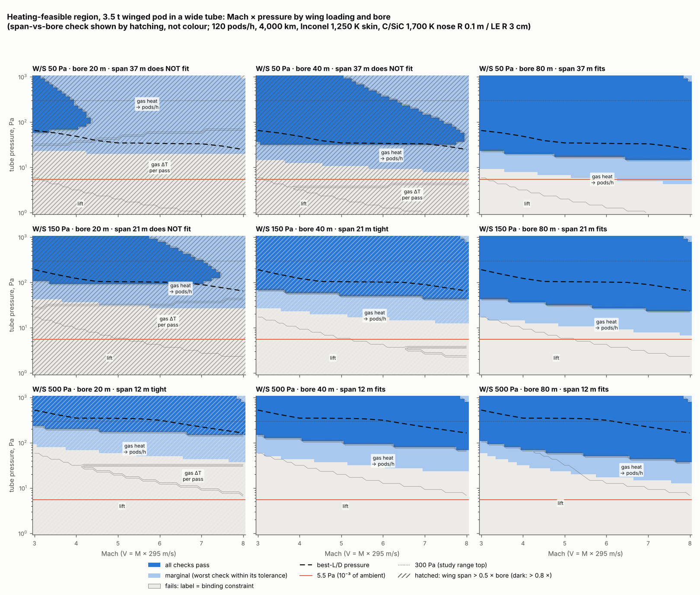
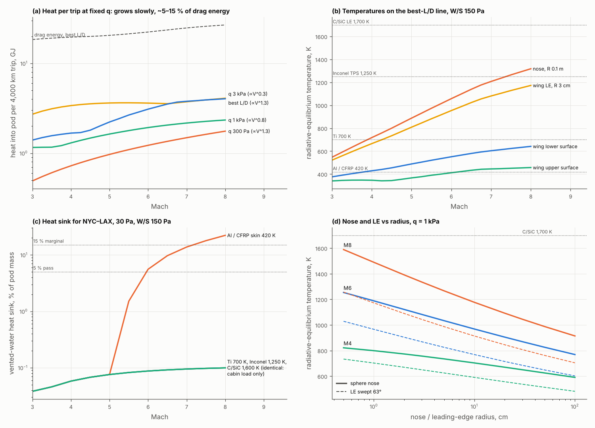
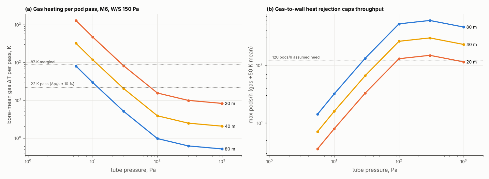

# Heating in a wide tube: winged pods at Mach 3–8

**Skyloop review · 23 October 2026 · screening level.** The rough feasible region for the heat problem only, as with BoomShield: free-flying winged pods in a 20–80 m bore, with tube gas at 216.65 K and 1–300 Pa; the maps run to 1 kPa to show the pod's heating ceiling.

- **Code:** `heating.py` (importing `regime/regime.py` read-only) writes the `heating_*.csv` files; `make_figures.py` draws the figures.
- **Conventions:** V = M × 295 m/s. *(A)* marks an assumption; web items are **unverified** search summaries.

## Bottom line

- **The pod is not where the heat problem is.** With a hot structure that radiates to the tube wall, the pod reaches radiative equilibrium at:
  - **skin 380–640 K** and **nose/LE 520–1,320 K**, along the best-L/D line at Mach 3–8 (W/S 150 Pa);
  - the LE limits only above **~0.7 kPa at M8** (C/SiC 1,700 K; ~0.2 kPa for a 1 cm LE).

  The heat that must be sunk is mostly the cabin's: **12–15 MJ per NYC–LAX trip, 0.15 % of pod mass as vented water** (1.5 % as PCM). Narrow-bore glide failed above M3 because of a cushion at stagnation temperature and a 400 K skin; free flight avoids both. A cold skin (Al/CFRP at 420 K) still needs a 6–23 % sink at M6 and 10–50 % at M8.
- **The coordinator's hypothesis half-holds.** At fixed q, heat input per trip still grows **∝ V^0.3–1.3**. From M3 to M8 that is ×1.3–3.6, driven by stagnation, LE and laminar St·V, not flat. Two things do hold:
  - The **sunk heat is speed-independent**: the hotter skin leaks more into the cabin, but for less time.
  - Pod heat input is a fixed **0.5–0.65 × skin-friction power** (Reynolds analogy), only 5–15 % of the drag energy.
- **The binding heat constraint is the tube gas.** The gas absorbs all the drag energy, and the per-pass rise is set by one ratio, **ΔT/T = (γ−1)·D/(p·A_bore)**: drag against the pressure force on the bore. At 5.5 Pa a 3.5 t pod flies at L/D 1.3–2.7 and deposits 13–26 MJ/km, heating the gas by **~1,300 K per pass in a 20 m bore and ~80 K in an 80 m bore**.

  At 5.5–10 Pa, conduction and weak convection shed only ~25–90 W per metre (up to ~1.8 kW/m at 300 Pa in 80 m), so throughput is capped at **4–30 pods/h**. Pumping gas through as coolant would need 10³–10⁵ m³/s per km.
- **Heating-feasible band** (`heating_summary.csv`), for a 3.5 t pod:
  - **80 m bore:** every check passes at **Mach 3–8**. The floor is 16–46 Pa at W/S 50–150 and 34–117 Pa at W/S 300–500, and the ceiling is ≥ 1 kPa (0.74 kPa at M8). It is marginal down to 5–19 Pa.
  - **40 m bore:** passes only for W/S ≥ 300 (floor 63–158 Pa). A 20 m bore is at best marginal (span; floor 34–100 Pa).
  - **10⁻³ of ambient (5.5 Pa)** fails everywhere on lift, gas ΔT per pass or throughput. The one exception is marginal: W/S 50 in an 80 m bore at M6.3–8, at ~30 pods/h.
- **Mach is nearly free on the heat side between M3 and M8; pressure and bore are not.** Film and guideway temperatures never bind; sunlight sets the film's.

## Method

- **Flight.** A 3.5 t pod (5 seats; `regime.pod`) with a delta wing (AR 2, sweep 63°) at W/S 50–500 Pa, including curvature relief (5 % at M6, 9 % at M8).
  - Lift comes from flat-plate pressures: upper suction ≤ 0.7 p∞, the rest from an oblique shock under the wing.
  - Drag is L·tan α + friction + wave + base.
  - The lift check is incidence: ≤ 25° passes, ≤ 40° is marginal.
  - Best L/D is 7.4 at M3 and 5.1 at M8 (Küchemann: 8 and 5.5), at **C_L ≈ 0.05–0.15, i.e. q ≈ 8–20 × W/S**.
- **Heating.**
  - Stagnation: Sutton–Graves [1], hot-wall, bridged to free-molecular ½ρV³. Fay–Riddell [2] gives 0.77–0.94 of it.
  - Leading edge: sphere ÷ √2 × cos Λ [5].
  - Acreage: Eckert reference temperature [3], transition at Re_x = 10⁶ *(A)*, with weak viscous interaction.
  - Rarefaction: Kn 0.1–0.4 on 1 cm edges at ≤ 5 Pa (bridged); < 10⁻³ on chords.
  - Shock-layer radiation is zero. Correlations [4] start near 9 km/s; ours is ≤ 2.4 km/s.
- **Cooling.**
  - Grey radiation (ε 0.85) to a 250 K tube wall, view factor ~1.
  - Heat above material limits goes to vented water (2.5 MJ/kg): pass ≤ 5 % of mass, marginal ≤ 15 %, over 4,000 km with 0.3 g launch.
  - Cabin: 150 W/seat plus leakage through 5 cm of insulation.
- **Tube gas.**
  - Per pass: ΔT = D/(ρA·c_v). Pass ≤ 22 K (Π = D/pA ≤ 0.25, wake Δρ/ρ ≈ 10 %), marginal ≤ 87 K.
  - Steady state: mean rise ≤ 50 K *(A)*, with Nu_D = max(8, 0.1 Ra^⅓) (conduction or natural convection), at 120 pods/h (30/h marginal) *(A)*.
- **Film and guideway.** Film (α/ε 0.5, sun + albedo + traffic) ≤ 353 K. Guideway (radiation only; motor losses at η 0.9 under launch thrust, plus belly radiation and gap convection) ≤ 423 K.

## 1. Pod heating on the best-L/D line (W/S 150 Pa, `heating_scaling.csv`)

| Mach | p, Pa | q, Pa | L/D | T nose / LE (R 0.1 m / 3 cm) | T lower / upper skin | heat in, kW | per trip: heat / drag energy, GJ | sunk per trip |
|---|---|---|---|---|---|---|---|---|
| 3 | 191 | 1,204 | 7.4 | 547 / 522 K | 376 / 340 K | 314 | 1.4 / 18 | 12 MJ (0.14 %) |
| 4 | 123 | 1,374 | 7.0 | 718 / 666 | 429 / 346 | 506 | 1.7 / 20 | 13 MJ |
| 6 | 102 | 2,562 | 6.1 | 1,058 / 954 | 551 / 412 | 1,446 | 3.1 / 22 | 15 MJ |
| 8 | 65 | 2,911 | 5.1 | 1,318 / 1,173 | 642 / 457 | 2,632 | 4.0 / 27 | 13 MJ (0.15 %) |

- **Heat per trip scales as** V^1.3 on the best-L/D line and V^0.3–1.3 at fixed q (`heating_pod.png` a).
- **Radius** (panel d) is a weak lever: T ∝ R^-⅛. At q 1 kPa, M8 runs 1,590 K at R 5 mm and 915 K at 1 m.
- **The stagnation temperature caps everything:** T₀ = 607 / 910 / 1,776 / 2,990 K at M3 / 4 / 6 / 8. Below M3.3 no surface can exceed titanium's 700 K, and below M4.9 none can exceed Inconel's 1,250 K.

**Cooling options** (`heating_sink.csv`):

| | What it gives | Verdict |
|---|---|---|
| Radiation to the tube wall | A 250 K wall surrounds the pod (view factor ~1) | Carries > 99 % of the pod's heat |
| Heat sink | Water 0.15 %, PCM 1.5 %; vented steam frosts onto a 216 K wall (cryopumping) | Small |
| LH₂ boil-off and transpiration | Not needed | Only sharp 1 cm LEs at M8 above ~0.2 kPa want them |
| Materials | Inconel 617 reuse ~1,250–1,310 K [6]; C/SiC demonstrated 1,370–1,770 K for M6 LEs [7]; UHTC ~2,300 K, not yet reusable [7] | At 1–100 Pa, SiC can enter **active oxidation** at low pO₂ [8], so C/SiC LEs need verification |
| Cabin insulation | Leak plus payload 2.7–8.3 kW | Sets the sink |

## 2. Tube side (M6, W/S 150 Pa, `heating_tube.csv`)

| p, Pa | L/D | drag, kN (= MJ/km) | gas ΔT per pass, 20 / 80 m | max pods/h, 20 / 80 m | heat-limited seats/h, 80 m (300 kg/seat) | gas flow to carry the heat, m³/s/km |
|---|---|---|---|---|---|---|
| 5.5 | 1.3 | 25.6 | 1,283 / 80 K | 4 / 14 | 165 | 190,000 |
| 10 | 2.0 | 17.0 | 470 / 29 | 8 / 32 | 370 | 70,000 |
| 30 | 3.9 | 8.9 | 82 / 5 | 33 / 131 | 1,530 | 12,000 |
| 100 | 6.1 | 5.6 | 15 / 1.0 | 129 / 517 | 6,030 | 2,300 |
| 300 | 3.2 | 10.8 | 10 / 0.6 | 148 / 591 | 6,900 | 1,500 |

- **Gas-to-wall coefficient** is h ≈ 0.002–0.1 W/m²K. Conduction alone caps the gas at 8πkΔT ≈ 25 W/m at a 50 K rise, whatever the bore; natural convection lifts that roughly as p^⅔·D. Relaxation takes 20–600 s, longer than a 30 s headway.
- **Spine demand** is 81 M pax/yr ([regime](../regime/regime.md)), ≈ 6,000/h per direction. Only ~100–300 Pa in an 80 m bore meets it without active gas cooling.
- **Pumping is not a coolant.** The regime study installs 20 m³/s/km.
- **Tube film** traffic flux is ≤ 60 W/m². Sunlight sets the film temperature: 287 / 316 / 348 / 365 K at α/ε 0.3 / 0.5 / 0.8 / 1.0, so **α/ε ≲ 0.8 is a film requirement** at any Mach.
- **Guideway** stays at 252–285 K (0.9–5 kJ/m² per pass, mostly motor losses).
- **Shock reflection:** the reflected bow shock returns to the flight line 57–635 m behind the pod, 3–8 bore diameters back, not on it.

## 3. Levers (W/S 150 Pa, 80 m bore unless stated; `heating_levers.csv`)

| Lever | M6 passing p, Pa | M8 passing p, Pa | What binds |
|---|---|---|---|
| **Base** | 29–1,000 | 25–736 | gas throughput below; LE at M8 above |
| Sharper (R_n 3 cm, R_LE 1 cm) | 29–1,000 | 25–**215** | LE |
| Blunter (0.3 m / 10 cm) or UHTC LE 2,200 K | 29–1,000 | 25–≥1,000 | – |
| Ti hot structure 700 K | 29–464 | 25–136 | skin |
| Al/CFRP 420 K | none (marginal 10–54) | none (marginal 7–22) | skin, then heat sink |
| Al/CFRP + 15 % sink | none (marginal 10–117) | none (marginal 7–40) | heat sink |
| W/S 50 Pa (687 m², span 37 m) | **18.5**–1,000 | 16–736 | throughput |
| W/S 500 Pa | 54–1,000 | 40–736 | throughput, lift |
| 40 m bore (W/S 300 to fit) | 74–1,000 | 63–736 | throughput |
| 20 m bore (W/S 500, span tight) | marginal 54–1,000 | marginal 40–1,000 | span, throughput |
| Gas stirring ×3 and +150 K allowed | **13.6**–1,000 | 10–736 | gas ΔT per pass |
| 30 instead of 120 pods/h | 13.6–1,000 | 10–736 | gas ΔT per pass |
| 17 t, 50-seat pod (W/S 300) | 158–1,000 | 185–631 | throughput |
| 1,000 km trip | none | none | cruise unreachable above M5.8 at 0.3 g |

**How the band moves:**

- **Lower tube pressure** cools the pod but heats the gas. Wider bores, lower wing loading, lighter or fewer pods and stirred gas lower the D/(pA) floor.
- **Hotter materials and blunter edges** raise only a ceiling already at ≥ 0.7 kPa.
- **Heat sinks matter only for cold skins.**

## Coordinator's framing, checked (`heating_check.csv`)

- **Confirmed:** q = 139 Pa at M6 and 5.5 Pa; curvature relief (5 % at M6, 12 % at 2.8 km/s); drag ≈ W/(L/D).
- **Corrected:**
  - A 3.5 t pod with 100 m² does not fly at 5.5 Pa below ~M8. At M8 it needs 43° incidence and runs L/D 1.2 and 29 MJ/km, not 7.
  - **C_L ≈ 1 is not an efficient operating point.** At Mach 3–8, best L/D needs q ≈ 8–20 × W/S, so ~65–200 Pa for W/S 150 Pa and ~130–400 Pa for 343 Pa. That is 10–70× the 10⁻³-of-ambient pressure.

## Caveats

- These are screening correlations: ±30 % on heating, ±50 % on gas-to-wall transfer (wake stirring is the big unknown).
- Shock impingement is unmodelled. A bow shock reflected off a motor strip ≲ 2 m below the belly can raise local heating 3–10×, giving hot spots rather than moving the band.
- Real-gas effects lower T₀ by ~5 % at M8.
- Film optics are *(A)*; no flight data was found.
- The 120 pods/h, 50 K and 22 K limits are *(A)*. Each moves the floor as shown, without removing it.

## Sources (search summaries, unverified unless noted)

1. Sutton & Graves, NASA TR R-376 (1971), <https://ntrs.nasa.gov/citations/19720003329>. k ≈ 1.74×10⁻⁴ SI, via <https://arxiv.org/pdf/2104.11831>.
2. Fay & Riddell, J. Aero. Sci. 25 (1958), from memory.
3. Eckert reference temperature, via Mason (VT) notes, <https://archive.aoe.vt.edu/mason/Mason_f/CAtxtAppD5.pdf>. Accuracy falls as T_w → T_aw, <https://lxxb.cstam.org.cn/en/article/doi/10.6052/0459-1879-25-350>. Weak-interaction coefficients from Anderson, *Hypersonic and High-Temperature Gas Dynamics* (memory).
4. Tauber & Sutton, J. Spacecraft Rockets 28 (1991), radiative heating (memory). Sutton & Hartung, equilibrium radiative tables, <https://ntrs.nasa.gov/citations/19900014359>.
5. Swept-cylinder stagnation-line coefficient ∝ cos Λ_eff (NASA TN, 60° delta with blunt LE), <https://ntrs.nasa.gov/api/citations/19930088716/downloads/19930088716.pdf>.
6. Inconel 617 metallic TPS reuse limit 1,800–1,900 °F; X-33 windward TPS, <https://ntrs.nasa.gov/api/citations/20040086762/downloads/20040086762.pdf>.
7. ONERA UHTC / CMC leading edges (M6 at 1,100–1,500 °C; > 2,000 °C as future work), <https://aerospacelab.onera.fr/en/al3/Ultra-High-Temperature-Ceramics>.
8. SiC passive-to-active oxidation at low pO₂, NASA Glenn, <https://ntrs.nasa.gov/api/citations/20120000845/downloads/20120000845.pdf>.
