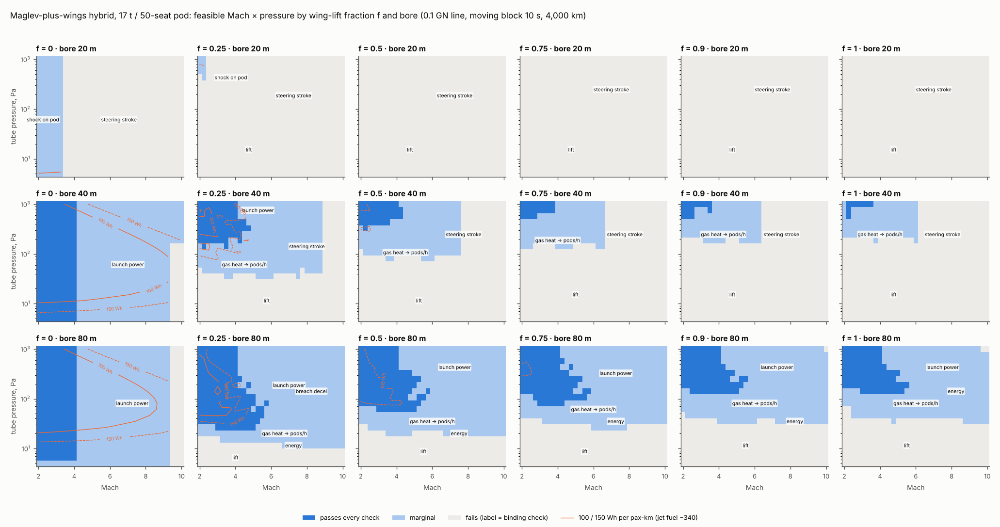

# Maglev-plus-wings hybrid: feasible map

**Skyloop review · 23 October 2026 · screening level.** Concept: pods in the floating tube's 10–80 m bore ride an actively steered maglev guideway. The linear motor gives contactless thrust and guidance, and wings carry a fraction f of the weight. f = 1 is [flight.md](../flight/flight.md)'s free-flying pod; f = 0 is [stability.md](../stability/stability.md)'s maglev pod on an actuated guideway. As with BoomShield, this maps the rough feasible region, taking faster as better.

- **Code:** `hybrid.py` reuses flight, heating, stability, regime, physics and system code read-only (checks, line spectra, economics); it reproduces flight's stroke table to ±6 %. `hybrid_grid.csv` (28 MB) is gitignored.
- **Conventions:** V = M × 295 m/s. *(A)* marks an assumption; web items are **unverified** search summaries.

## Bottom line

- **The wings are the problem.** In near-vacuum, magnets lift at L/D ~300 (system.md; Inductrack ~200–300 at 500 km/h, rising with speed [1]); wings lift at 3–8. Each 10 % of weight moved to the wing costs ~25 Wh/pax-km and saves ~0.45 Wh of magnetic drag. Wings also take bore width, heat the tube gas, and overload in a breach (f × p_amb/p, i.e. 5–1,000 × f × weight). **f = 0 wins on energy, bore, gas heat and breach.**
- **The compliant gap is the useful part, but it does not shrink the bore.** The floating line moves metres at 3–100 km wavelengths. Any suspension with ≤ 1 m of travel must follow that, so the guideway still needs 7–25 m of steering stroke (M2–10). A softer suspension only adds stroke: its gap fills, and the guideway must then run smoother. What the gap buys is tolerance to short-wave guideway error: 1–3 mm (EMS) rises to 8 mm (EDS, f = 0), 32–80 mm (f = 0.75–0.9) and 140 mm (active 0.3 Hz). That matters on a **ground** tube, where it lifts the elevated-tube alignment limit from ~M2 to M6–12.
- **Fastest passing points:** M4.75 at f = 0 (8 t, 40 m bore, 56 Wh/pax-km) and M5.75 at f = 1 (17 t, 60 m, 324 Wh). At f = 0 the cap is **station launch power** (2 GW at M6 to carry 81 M pax/yr through one bore pair). With a 5 GW station budget, f = 0 passes **M6 in a 40 m bore** at 0.1 GN, M7 at 0.3 GN and M9 at 1 GN. Every f is marginal to the M10 grid edge in 40–60 m.
- **Q3: can a 20–40 m bore reach M5–8 well below jet fuel? Only at f ≈ 0.**
  - **40 m:** M6–9 at ~50–90 Wh/pax-km (a quarter of jet fuel), with 5 GW stations and 0.1–1 GN of tension.
  - **20 m:** only M5.5 (40 Wh), and only at 1 GN.
  - **With wings (f ≥ 0.5),** 40 m passes M4–5.5 at 120–340 Wh/pax-km.
- **B/C is no better than system.md.** At f = 0 it peaks at:

  | Comparison (f = 0, 40 m bore) | B/C |
  |---|---|
  | vs subsonic, net, low cost | 1.43 (spine M3) |
  | vs subsonic, net, low cost, NYC–LAX | 1.25–1.31 (M6–8) |
  | vs Boomless, net, low cost | 1.73 |
  | vs subsonic, net, base cost | 0.42 |
  | vs subsonic, gross | ≤ 1.15 |

  Against BoomShield M2.2 it reaches 1.04 once (spine, 20 m, M3, marginal); otherwise ≤ 0.95. At 30 % capture it stays ≤ 0.57. Wings lower every B/C.
- **Onboard propulsion is not an option** (§5). Thrust must come through the track.

## 1. Gap and suspension (`hybrid_suspension.csv`, `hybrid_tolerance.csv`)

**Gap model *(A)*.** SC-EDS lift scales as exp(−2πg/τ_p), with τ_p = 1 m and a 0.10 m gap at full load (SCMaglev ~0.10–0.15 m [2]). Wing unloading at fixed magnets therefore:

- opens the gap by (τ_p/2π)·ln(1/(1−f));
- softens heave to 1.25·√(1−f) Hz.

Aero damping is c = L·C_Lα/(C_L·V), which gives ζ = f·g·C_Lα/(2ω·C_L·V).

| f (17 t pod) | 0 | 0.25 | 0.5 | 0.75 | 0.9 | 1 |
|---|---|---|---|---|---|---|
| magnet load, kN | 167 | 125 | 83 | 42 | 17 | 0 |
| EDS gap at fixed magnets, m | 0.10 | 0.15 | 0.21 | 0.32 | 0.47 | 0.15 (thrust gap, flight) |
| passive heave frequency, Hz | 1.25 | 1.08 | 0.88 | 0.62 | 0.40 | – |
| magnetic drag, Wh/pax-km (L/D 300) | 4.5 | 3.4 | 2.3 | 1.1 | 0.5 | 0 |
| wing drag at M5, 200 Pa, Wh/pax-km | 0 | 63 | 127 | 190 | 228 | 254 |
| aero heave damping ζ (M2–8) | 0 | 0.001 | 0.002 | 0.005 | 0.009 | 0.004 |

- **Aero damping is negligible** (≤ 1 % of critical): the wing is a static unloader, not a damper; active magnetic control does the work.
- **EMS large gaps:** Transrapid needs ~1.7 kW/t at 10 mm [3]. Power scales as load × gap², so a 0.1 m EMS gap needs ~2.9 MW per 17 t pod, and the wings cut that only in proportion to (1−f). SC-EDS holds the gap without power.

**Tolerance on a fixed guideway** (largest sinusoidal error, 0.05 g, stage travel respected, M6). The pod body is the sprung mass.

| Suspension | 25–300 m | 3 km | 30 km | Elevated ground (3 mm + 15 mm/km): Mach limit |
|---|---|---|---|---|
| rigid maglev: EMS 10 mm + 1 Hz secondary | 1–3 mm | 25 mm | 1.8 m | none ¹ |
| f = 0, SC-EDS gap as the suspension (skyhook) | 8 mm | 36 mm | 1.1 m | M2.2 |
| f = 0.75 | 32 mm | 47 mm | 2.2 m | M5.8 |
| f = 0.9 | 80 mm | 87 mm | 2.1 m | M9.7 |
| active large gap 0.3 Hz, 0.3 m (any f) | 140 mm | 140 mm | 1.1 m | M12 |
| free flight f = 1 (0.5 Hz, 0.12 m thrust gap) | 50 mm | 61 mm | 0.7 m | M7.5 |

¹ Stricter than regime.md's M2 because damper transmission and resonance are included; it is the "mm-level" requirement.

- **Short waves:** tolerance ≈ min(usable gap, a_lim/ω_n²). Wing unloading is one way to a softer, larger gap; bigger magnets or active control do the same at f = 0.
- **Long waves.** Every option allows only ~1–2 m at 30 km. The floating tube moves 0.4–2.6 m per octave at 5–36 km and ~27 m rms overall, so a **fixed guideway on the floating tube gives 0.2–9 g at M2–10.** Steering is mandatory.

**Steered guideway** (40 m bore, 0.1 GN). The stroke needed at M2 / 4 / 6 / 8 / 10:

| Suspension | Stroke, m |
|---|---|
| 1 Hz passive (flight convention; uses 1.2–1.4 cm of gap) | 7.3 / 13.3 / 17.2 / 21.9 / 24.4 |
| EMS or EDS f = 0–0.9 | within ±5 % of that |
| active skyhook 0.3 Hz, 0.3 m gap | 28 / 65 / 105 / > 110 / > 110 |
| same, 1 m gap | 7.9 / 17.5 / 24.9 / 34 / 46 |

The required stroke is set by line motion at 3–100 km, not by the suspension. A 10 cm EDS gap is ample: it needs ~2.5 cm, including 1 cm of cable-robot guideway error *(A)*. The gap check never binds.

## 2. Trade space (`hybrid_band.csv`, `hybrid_bore.csv`)

- **Grid:** f = 0–1 (six values) × Mach 2–10 (step 0.25) × 5–1,000 Pa (20 log steps) × bore 10/15/20/30/40/60/80 m × pods 8/17/30/47 t × wing loading 50–1,600 Pa.
- **Checks:** flight.py's 17 checks plus a magnetic-gap check.
- **Hybrid accounting:**
  - **Drag:** the body is always present; the wing contributes f × the full-weight wing's drag; magnetic drag is (1−f)·W/300.
  - **Where the heat goes:** only aero drag heats the tube gas; magnetic drag heats the strip.
  - **Width:** the lateral width is max(span, pod + 1 m of magnets).
  - **Tube cost:** the run keeps its levitation guideway and adds a full-length LSM.

**Highest passing / marginal Mach, 17 t pod** (0.1 GN, moving block 10 s, 4,000 km):

| f | 20 m | 30 m | 40 m | 80 m | above the pass ceiling |
|---|---|---|---|---|---|
| 0 | – / 3.25 | 3.75 / 6.25 | **4.0 / 10** | 4.0 / 9.25 | station launch power (40–80 m), stroke (30 m) |
| 0.25 | – / 2.25 | 3.0 / 4.75 | 4.75 / 8.75 | 5.75 / 10 | stroke; gas heat → pods/h |
| 0.5 | – | 2.5 / 4.0 | 4.25 / 7.5 | 5.75 / 10 | stroke; gas heat |
| 0.75–0.9 | – | – / 3.25–3.5 | 3.5–3.75 / 6.25–6.5 | 5.5–5.75 / 10 | stroke; launch power |
| 1 (flight) | – | – / 3.0 | 3.5 / 6.0 | 5.5 / 10 | stroke; launch power |

**Lowest energy, Wh/pax-km** (any pod, not failing), at M2 / 4 / 6 / 8:

| f | 80 m bore | 40 m bore |
|---|---|---|
| 0 | 22 / 35 / 52 / 74 | 17 / 28 / 44 / 64 |
| 0.25 | 55 / 74 / 96 / 141 | – |
| 0.5 | 95 / 114 / 139 / 182 | – |
| 0.75 | 126 / 157 / 187 / 230 | – |
| 1 | 172 / 196 / 231 / 282 | – |

f = 1 reproduces flight.md (165–340). At f = 0 the energy is kinetic loss plus pumping, as in system.md (21–85).

At f = 0 heating is benign (M6: nose 790–1,200 K, gas ΔT ≤ 2 K per pass, breach 1.7 g), and the 10 s block sets capacity (126–378 M pax/yr per pair, 17–47 t). Gas heat caps pods/h only once wings add drag.

## 3. Required bore vs Mach (`hybrid_bore.csv`; 17 t, 0.1 GN)

**Bore for stroke plus width** (span, or pod plus magnets) + 2 m of clearance:

| Mach | 2 | 4 | 6 | 8 | 9 |
|---|---|---|---|---|---|
| f = 0 | 19 m | 32 | 40 | 47 | 52 |
| f = 0.5 | 45 | 39 | 47 | 54 | 59 |
| f = 1 | 45 | 49 | 51 | 58 | 63 |

Levers (`hybrid_levers.csv`; highest passing Mach, 17/47 t pods):

| Lever | 20 m bore, f = 0 / 0.5 / 1 | 40 m, f = 0 / 0.5 / 1 | 80 m, f = 0 / 0.5 / 1 |
|---|---|---|---|
| base | – / – / – | 4 / 4 / 3.5 | 4 / 5.5 / 5 |
| station launch budget 5 GW (vs 1) | – / – / – | 6 / 4 / 3.5 | 9 / 8 / 6.5 |
| + 0.3 GN tension | 3.5 / – / – | 7 / 5.5 / 4.5 | 9 / 8 / 6.5 |
| + 1 GN tension | **5.5** / 4 / – | **9** / 7 / 5.5 | 9 / 8 / 6.5 |
| 30 % capture (less traffic per station) | – | 6 / 4 / 3.5 | 7.5 / 7.5 / 6.5 |

Magnetic L/D 100 or 1,000 moves f = 0 energy only within 14–26 Wh/pax-km; a 100 Wh energy bar removes every f ≥ 0.5 point at 40 m.

## 4. Best points and B/C (`hybrid_points.csv`, `hybrid_econ.csv`)

| Point | f · pod · bore | Mach · p | Wh/pax-km | M pax/yr per pair | NYC–LAX door to door |
|---|---|---|---|---|---|
| Fastest passing (base) | 0 · 8 t · 40 m | 4.75 · 81 Pa | 56 | 50 | 2.60 h |
| Fastest passing, 5 GW stations + 1 GN | 0 · 17 t · 40 m | 9 · 53 Pa | 90 | 126 | 2.34 h |
| Fastest passing, wings | 1 · 17 t · 60 m | 5.75 · 330 Pa | 324 | 43 | 2.49 h |
| Fastest marginal | any f · 40–60 m | 10 (grid edge) | 137 (f = 0) – 410 (f = 1) | 26–59 | 2.32 h |
| Energy- and capacity-optimal | 0 · 47 t · 40 m | 2 · 190 Pa | **17** | **378** | 3.63 h |
| Energy-optimal with wings | 1 · 47 t · 80 m | 2.5 · 760 Pa | 168 | 178 | 3.26 h |

**B/C** (2050 opening, rebuilt as in flight.md). Tube cost: $146–189 M/km base and $44–50 M/km low at 40 m.

| Best point | gross / net vs subsonic, base | gross / net vs subsonic, low | net, low: vs Boomless / vs BoomShield M2.2 | net, low, 30 %: vs subsonic / Boomless / BoomShield |
|---|---|---|---|---|
| f 0 · spine · 40 m · M3 | 0.31 / 0.42 | **1.06 / 1.43** | **1.73** / 0.95 | 0.52 / 0.52 / 0.28 |
| f 0 · NYC–LAX · 40 m · M6 | 0.29 / 0.39 | 0.97 / **1.31** | **1.20** / 0.88 | 0.40 / 0.36 / 0.26 |
| f 0 · NYC–LAX · 40 m · M8 | 0.27 / 0.35 | 0.94 / **1.25** | **1.15** / 0.84 | 0.38 / 0.34 / 0.25 |
| f 0.5 · spine · 40 m · M3 | 0.31 / 0.39 | **1.06 / 1.33** | **1.66** / 0.92 | 0.49 / 0.50 / 0.28 |
| f 0.5 · NYC–LAX · 40 m · M6 | 0.26 / 0.31 | 0.88 / **1.03** | 1.00 / 0.74 | 0.34 / 0.33 / 0.24 |
| f 1 · spine · 40 m · M4 | 0.22 / 0.24 | 0.80 / 0.87 | **1.22** / 0.66 | 0.45 / 0.48 / 0.26 |
| f 1 · NYC–LAX · 80 m · M6 | 0.23 / 0.27 | 0.74 / 0.88 | 0.84 / 0.62 | 0.27 / 0.25 / 0.19 |
| *system.md, maglev floating, spine+LAX M4* | *0.36 / 0.47* | *1.28 / 1.67* | *2.17 / 1.15* | *0.65* |

B/C exceeds 1 only at low cost and 100 % capture; never at base cost, at 30 % capture, or gross vs Boomless (≤ 0.83) or BoomShield (≤ 0.53). Every point sits below system.md's floating maglev: bore wall, tension and a full-length LSM add ~$20–60 M/km.

## 5. Side check: onboard propulsion for free-flying pods (`hybrid_propulsion.csv`; 17 t, M5, 4,000 km)

| Option | Numbers | Verdict |
|---|---|---|
| Scramjet / ramjet | Tube q is 0.9–3.5 kPa at 50–200 Pa, against a ~25–100 kPa flight corridor (tests at 30–48 kPa [4]). That is 14–57× short at M5 and 100–1,000× at 5–15 Pa. After ~30× inlet compression the combustor sits at ~2–6 kPa, against the coordinator's ≥ ~50 kPa (≥ 0.5 atm is not verified [4]). Fuel heat and exhaust would go into the tube gas. | **Confirmed:** fails |
| Rocket, LOX/LH₂ (Isp 450 s) | Winged pod: drag 31 kN × 2,711 s = 84 MN·s, i.e. **19 t of propellant (1.1× the pod)**. Kerosene: 26 t. The exhaust is 4.8 kg/km per pod; at 100 pods/h that is 76 m³/s per km to pump at 200 Pa, 3.8× regime's installed pumping. | **Confirmed** (the coordinator had 17 t) |
| Battery + fan | All the air crossing the pod's frontal area is only 19 kg/s at 200 Pa. That needs a 3,100 m/s jet, 71 MW, a 1,300 K inlet and **~180 t** of battery at 0.3 kWh/kg. | fails |
| Battery + onboard LIM on a passive rail | 41 MWh, ~135 t of battery (f = 1). The rail is the track anyway. | **Confirmed:** reaction only through the track |
| Maglev pod (f = 0) with a rocket | 1.5 kN of drag gives 0.9 t of propellant, but the track and its LSM are already there | pointless |

Wayside LSM thrust is the only workable option.

## Caveats

- Flight.md's flat-plate correlations (±30 %) and stability's line model (10 % bridle residual) carry over.
- The EDS gap law, τ_p, minimum gap and guideway error are *(A)*; EDS drag and onboard SC-magnet AC losses at M2–10 (400–700 Hz) are untested.
- Station power is per bore, so f = 0's pass ceiling partly reflects carrying the whole demand through one pair.
- "Shock on pod" (15–20 m bores) is flight.md's reflection check applied to bodies.
- Evacuation from 20 km, line strain energy and winged-pod breach overload are unchanged.

## Sources (search summaries, unverified)

1. Inductrack L/D ≈ k·v·L/R, ~300 at 500 km/h, <https://patents.google.com/patent/US6629503>; ~200 at 500 km/h, <https://en.wikipedia.com/wiki/Inductrack>.
2. SC-EDS gap ~10 cm, levitation above ~120–130 km/h, <https://publikationen.bibliothek.kit.edu/1000075557/4402937>; 100–150 mm, <https://gshimirwa.commons.gc.cuny.edu/?p=209>.
3. Transrapid 10 mm gap, <https://en.wikipedia.org/wiki/Transrapid>; ~1.7 kW/t for levitation and guidance (secondary source), <https://wikipedia2007.classicistranieri.com/t/r/a/Transrapid_German_d506.html>.
4. Scramjet tests at M4–6, q 47.9 kPa (combustor pressure ratio 3.1–4.0) and a 500–2,000 psf (24–96 kPa) corridor: <https://ntrs.nasa.gov/api/citations/20080020517/downloads/20080020517.pdf>, <https://apps.dtic.mil/sti/pdfs/ADA533012.pdf>. No source found for the ≥ 0.5 atm combustor floor.
