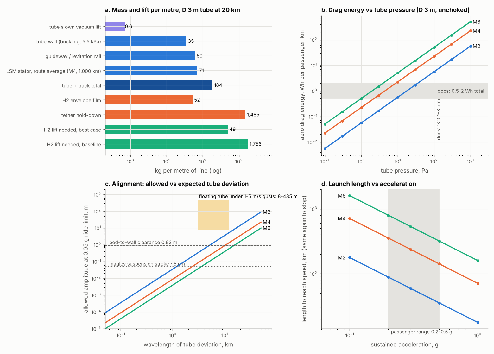

# Skyloop physics re-review: buoyant near-vacuum tube at 20 km

**Skyloop review · 22 October 2026 · screening level.** This reviews the original concept (README, docs/01–08) against BoomShield's re-derived physics ([vacuum review](../../boom-shield/vacuum/vacuum-balloon-review.md), [altitude trade](../../boom-shield/altitude/altitude-trade.md), [tethers](../../boom-shield/operations/tethers-build-failure.md)), reusing their atmosphere, H₂ lift, tether and leak models. Conventions: "Mach" means V = M × 295 m/s (20 km), so M2/4/6 = 590/1,180/1,770 m/s. Pod: 3 t, 3 passengers, 1 m² frontal area (docs/07: 1.5–3.5 t, 2–4 pax). Tube gas is at 250 K. Script: `skyloop_physics.py` → 13 CSVs; `make_figure.py` → `physics.png`. System-level numbers (capacity, cost, network) are in [../system](../system); the handoff is in `FOR-SYSTEM.md`. *(A)* marks an assumption.

## Verdict

**The tube can be made to float, but not to stay straight.** A Mach 2–6 path tolerates ~0.1–1 m of deviation at km wavelengths. A tethered H₂-lifted line moves 8–500 m in ordinary 1–5 m/s gusts. Holding the line would take 170× stiffer tethers or 0.4–2 GW of active thrust per 1,000 km. That is the main killer. Two more nearly fatal problems are independent of altitude: brick-wall stopping distances of 18–160 km cap safe throughput at **120–360 passengers/h per tube** (docs: 12,000), and the docs' energy claim is **~5–80× too low** once kinetic-energy losses are counted. The vacuum itself is the easy part.

## 1. Structure and buoyancy

**The tube cannot float on its own vacuum.** A 2–6 m bore evacuated at 20 km displaces only **0.3–2.5 kg/m** of air. Tube plus track weighs **90–410 kg/m**, so self-buoyancy falls short by ~150–300×.

**Per-metre budget, 20 km, central case** (`tube_mass_budget.csv`). The wall is a CFRP sandwich sized for long-cylinder buckling at Δp × 1.5 / 0.56 (SP-8007-class knock-down), with a foil liner and +20 % for joints *(A)*. Guideway *(A)*: 30/60/120 kg/m (EDS conductor plus local stiffening). LSM stator: 50/150/300 kg/m, but only in the launch and catch zones, which cover 47 % of a 1,000 km route at M4 and 0.3 g.

| D m | wall (monocoque CFRP) | guideway + LSM avg + utilities | tube + track | own vacuum lift | H₂ envelope R, baseline / best | H₂ lift needed, t/m |
|---|---|---|---|---|---|---|
| 2 | 18 (111) | 149 | 167 | 0.28 | 81 m / – | 1.72 |
| 3 | 35 (249) | 149 | 184 | 0.63 | 82 m / 43 m | 1.76 / 0.49 |
| 4 | 60 (442) | 149 | 209 | 1.1 | 83 m / – | 1.81 |
| 6 | 133 (995) | 149 | 282 | 2.5 | 87 m / – | 1.95 |

- **The wall is not the problem; the track is.** At 20 km a sandwich wall needs only 18–133 kg/m (monocoque would need 9–28 mm). Track, stator and utilities add ~150 kg/m at any bore.
- **Tether hold-down sizes the lift, not the tube.** At 40 m/s design wind (C_D 0.6, BoomShield V/H 1.5 tethers every 3 km), hold-down needs 1,485 kg/m of lift against a 184 kg/m payload. The envelope grows to R ≈ 82 m, with 45 MN, 0.9 kt tethers. A faired/lenticular envelope with flatter tethers gives R 43 m and 0.49 t/m (`envelope_sensitivity.csv`). Untethered it would be R 30 m, but untethered is not an option.
- **Altitude.** At 15 km the envelope needs R 131 m; at 10 km (jet stream) 269 m and ~2.9 GN tethers; at 25 km 133 m. So 20 km is the optimum, as in BoomShield. Docs/01's "20–30 km" and docs/02's "5–50 kPa" do not hold up.

| docs claim | check | status |
|---|---|---|
| Invballoon "operates entirely in tension" (07 §3.2) | Pressure-loaded lobes need compression rings. BoomShield: 11 MN hoop, 10.5 t per ring at R 40 m vs the docs' ~1 t | **false** |
| R_env 40 m → +233 kg/m; 50 m → +449 (07 §5) | Reproduced only with film plus 1 t rings. With BoomShield's closure (structure = 1.23–1.29 × gross vacuum lift) the result is **−253 / −311 kg/m**. Even buckling-free ideal members leave only +11 / +101 | **false**: sinks |
| Membrane t ≈ Δp·R/σ = 80–200 µm | 221 µm at R 40 m and 1 GPa with no safety factor. It assumes inflation; lobes under external pressure are carried by rings | optimistic; wrong load path |
| Core tube 150 kg/m, 10 Hz on 50 m spans (07 §3.1) | 150 kg/m CFRP gives f₁ ≈ 4.0 Hz pinned. 10 Hz needs 6.2× the EI | off ~2.5× |
| Pressure transients negligible below 10⁻³ atm (101 Pa) | At 101 Pa drag costs 6–50 Wh/pax-km (§2) | **false** |

**The three options.** (i) **Separate H₂ envelopes** carrying the tube work, at 0.5–1.8 t/m of lift and 37–131 t of H₂ per km. (ii) A **vacuum invballoon** fails: structure is 1.23–1.44 × lift at every size (BoomShield). (iii) An **H₂ jacket** has the same lift as (i). But it puts H₂ next to the vacuum, so any breach draws an H₂/air mix into the tube in front of hypersonic pods (§6). Prefer (i) with physical separation.

## 2. Vacuum level and aerodynamics

| quantity | M2 | M4 | M6 |
|---|---|---|---|
| Kantrowitz β_max (self-starting), relative to 317 m/s gas | 0.16 | 0.32 | 0.36 |
| D 3 m tube, 1 m² pod: β = 0.14 | unchoked (marginal) | unchoked | unchoked |
| D 2 m: β = 0.32 | choked | marginal | ok |
| aero energy at 1 / 10 / 100 Pa, Wh/pax-km | 0.06 / 0.6 / 5.6 | 0.22 / 2.2 / 22 | 0.5 / 5 / 50 |
| pod heat (30 % of drag power) at 10 Pa vs ~10 kW radiative capacity | 1 kW | 9 kW | **29 kW** |
| nose (5 cm) heating at 1 / 10 Pa | 0.7 / 1.9 kW/m² | 6 / 15 | 19 / 51 kW/m² (800 / 1,015 K) |

- **Kantrowitz is not a killer in near-vacuum.** Every pod chokes briefly at M ≈ 1 during launch, but at ≤ 10 Pa even full-bore "piston" drag is ≤ 4 kN. Keep β ≤ 0.15 (bore ≥ 2.6× pod diameter).
- **Target 1–3 Pa** (Kn ≈ 0.002–0.02 on the gap, so near-continuum). That keeps aero ≤ 0.5–1.5 Wh/pax-km and pod heating within radiative limits at M6. Hyperloop Alpha's 100 Pa [2] and Swissmetro's ~10 kPa [6] are 30–10⁴× too high for Mach 4–6.
- **Pumping** (`pumping_per_km.csv`, D 3 m). Outgassing (CFRP 10⁻⁵ Pa·m³/s/m² *(A)*: 0.09 Pa·m³/s per km) and seal permeation are negligible. **Holes dominate.** 1 cm² per km at 20 km needs 6.5 m³/s, ~65 kW/km and 1.6 t of pumps per km at 10 Pa (×10 at 1 Pa); the same holes at ground level cost 16× more. **Altitude genuinely helps leakage.** LIGO's 1.2 m × 4 km tubes reach ~10⁻⁷ Pa only after a 20-day, 160 °C bake [4]. Skyloop needs 10⁶× less vacuum, so the issue is sealing many km of composite (microcracking, as in CFRP H₂ tanks), not physics.
- **Re-evacuation after a breach** takes 1.2 h per section at 10 m³/s/km; the minimum work is 11 kWh/km. Cheap. The cost of a breach is the damage, not the pumping.

## 3. Propulsion and energy

| | M2 | M4 | M6 |
|---|---|---|---|
| launch length at 0.2 / 0.3 / 0.5 g, km | 89 / 59 / 36 | 355 / 237 / 142 | 799 / 533 / 320 |
| peak power per pod at 0.3 g | 5.2 MW | 10.4 MW | 15.6 MW |
| KE per pod (per pax) | 145 kWh (48) | 580 (194) | 1,306 (435) |
| station launch power at docs' 4,000 pods/h | 0.58 GW | 2.3 GW | 5.2 GW |
| LSM frequency, τ = 0.5 m pole pitch | 590 Hz | 1,180 Hz | 1,770 Hz |

- **Energy per pax-km** (`energy_per_paxkm.csv`): regen round-trip 0.8, EDS L/D 1,000 (Inductrack ~300 at 500 km/h, rising with speed [7]), 1 Pa. **M4: 42 Wh at 1,000 km, 16 at 3,000 km, 7 at 9,000 km. M6: 32 at 3,000 km. M2: 12 at 1,000 km.** The docs' 0.5–2 Wh is reached only by M2 on 9,000 km trips at 90 % regen. The kinetic loss, (1−η)·KE / trip, dominates; it scales as V²/L. These figures are still ~7–40× better than a jet's fuel energy per pax-km *(A: ~300 Wh)*.
- **M6 does not fit routes under ~1,070 km** at 0.3 g. Docs/02's stations "every 20–50 km" cannot be launch points for through-traffic.
- **LSM.** Transrapid drives were tested to ~270 Hz [8]; M4–6 needs 1–2 kHz, or 2–5 m pole pitches. Kilovolt windings in 1–10 Pa sit at the **Paschen minimum** (~330 V at p·d ≈ 0.75 Pa·m [13]), so everything must be solid-insulated: hard but solvable. GW-class power must also come up 20 km of cable (§6).

## 4. Ride and route geometry: the killer

| | M2 | M4 | M6 |
|---|---|---|---|
| min horizontal radius at 0.1 g / 0.2 g, km | 355 / 178 | 1,421 / 710 | 3,196 / 1,598 |
| fully banked at 0.5 g (n = 1.12) | 71 | 284 | 639 |
| aero lift: wing area to glide at 10 Pa (C_L 0.3) | 4,041 m² | 1,010 m² | 449 m² |
| allowed deviation, 0.05 g, λ = 6 km | 1.28 m | 0.32 m | **0.14 m** |
| allowed deviation, 0.05 g, λ = 1 km | 3.6 cm | 0.9 cm | **0.4 cm** |

- **"Gliders" cannot glide in vacuum.** Lift needs 450–4,000 m² of wing, so every metre needs a levitation guideway (§1). Earth's curvature unloads 0.05 g at M6, a ride bonus.
- **Alignment.** A sinusoidal tube deviation of amplitude A and wavelength λ gives a ride acceleration A(2πV/λ)². Under 1–5 m/s gusts on the 20 km envelope (ΔF = ρ·U·u′·C_D·2R = 160–790 N/m), the tether tops (k_h = 5.8×10⁴ N/m) move **8–41 m**. Mid-span cable deflection adds **18–440 m** at 2–10 MN axial tension (`floating_tube_motion.csv`). The diurnal 9 % lift swing moves tethers **~37 m** vertically. The result is **60–3,500× over** the M6 allowance and **6–380× over** at M2. It also exceeds the whole 0.93 m pod-to-wall clearance (Fig. c).
- **Fixes fail.** Tethers 172× stiffer would mean ~150 kt of fibre each. Active rotors cancelling the gusts would need 0.37–1.9 GW per 1,000 km (ideal). Real-time trajectory following keeps the deviation and only lowers the ride limit. Docs/08's 30 km tether spacing makes it 100× worse (sag ∝ L²).

## 5. Thermal

- **Thermal bow.** A side-to-side ΔT across a 3 m CFRP tube curves it by α·ΔT/D. At M6 each **1 K costs 0.21 g** of lateral acceleration if the tube is free to bow; holding 0.05 g needs **≤ 0.24 K** (M2: ≤ 2 K). Sun on one side gives 10–40 K. The tube needs full shading or insulation and restraint: hard, and it adds to §4.
- **Expansion.** A 60 K diurnal swing moves 6 mm per 50 m bay (CFRP) but **69 mm per bay for an aluminium rail** (1.4 km per 1,000 km). That needs staggered rail joints crossed at Mach 6. Solvable, as on Transrapid joints, but unproven at 13× the speed.
- **Heat rejection in vacuum** is radiative only, ~190 W/m² on the pod. That is fine at ≤ 3 Pa; at 10 Pa and M6, 29 kW must be stored. Grid-loss braking dumps 14.7 kJ/m per pod into eddy rails, ~0.3 K per pod in a 50 kg/m Al rail *(A)*, so minutes of arrivals are fine but not hours.

## 6. Safety

| hazard | numbers | rating |
|---|---|---|
| pod break-up at M6 | KE 4.7 GJ = **1.1 t TNT** per pod; debris breaches the tube | likely fatal locally |
| following pods | stop 160 km / 180 s at 1 g (M6), 71 km (M4), 18 km (M2). Brick-wall headway gives **40 / 60 / 120 pods/h** | **capacity killer** |
| tube breach | inflow sonic at break, front head **1,616 m/s**. A pod at M6 meeting ambient air sees 139 kPa q, 1.2–8.5 g, and **0.4–1.3 MW/m²** nose heating (re-entry class). Stored pV only 39 MJ/km (9 kg TNT) vs 716 MJ at ground | hard / likely fatal within ~100 km |
| H₂ next to vacuum | a breach draws H₂ + air into the tube; stagnation T at M6 ≈ 2,000 K ignites it; long pipes favour detonation | hard |
| power loss | EDS levitation is passive and pods coast for hours to days on drag alone, so stations need passive eddy brakes | solvable |
| evacuation | 20 km is above the Armstrong limit (6.3 kPa ≈ 19 km [14]). Docs' parachutes cannot leave an intact tube. Rescue must come by vehicle inside the tube | hard |
| lightning | conductive CFRP plus 20 km power risers. Wire-triggered strikes begin with only 100–300 m of grounded wire [11] | hard |
| structural fall | BoomShield: a deflated bay falls in ~27 min and lands 50–90 km downwind | hard (shared with BoomShield) |

## 7. Alternatives

| variant | vanishes | worsens |
|---|---|---|
| **Ground / elevated tube** (Hyperloop, vactrain) | buoyancy, tethers, wind alignment, H₂, altitude rescue, airspace | wall 2.5× (87 vs 35 kg/m at D 3); leaks 16×; implosion energy 18×; terrain needs R ≥ 355–3,200 km; mm tolerances still scale V²: M6 is ~160× tighter than 500 km/h maglev at the same λ |
| **Buried / tunnelled** | plus thermal bow, weather, most lightning | tunnelling cost (system); straight chords at M4–6; seismic offsets |
| **Mach 1–2 ground tube** | most of the speed problems: launch 18–60 km, R 71–355 km | none of the 20 km advantages; this is Hyperloop |
| **BoomShield + supersonic aircraft** | vacuum, guideway, alignment, launch power, headway (ATC separation) | acoustics pass a screen, but costs and H₂ hazards remain. Tolerances are metres, not mm. This is the better use of the stratospheric layer |
| **Tube only at corridor ends** (mass driver → hypersonic glider) | most of the tube | exits into 20 km air at 1.3 MW/m²; L/D ~4 gives a ~700 km glide *(A)*; booms over land |

## 8. Ranked killers

| # | issue | number that decides it | verdict |
|---|---|---|---|
| 1 | Alignment of a floating, wind-loaded tube | 8–500 m motion vs 0.14 m (M6) / 1.3 m (M2) at 6 km λ; fixes need 172× tether stiffness or 0.4–2 GW per 1,000 km | **likely fatal** |
| 2 | Safe headway | 18–160 km stopping; 120–360 pax/h per tube vs 12,000 claimed | **likely fatal** for the business case |
| 3 | Thermal bow | ≤ 0.24 K side-to-side at M6 | hard; aggravates #1 |
| 4 | Buoyancy | vacuum self-lift 0.3–2.5 vs 90–410 kg/m; invballoon −250 kg/m; H₂ R 43–82 m plus 45 MN tethers | solvable with H₂, but large; feeds #1 |
| 5 | Energy | 7–42 Wh/pax-km central (4–70 range) vs 0.5–2 claimed; 0.6–5 GW per station | hard (claim false; the physics is still good) |
| 6 | Route geometry and launch length | R 355–3,200 km; 59–533 km launches | hard: long straight corridors only |
| 7 | Breach / H₂ / evacuation / lightning | 1.1 t TNT pods; MW/m² air plug; above the Armstrong limit | hard |
| 8 | Vacuum level, pumping, Kantrowitz | 1–3 Pa; ~65 kW/km per cm² of holes | **solvable** |

## Sources

Page fetches were not attempted or were blocked. Items marked † rest on search summaries or memory and are **unverified**.

1. †Kantrowitz & Donaldson, NACA WR L-713 (1945), inlet starting limit (memory).
2. †SpaceX, *Hyperloop Alpha* (2013): 100 Pa, 2.23 m tube, 20–23 mm wall (secondary summaries: <https://www.academia.edu/6033175/Hyperloop_Alpha>).
3. †Opgenoord & Caplan, "Aerodynamic design of the Hyperloop concept", AIAA J. 56(11), 2018 (memory).
4. †LIGO vacuum: 1.2 m × 4 km, 304L, ~20 days at 160 °C, ~10⁻⁹ Torr, <https://arxiv.org/pdf/0711.3041>, <https://ligo.caltech.edu/page/vacuum>.
5. †Virgin Hyperloop DevLoop, 500 m, "200,000 ft equivalent" (~20 Pa, my conversion), <https://en.wikipedia.org/wiki/Hyperloop_One>, <https://www.engadget.com/virgin-hyperloop-one-crewed-test-trip-success-070619690.html>.
6. †Swissmetro: <10 kPa, pumps every 15 km, <https://www.strc.ch/2001/mossi.pdf>.
7. †Post & Ryutov Inductrack: L/D ≈ 300 at 500 km/h, ∝ v (inventors' analysis), US 6,629,503 <https://patents.google.com/patent/US6629503B2>, US 7,096,794.
8. †Transrapid digital drive control to ~270 Hz (Siemens), <https://www.thyssenkrupp.com/en/newsroom/press-releases/high-tech-material-for-high-tech-rail-system-3252.html> and search summary.
9. †NASA SP-8007, *Buckling of Thin-Walled Circular Cylinders* (knock-down factors; memory).
10. †Sutton & Graves, NASA TR R-376 (1971), stagnation heating constant 1.74×10⁻⁴ SI (memory).
11. †Triggered lightning at 100–300 m wire height, <https://aerospacelab.onera.fr/sites/default/files/2024-01/AL05-05.pdf>; tethered aerostats, DTIC ADA034847.
12. BoomShield studies in this repo (vacuum closure, winds, tether model, fall times).
13. †Paschen minimum for air ≈ 330 V at ≈ 0.75 Pa·m (textbook value).
14. †Armstrong limit ≈ 6.3 kPa (textbook value).

**Caveats.** 1-D, quasi-static and smeared throughout. Gust loads use an assumed u′ on mean wind with no spectral or dynamic response. Pod and guideway masses are engineering estimates. Drag uses C_D 0.25 unchoked and 1.8 for a standing shock. The Mach convention makes M6 ≈ 5.6 relative to 250 K tube gas.
