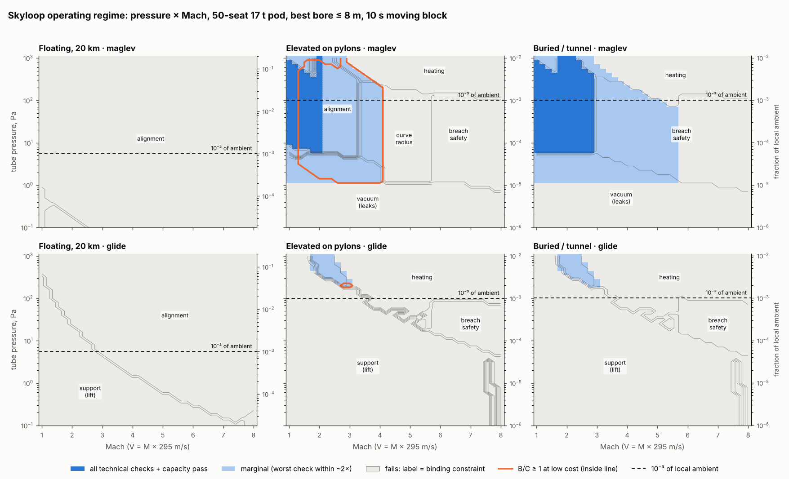
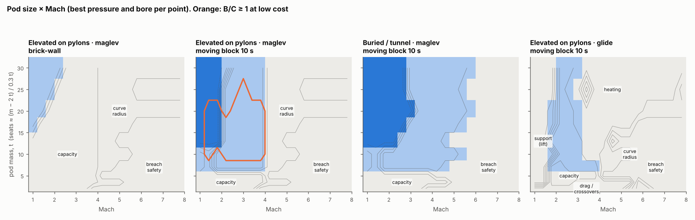
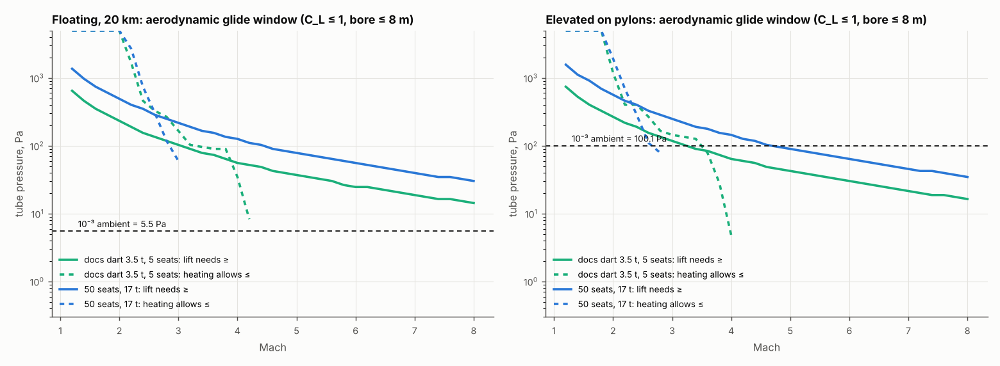

# Skyloop operating regime: where, if anywhere, a low-pressure tube works

**Skyloop review · 23 October 2026 · screening level.** As with BoomShield, the aim is to find the rough feasible region across disciplines, not to judge one design point. `regime.py` (reusing `physics/skyloop_physics.py` and `system/sky_model.py` read-only) writes `regime_grid.csv`, `regime_pods.csv`, `regime_summary.csv`, `regime_levers.csv` and `glide_check.csv`; `make_figures.py` draws the figures. Mach means V = M × 295 m/s in every setting. *(A)* marks an assumption; web items are **unverified** search summaries.

**Correction carried in.** The intent is **10⁻³ of local ambient (≈ 5.5 Pa at 20 km)**, not a hard vacuum, so pods have air to glide on. The physics review read "<10⁻³ atm" as 101 Pa and checked gliding at 10 Pa. Here every setting spans 0.1 Pa–1 kPa, also shown as a fraction of ambient.

## Bottom line

- **The floating 20 km tube has no feasible point**, under either support mode, at any pressure, Mach 1–8, pod size or bore. Alignment fails everywhere. The best gust case moves the tube 26 m at 6 km wavelength; a pod allows 5.1 m at M1 and 0.14 m at M6. Gliding does not change this, because a pod in ground effect still follows the tube. Gliding also needs 25–1,400 Pa (0.5–25 % of ambient), not 5.5 Pa.
- **Gliding at 10⁻³ of ambient does not work anywhere.** At 5.5 Pa lift per m² is 10–100× too small for any pod in a ≤ 8 m bore. Lift becomes possible at ~25–60 Pa only at Mach 6–8, and there the cushion heat (stagnation ~1,600 K) is 2–4× what the pod can radiate. The only glide window is **Mach ~1.8–3 at 200–1,000 Pa**, costing **130–260 Wh/pax-km**. That is near jet-fuel parity (~340), and it needs a linear motor along the whole route.
- **A technically open region exists only on the ground, with maglev:** Mach 1–2 (elevated) or 1–2.8 (buried) at **~6 Pa to 1 kPa**, with **≥ 33-seat (≥ 12 t) pods under a 10 s moving block**. It is marginal up to M4 (elevated) or M5.6 (buried). Brick-wall braking leaves only marginal points, for ≥ 17 t pods at ≤ M2.2.
- **B/C ≥ 1 is possible only for the elevated tube at the low-cost end (~$38–49 M/km)**, with a certified moving block, at Mach 1.4–4: 1.0–1.4 at low cost, 0.5–0.75 at base. Buried never reaches 1 (≤ 0.51). Floating would reach 1.2 at low cost, but it fails physically.

## Method

Grid: pressure 0.1–1,000 Pa, Mach 1–8, three settings, maglev (EDS) or glide, two headway rules, pod mass 2–30 t (seats ≈ (m − 2 t)/0.3 t *(A)*; system.md used 0.5 t/seat) and blockage β = (d_pod/D)² of 0.03–0.3 with bores ≤ 8 m. The best bore is chosen at each point. Maps use a 50-seat, 17 t pod (d 2.25 m, 21.5 m long). Each check gives a margin (log of limit / demand): pass, marginal (within ~2×) or fail. The **binding** constraint is the worst. Settings *(A)*:

| | Floating, 20 km | Elevated on pylons | Buried / tunnel |
|---|---|---|---|
| Ambient p; tube gas | 5.47 kPa; 250 K | 100 kPa; 288 K | 101 kPa; 288 K |
| Achievable deviation | 26 m at λ 6 km (physics: 1 m/s gust, 10 MN) | 3 mm + 15 mm/km | 1 mm + 5 mm/km |
| Usable curve radius | unlimited | ≤ 150 km | unlimited |
| Leak area per km | 1 cm² (composite) | 0.1 cm² (welded) | 0.1 cm² |
| Cost, $M/km (low / base, 4 m bore) | run + ramps, 27–44 / 98–157 | 34 / 62 | 100 / 207 |

## Discipline by discipline

1. **Support.** Glide needs C_L = W/(q·S) ≤ 1 (optimistic ram/ground effect). Planform is limited to 0.85 D × pod length, so wing loading is 55–140 kg/m² against hang-glider-class ~15 kg/m² needed at 5.5 Pa. Required pressure falls from ~1,400 Pa at M1.2 to ~30 Pa at M8 (`regime_glide.png`). Glide pods decelerate at g/(L/D) ≈ 0.1–0.17 g, so they need a full-length motor. **Maglev works at any pressure**, but needs 0.3–1.2 kHz stators at 1 m pole pitch (Transrapid: ~270 Hz).
2. **Drag and energy** (1,500 km trip, regeneration 0.85 each way). Maglev uses **11–14 / 30–38 / 62–80 Wh/pax-km at M2/M4/M6**, set by kinetic loss, not pressure, up to ~100 Pa. Glide uses 130–300 Wh/pax-km and **11–60 MW per 50-seat pod**. **Kantrowitz:** β_max ≈ 0 at M1, 0.13 at M2, 0.30–0.35 at M4–6; choked running is tolerable at ≤ 10 Pa. **Piston/self-pumping:** pods push gas downstream, and a closed section holds it only at Δp = ΣD/A_t. Relief crossovers are needed every 1–14 km for maglev (0.8 km choked at M2) and 0.05–3 km for glide; the Channel Tunnel has them every 250 m (memory, unverified). A choked precursor shock reaches the pod ahead within ~5 headways.
3. **Heating** (radiative only, 400 K skin, 3 % of mass as heat sink). Maglev passes to ~250 / 80 / 30 Pa at M3/4/6 (marginal ~630 / 200 / 50). Glide fails above ~M3–3.5 because the cushion recovers stagnation temperature, **which closes the coordinator's M6 window.** Noses stay below 1,900 K.
4. **Vacuum.** Leaks dominate. At 0.1 cm²/km on the ground, 6 Pa needs 20 m³/s per km (~200 kW/km), setting the floor at ~6 Pa (marginal ~1.3 Pa); LIGO-grade sealing lowers it ~10×. Re-evacuating 10 km takes 2.5–10 h. Aloft, leaks are 16× smaller.
5. **Structure.** Passes everywhere. Aloft the H₂ envelope is R ≈ 87–92 m (physics.md: 82–88 m), and a glide tube is *heavier*, because a full-length stator outweighs the saved guideway. On pylons a ring-stiffened steel tube is 2.1–2.9 t/m at 4–5 m bore. Pressure ≤ 1 kPa changes wall load < 1 % on the ground, < 20 % aloft.
6. **Alignment / ride** (0.05 g, 1 Hz secondary suspension). Below λ = V/f_s the cabin is isolated and tolerates ~12 mm; above it the pod follows, allowing A = a·λ²/(2πV)² (a refinement of physics.md's rigid following). Binding λ = V/f_s. Elevated passes to **M2.0** (marginal 4.8); Shanghai maglev re-aligns at 5–8 mm long-wave deviation, HSR slab track holds 7 mm per 60 m chord at 350 km/h (unverified). Buried passes to M7.6. Floating fails at every Mach, by 5× (M1) to 180× (M6).
7. **Route geometry.** The banked (0.5 g) minimum radius is 71 / 284 / 639 km at M2/4/6. On pylons with R ≤ 150 km the limit is **M2.8** (marginal M4). A 720 km all-stop leg fits launch + brake at 0.3 g only to M4.9.
8. **Capacity** (81 M pax/yr on the spine). One tube pair needs ≥ 32 seats at a 10 s moving block. Brick-wall at 0.5 g needs **113 seats at M1 and ~220 at M2**, so in practice 2–3 pairs of 50–100-seat pods. The docs' 4-seat dart needs ~8 pairs even under moving block.
9. **Safety.** A pod meeting ambient air in a full-bore breach (C_D 0.5) sees **2.5 / 10 / 23 g** at M2/4/6 on the ground: pass ≤ M2.8, marginal ≤ M5.6; 30 t pods only reach M3.0. Aloft it is 0.2 / 0.7 / 1.7 g, a genuine advantage, but evacuation from 20 km is unsolved. The kinetic energy is **0.7 / 2.8 / 6.4 t TNT** per 17 t pod. A moving block puts **12 / 24 / 36 pods** within stopping distance of a breach at M2/4/6, against ≤ 1 under brick-wall.
10. **Economics hook.** B/C ≈ the system study's break-even average tube cost ($49–55 M/km at M2–6; spine+LAX, net vs subsonic, 2050, 100 % capture; ~$26 M/km at M1 extrapolated) ÷ (setting cost per km × tube pairs needed), with bore-scaled cost, launch-zone motor (full-length for glide), and extra energy and pumping added.

## Feasible regime per setting (moving block 10 s unless stated)

| Setting · support | Passes all technical + capacity checks | Marginal (worst check within ~2×) | B/C ≥ 1? (base / low cost, max) | Binding where it fails |
|---|---|---|---|---|
| **Floating · maglev** | **none** | **none** | 0.43 / 1.21, moot | **alignment** at every point (26 m vs 0.14–5 m); vacuum below ~1 Pa |
| **Floating · glide** | **none** | **none** | 0.40 / 1.09, moot | lift below 25–1,400 Pa (0.5–25 % ambient); alignment above |
| Elevated · maglev | M1–2.0, 6–1,000 Pa (6×10⁻⁵–10⁻² ambient), bore 4–8 m, ≥ 12 t / 33 seats | M up to 4: alignment, curve radius, safety; 1.3–6 Pa: vacuum; ≤ 630 / 200 Pa at M3 / M4: heating | 0.75 / **1.38** (M1.4–4, 10–25 t pods, low cost only) | vacuum (low p), heating (high p, M ≥ 3), curve radius (M > 4), breach safety (M > 5.6) |
| Elevated · glide | none | M1.8–3, 200–1,000 Pa (0.2–1 % ambient), 130–260 Wh/pax-km | 0.64 / 1.11 at the edge | lift (low p), heating (M > 3), crossovers |
| Buried · maglev | M1–2.8, 6–1,000 Pa, ≥ 12 t | to M5.6 (breach safety); heating p ≤ 100 Pa at M5 | 0.25 / 0.51: **no** | breach safety (M > 5.6), heating, vacuum; cost |
| Buried · glide | none | M1.8–3, 200–1,000 Pa | 0.23 / 0.46: no | lift, heating |
| Any · brick-wall | none | ground maglev at M ≤ 2.2 with 17–30 t pods (2–3 pairs) | ≤ 0.36 low cost | capacity, then B/C |

## Which disciplines bind where

- **Low pressure** (< ~6 Pa ground, < ~1 Pa aloft): leak pumping. No Mach needs hard vacuum for drag.
- **High pressure:** heating, not drag (M ≥ 3, above ~30–600 Pa). Glide is squeezed between lift and heating to M1.8–3.
- **Mach, ground:** alignment (elevated, M > 2), curve radius (elevated, M > 2.8), breach deceleration (M > 2.8). Below M2 pods choke, which costs crossovers, not feasibility.
- **Mach, floating:** alignment at every Mach.
- **System:** capacity binds every brick-wall case; economics every case except low-cost elevated.

## What would open the regime (`regime_levers.csv`)

| Lever | Effect |
|---|---|
| Floating: tethers 10× stiffer (2.6 m motion) | alignment passes only to M1.4. **Active hold to 0.3 m** (physics: 0.4–2 GW per 1,000 km) reaches M4, still 2× short at M6. Evacuation from 20 km stays open. **No credible lever.** |
| Elevated: active suspension 0.5 Hz / survey to 5 mm per km / both | alignment limit M2.0 → 5.2 / 6.2 / 8 |
| Elevated: right-of-way allowing R ≥ 500 km | curve limit M2.8 → 5.2 |
| Moving-block (≤ 10 s) certification | turns capacity from 2–9 tube pairs into one; the only route to B/C ≥ 1. It raises breach exposure from ≤ 1 to 12–36 pods |
| Tube at ≤ ~$40 M/km at a 4–5 m bore | B/C ≥ 1 on the spine at M1.4–4 (elevated) |
| Tunnelling at ≤ ~$50 M/km | would make the buried case (widest technically, to M5.6) pay |
| Fast sector valves / heavier, blunter pods | breach limit M2.8 → ~3 only; breach is a hard ceiling near M3–5 on the ground |
| Glide | no lever gives both lift and heat rejection above M3. Glide also costs 4–12× maglev energy and a full-length motor. **Use maglev; keep 6–100 Pa.** |

**The resulting regime**, if any, is a **ground-level (elevated) maglev tube at Mach ~1.5–3, 10–100 Pa (≈10⁻⁴–10⁻³ of sea-level ambient), with 30–80-seat pods on a certified ~10 s moving block, built for ≤ ~$40 M/km**. That is a Hyperloop with bigger pods, not Skyloop. The stratospheric tube's real advantages, 16× smaller leaks and ~15× gentler breaches, matter only once alignment is solved, and it is not.

## Verifying the coordinator's check

Confirmed: q = **15 / 62 / 139 Pa** at M2/4/6 (217 K; 13 / 53 / 120 at 250 K) and **2,230 / 557 / 248 m²** for 3.5 t at C_L 1. **"Glide only at M~6, ~15–40 Pa"** holds for *lift* (38 m² needs ~36 Pa) but fails on *heating* (177 kW in, ~70 kW out). **12–25 MW per pod** holds at L/D 6–2.5. **~100 Wh/pax-km** needs ~20 seats per 3.5 t; the docs' 2–4-seat dart uses **400–950**, above jet fuel; a 50-seat 17 t pod ~280 Wh and 57 MW (`glide_check.csv`).

## Caveats

Quasi-steady 1-D screen; gust motion from physics.md without a spectrum. Glide uses the Küchemann L/D bound with C_L 1 (optimistic; no supersonic ram-wing data found). Cushion heating is a Stanton estimate (±3×). Breach is a full-bore guillotine. Economics are a proxy on the system study's 100 %-capture break-even. 300 kg/seat is optimistic (system.md: 500). Tolerances and costs are *(A)*; each moves a boundary rather than removing it.

Sources (unverified search summaries): Shanghai maglev realignment thresholds, <https://easychair.org/publications/preprint/Qlhj>; HSR chord tolerances, <https://aben.springeropen.com/articles/10.1186/s43251-025-00176-2/tables/2>; ram-wing channel theory (subsonic only), <https://apps.dtic.mil/sti/html/tr/AD0727774/index.html>.
