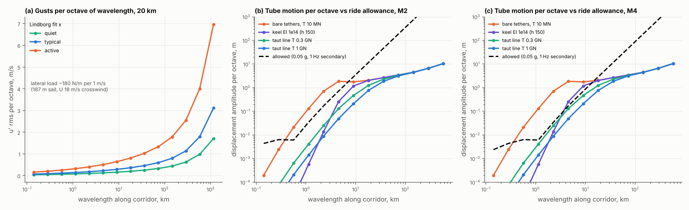
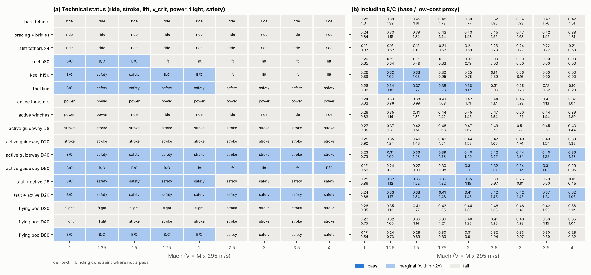
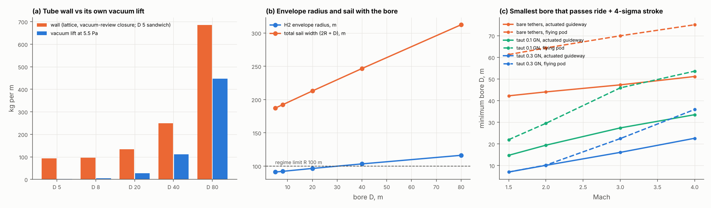

# Floating-tube stability: can a tethered tube at 20 km be held straight enough?

**Skyloop review · 23 October 2026 · screening level.** As with BoomShield, this maps the rough feasible regime rather than judging one design point. `stability.py` (reusing `physics/skyloop_physics.py`, `regime/regime.py` and `system/sky_model.py` read-only) writes `gust_spectrum.csv`, `tether_field.csv`, `motion_octaves.csv`, `keel_sizing.csv`, `active_trim.csv`, `bigbore.csv`, `sensitivity.csv` and `feasibility_map.csv`; `make_figures.py` draws the three figures. Mach means V = M × 295 m/s. *(A)* marks an assumption; web items are **unverified** search summaries.

## Bottom line

- **The killer is steady wind and lift loads landing on discrete tethers, not gusts.** Wind varying between 18 and 30 m/s changes the side load by ~2.9 kN/m, and the daily lift swing is ~1.9 kN/m. Both are 10–50× the km-scale gust loads (20–60 N/m per octave). Tethers every 3 km scallop the line under them. Without load-spreading bridles no scheme passes at any Mach.
- **Coordinator's (a) is confirmed.** Tether stiffness per kg of fibre is capped at E/(4ρh²) ≈ 0.074 N/m per kg at 20 km. That holds whatever the layout, bracing, spacing or pre-tension. Bracing spreads load but adds no stiffness; only a stiffer fibre (M55J carbon, ×2.4) raises the cap.
- **Coordinator's (b) is confirmed, with a better tool.** For a line under axial tension T, a load f gives curvature f/T at every wavelength, so the ride acceleration is V²f/T. That matches the allowance's λ² scaling exactly. **Tension is 3–10× cheaper than a keel** for the same short-wave stiffness. A keel of 1e14 N·m² needs 0.3–1.1 t/m (150–80 m deep); the same stiffness from tension needs 0.1–0.45 t/m.
- **A bigger bore helps only as stroke, not as a beam or a lift source.** Its buckling-limited wall is too thin to add useful EI: 1e10–1e13 N·m² against the 1e14 needed. Self-lift reaches 21–65 % at D 20–80 m, but sail and envelope still grow, and tube motion stays ~27 m rms. What a big bore buys is clearance for a decoupled guideway.
- **A marginal floating region opens, but nowhere passes:**
  - **M1–2:** a taut line (0.1–0.44 GN of CFRP rod) with bridles.
  - **M1–4:** a taut line of 0.04–0.37 GN plus an actuated internal guideway in a 20 m bore.
  - **M1–4:** an actuated guideway alone in a 40–80 m bore.

  Binding constraints: evacuation from 20 km, stored strain energy in the tension member, envelope size (R 100–117 m), and **B/C 0.24–0.42 at base cost** (0.9–1.45 at the low-cost end). This is no better than the elevated ground tube, and the [regime](../regime/regime.md)'s headway and breach issues are untouched.

## 1. Gust environment at 20 km (`gust_spectrum.csv`)

Spectrum: Lindborg's fit to the GASP/MOZAIC Nastrom–Gage spectrum, E(k) = 9.1×10⁻⁴ k^-5/3 + 3×10⁻¹⁰ k^-3 per component *(coefficients from memory)*. It is k^-5/3 from ~2 to 500 km and k^-3 above [1, 2]. Wind amplitudes vary little between troposphere and stratosphere and fall toward the equator [2]. I bracket it at ×0.3 variance (quiet summer) to ×5 (jet, mountain waves). Clear-air turbulence above ~18 km was found <1 % of the time in U-2 data [3]. ε ≈ 10⁻⁴–10⁻³ m²/s³ patches add 0.3–0.6 m/s below 1 km, which the suspension filters out. The QBO swings 20–30 hPa winds by about −30 to +15 m/s over ~28 months [4]. Mean winds are from [altitude-trade](../../boom-shield/altitude/altitude-trade.md): 18 m/s winter mean, 40 m/s design.

**Loads.** Crosswind U advects a frozen field across a 187 m sail (R 91 m envelope plus a 5 m tube), so f = ρ·U·C_D·W·u′·χ, about 180 N/m per m/s. The vertical channel is buoyancy from gravity-wave T′ (ρπR²N·u′) plus drag rotation: ~0.3× the lateral load, against 2.2× the stiffness.

| wavelength band | u′ rms, typical (quiet–active) | lateral load rms | allowed amplitude at M2 / M4 |
|---|---|---|---|
| 0.4–0.8 km | 0.11 (0.06–0.25) m/s | 14 N/m | 6 mm / 6 mm (suspension-filtered) |
| 3.2–6.4 km | 0.23 (0.12–0.51) | 40 N/m | 0.7 m / 0.17 m |
| 25–51 km | 0.46 (0.25–1.0) | 83 N/m | 47 m / 12 m |
| 100–200 km | 0.80 (0.44–1.8) | 143 N/m | 750 m / 190 m |
| slowly varying: wind 18 → 30 / 40 m/s | – | **+2.9 / +6.4 kN/m** | – |
| diurnal lift swing (9 %, zero-pressure; superpressure ≈ 0) | – | **1.9 kN/m vertical** | – |

Gust loads peak at long wavelengths, where the allowance grows as λ². So the uniform worst case in physics.md overstates long waves and understates the 1–6 km band.

## 2. Tether field (`tether_field.csv`)

The baseline line is R 91 m, W 187 m, effective mass 3.0 t/m (63 % of it the entrained air), aerodynamic damping ζ ≈ 0.25 and a natural period ~50 s. On V-pair tethers it moves **27 m rms laterally and 3.6 m vertically**, matching physics.md's 26 m.

| layout (3 km spacing) | fibre, kg/m | k_h, N/m per m | k_h per kg of fibre | motion per 1 m/s |
|---|---|---|---|---|
| vertical (pendulum) | 244 | 0.75 | 0.003 | 229 m |
| single inclined, V/H 1.5 (physics) | 299 | 19 | 0.064 | 9.0 m |
| V-pair, V/H 1.5 (baseline; both wind directions) | 597 | 38 | 0.064 | 4.5 m |
| V-pair at 45° (the optimum) | 551 | 41 | **0.075 = bound** | 4.2 m |
| same, at 0.3 GPa (4× fibre) | 2,205 | 164 | 0.074 | 1.0 m |
| cross-braced truss | 772 | 41 | 0.053 | 4.2 m |
| M55J carbon at 45° | 864 | 153 | 0.18 | 1.1 m |

UHMWPE strains 1.03 % at working stress, i.e. 200–290 m over a 20–28 km leg. Lowering the stress buys stiffness only in proportion to fibre mass. Closer spacing (1 km, 0.3 km) leaves stiffness per km unchanged; it only shortens the inter-tether bow. Holding 0.14 m at M6 would need physics.md's ~170× the stiffness, or ~100 t/m of fibre.

## 3. Keel truss vs taut line (`keel_sizing.csv`, `sensitivity.csv`)

The ride limit sets **T ≥ V²·f/a_lim** for tension, or **EI ≥ V²·f·λ²/(4π²·a_lim)** for a keel. So a keel's requirement grows with the span it must bridge.

| Mach | EI needed, 3 km span | keel mass, h 80 / 150 m | same stiffness as tension | tension member (CFRP rod, 1.1 GPa) |
|---|---|---|---|---|
| 1.5 | 4×10¹³ N·m² | 0.61 / 0.17 t/m | 0.045 GN | 0.06 t/m |
| 2 | 7×10¹³ | 1.09 / 0.31 | 0.08 GN | 0.11 |
| 3 | 1.6×10¹⁴ | 2.4 / 0.70 | 0.18 GN | 0.26 |
| 4 | 2.9×10¹⁴ | 4.4 / 1.2 | 0.32 GN | 0.45 |
| 6 | 6.5×10¹⁴ | 9.8 / 2.8 | 0.72 GN | 1.0 |

With the full spectrum, both slowly varying loads and the envelope-growth feedback included, the solved requirements are:

- **Taut line:** T = 0.08 / 0.21 / 0.44 / 1.4 / 5 GN at M1 / 1.5 / 2 / 3 / 4, and R = 96 / 102 / 113 / 146 / 222 m.
- **Keel, h = 150 m:** 0.09–0.9 t/m at M1–2, with R up to 120 m. The h = 80 m keel runs out of lift above M1.5.

The required tension depends steeply on the bridle residual ε, the share of slowly varying load not spread evenly between tethers:

| bridle residual ε | T at M2 (quiet–active) |
|---|---|
| 3 % | 0.15–0.50 GN |
| 10 % *(A, used)* | 0.34–0.76 GN |
| 30 % | 1.1–1.7 GN |
| 100 % (no bridles) | impossible |

**Issues with the taut line:**

- **Stored strain energy:** 0.3–1.6 MJ/m to M2. BoomShield's tethers hold ~0.15 MJ/m. Containing a break needs anchors whose 45° pull-down the local lift cannot carry.
- **Reactions:** tension must be reacted at the ramps, and curves add T/R_c of side load (1.2 kN/m at 0.44 GN and R_c 355 km).
- **Critical speed:** the line's wave speed is 150–300 m/s, so pods cruise supercritical (V/v_crit ≈ 1.9–4) but cross that speed during launch.
- Tension also suppresses thermal bow (EI·k² ≪ T).

## 4. Active trim (`active_trim.csv`)

| actuator | power per 1,000 km | bandwidth | verdict |
|---|---|---|---|
| envelope thrusters or rotors | 0.8 GW for gusts; **1.6 GW** including the scallop residual. Even at 90 % cancellation the ride fails above M1 | 0.001–0.05 Hz | fails on power, as in physics.md |
| servo tether winches (10× stiffness at tether tops) | 0.44 GW net, 3 GW reactive (45 MN × 0.09 m/s × 667 winches) | to ~0.05 Hz (2.2 s wave transit) | fails: the inter-tether band is untouched |
| **actuated internal guideway** (cable-robot supports every ~25 m, weight passively balanced, inertial or laser reference) | **2–3 MW** (42 MW if the weight is not balanced) | 0.01–0.3 Hz tube drift; passive above 1 Hz for pod loads | power is trivial; **stroke is the limit**, which needs the bore |

The tube moves slowly (0.09 m/s rms), so a guideway that tracks a smooth path inside the tube costs little power. It needs a stroke of ~4× the relative motion.

## 5. Big bore (`bigbore.csv`)

The wall is the vacuum review's lattice closure (1.23–1.44 × gross lift) plus 80 kg/m of track-carrying frames *(A)*, so D 5 m matches physics.md's sandwich. Leaks are scaled by wall area (1 cm²/km at D 3 m).

| D, m | 5 | 8 | 20 | 40 | 80 |
|---|---|---|---|---|---|
| wall / vacuum lift, kg/m | 93 / 2 | 96 / 4 | 134 / 28 | 249 / 112 | 685 / 447 |
| self-lift fraction | 2 % | 5 % | 21 % | 45 % | 65 % |
| tube EI, N·m² (need ~10¹⁴) | 3×10⁹ | 2×10¹⁰ | 1.5×10¹¹ | 1.1×10¹² | 1.2×10¹³ |
| envelope R / total sail W, m | 91 / 187 | 92 / 192 | 96 / 213 | 103 / 247 | 116 / 312 |
| guideway stroke available (± m) | – | 1 | 7 | 17 | 37 |
| pump-down at 10 m³/s/km; pumping at 5.5 Pa | 0.2 d; 0.2 MW/km | 0.4 d; 0.3 | 2.5 d; 0.8 | 10 d; 1.6 | 40 d; **3.2 MW/km** |
| breach stored pV | 0.03 t TNT/km | 0.07 | 0.4 | 1.7 | **6.6** |
| flying pod (span D/2): pressure needed at M2 / M3 | – | 36 / 16 kPa | 5.7 / 2.5 kPa | 1.4 / 0.64 kPa | 0.36 / 0.16 kPa |
| flying pod: lift multiple if it meets ambient air (M2) | – | – | 1× | 4× | 15× (35× at M3) |

- **Inertia does not filter gusts.** Effective mass rises 3.0 → 5.3 t/m from D 5 to 80 m, but the sail rises 67 %, and gust time scales (1–30 min) sit above the 50 s natural period.
- **Smallest bore that passes ride plus a 4σ stroke:**

  | support under the line | actuated guideway | flying pod |
  |---|---|---|
  | bare tethers | 42–51 m | 61–75 m |
  | 0.1 GN tension | 15–34 m | 22–54 m |
  | 0.3 GN tension | 7–23 m | 7–36 m |

- **Flying pods** need 0.4–6 kPa. The decoupled lift cost is 155–270 Wh/pax-km (L/D 0.7 × Küchemann), near jet fuel's ~340. Skin heating is fine to ~M3 at D ≥ 40 m (500 K skin). There is **no contactless propulsion**: coasting loses 5 % of speed every 18–72 km. A breach overloads the wings 4–35×. Of the two, the actuated maglev guideway is the better use of a big bore.

## 6. Feasibility map (`feasibility_map.csv`)

Checks per cell: **ride** (2.5σ + scallop ≤ 0.05 g, both planes); **stroke** (0.1 m secondary, or 4σ within the bore clearance when decoupled); **lift** (R ≤ 100 m pass, ≤ 150 m marginal); **critical speed** (V/v_crit ∉ 0.7–1.4); **power** (≤ 50 MW per 1,000 km); **flight** (pod lift, heat, energy); **safety** (floating evacuation marginal at best; strain energy ≤ 2 MJ/m; breach lift multiple); and **B/C** (regime proxy: break-even $26–55 M/km ÷ (floating cost + adders × soft costs and contingency)).

| scheme | marginal Mach range | added mass, kg/m | R, m | cost base / low, $M/km | B/C base / low | binding |
|---|---|---|---|---|---|---|
| bare / braced / stiff tethers, winches | none | – | 91–128 | – | – | ride, from short-wave bow and scallop |
| thrusters | none | – | 91 | – | – | 1.6 GW per 1,000 km |
| keel, h 150 m | 1–2 | 85–890 | 94–120 | 100–196 / 29–65 | 0.26–0.33 / 0.75–1.09 | lift above M2 |
| taut line | 1–2 | 120–630 | 96–113 | 98–137 / 28–42 | 0.26–0.38 / 0.92–1.27 | strain energy above M2 |
| **taut + guideway, D 20 m** | **1–4** | 63–520 + wall | 99–114 | 105–171 / 30–51 | 0.24–0.42 / 0.86–1.45 | evacuation, strain energy, B/C |
| guideway, D 40 / 80 m | 1–4 | wall 156 / 592 | 104 / 117 | 113–188 / 32–56 | 0.17–0.44 / 0.56–1.54 | stroke (D 40) / lift (D 80), B/C |
| flying pod, D 80 m | 1–2 | wall 592 | 115 | 148–160 / 48–53 | 0.17–0.31 / 0.54–0.91 | energy, breach, B/C |

## What it means

**A floating region does open technically, but only as "marginal".** The minimum kit is load-spreading bridles, a few hundred kg/m of tensioned CFRP, and an actuated guideway in a ~20 m bore. That reaches **M1–4 at ~0.35–0.8 t/m of payload, an R ≈ 100–115 m envelope and $105–170 M/km**.

**Cost drivers:**

- the floating base itself ($98–157 M/km including ramps);
- tension and envelope growth (+$5–35 M/km);
- big-bore walls (+$10–40 M/km).

**B/C ≥ 1 only at the low-cost end, and never above the elevated ground tube.** Evacuation from 20 km, breach, brick-wall headway (physics.md) and stored line energy remain. **Recommendation: no change to the verdict.** If anyone pursues it, the cheap experiment is the bridle residual ε and stratospheric spectra along a 10–100 km tethered line.

## Caveats

- Linear, frozen-turbulence, 1-D line model with smeared tethers (cut off below 2× spacing).
- Gaussian 2.5σ/4σ margins; real gusts are intermittent.
- Bridle residual ε = 10 % is the key unknown.
- Tension-member creep (UHMWPE creeps at >20 % of break [5], hence CFRP rod).
- Cable-robot guideways carrying 17 t pods at Mach 2–4 are unproven.
- Lindborg coefficients are from memory.

## Sources (search summaries, unverified)

1. Lindborg, JFM 388 (1999), <https://resolve-he.cambridge.org/core/journals/journal-of-fluid-mechanics/article/can-the-atmospheric-kinetic-energy-spectrum-be-explained-by-twodimensional-turbulence/2835300488AEAA21B17FEF0B372FA3CC>; Skamarock NCAR workshop, <https://www2.mmm.ucar.edu/mm5/workshop/ws04/Session2/Skamarock.Bill.pdf>.
2. Nastrom & Gage (1985), NASA summary <https://ntrs.nasa.gov/citations/19850024191>; review <https://arxiv.org/pdf/nlin/0608064>.
3. HICAT U-2 programme, <https://www.aftc.af.mil/News/On-This-Day-in-Test-History/Article-Display-Test-History/Article/2276751/august-16-1967-project-hicat>; NASA U-2 (<1 % at 60–75 kft), <https://ntrs.nasa.gov/citations/19980227981>; ε variability, <https://angeo.copernicus.org/articles/34/1209/2016/>; balloon gravity waves, <https://hal.sorbonne-universite.fr/hal-01311339/document>.
4. QBO, <https://en.wikipedia.org/wiki/Quasi-biennial_oscillation>.
5. Dyneema creep, <https://www.samsonrope.com/docs/default-source/technical-bulletins/tb_understanding-creep_mar2012_web.pdf>.
