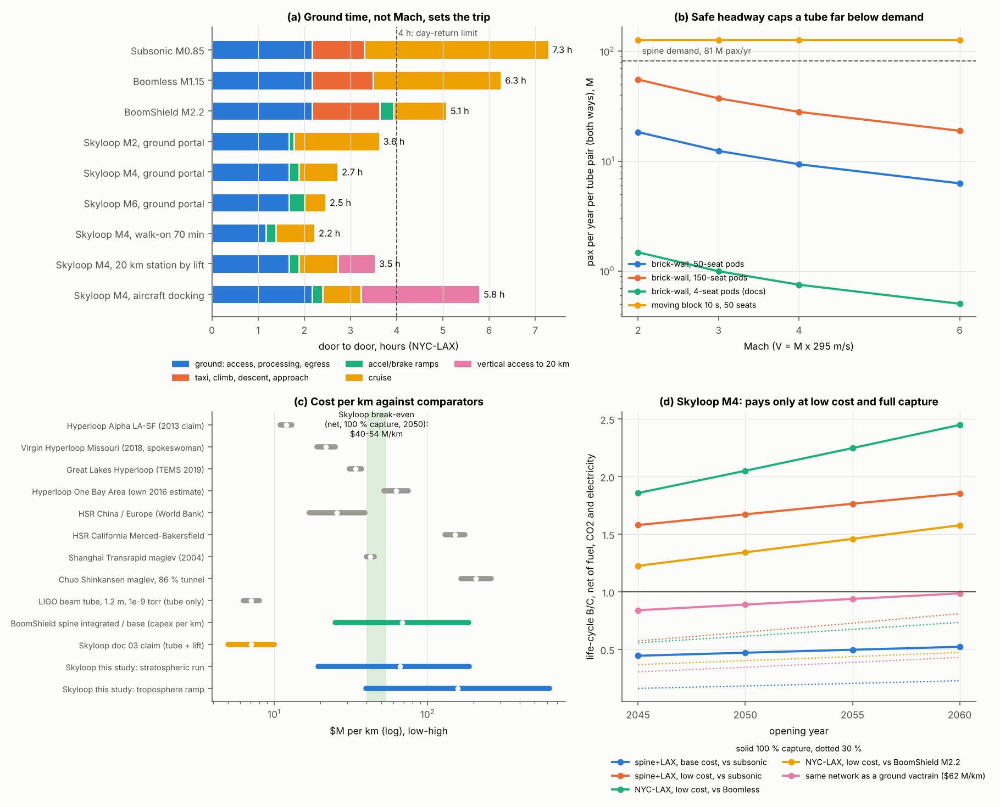

# Skyloop re-review: system and economics

**Skyloop review · 22 October 2026 · screening model.** Tests docs/01–08 (pods in a near-vacuum tube floating at 20 km, Mach 2–6) with BoomShield's machinery, read-only: coverage/demand O&D, highmach's door-to-door phases and fuel, rule-of-half induced demand with day-return credits, and growth/'s traffic, value-of-time and energy paths (7 %, 25 yr). Physics numbers come from the [physics study](../physics/physics.md). Scripts: `sky_model.py`, `sensitivities.py`, `make_figure.py`. Web figures are **unverified** search summaries (`evidence.csv`); [U] = assumption. "Mach" means V = M × 295 m/s.

## Bottom line

- **The time case is real, and it does not come from Mach.** Pods leave a ground portal and climb on their launch ramp: no taxi, climb or approach. NYC–LAX takes **2.7 h door to door at M4** (3.6 h at M2), against 5.1 h for BoomShield M2.2 and 7.3 h subsonic, so a **coast-to-coast day return works even at M2**. M2 → M6 saves only another 70 min.
- **Getting up to 20 km kills every option except the ramp.** A lift adds 49 min even at the record 20.5 m/s, on a structure that does not exist. Aircraft docking gives 5.8 h, slower than BoomShield.
- **Safe headway caps capacity.** Brick-wall braking at 0.5 g allows 27 pods/h at M4, or **9 M pax/yr per tube pair with 50-seat pods**. The spine needs 81 M. Only an uncertified 10 s moving block (126 M/yr) carries it.
- **Bottom-up cost is $66 M/km for the stratospheric run** ($19–187 M/km) and **$157 M/km for the troposphere ramps**. Spine+LAX at M4 costs **$569 B** (BoomShield: $91 B). The docs' $5–10 M/km omits tethers, ramps, motors and contingency.
- **Electric propulsion turns the net case around.** At 21–85 Wh/pax-km (3–13 g CO₂ on a 2045 grid) against ~340 Wh of jet fuel, net B/C is **1.3–2.2× gross**. BoomShield is the reverse.
- **It still does not pay at base cost.** Spine+LAX M4, 2050 opening, 100 % capture: **gross 0.36 / net 0.47 vs subsonic, 0.28 / 0.61 vs Boomless, 0.17 / 0.32 vs BoomShield M2.2**. At 30 % capture divide by about three.
- **It pays only at the low-cost end ($19 M/km run) with full capture:** net 1.7–2.2 and gross 1.1–1.3 vs subsonic and Boomless (net 1.15 vs BoomShield). Break-even is **$40–55 M/km all-in tube** (net, 100 %, 2050), or ~$11–14 M/km at 30 % capture. Hyperloop firms claimed that range and never built it.
- **Physics vetoes it anyway.** The floating tube moves 8–500 m in gusts against 0.14–1.3 m allowed (physics §4). The same network as a ground vactrain at $62 M/km scores better (net 0.89 vs subsonic).

## 1. Access, stations and door to door

**Access options** (`access.csv`):

| Option | Added per round trip | Verdict |
|---|---|---|
| Lift on a tower or tether | +49 min (20.5 m/s), +83 (10 m/s climber) | No 20 km structure (tallest building 0.83 km, rope lifts ≤ 1 km; the 20 km inflatable tower is only a patent, S12–S13). Tether sway 8–41 m. Cabin needs full pressure above 19 km |
| Aircraft or VTOL docking at 20 km | +154 min plus the airport's 130 | eVTOL ceilings are ~6 km, so this needs a high-altitude airliner, which is BoomShield's aircraft |
| **Ground portal + climbing acceleration ramp** | **0** | The 0→20 km climb fits inside the launch length (237 km at M4, 0.3 g). Ramps, linear motors (LSM) and urban approaches then dominate cost |
| Ground-level vactrain | 0 | Right-of-way and curvature (R ≥ 284 km banked at M4) mean tunnels |

**Stations** (ground portal, [U]): 35 min access, 40 min screening and boarding through a pod lock, 25 min egress = **100 min** (130 for aircraft). Pods cycle a lock in ~8 min, so ~25 berths serve 180 pods/h. Intermediate stops cost V/a + 4 min dwell, about 11 min each at M4.

**Table 1. Door to door, hours** (`d2d.csv`; highmach components for the aircraft; Skyloop from a 100 min portal)

| Mode | NYC–LAX | DEN–CHI | NYC–LAX day return? |
|---|---|---|---|
| Subsonic / Boomless / BoomShield M2.2 | 7.29 / 6.27 / 5.08 | 4.38 / 4.12 / 3.99 | no |
| Skyloop M2 / M3 / M4 / M6 | 3.63 / 3.02 / 2.73 / 2.47 | 2.41 / 2.21 / 2.12 / 2.06 | **yes, at every Mach** |
| Skyloop M4: walk-on 70 / airport-like 130 min | 2.23 / 3.23 | 1.62 / 2.62 | yes |
| Skyloop M4 via 20 km lift / via aircraft docking | 3.54 / 5.80 | 2.93 / 5.19 | yes / no |

Ground overhead does not erase the advantage, because a portal removes 68–90 min of taxi, climb and approach; vertical access to an elevated station does. At M6, launch and braking take 20 of 48 ride minutes; below ~1,070 km M6 never reaches cruise.

## 2. Capacity

**Table 2. Pax/yr per tube pair** (`capacity.csv`; LF 0.8, peak hour = 1/12 of the day)

| Rule (headway at M2 / M4 / M6) | 4 seats (docs) | 50 seats | 150 seats | Tube pairs for the spine's 81 M, 50 seats |
|---|---|---|---|---|
| Brick-wall 0.5 g (68 / 135 / 201 s) | 1.5 / 0.75 / 0.50 M | 18 / 9.4 / 6.3 M | 55 / 28 / 19 M | 4.4 / 8.7 / 13 |
| Moving block, 10 s | 10 M | 126 M | 378 M | 0.65 |
| "Virtual coupling", 3 s | 34 M | 420 M | — | 0.19 |

- **Brick-wall is the only certified basis** (rail, [K]); physics at 1 g gives 40–120 pods/h. 150-seat pods need ~5 m bores and still 3–4 tube pairs.
- **Switching at speed barely works.** Diverging two bores by 10 m takes 2.4 km at 0.5 g banked (M4), and an offline station needs 4 × 237 km of launch/brake tube. So: point-to-point tubes, or all-stop lines with every station at the foot of a ramp. Express costs +$130 B on the spine.
- **Turn-around:** a 2–3 h pod cycle needs ~1,400 50-seat pods ($10 B) on spine+LAX.

## 3. Network and first corridor

**Table 3. M4, 2025 demand, 100 % capture** (`networks.csv`). Benefit = time + day-return/after-work credits + induced demand (rule of half), at $86/h × 95 %. Feeders connect by air with a 45 min transfer.

| Network | vs | Pax M/yr | pax-h M | Day-return pax M | Benefit $B/yr | Fuel saved Mt/yr | Peak segment M | Capex $B | Annual gross B/C |
|---|---|---|---|---|---|---|---|---|---|
| Spine+LAX all-stop | subsonic | 84 | 117 | 22 | 14.4 | 5.6 | 80 | 569 | 0.23 |
| | Boomless | 56 | 68 | 16 | 8.5 | 10.7 | 53 | 566 | 0.14 |
| | BoomShield M2.2 | 26 | 39 | 15 | 5.2 | 4.7 | 19 | 562 | 0.08 |
| Spine express | subsonic | 87 | 117 | 20 | 14.0 | 5.7 | 83 | 632 | 0.20 |
| NYC–LAX direct | subsonic | 41 | 70 | 4.7 | 7.8 | 3.5 | 48 | 329 | 0.21 |
| NYC–MIA direct | subsonic | 25 | 29 | 12.4 | 4.4 | 1.1 | 32 | 176 | 0.22 |
| NYC–CHI direct | subsonic / Boomless | 30 / 6.5 | 18 / 7.7 | 6.7 / 2.0 | 2.4 / 0.9 | 1.0 / 0.7 | 34 | 136 | 0.16 / 0.06 |
| DEN–CHI direct | subsonic | 20 | 14 | 2.5 | 1.6 | 0.8 | 22 | 152 | 0.10 |
| LAX–SFO; SFO–LAX–LAS | subsonic | 6.2; 10.6 | 8.8; 14.6 | 0 | 0.9; 1.5 | 0.1; 0.2 | 8; 11 | 91; 158 | 0.09 |
| Transcon star (4 links, 12,300 km) | subsonic | 72 | 127 | 18 | 15.6 | 5.4 | 25 | 1,022 | 0.14 |

- **Mach.** Spine+LAX benefit vs subsonic: 10.0 / 13.3 / 14.4 / 14.7 $B/yr at M2/3/4/6; capex 452 / 465 / 569 / 687 $B. **B/C peaks at M3** (net 0.59). M6 is all ramp.
- **Day returns** are what Mach 2–4 finally crosses: 15–22 M pax/yr on spine+LAX.
- **First corridor.** Of 726 direct tubes among the top-40 metros (`p2p_rank_M4.csv`), NYC–Orlando/Miami (0.22–0.24), NYC–LAX (0.22) and LAX–CHI (0.19) lead. A point-to-point tube matches the spine (0.23) but does not beat it; two transcon tubes score 0.15. Short links (LAX–SFO, NYC–CHI) are all ramp and already day-returnable by air.

## 4. Costs

**Table 4. Bottom-up cost per km of tube pair, and comparators** (`cost_perkm.csv`, `comparators.csv`, `evidence.csv`; $M/km, low / base / high)

| Item or system | $M/km |
|---|---|
| Core tubes 3 / 8 / 25 · guideway + alignment actuators 3 / 6 / 12 · vacuum 1 / 2 / 5 · power 1 / 2 / 4 · safety 1 / 2 / 4 | 9 / 20 / 50 |
| H₂ envelope, physics R 43–88 m (2.6 / 9.8 / 20.5) · tethers, 45 MN every 3 km (3 / 11 / 22) | 5.6 / 21 / 43 |
| **Run, after soft costs 15–35 % and contingency 15–50 %** | **19 / 66 / 187** |
| **Troposphere ramp** (2× run + LSM) · urban approach, 20 km per station | **40 / 157 / 623** · 60 / 150 / 300 |
| Station $1 / 2.5 / 5 B · pods $0.15 M per seat · O&M 2.5 %/yr of capex | — |
| Hyperloop Alpha claim (2013) / Virgin Missouri (2018) / Great Lakes TEMS (2019) / Hyperloop One own Bay Area (2016) | 11–13 / 19–25 / 31–37 / 52–75 |
| HSR China–Europe / California Merced–Bakersfield | 17–39 / 130–175 |
| Transrapid Shanghai / Chuo maglev (86 % tunnel; ¥7.0 → 11 T) | ~40 / 165–260 |
| LIGO beam tube, 1.2 m (tube only) | 6.3 + $30 M fixed |
| BoomShield spine, integrated / base | 25 / 186 |
| **Skyloop: run / ramp (this study)** | **66 (19–187) / 157 (40–623)** |

**Opex.** Energy at M4: 21 Wh/pax-km on NYC–LAX, 85 on the all-stop spine (each stop is another launch); physics gets 16–42. Spine+LAX draws 22 TWh/yr (~$1.5 B). Pumping ~65 kW/km per cm² of holes. Active alignment (~1 GW per 1,000 km, physics) costs ~$2.5 B/yr (−2 % B/C). **The docs' $0.008–0.015 per pax-mile is ~30–50× low:** capital and O&M alone come to $0.24 per pax-km on the spine+LAX.

## 5. Economics

**Table 5. Life-cycle B/C, M4, gross / net of fuel, CO₂ and electricity** (`lifecycle.csv`; central energy and grid, 0.15 kg/kWh in 2045)

| Network · cost | Opening | vs subsonic 30 % | vs subsonic 100 % | vs Boomless 100 % | vs BoomShield M2.2 100 % |
|---|---|---|---|---|---|
| Spine+LAX · base ($569 B) | 2045 / 2060 | 0.12 / 0.16 → 0.18 / 0.23 | 0.34 / 0.45 → 0.41 / 0.52 | 0.24 / 0.55 → 0.34 / 0.70 | 0.15 / 0.29 → 0.22 / 0.39 |
| Spine+LAX · low ($172 B) | 2045 / 2060 | 0.43 / 0.57 → 0.64 / 0.81 | **1.19 / 1.58 → 1.46 / 1.86** | 0.86 / 1.97 → 1.21 / 2.48 | 0.54 / 1.03 → 0.79 / 1.39 |
| NYC–LAX · base ($329 B) | 2045 / 2060 | 0.11 / 0.17 → 0.17 / 0.23 | 0.38 / 0.56 → 0.55 / 0.77 | 0.21 / 0.51 → 0.31 / 0.68 | 0.10 / 0.34 → 0.15 / 0.44 |
| NYC–LAX · low ($99 B) | 2045 / 2060 | 0.41 / 0.60 → 0.61 / 0.84 | **1.37 / 2.02 → 1.99 / 2.76** | 0.76 / 1.86 → 1.12 / 2.45 | 0.36 / 1.23 → 0.54 / 1.58 |
| Spine+LAX as a ground vactrain ($62 M/km) | 2050 | — | 0.68 / 0.89 | 0.52 / 1.15 | 0.33 / 0.61 |
| *BoomShield M2.2, integrated (growth; net-reconciliation)* | *2050* | — | *~5.0 / −5.2* | *~1.6 / 0.46* | — |

BoomShield's life-cycle gross is growth's 1.67 / 5.2 less the ~4 % net-reconciliation correction; its canonical single-year values are 0.87 / 0.04 vs Boomless. **NPV** (2026 $, net, base, 2050, 100 %): spine+LAX −$106 B vs subsonic, −$78 B vs Boomless. At low cost it is +$38 B and +$65 B.

**Sensitivities** (spine+LAX, net vs subsonic, base 0.47; `sensitivities.csv`):
- 70 min walk-on 0.55; airport-like 130 min 0.41; lift to 20 km 0.37; 0.15 g acceleration 0.35.
- Brick-wall headway 0.04 (50 seats, 12 tube pairs) or 0.12 (150 seats).
- 3 % discount 0.77; 50-yr life 0.57; benign energy 0.40; stringent 0.53.
- Crediting avoided airline non-fuel cost (~$0.06/pax-km) less Skyloop operations: 0.72.
- **Grid carbon barely matters:** stalled 0.44, clean 0.48. The gain is the jet fuel and CO₂ avoided.

**What would make it pay.** Break-even, all-in average tube cost ($M/km, 2050, M4; `breakeven.csv`):

| Network | Base | 100 %, gross / net vs subsonic | 100 %, net vs Boomless | 30 %, net vs subsonic |
|---|---|---|---|---|
| Spine+LAX all-stop | 128 | 38 / 54 | 73 | 14 |
| NYC–LAX direct | 77 | 31 / 47 | 42 | 11 |
| NYC–MIA direct | 90 | 42 / 53 | 50 | 11 |

## 6. Lessons from Hyperloop

| Company or project | What happened |
|---|---|
| Hyperloop Alpha (2013) | $6 B LA–SF, 28-pax pods every 30 s–2 min (S2) |
| Hyperloop One / Virgin | >$450 M raised, a 500 m test track, never a contract. Dropped passengers for cargo in 2022, shut Dec 2023 (S9). Its own Bay Area estimate was $52–75 M/km, 5× Alpha's (S1) |
| Arrivo; Zeleros; Hardt | Folded 2018; insolvent; bankrupt Mar 2026 (S10) |
| HTT / Great Lakes (TEMS 2019) | $31–37 M/km study; nothing built (S4) |
| CASIC T-Flight | 623 km/h on 2 km; 60 km planned. Track flat to 0.3 mm (S8) |
| Standards | CEN/CLC TR 17912:2023 is a roadmap. No certified passenger system exists (S11) |

**Why they failed:** costs rose ~5× once engineered; right-of-way and curvature forced tunnels; no certification path (braking, evacuation, fire); mm tolerances; small pods; no anchor customer.

**What 20 km changes.** Land is nearly free (BoomShield: < 1 % of cost). Great-circle lines need no tunnels. Leaks are 16× smaller and the wall thinner. Against that:
- **tolerances go from hard to impossible** (8–500 m motion vs 0.14–1.3 m);
- the structure gains H₂ envelopes of R 43–88 m and 45 MN tethers;
- **the ramps cross the jet stream**, at 2–4× run cost;
- GW-class power has to go up 20 km of riser;
- evacuation is above the Armstrong limit, and H₂ sits next to the vacuum.

The expensive Hyperloop items (stations, motors, urban approaches, certification) all remain.

## 7. Synthesis with BoomShield

**Hybrids:**
- **(a) BoomShield for Mach 2 now, Skyloop later.** Both claim the same passengers and the same 20 km layer. In a BoomShield world, Skyloop's spine B/C falls to 0.32 net.
- **(b) A tube on the shield's tether field.** This saves at most the ~$11 M/km of tethers. But it couples a soft, metre-moving H₂ shield to a tube that needs centimetre tolerances.
- **(c) A tube for the long middle with aircraft for access.** Docking gives 5.8 h NYC–LAX, slower than BoomShield.

None of the three works. **The transferable result runs the other way: in both studies, ground processing is worth more than Mach.**

**Table 6. Comparison** (NYC–LAX; vactrains at M4; B/C for a 2050 opening at 100 % capture)

| | Air subsonic | Boomless M1.15 | BoomShield M2.2 | Skyloop, 20 km | Ground vactrain | HSR 350 km/h |
|---|---|---|---|---|---|---|
| Door to door, NYC–LAX / DEN–CHI, h | 7.3 / 4.4 | 6.3 / 4.1 | 5.1 / 4.0 | **2.7 / 2.1** | 2.7 / 2.1 if straight | ~14 / ~6 [K] |
| Infrastructure $M/km | airports | airports | 25–186 | 66 run, 157 ramp (19–623) | 34–207 | 17–175 |
| Corridor capex | — | — | $91 B spine | $569 B ($172–1,567 B) | $302 B ($187–892 B) | — |
| Energy, Wh/pax-km | ~340 fuel | ~1,000–1,700 | ~1,400 | 21–85 electric | similar | ~30–50 [K] |
| CO₂, g/pax-km | 90 | 270–450 | ~380 | 3–13 | 3–13 | ~5 |
| Capacity per corridor | airports | airports | lid cap 10,000 flights/day | 9 M/yr brick-wall; 126 M moving block | same | ~100 M+ [K] |
| B/C vs subsonic, gross / net | — | — | ~5.0 / −5.2 (single-year canonical 2.69 / −4.41) | 0.36 / 0.47 (low cost 1.28 / 1.67) | 0.68 / 0.89 | not competitive > 1,000 km |
| Status | mature | Overture in test | screening; acoustics pass | **physics veto (alignment)** | 2 km test tracks | mature |

## 8. Verdict and research plan

**Verdict.** Skyloop has the right economics and the wrong structure. The ground portal, electric drive and day returns give the best time and carbon figures here, and net B/C exceeds gross. But the stratospheric tube adds H₂ lift, tethers and troposphere ramps, plus an alignment problem physics rates likely fatal, to buy cheap land. At base cost every case is 0.1–0.7; only a ~$20 M/km tube with full capture pays, and no vactrain has been built at that cost. **Do not pursue the stratospheric tube.** Keep a watching brief on ground vactrains, and carry the "ground time beats Mach" result into BoomShield.

**Staged plan.** This is research only, and the first gate is designed to stop it.

| Stage | Dates · cost | Work | Gate |
|---|---|---|---|
| 0. Desk | 2026–28 · < $1 M | Gust-spectrum dynamics with active control; a certifiable headway rule with regulators; ramp structure through the jet stream; ground-vactrain cost on NYC–MIA / NYC–LAX | **G0:** ≤ 1 m tube motion at km wavelengths and ≥ 30 M pax/yr per tube under a certifiable rule; otherwise stop the 20 km variant |
| 1. Lab | 2028–32 · $5–20 M | 1–2 kHz LSM in 1–3 Pa (Paschen); 100 m tethered segment in a wind tunnel or at low altitude with active alignment; CFRP leak and outgassing coupons | **G1:** measured alignment and leak within 2× of model; supplier quote ≤ $40 M/km |
| 2. Altitude | 2032–38 · $0.2–1 B | 1–5 km tethered tube at 18–20 km carrying M1 cargo pods. Share BoomShield's stage-2 site | **G2:** ≥ 95 % availability for a year; T-Flight 60 km results (~2030) |

Only after G2 would a 100 km ramp-to-ramp cargo demonstrator (docs/04, phase 1) be justified.

## Caveats

BoomShield's demand, capture and fare conventions (equal fares, so time benefits only); exogenous capture; 45 min air-feeder transfers. Costs are [U] bottom-up with no alignment fix; ramp multiplier and stations are guesses. Ground-vactrain rows reuse Skyloop's times, ignoring the detours and tunnels M4 curvature forces. Web sources unverified.
